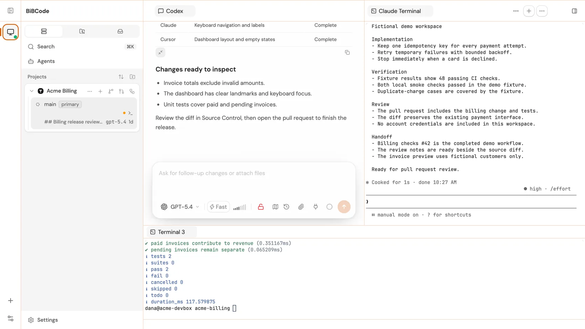
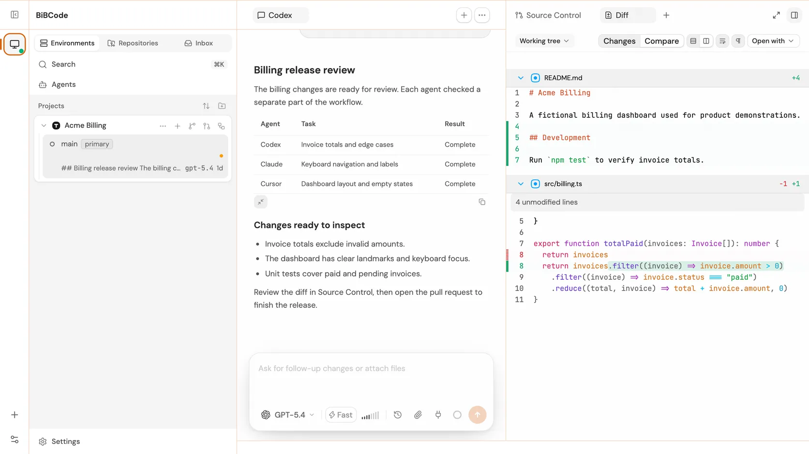
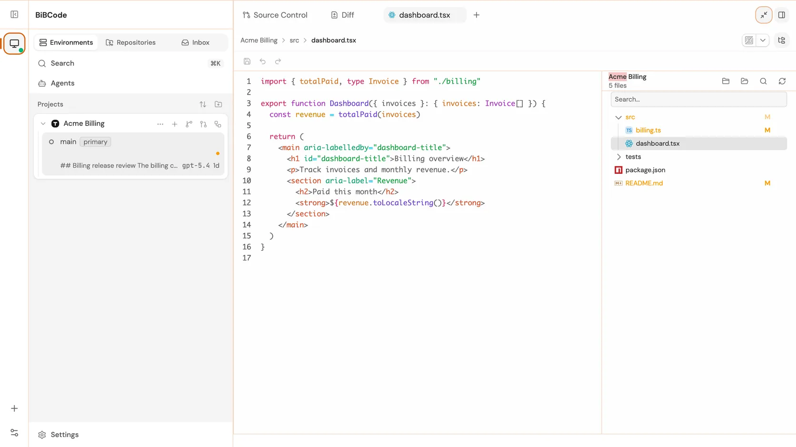
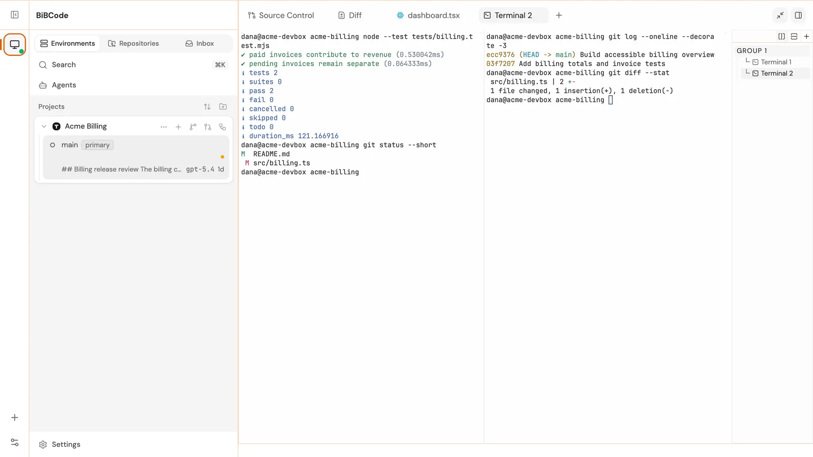
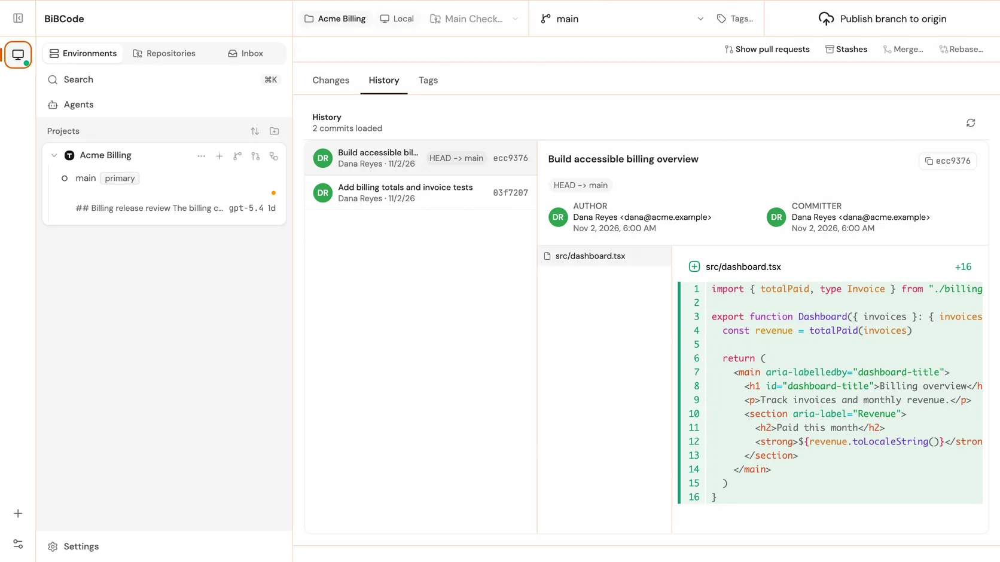
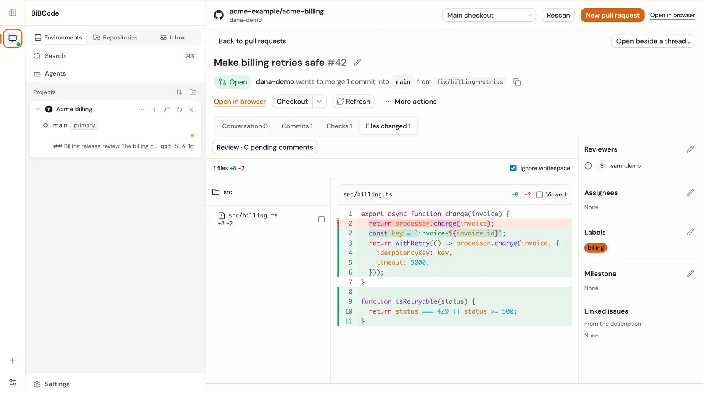
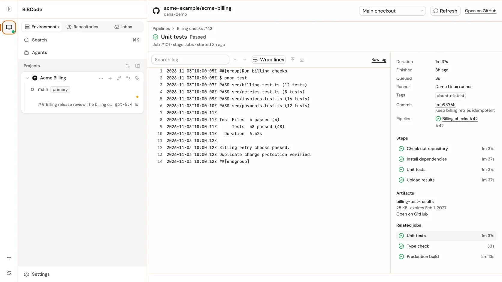
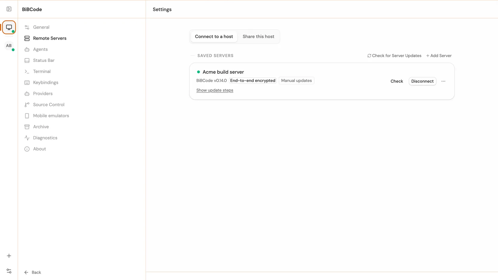
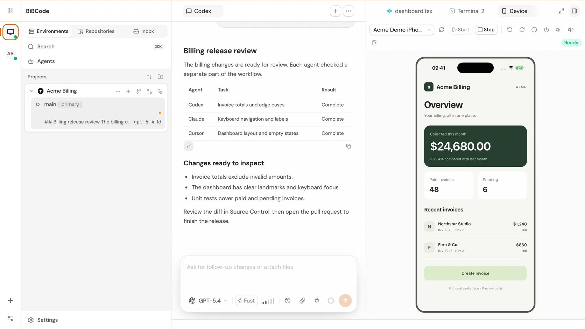

<div align="center">

<a href="https://bibcode.dev">
  
</a>

# BiBCode

**Your agents. One workspace. Open source.**

[Website](https://bibcode.dev) · [Download](https://github.com/mubeda/BibCode/releases/latest) · [Documentation](docs/README.md) · [Changelog](https://bibcode.dev/changelog)

[](https://github.com/mubeda/BibCode/releases/latest)
[](LICENSE)
[](https://github.com/mubeda/BibCode/actions/workflows/ci.yml)

<picture>
  <source media="(prefers-color-scheme: dark)" srcset="docs/assets/readme/fleet-workspace-dark.webp">
  
</picture>

</div>

## What it is

BiBCode is a desktop app, a browser UI, and a headless server for coding agents. It runs Codex, Claude Code, Cursor (Early Access), and OpenCode side by side, each in its own Git worktree, with the terminals, Git client, pull requests, and CI pipelines for the same project one click away. It runs on macOS, Windows, and Linux, on Apple Silicon, Intel, and ARM64, and it can run on another machine and connect back to your desktop.

All screenshots below use demo data.

## Features

### Agent fleet

Run several agents at once. Each project lists its checkout and worktrees, each worktree hosts its own chat and terminal panes, and you switch between agent sessions from the left panel. [Docs](docs/user/workspace-ui.md#left-panel)

### Source control

Stage files, write commits (with an AI-drafted message if you want one), and pull, push, and open pull requests from the right panel, next to the agent that made the change. [Docs](docs/user/workspace-ui.md#source-control)

<picture>
  <source media="(prefers-color-scheme: dark)" srcset="docs/assets/readme/source-control-dark.webp">
  
</picture>

### Files and editor

Browse, create, rename, and edit project files without leaving the workspace. Save with Ctrl/Cmd+S. [Docs](docs/user/workspace-ui.md#files)

<picture>
  <source media="(prefers-color-scheme: dark)" srcset="docs/assets/readme/files-and-editor-dark.webp">
  
</picture>

### Terminals

Open terminals in the same worktree as the agent, or run an agent CLI in a terminal pane. Up to four panes share a worktree. [Docs](docs/user/workspace-ui.md#center-panel)

<picture>
  <source media="(prefers-color-scheme: dark)" srcset="docs/assets/readme/terminals-dark.webp">
  
</picture>

### Git Manager

A full Git client for local work: commit history, changes, tags, stashes, and branch operations. [Docs](docs/user/workspace-ui.md#git-manager)

<picture>
  <source media="(prefers-color-scheme: dark)" srcset="docs/assets/readme/git-manager-dark.webp">
  
</picture>

### Pull requests

List, review, comment on, edit, merge, and check out pull requests on GitHub and merge requests on GitLab. Bitbucket and Azure DevOps support creating and opening them. [Docs](docs/user/workspace-ui.md#pull-requests) · [Providers](docs/integrations/source-control-providers.md)

<picture>
  <source media="(prefers-color-scheme: dark)" srcset="docs/assets/readme/pull-requests-dark.webp">
  
</picture>

### Pipelines

Follow CI pipeline runs, their jobs, and job logs. [Docs](docs/user/workspace-ui.md#pipelines)

<picture>
  <source media="(prefers-color-scheme: dark)" srcset="docs/assets/readme/pipelines-dark.webp">
  
</picture>

### Remote servers

Run agents on another machine and use them from your desktop or browser. Pair a headless `bibcode` server, or connect over SSH or WSL. [Docs](docs/user/remote-access.md)

<picture>
  <source media="(prefers-color-scheme: dark)" srcset="docs/assets/readme/remote-servers-dark.webp">
  
</picture>

### Device previews

Run an Android emulator, or an iOS simulator on a macOS server, and see its screen beside the chat. It is off by default. [Docs](docs/user/workspace-ui.md#device-previews)

<picture>
  <source media="(prefers-color-scheme: dark)" srcset="docs/assets/readme/device-previews-dark.webp">
  
</picture>

### MCP and webhooks

Let outside agents drive BiBCode over [MCP](docs/user/mcp.md), and send events to your own tools with [webhooks](docs/user/webhooks.md).

## Download

Get the latest build from the [latest release page](https://github.com/mubeda/BibCode/releases/latest):

- macOS: `.dmg` (Apple Silicon or Intel)
- Windows: `.exe` installer (x64 or ARM64)
- Linux: `.AppImage` (x64 or ARM64)

The same release has standalone `bibcode` server archives for each platform, plus `.deb` and `.rpm` packages for Linux. See [Standalone server installation](docs/user/server-installation.md) for checksums, installation, and manual updates.

> [!NOTE]
> macOS releases are ad-hoc signed without an Apple Developer identity or
> notarization. On first launch, macOS will block the app; open System Settings
> → Privacy & Security and choose **Open Anyway** for BiBCode. For local testing,
> the quarantine flag can instead be removed with
> `xattr -dr com.apple.quarantine "/Applications/BiBCode.app"`.
> Because each ad-hoc signed build has a new code identity, macOS also asks
> again for folder and network permissions after every update; grant them once
> per version.
> Windows releases remain unsigned; choose "More info" → "Run anyway" if
> SmartScreen warns.

## Quick start

> [!WARNING]
> Install and authenticate at least one provider before use:
>
> - Codex: install [Codex CLI](https://developers.openai.com/codex/cli) and run `codex login`
> - Claude: install [Claude Code](https://claude.com/product/claude-code) and run `claude auth login`
> - Cursor: install [Cursor CLI](https://cursor.com/cli) and run `cursor-agent login`
> - OpenCode: install [OpenCode](https://opencode.ai) and run `opencode auth login`

Then open BiBCode, add a project, and start a chat. [Getting started](docs/getting-started/quick-start.md) walks through the first launch, and [Workspace UI](docs/user/workspace-ui.md) covers every panel.

## Run it on a server

```bash
bibcode serve --host <tailscale-ip>
bibcode pairing offer --endpoint http://<tailscale-ip>:3773
bibcode service install --host <tailscale-ip>
```

`serve` starts the headless server, `pairing offer` prints a pairing offer for a desktop or browser, and `service install` keeps the server running as a per-user service. See [Standalone server installation](docs/user/server-installation.md) and [Remote Access](docs/user/remote-access.md), including [SSH](docs/user/remote-access.md#desktop-managed-ssh) and [WSL](docs/user/remote-access.md#windows-subsystem-for-linux).

## Technology

- Desktop: Tauri 2 with a Rust host and the operating system WebView.
- Frontend: React 19, Vite, TypeScript, TanStack Router, Zustand, and Effect.
- Application server: Rust with Axum and Tokio, embedded in the desktop process
  and available as the native `bibcode` headless server.
- Transport: typed WebSocket/RPC contracts shared by browser and desktop clients.

The React frontend is shared unchanged between browser and desktop modes. Tauri-specific behavior is
kept behind `window.desktopBridge`. Production builds contain no Electron,
Node.js runtime, or TypeScript server. See the [architecture overview](docs/architecture/overview.md).

## Documentation

- [bibcode.dev](https://bibcode.dev) and its [changelog](https://bibcode.dev/changelog)
- [Documentation index](docs/README.md)
- [Getting started](docs/getting-started/quick-start.md)
- [Workspace UI](docs/user/workspace-ui.md)
- [Source Control](docs/integrations/source-control-providers.md#source-control-panel)
- [Architecture overview](docs/architecture/overview.md)
- [Provider guides](docs/providers/README.md)
- [Operations](docs/operations/ci.md)
- [Reference](docs/reference/encyclopedia.md)

## Contributing

BiBCode is an early project, so expect bugs. Issues are welcome. Open an issue before a large pull request, and read [CONTRIBUTING.md](CONTRIBUTING.md) first.

To run from source, install the global `vp` command-line tool from [Vite+](https://viteplus.dev/guide/), then install dependencies:

```bash
# macOS / Linux
curl -fsSL https://vite.plus | bash
# Windows (PowerShell)
irm https://vite.plus/ps1 | iex

vp install
```

Node.js is used only for frontend and repository tooling. It is not part of the shipped runtime. See [Getting started](docs/getting-started/quick-start.md) for the full source workflow.

## Origins and acknowledgements

BiBCode began as a fork of [pingdotgg/t3code](https://github.com/pingdotgg/t3code). It has since
been substantially rewritten: the original Electron and Node.js runtime was replaced by a Rust
application server and a Tauri 2 desktop host. BiBCode is now a Rust/Tauri application and does not
ship Electron or a production Node.js runtime.

BiBCode also uses code and ideas from [stablyai/orca](https://github.com/stablyai/orca), alongside
workflow inspiration from [Conductor](https://conductor.build/). We are deeply grateful to the
maintainers and contributors of T3 Code and Orca. Their important open-source work made BiBCode
possible and continues to help shape it.

## License

MIT. See [LICENSE](LICENSE).
