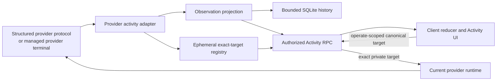

# Activity observation

Activity is the bounded observation and capability-gated targeted control view
of provider work shown in the **Subagents** and **Background Tasks** surfaces.
It is not globally read-only. Observation is separate from chat rendering and
terminal output: provider adapters emit only activity they can attribute, while
the server owns projection, persistence, authorization, stream recovery, and
targeted cancellation policy.

## Canonical model and invariants

The canonical wire model lives in
[`packages/contracts/src/activity.ts`](../../packages/contracts/src/activity.ts):

- A **scope** is either one provider chat thread or one managed provider terminal
  within a thread. Its current generation has a `scopeId`, provider identity,
  capability set, section health, observation state, and revision.
- An **actor** is a provider-attributed agent. It may reference a parent actor in
  the same scope.
- A **work item** is a provider-attributed background unit. It may reference its
  owning actor in the same scope.
- An **entry** is immutable detail attributed to an actor or work item:
  commentary, tool, command, result, error, state, or completion.

Parent and owner references must exist in the same scope, actor cycles are
rejected, and the provider may not emit records for a capability it did not
negotiate. Lifecycle states are `starting`, `running`, `waiting`, `unknown`,
`completed`, `failed`, `cancelled`, and `interrupted`. The last four are
terminal and require `terminalAt`; non-terminal records must not have it.

Terminal-state monotonicity currently differs by layer:

- The Codex tracker can authoritatively reopen a terminal actor from an
  object-form `Active` status or descendant snapshot whose provider timestamp is
  equal to or newer than the terminal update. It rejects an older `Active`
  signal.
- The repository rejects a terminal-to-non-terminal update only when its
  `updatedAt` is strictly older than the stored terminal update. Equal or newer
  updates are accepted.
- The client incremental reducer rejects every terminal-to-non-terminal summary
  update while still accepting the containing delta revision. That delta does
  not itself trigger recovery, so the client can show the terminal summary until
  a later authoritative snapshot replaces it.

Interruption on teardown is also topology-specific. The Claude terminal
observer explicitly marks tracked active records `interrupted` when its worker
ends. Codex and OpenCode observer workers do not directly close every unresolved
record. When the terminal manager tears down their generation, it cancels the
observer and then invalidates further publication. Separately, repository
startup cleanup interrupts unresolved records in persisted terminal scopes, and
replacing the current generation for the same terminal interrupts active
records in the prior scope.

## Protocol v2, revisions, control overlays, and resync

The server advertises `activityProtocolVersion: 2` in environment capabilities.
The client subscribes only when that exact feature is advertised; `null` means
the activity protocol is unavailable. This server/client negotiation is
independent of provider CLI probing. See
[`packages/contracts/src/environment.ts`](../../packages/contracts/src/environment.ts)
and [`packages/client-runtime/src/state/activity.ts`](../../packages/client-runtime/src/state/activity.ts).

Every subscription starts with a full `ActivitySnapshot` whose
`protocolVersion` is `2`. Effective observation changes are journaled as
contiguous deltas: `previousRevision` must equal the accepted observation
snapshot revision and `revision` is the next value. A large mutation batch may
be split into multiple deltas of at most 256 changes. Duplicate and net-no-op
provider events do not consume an observation revision.

The server replaces the stream with a fresh snapshot when the current scope
generation changes, a non-contiguous delta is observed, or the broadcast
receiver lags. The client discards old-scope and duplicate data. On a client-side
gap—including a change that cannot safely refill a capped page—it keeps the last
snapshot as stale and issues `activity.getSnapshot`; reconnecting creates a new
subscription and therefore a new authoritative snapshot. The server rules are
in [`apps/server/src/activity/rpc.rs`](../../apps/server/src/activity/rpc.rs);
the client rules are in
[`packages/client-runtime/src/state/activityReducer.ts`](../../packages/client-runtime/src/state/activityReducer.ts).

Targeted cancellation control is an independent ephemeral overlay. It has its
own contiguous revision stream and joins durable actor summaries only at the
snapshot, roster, and detail RPC boundaries. The overlay retains at most 200
actor and operation records, and a delta contains at most 256 changes. It is
never written to SQLite: after a server restart, historical actors remain
`unsupported` until the current runtime proves an exact native target. Provider
native target IDs never cross contracts, persistence, or diagnostic logs.
The current runtime registration owns its overlay generation. Lifecycle cleanup
publishes one bounded removal delta and leaves a bounded, target-free in-memory
tombstone for the stable public scope. The tombstone retains only monotonic
scope and actor-fence counters; it contains no provider target, operation, or
SQLite state. At most 200 inactive scope tombstones are retained. Within each
scope, at most 200 inactive actor counters are retained in addition to the
existing 200-active-actor bound. A scope or actor recreated after bounded
tombstone eviction is seeded above a registry-local high-water mark.
Replacement targets therefore cannot reuse pre-restart control revisions, an
already-open stream can consume the replacement delta or recover its
intentional revision gap, and a superseded registration still cannot remove
its replacement.

Observation and control revisions are independent monotonic domains. An
observation delta cannot fill a control gap, and a control delta cannot advance
observation history. The client recovers a gap in either domain from a fresh
server snapshot while retaining the other domain's last accepted data as
stale. Cancellation operations and their residual sets are therefore
reconnect-visible during one live server runtime, but they are intentionally
not restart-resumable. Every public operation revision comes from one checked,
registry-lifetime monotonic allocator rather than a scope- or operation-local
counter. Replacing or evicting a stable scope therefore cannot make an old
same-root retry fence valid for replacement work. Exhaustion fails closed
before provider I/O, and the allocator is runtime-only rather than SQLite
state.

`requested` control records and the UI label **Stopping** express
server-authoritative cancellation intent. They never manufacture a terminal
actor lifecycle. Only provider observation can move an actor to `cancelled`,
`interrupted`, `completed`, or `failed`; terminal observation also removes the
actor from any residual set. A partial operation may be retried only with its
current operation revision, and the server dispatches only active residuals and
late descendants already admitted beneath the original cancellation fence.
Every admitted operation also owns one non-polling ten-second finalizer. If
active residuals remain after that deadline—even when the exact target was
unavailable or provider delivery produced no terminal event—the generation- and
deadline-identity-fenced finalizer publishes `partial` without inventing a
provider lifecycle. Its private deadline identity remains stable when ordinary
provider reconciliation changes coverage, residuals, or the public operation
revision, so those updates do not postpone or disable the original ten-second
window. Absorption creates a new owner and deadline; retry starts a fresh full
window and identity. Terminal observation, replacement, and teardown remove the
operation and cancel its timer. Retry re-dispatches only targets whose prior
provider attempt failed plus newly targetable residuals; successfully delivered
targets remain fenced until provider lifecycle changes.

Claude targeted dispatch is provisional for a runtime generation only when its
bounded compatibility probe proves both required hook switches and the private
hook sink starts. An exact current `ClaudeTask` handle dispatches one correlated
`stop_task` control request; foreign target variants, root, foreground, and
unmapped actors fail before provider I/O, and root interrupt is never a
fallback. The response router is bounded and request-ID correlated. Only
Claude's exact unsupported-control protocol response authoritatively downgrades
the current generation. That transition clears every exact target and pending
operation, publishes targeted cancellation as unsupported, and cancels and
reaps in-flight dispatch work before returning. Later clicks in the same
generation fail before provider I/O; timeout, connection close, and generic
provider failures do not downgrade. A replaced or re-enabled runtime begins a
fresh provisional generation and must prove its targets again.

Structured provider batches install and reconcile their private control handles
after validating the native event identity and before projecting display
mutations. Any cancellation jobs discovered for late descendants start only
after control observation and display projection have released their locks. The
long-lived event pump reads the generation from the exact registration used for
each observation; it does not retain a launch-time generation across Activity
disablement and re-enablement. Late-job batches then cross a dedicated bounded
handoff whose capacity matches the provider supervisor queue, with at most 256
jobs per batch and no more active aggregate dispatch tasks than that configured
capacity. A full handoff backpressures the event pump and session or shutdown
cancellation abandons the pending send without orphaning provider I/O. Each
aggregate task has a stable session-owned ID. Its bounded priority completion
removes and awaits that exact handle, so capacity is released even when the
completion message is observed before Tokio marks the handle finished; stale
generation and duplicate completion IDs cannot remove current work.
Terminal display mutations reconcile the overlay even when the provider sends
no control updates, so completed descendants cannot remain as cancellation
residuals. If durable display projection rejects a batch after control
observation, the provider supervisor invalidates the exact observed generation,
suppresses every returned dispatch job, and cancels and reaps its queued or
in-flight targeted work before ordinary event handling continues. Restart,
disablement, session stop, and shutdown use the same cancel-before-cleanup
ownership rule, so no late dispatch task outlives its session.

Each snapshot negotiates provider capabilities separately: actors, attributed
entries, background work, history recovery (`full`, `bounded`, or `none`), and
terminal observation. Per-section health (`unsupported`, `live`, `stale`, or
`error`) can downgrade one surface without inventing records or hiding valid
data from another surface.

## Structured chat and provider-terminal topology

Structured chat activity comes from the provider runtime's typed protocol.
Provider-terminal observation is a separate opt-in path attached only to a
provider terminal launched by BiBCode. It requires explicit enablement before
that terminal is launched (or reopened), and it does not scrape arbitrary PTY
text.

The terminal manager is the sole owner of each observer generation's worker
registry. Provider observer workers receive only a lightweight observation
lease containing generation identity, publication fencing, and cancellation;
that lease cannot retain the registry that owns the worker future or invalidate
the generation. Only the manager-owned generation exposes lifecycle mutation.
Explicit teardown cancels and drains the registry before invalidating
publication. If the final manager generation owner is instead dropped,
registry drop publishes cancellation without blocking and transfers its workers
to a retained runtime cleanup task for the same bounded graceful-then-abort
policy. Each transferred worker record also synchronously requests abort when
dropped, so discarding that cleanup task during runtime shutdown cannot strand
a noncooperative worker. The process-wide join reaper continues to own each
worker thread and permit until joining proves the OS thread exited, so a worker
that retains its observation lease cannot form an ownership cycle or
permanently consume observer capacity.

Closing or restarting an individual terminal fences its generation against new
work while holding the observer's first-cancellation-reason arbitration, before
publishing observer cancellation. An invalidated open cannot replace that
lifecycle reason with its own cleanup reason. This admission fence is separate
from the observer's publication fence: the one-shot cancellation reason and
bounded worker drain still precede publication invalidation. An in-flight open
checks both closing and invalidation after observer readiness and again after any
rejected-preparation cleanup, before attempting the original command as a
fallback. Lifecycle cancellation follows generation-invalidation cleanup and
cannot be treated as a preparation rejection that starts another PTY. The
per-terminal operation lock remains held across spawn and publication, so a
restart starts its replacement only after the displaced open releases ownership.

Terminal-observer setup and activity-transition callbacks use a separate
isolation boundary with eight admissions per manager and sixteen across the
process. One named process-wide standard-library join reaper retains every
callback thread's `JoinHandle` plus both its manager and global admission
permits until `JoinHandle::join` proves the OS thread exited. Returning a
callback result, catching its panic, timing out or cancelling its async caller,
and tearing down the caller's Tokio runtime therefore cannot release capacity
while native thread teardown is still running. The reaper's submission channel
and retained set are bounded by the same sixteen-permit global admission cap;
it does not create a per-callback joiner thread and does not depend on an
application Tokio runtime remaining alive.

OpenCode helper cleanup is owned by the system helper launcher. Before a
foreground cleanup waiter can block, the launcher transfers the exact child,
reserved process-group identity, and one of sixteen cleanup permits into its
retained reaper registry. The cleanup permit is acquired before the helper
process is spawned. Retained submission synchronously inserts a pending
registration before it spawns the Tokio reaper task, then promotes that exact
entry to running without an await or other cancellation point. Pending and
running entries and the active drain epoch share one registry mutex, so
shutdown treats an in-flight submission as live work.

Codex and OpenCode helpers are independent roots rather than descendants of the
prepared PTY. Each receives a dedicated Unix process group or Windows Job and
registers its exact root identity in the server runtime's shared attribution
registry before publication. Registration rejection after shutdown freeze or
at registry capacity terminates and reaps the uncommitted ownership unit.
Codex retains a factory task guard through group/Job cleanup and exact wait;
factory shutdown drains those guards. Natural Unix root exit is observed with
`waitid(..., WNOWAIT)` so the leader reserves its PID/PGID until late
same-group descendants are killed and the root is reaped.

The foreground TERM/grace/KILL/wait budget remains bounded; a timed-out child
stays registry-owned until `Child::wait` completes. An `Interrupted` wait is
retried immediately. Any other wait failure keeps the same child,
process-group guard, stdout ownership, and permit in that task and retries
after a fixed 100 ms delay. The first shutdown of a non-empty registry phase
publishes a snapshot drain epoch that permits one immediate retry per retained
task. A task promoted after that publication reads the current snapshot and
cannot miss the epoch. Concurrent and repeated shutdown callers, including
replacements after an earlier caller is cancelled, reuse the active epoch and
cannot repeatedly bypass the delay. A repeated failure cannot publish reap
completion, disarm the guard, or release capacity.

Shutdown removes completed running entries, creates or reuses the phase epoch,
and decides whether it may return while holding the same registry mutex. When
the last entry is removed, epoch reset and the empty-state shutdown return
linearize under that lock; a later submission belongs to a distinct phase.
Process waits, stdout joins, task joins, timers, logging, and notification
waits all run after the mutex is released. Each completed task keeps its join
handle in a shared async owner reachable from the registry. Shutdown callers
serialize on that owner and await the handle by mutable reference, so
cancelling one caller cannot detach the handle or make a replacement drain see
an empty registry. Only a successful join permits removal. Normal reservation
also prunes finished, successfully joined terminal records synchronously, so a
long-running server cannot accumulate records beyond the live cleanup
capacity; it never detaches a running task epilogue to do so. A persistent
platform wait error therefore keeps shutdown pending at a finite retry cadence
rather than discarding the exact owner or hot-looping, while repeated shutdown
after an empty-state linearization is inert.

Terminal-manager shutdown first cancels and drains observer generations and
sessions, then calls the launch-preparer/factory shutdown hook to drain helper
owners while the production Tokio runtime is still live. Codex and OpenCode
use the hook; other provider factories use its no-op default. This makes waiter cancellation safe,
bounds live helper/reaper ownership, and prevents runtime teardown from
discarding an unreaped OpenCode child.

## Independent activity controls

Each environment has separate Chat and AI Terminal activity gates. Chat defaults
on and owns `thread` scopes. AI Terminal defaults off and owns `terminal` scopes.
RPC admission, generation fencing, projection, cleanup, and observer lifecycle
are selected from the request scope; changing one gate does not transition the
other. Legacy `enableAgentActivity` values migrate only to Chat.

### AI Terminal agent status

Every observable AI Terminal (Claude, Codex, OpenCode) launches with its
observer, whatever the AI Terminal gate says (#187). The left panel's terminal
agent status needs the observer.

**What the gate still controls.** The gate decides whether the observer also
publishes activity:

- An observer launched while the gate is off starts dormant
  (`TerminalAgentActivityControl::with_enabled(false)`, a `Prepared` launch
  with no admission). It skips the history and child reconciliation it would
  publish.
- A dormant observer follows later gate transitions like any other observer.
  When the gate opens on one that never published, it creates its activity
  scope with the root agent then; OpenCode reconciles the session tree at once.

**How each provider reports.** Each observer reports its main agent's state
through its generation (`TerminalObserverGenerationLease::publish_agent_status`),
independently of admission:

- **Claude:** status hooks on the existing authenticated loopback receiver.
  The hooks are `SessionStart`, `UserPromptSubmit`, `PermissionRequest`,
  `Notification` (`idle_prompt` reads Done), `Elicitation`,
  `ElicitationResult`, `Stop`, `StopFailure` and `SessionEnd`, plus main-agent
  `PreToolUse` and `PostToolUse`; any agent's finished tool ends an approval
  prompt. Status follows the main session, rebinding on `SessionStart`.
  Status-only hooks never reach the activity worker, and status decodes only
  the fields it reads; a hook is decoded whole only for live activity.
  Activity admission is still taken before the body arrives.
- **Codex:** the TUI root thread's `thread/status/changed` notifications
  (including `activeFlags`), `turn/started`, `turn/completed`, its approval and
  question requests, and its `item/*` notifications as progress. The
  `thread/resume` response sets the state at attach and reattach.
- **OpenCode:** root-session `session.status`, `session.idle`,
  `session.error`, permission and question events, and its `message.part.*`
  events as progress, read from a dormant stream too, which decodes only the
  type, session and status fields. The session statuses set the state at
  attach and reconnect (OpenCode lists only sessions that are not idle).
- **Progress** reads Working unless the agent is blocked on an approval or
  waiting on the user, which only an answer or a new status ends.

**Publication.** The terminal manager mirrors the latest report into
`TerminalSummary.agentStatus` on the metadata stream:

- A changed state is mirrored at once.
- An unchanged report refreshes its age at most once a minute.
- The age (`ageMs`) and the evidence token (`observedAt`) are computed when the
  summary is serialized, so the metadata snapshot that starts each subscription
  carries current ages.
- A launch that names a provider but gets no observer reads `unavailable`.
  That covers Cursor and Grok, Windows, and a failed preparation, and the value
  stays `unavailable` after exit. An observed agent settles to `done` on exit,
  failed for a non-zero exit code other than a Ctrl+C quit (130, SIGINT, or
  Windows' control-C status).

**Trust boundary.** It is unchanged. Hooks still reach only a `127.0.0.1`
listener with a per-generation bearer token, checked in constant time, and
settings owned by that generation. Codex still uses its generation's
Unix-socket helper. The status carries only the derived state, never prompt,
message or terminal content. The change is in reach: every observable AI
Terminal now runs an observer, not only terminals launched with the gate on.

### Codex structured recovery

Codex structured recovery merges validated, bounded live and root/child-history
`subAgentActivity` hints with descendants returned by `thread/list`. Hinted
child IDs are direct-read under the current activity generation. A read response
is accepted only when its thread ID matches the requested child ID and its
parent is the root or an already verified actor. Bounded root, live, list, and
nested recovery repairs reconnect topology. An empty successful list neither
erases known actors nor suppresses hinted actors and their direct reads.
Malformed, out-of-scope, self-referential, or cyclic hints are ignored.

The official `thread/backgroundTerminals/list` response does not provide a
background terminal start time. For each successfully decoded reconciliation
batch, the server therefore samples one canonical RFC 3339 observation
timestamp and uses it for that batch's background-work mutations. An unchanged
tracker entry retains its first observation time across later batches. A server
restart or other new tracker generation may begin that elapsed interval at its
first new observation because no earlier provider timestamp exists to recover.
Live root `commandExecution` start and completion notifications wake that
bounded reconciliation path; the notifications remain hints, while the
official background-terminal list stays authoritative for work-item state.

For structured chat only, a verified descendant becomes cancellable while the
tracker can prove one current active turn for that native child thread. Live
`turn/started` and bounded child-history reconciliation install the same private
thread/turn handle; matching completion removes it. Conflicting turns,
provisional hints, malformed or oversized IDs, terminal turns, and stale
completion for an older turn fail closed. Dispatch revalidates that exact
handle against the current tracker state and sends `turn/interrupt` with the
child `threadId` and `turnId`. Equality with the root provider thread is rejected
before provider I/O; the composer interrupt and background-terminal or process
cleanup paths are never used as targeted fallbacks.

Every accepted terminal actor transition revokes any retained native turn
target in the same tracker update; a later status-only actor reopen cannot
restore that completed handle. Reconciliation passes capture the live-control
revision at pass start, coalesce staged updates by canonical actor/work subject,
and discard a staged subject when newer live evidence has published. Child
recovery results for a superseded subject are fenced under the same activity
state lock before any tracker mutation, retained for a bounded fresh-pass
retry, and never allowed to erase a newer live turn or reinstall a completed
one. Root and nested history hints apply the same pre-mutation fence to every
validated receiver rather than only to the history owner; superseded receivers
remain queued for bounded recovery while unrelated hinted receivers in that
pass continue to reconcile normally.

Epoch and cancellation fences cancel recovery when activity is disabled, the
root is replaced, or the runtime disconnects or shuts down; late results and
old-root mutations are discarded. Mutations already accepted into the current
root's tracker are staged under the same activity lock until a current
reconciliation event is queued successfully, so a transient failure or
same-root reconnect cannot acknowledge recovery data that was never published.
The bounded staging buffer coalesces superseded actor and work-item states,
preserves each actor's retained state order, and dependency-orders every
retained parent state before the child or reparent state that needs it. Cyclic
or otherwise unsortable staged topology remains pending and produces a runtime
warning instead of an invalid activity event. Oversized valid recovery is
published as repository-sized chunks. Scope and section health lead the first
chunk; each chunk is removed from staging only after its event is queued, and
remaining chunks are queued immediately without waiting for provider history to
change.
The staged buffer is cleared when activity or the root is replaced. History
recovery is `full` only for
`supported`/`supported`, `none` only for `unsupported`/`unsupported`, and
`bounded` for every other list/read pair, including unknown or unproven pairs.
A history read is a metadata-only `thread/read` followed by `thread/turns/list`
pages of 20 turns, newest first, until 20 turns are held. The reply size
therefore depends on the newest turns, not on the thread's length
([design](../superpowers/specs/2026-10-17-codex-activity-paging-design.md)).
Only a missing-method answer marks `thread/read` or `thread/turns/list`
unsupported, and either one downgrades history reads. A reply that does not
decode, including one whose newest 20 turns and 200 items still exceed the
512 KiB bound after command output is reduced to a presence marker, skips that
thread with a log warning. The pass continues, and the next pass reads the
thread again. The same rule holds for `thread/list` and
`thread/backgroundTerminals/list`: an undecodable page ends that method's paging
for the pass with a log warning, the snapshot stays partial (background work is
not treated as authoritative), and the next pass asks again.
These recovery downgrades do not disable ordinary Codex chat.

Claude structured control normally joins native task identity only through the
complete same-session, same-generation Agent/Task `tool_use_id` chain: an Agent
tool invocation from either the current `assistant` record or the legacy
`stream_event` content-block record, authenticated asynchronous PostToolUse
`agentId`, an exact `task_started` `task_id` whose optional `task_type` is
absent, `local_agent`, or `remote_agent`, and verified `SubagentStart`
`agent_id`. Other task types fail closed. This exact PostToolUse path remains
authoritative: it can promote a
pending nested fallback to an exact target or contradict it, retire it, and
tombstone its identity chain so replay cannot recreate the target.

For nested invocations only, an authenticated `PreToolUse` from the already
verified parent opens a parent-owned pending interval when a matching
PostToolUse result is not available. The fallback admits a target only when the
stream parent tool, one accepted nested `task_started` candidate, and one
verified unassigned child all agree on that active parent. Documented
`SubagentStart` hooks omit `parent_agent_id`, so a parentless child is reparented
only when there is one nested candidate in the whole generation, one unmatched
verified child, and no unresolved root Agent/Task launch that could own it. An
exact nested PostToolUse may reparent its named child directly after proving the
same exact active source parent. Present explicit lineage must still agree.
Ambiguity is observable but unsupported and performs zero provider I/O;
semantic text, timing, order, proximity, transcript reads, polling, and timers
are never correlation inputs.
A fallback target is provisional until matching exact PostToolUse evidence promotes it.
It remains part of its parent's complete candidate set after installation. If later
same-generation evidence makes that set non-unique, the correlator synchronously
removes only the inferred target and inferred lineage, publishes unsupported control,
and retains the actors and task facts as unresolved evidence. Exact targets are not
revoked by sibling ambiguity, and exact evidence may later resolve one named child.
Affirmative parent-level ambiguity disables further fallback for that parent until
generation reset, so resolving one sibling exactly cannot reopen another by elimination.
At most 200 ambiguous parent identities are retained across terminal cleanup. Reaching
capacity preserves those parent-specific denials; a further affirmative ambiguity for a
distinct parent latches all fallback admission closed until generation reset, while exact
PostToolUse identity remains authoritative.
Pending state is generation-owned and bounded to 200 correlations. Terminal
events, runtime replacement, and Activity disablement retire or clear pending
and installed fallback state.

The bounded correlator fails closed on conflicts, malformed identity, duplicate
assignment, stale generation, or saturation. Accepted effect facts always carry
opaque event keys; target updates share the provider event batch with the
canonical actor mutation, and native identities remain private and redacted.
Current `assistant` and legacy `stream_event` forms of the same exact Agent
invocation derive the same bounded key inputs, so event ordering cannot leave a
resolved target private to the correlator while the Activity overlay stays
unsupported.
`task_notification(stopped)` monotonically cancels the mapped actor and retires
its handle, so later hook completion cannot rewrite cancellation. When targeted
dispatch is provisionally supported, an admitted handle maps to the Claude
stream-JSON `stop_task` control subtype. Authoritative unsupported responses
revoke all such handles for that runtime generation without changing ordinary
Claude chat or observation.

Signals, references, and minimum versions per provider and surface. **Current**
means the signal BiBCode uses still matches the provider's documentation;
**unused** names documented signals BiBCode does not read yet. The
[provider guides](../providers/README.md) quote the references.

| Provider | Surface  | Signals BiBCode uses                                                                                                                                                                                                                       | Reference                                                                                                                                                                                               | Minimum version                                                                                        | Status                                                                                                                                                                  |
| -------- | -------- | ------------------------------------------------------------------------------------------------------------------------------------------------------------------------------------------------------------------------------------------ | ------------------------------------------------------------------------------------------------------------------------------------------------------------------------------------------------------- | ------------------------------------------------------------------------------------------------------ | ----------------------------------------------------------------------------------------------------------------------------------------------------------------------- |
| Claude   | Chat     | `--include-hook-events` and `--forward-subagent-text`, both listed by `--help`; `SubagentStart`/`SubagentStop` hooks; Agent and legacy Task `tool_use` with `parent_tool_use_id`; `task_started`/`task_notification` for targeted Stop     | [CLI reference](https://code.claude.com/docs/en/cli-reference), [headless](https://code.claude.com/docs/en/headless#follow-subagent-messages), [hooks](https://code.claude.com/docs/en/hooks)           | `--forward-subagent-text` v2.1.211; every nesting depth v2.1.219; `--include-hook-events` undocumented | Current, help-gated. Unused: `local_bash` tasks and `background_tasks_changed` (v2.1.203), `run_id` and `parent_task_id` (Agent SDK v0.3.292), forked skills, teammates |
| Claude   | Terminal | `--settings` with `--setting-sources`, both listed by `--help`; authenticated HTTP hooks; additive hook merge; private executable pin                                                                                                      | [CLI reference](https://code.claude.com/docs/en/cli-reference), [hooks](https://code.claude.com/docs/en/hooks)                                                                                          | HTTP hooks v2.1.63, the oldest version BiBCode proved                                                  | Current, help-gated                                                                                                                                                     |
| Codex    | Chat     | App Server with `experimentalApi`: `subAgentActivity` items, `thread/read`, `thread/turns/list`, `thread/list`, `thread/backgroundTerminals/list`                                                                                          | [App Server README](https://github.com/openai/codex/blob/main/codex-rs/app-server/README.md), [protocol](https://github.com/openai/codex/blob/main/codex-rs/app-server-protocol/src/protocol/common.rs) | None pinned; each method is feature-detected                                                           | Current. Unused: `thread/backgroundTerminals/terminate` and `/clean` (experimental), so no Stop for background terminals                                                |
| Codex    | Terminal | Unix App Server listener and remote TUI; `thread/list` reconciliation that `subAgentActivity` can wake                                                                                                                                     | Same as chat                                                                                                                                                                                            | Probe-gated                                                                                            | Current                                                                                                                                                                 |
| OpenCode | Chat     | OpenCode 1: `GET /session/:id/children`, `GET /session/status`, `GET /session/:id/message`, `GET /event`, `POST /session/:id/abort`. OpenCode 2: `GET /api/session?parentID=…`, `GET /api/session/active`, `GET /api/session/{id}/message` | [Server](https://opencode.ai/docs/server/) (OpenCode 1 routes only)                                                                                                                                     | 1.x and 2.x; 2.x replayed from captured 2.0.29 responses                                               | Current for 1.x; the 2.x routes are not in the server documentation                                                                                                     |
| OpenCode | Terminal | Authenticated serve, then `attach` (1) or `--server`/`--session` (2); owned-root correlation; the chat routes                                                                                                                              | [Server](https://opencode.ai/docs/server/)                                                                                                                                                              | 1.x and 2.x                                                                                            | Current                                                                                                                                                                 |
| Cursor   | Chat     | None; ordinary ACP chat only                                                                                                                                                                                                               | [CLI ACP](https://cursor.com/docs/cli/acp)                                                                                                                                                              | None                                                                                                   | Unsupported in protocol v2. Unused: `cursor/task` (subagent completion) and `cursor/generate_image`                                                                     |
| Cursor   | Terminal | None                                                                                                                                                                                                                                       | [CLI ACP](https://cursor.com/docs/cli/acp), [subagents](https://cursor.com/docs/subagents)                                                                                                              | None                                                                                                   | Unsupported: no documented live signal                                                                                                                                  |

Recovery and truthful downgrade:

- **Codex**: structured recovery combines bounded validated hints, list
  discovery, and direct reads; the exact `full`/`bounded`/`none` guarantees are
  above. Background work is enabled only when its reconciliation method is
  accepted. The terminal path publishes only after root resume and keeps known
  data when an optional bounded reconciliation request has no usable response.
  It reads descendants with the same paged, bounded history read; a history too
  large to keep is skipped without breaking its connection.
- **Claude**: no background-work capability. Recovery moves from `none` to
  `bounded` only after correlated transcript recovery; unproven hook support
  leaves activity unsupported. A session that restarts in the same server
  process keeps its activity lifecycle, and the new process's startup
  capabilities replace what the old one reported. This also happens while Chat
  Activity is off, so turning it back on publishes what the new process
  reports. A Claude process whose probe
  found no hook flags starts without a hook sink and reports `none`, so retained
  subagents turn stale instead of staying live. Other providers whose startup
  report is `none` (Cursor, Grok, OpenCode) only mean "not known yet". Their
  restarted sessions keep the capabilities observed at runtime until the new
  process reports its own (`ProviderDriver::startup_activity_capabilities_are_final`).
  The terminal path additionally needs settings
  composition, authenticated HTTP hooks, additive merge semantics, and a safe
  private executable pin.
- **OpenCode**: structured chat reports no activity when the child endpoint is
  unsupported, `bounded` recovery when child discovery works without both status
  and history, and `full` when all three work; transient fetch failure marks the
  scope stale while retrying. The terminal path instead publishes `full` after
  owned-root correlation and currently skips later child/status/message request
  failures without downgrading that capability. Failed correlation publishes no
  terminal activity scope.
- **Cursor**: no structured activity or activity dock is claimed; ordinary
  Cursor chat still works.

Codex provider-terminal observation remains list-based. A terminal-scope
`subAgentActivity` item can wake the bounded reconciliation pass, but it does
not materialize a provisional actor or enqueue a direct hinted-child read; an
actor is published there only after `thread/list` verifies its topology.

The terminal supervisor validates the enabled provider instance and executable,
then chooses only the Codex, Claude, or OpenCode observer factory. Before
spawning, an unavailable observer, rejected probe, preparation failure, or
preparation timeout passes through the original executable, arguments, and
environment. A collision between the launch environment and a prepared
observer's reserved environment key is instead a hard terminal error, as is
failure to spawn the selected prepared command. Neither path retries the
original command. If the prepared PTY starts but its observer is not ready
immediately before `on_spawned`, the manager discards that uncommitted PTY and
respawns the original command only while the terminal generation remains open
and valid. If the bounded `on_spawned` callback times out or panics while that
generation is still open and valid, the manager instead cancels the observer
and invalidates further activity publication, then continues creating and
registering the prepared PTY as the running terminal. It does not respawn the
original command.

Every way a Codex terminal ends up without Activity is logged under
`bibcode_server::provider_terminal::codex`. Each line carries a `reason` and an
`elapsed_ms`:

- **Preparation, as info:** an executable or command that cannot be observed
  (`unsupported_capabilities`, `rejected_args`, `probe_version_unparsed`).
- **Preparation, as a warning:**
  - a failure that should have worked:
    - `probe_timeout`, `probe_spawn_failed`, or `probe_unavailable`, which
      carry only the kind of failure, never a path;
    - `probe_command_failed`, `generation_dir_failed`, `socket_path_too_long`;
    - `helper_start_failed`, with the launcher's error and helper time.
  - `preparation_timeout`, with the `stage` the budget ran out in;
  - `helper_start_abandoned`, with the helper step (`supervisor`, `spawn`,
    `admission`, or `readiness`) when a helper start is dropped unfinished.
- **After spawn, as a warning:**
  - `connect_timeout`, once, with the step reached (`connect`, `initialize`, or
    `initialized`), when the App Server has not connected within three
    seconds. The observer keeps waiting.
  - `connect_failed`, unless the terminal is already closing.
  - `root_discovery_stopped`, `root_discovery_reconnect_failed`, the `resume_*`
    reasons, and `live_publication_rejected`, whose detail says whether the
    terminal generation was no longer current or creating the scope failed (the
    kind of failure only).
  - `root_discovery_pending`, once, if no TUI thread is found within ten
    seconds.

  These lines carry no App Server error text, which can quote thread content.
  They carry the JSON-RPC error code, or which transport step failed.

**Preparation budgets.** Each provider factory owns the time its preparation may take
(`ProviderTerminalObserverFactory::preparation_budget`) and enforces it with
its own timeout. The supervisor tells the terminal manager to wait that long
plus a fixed 150 ms, so the factory's timeout fires first and cleans up. A
launch the supervisor cannot validate (disabled or unknown instance, mismatched
driver, unresolved executable) gets the manager's 500 ms default and passes
through almost at once. The manager's own ceiling (3 s) is a stop for a
preparer that asks to wait too long; a test keeps it above every provider's
wait, so the ceiling never cuts a provider short (#200). The settings are read
once per launch: the lookup that chooses the wait keeps the validated reading,
and preparation of the same launch uses it, so settings that change between the
two cannot start a preparation under the wrong wait. If that lookup is cut off,
the launch passes through without a second read.

| Provider | Own budget | `terminal.open` waits at most |
| -------- | ---------- | ----------------------------- |
| Codex    | 350 ms     | 500 ms                        |
| OpenCode | 850 ms     | 1 s                           |
| Claude   | 2.25 s     | 2.4 s                         |

The wait applies only to a preparation still running. A launch that cannot be
observed (an unapproved Claude build, missing capabilities) passes through in
0.15 to 0.4 s without waiting for its budget. When the budget runs out the
original command spawns unobserved, and the manager logs
`provider terminal observer callback timed out` with `timeout_ms`. Claude
cannot attach late: its observer rewrites the command (pinned executable and a
`--settings` overlay), which has to happen before the PTY spawns.

Claude's 2.25 s is the probe runner's own 2 s timeout, which bounds its slowest
step (the attestation's `codesign` is capped at 500 ms and runs beside it),
plus 250 ms to pin the executable, write the overlay and bind the listener.
Measured on a 12-core Mac with a 276 MB Claude binary, the stages (`clonefile`
pin, `--version` and `--help`, SHA-256 of the binary, `codesign`) take about
0.2 s together, and a median of 252 ms (maximum 356 ms) with the CPU
oversubscribed twice over. The earlier 500 ms wait cut a Claude preparation
that was merely slow, which left the terminal without Activity or agent status.

The Codex budget is unchanged. Run alone, the packaged Activity spec passed on
both macOS architectures with none of the Codex observer lines (#192), so the
earlier x64 failures happen only with the full suite's load. Budgets change
only if a full macOS x64 run fails and these lines name the stage that ran out.

A version the probes cannot parse is cached for that executable build for ten
minutes, so launches in that window pass through without spawning probes. The
window lets a wrapper script whose own bytes never change recover once the
Codex behind it is upgraded. Unsupported capabilities are cached for the life
of the build. A probe that could not run, or exited unsuccessfully, is not
cached: it may be transient.

Observer workers are admitted under a process-wide cap of sixty-four, and
sixteen per terminal generation. An observed terminal holds one worker; an
OpenCode launch briefly holds a second until its terminal spawns. A worker
refused at the cap, or because the runtime or its thread is unavailable, is
logged once as a warning, and is not queued or retried. If the refusal comes
before spawning, the launch passes through to the original command. If it comes
in `on_spawned`, the prepared command keeps running unobserved: no activity
scope is published, and the resources it runs on stay until the terminal
generation ends. Claude keeps its pinned executable and settings overlay,
Codex and OpenCode keep the helper their TUI attaches to, and the OpenCode
root session is not deleted when the terminal closes. The cap sits above
ordinary use, so a refusal signals overload, and the warning reports it.
Admitting the worker when a slot frees later would need a waiting queue with
its own bound and cancellation, and the observer would start after the events
it should have seen.

Provider root correlation is asynchronous after `on_spawned`. A correlation or
later observer failure does not replace the running prepared command with the
original command. Until correlation succeeds, no activity scope is published.
After publication there is no universal observer-failure state transition:
Claude explicitly interrupts tracked active records when its observer ends;
Codex does not directly terminalize them; and OpenCode retries its event stream
but skips failed reconciliation requests without changing its advertised
terminal history capability. The terminal remains independent of its read-only
Activity panel, which opens inside the terminal's own pane.

See the ownership and fallback paths in
[`apps/server/src/provider_terminal/supervisor.rs`](../../apps/server/src/provider_terminal/supervisor.rs)
and [`apps/server/src/terminal/manager.rs`](../../apps/server/src/terminal/manager.rs).
Cross-provider semantics and handshakes are covered by
[`apps/server/tests/activity_provider_conformance.rs`](../../apps/server/tests/activity_provider_conformance.rs),
[`apps/server/tests/fixtures/activity-conformance/canonical-scenarios.json`](../../apps/server/tests/fixtures/activity-conformance/canonical-scenarios.json),
and [`apps/server/tests/provider_terminal_supervisor.rs`](../../apps/server/tests/provider_terminal_supervisor.rs).

## Bounds, retention, authorization, and data policy

The v2 contract limits IDs and labels to 256 UTF-16 units, summaries to 2,048,
details to 16,384, cursors to 512, snapshot/page results to 200 records, and a
delta to 256 changes. Provider payload decoders, probe output, hook bodies,
queues, reconciliation passes, and observer workers have additional local
bounds.

Repository retention targets 2,000 summary records per scope, 200 entries per
record, and 5,000 journal/idempotency rows per scope. Eligible terminal records
older than 30 days are pruned. Work is incremental (normally 128 rows per
transaction), and active or still-referenced records are retained even if that
temporarily leaves the scope above its target. Exact rules are in
[`apps/server/src/activity/repository.rs`](../../apps/server/src/activity/repository.rs).

Snapshot, roster, detail, and subscription reads—including replacement
snapshots—need the authenticated environment session's `orchestration:read`
scope. `activity.cancelSubtree` and `activity.retrySubtreeCancellation` are
mutations and require `orchestration:operate`; maintenance admission closes
both with the other environment mutations. Roster and detail requests bind the
requested scope reference to the current `scopeId`, while cancellation also
fences the actor or operation revision before provider I/O. Terminal scopes are
read-only. Before persistence, display text is bounded, control characters are
normalized, and common authorization, cookie, password, secret, token, and
API-key assignments are redacted. Operational logs and typed errors never
include provider-native cancellation targets or provider payload bodies.

Raw hidden reasoning is never activity commentary. Codex can publish the
provider's completed reasoning **summary**, but not its raw reasoning content.
Claude thinking deltas and recovered thinking blocks, and OpenCode reasoning
parts, are excluded from activity entries. The chat shows the same root
reasoning, Claude thinking and Codex summaries, as its own reasoning entries
([Provider reasoning](./rpc-and-orchestration.md#provider-reasoning)); a
reasoning `item.completed` never becomes a thread activity either. Provider coverage is in
[`apps/server/tests/provider_codex.rs`](../../apps/server/tests/provider_codex.rs),
[`apps/server/tests/provider_claude.rs`](../../apps/server/tests/provider_claude.rs),
and [`apps/server/tests/provider_opencode.rs`](../../apps/server/tests/provider_opencode.rs).

## Troubleshooting states

| State            | Meaning                                                                                                                                                                           | Operator response                                                                                                                                 |
| ---------------- | --------------------------------------------------------------------------------------------------------------------------------------------------------------------------------- | ------------------------------------------------------------------------------------------------------------------------------------------------- |
| **Live**         | The scope or section is current and contiguous revisions are applying.                                                                                                            | No action.                                                                                                                                        |
| **Reconnecting** | If emitted, the scope says its observer is attempting to re-establish provider state. A client transport reconnect separately keeps the last snapshot stale until resubscription. | Wait for a replacement snapshot; inspect provider connectivity if it persists.                                                                    |
| **Stale**        | Previously valid data is retained, but reconciliation or transport recovery has not established that it is current.                                                               | Treat the data as historical and resolve the reported provider/connection condition.                                                              |
| **Error**        | A scope's bare `observationState` is `error`, or a section health object is `error`. Only section health has `message` and `retryable` fields.                                    | For a section, inspect its message and retryability. For a scope, use operational logs plus reconnect, resubscribe, and snapshot-resync evidence. |
| **Interrupted**  | A record—not the scope—reached the terminal `interrupted` lifecycle through a provider-specific transition or repository cleanup.                                                 | Treat that work as ended; start a new provider operation if needed.                                                                               |

An absent dock is also meaningful: protocol v2 may be unavailable, the provider
may be unsupported, or a terminal handshake may not have established correlated
activity. None of those states changes whether the provider itself can run.
