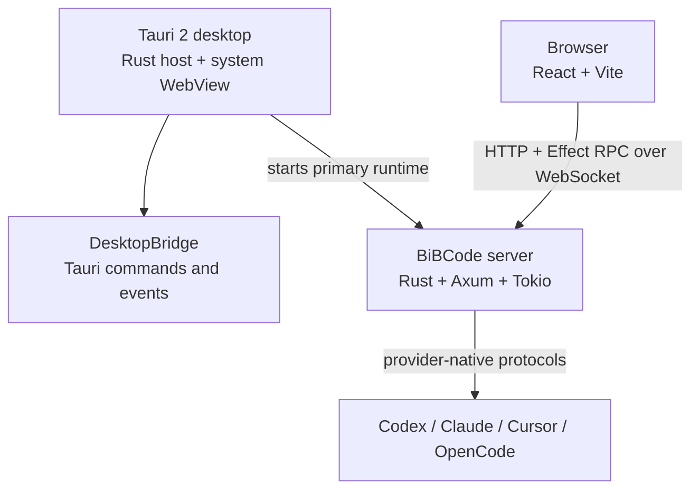
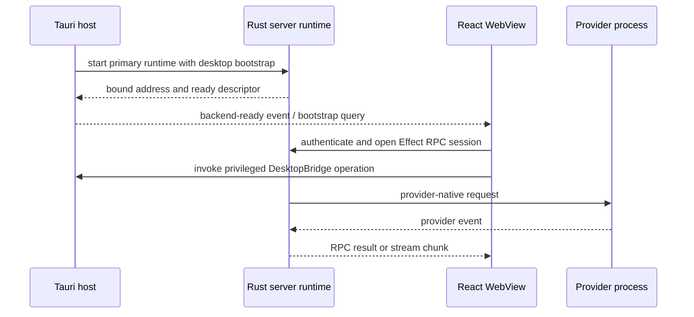

# Architecture

BiBCode has one React/Vite frontend and one native Rust backend. Browser mode
connects to a running `bibcode` server. Desktop mode runs the same frontend in
Tauri 2 and starts the primary Axum/Tokio server in-process. Native shell
capabilities cross a narrow `DesktopBridge`; application traffic uses the same
typed HTTP and WebSocket RPC boundaries in both modes.

## Components

- **Tauri host (`apps/desktop`)** owns native windows, menus, dialogs, updates,
  WSL and SSH launch, the desktop connection catalog, and backend lifecycle.
  Windows protects the catalog with DPAPI. Atomic compare-only and
  compare-and-write transitions cross privileged bridge commands and are
  serialized by the native catalog owner across all WebViews in that host. A
  protected bridge collapses a legacy renderer catalog into native storage
  before publication, then uses native storage exclusively. macOS and Linux
  advertise that native protection is unavailable and use the renderer's
  transactional IndexedDB catalog instead; any legacy renderer value is
  atomically migrated into that single source before it is cleared.
- **React app (`apps/web`)** owns the user interface and client-side state. It
  uses hash history in desktop mode and browser history on the web. Preview
  content is hosted in Tauri child webviews; preview automation is brokered by
  the Rust server and consumed by the React host. On the Tauri desktop host only
  tab status, open, and navigate are supported and advertised; snapshot, click,
  type, and the other automation calls are not yet. Its native views drive
  only the visible tab, so open always shows the tab, and a request for a
  thread that is not on screen times out. The desktop keeps one long-lived
  native view per environment's preview storage (the local environment keeps
  the original profile; each other environment gets its own), because
  recreating child webviews while switching tabs disconnected the app; logical
  tabs rebind to their environment's view. On Linux, Tauri packs child
  webviews into the window's content box, where bounds cannot move them, so
  the desktop wraps the main webview in a `GtkOverlay` with a pass-through
  `GtkFixed` layer and places preview views there
  (`apps/desktop/src-tauri/src/preview/platform/linux.rs`). Removing an environment deletes its preview storage with its other
  environment-owned data (`EnvironmentOwnedDataCleanup`, through
  `desktop_preview_forget_environment`); a profile one of its previews used in
  this session stays on disk, since its native view lives until the app exits. In browser mode there is no child
  webview. A page served over plain HTTP implements the same `DesktopPreviewBridge`
  with sandboxed iframes mounted inside each tab's panel slot
  (`apps/web/src/browser/framePreviewBridge.ts`, chosen in
  `components/preview/previewBridge.ts`; the same `browserSurfaceSync` stream
  drives their visibility and moves a frame into a remounted slot, reopening
  the page it last reported). It frames only gateway bootstrap URLs on
  the page's own host, the only host a gateway lets frame it, including a
  same-host server's loopback, which `browserTargetResolver` routes
  through the gateway on the environment's own address; the bootstrap's `ui=` parameter
  names the page's origin so the gateway lets it frame the preview
  ([Framing](remote.md#preview-gateway)). The gateway's injected `/__bibcode/frame.js` reports
  each page's URL, title, and history by `postMessage`, and Back, Forward, and
  Reload go back as messages. Its failures stay local to the client, and
  `previewRuntimeCapabilities` turns off picking, recording, screenshots, page
  tools, and automation. An HTTPS page has no preview bridge, so gateway links
  open in new tabs. In browser mode the client advertises only status and open
  for automation, and open shows a prompt and returns `pending-user` at once;
  the page opens only if the user clicks Open. The server prefers the host
  with more operations, so a connected desktop serves automation first.
  Loopback dev servers on a remote environment load through the server's
  preview gateway. Typography and text-contrast
  rules live in [`UI.md`](../../UI.md).
- **Desktop adapter (`apps/web/src/tauriDesktopBridge.ts`)** installs
  `window.desktopBridge` only when Tauri globals are present. Tauri commands and
  events implement privileged operations; browser fallbacks are limited to
  explicitly safe capabilities.
- **Server (`apps/server`)** is both a Rust library and the native `bibcode`
  binary. It owns HTTP/WebSocket RPC, authentication, SQLite persistence,
  orchestration, providers, terminals, Git, files, diagnostics, relay access,
  and process supervision. Its worktree catalog joins bounded live Git and
  filesystem observations with durable project and canonical-thread
  projections. A nullable project repository-key pin is stored outside the
  rebuildable projection, established only by a trusted primary-checkout scan,
  and joined into project reads; generic projection writes cannot change it,
  and projection rewind/replay preserves it. It fences later fallback anchors
  and is not a persisted live catalog.
  Each project also carries a server-authored `repositoryIdentity` derived from
  its checkout's `origin` remote: a canonical key of the lowercased host and the
  repository path without `.git`, plus the remote (stored without userinfo,
  query or fragment, so no credentials persist), name, owner, provider and
  checkout root. A remote whose path has an empty segment has no identity. It lives in
  the rebuildable project projection and changes only through the
  server-internal `project.repository-identity.set` command, which emits
  `project.meta-updated` without changing `updatedAt`. A reconcile runs right
  after project creation or a workspace move (so a new project is briefly
  ungrouped), once at startup for every project, and after a healthy
  worktree-catalog scan: at most every five minutes per project, or at once
  when the primary checkout's `.git/config` size or modification time changed
  since the last scan (one stat in a tracked task, bounded to three seconds, one
  outstanding per project; an unknown stamp falls back to the interval, and the
  catalog refresh never waits for it, so a stalled network mount cannot block it).
  Reconciles are serialized
  per project, bounded to four concurrent Git reads, cancellable while waiting
  for either, and run as tracked tasks
  off the effects worker and catalog refresh paths, joined at shutdown. A
  checkout that is missing, unreadable, refused, or no longer a repository
  keeps the stored value; only a confirmed repository whose `origin` was
  removed or changed updates it. Clients group projects by it but cannot set
  it. It is unrelated to the path-based repository-key pin, which fences
  worktree adoption on one machine. Projects sharing a repository may share
  Git observation, but retain isolated latest-value snapshots, streams, thread
  joins, subscribers, suppressions, and mutation epochs. Catalog views retain
  the last authoritative arrays through degraded observations and cancel
  pending poll, Git, and probe work after their final subscriber before bounded
  idle eviction. Project and repository lifecycle epochs make poller
  initialization transferable across subscriber aborts and prevent canceled
  prior-lifecycle work from publishing into an immediate reattachment.
  For an already trusted repository, Focus may reuse that observation when two
  bounded, no-follow Git-admin fingerprint passes match the proof captured
  before its last successful real scan. Unknown or changed proofs fail open to
  Git; Explicit requests always scan; and Focus reconciles with real inventory
  at exactly five minutes from the last successful real-scan completion. Reuse
  still rebuilds the project join, suppressions, availability, generation, and
  healthy-publication effects. Managed create, retarget, and removal invalidate
  the shared proof only after their terminal durable settlement, while managed
  creation retains its bounded path suppression.
  VCS status has one server-owned coordination entry per canonical worktree.
  Local and full reads are shared independently, each caller retains its own
  cancellation lease, and only final-lease release or a lifecycle/mutation
  fence cancels the physical read. A read gate and checked mutation epoch
  prevent work admitted before or during a mutation from publishing afterward;
  post-fetch remote reads and pull-request enrichment carry that same epoch
  through their final internal publication or delivery check without changing
  public status schemas. Stream and unary pull-request enrichment share one
  coalesced open-request lookup per worktree, provider, and branch, reused for
  10 seconds after success and never after failure, and forgotten when a
  mutation finishes, a local change is reported, or BiBCode creates a request.
  Cached remote state additionally carries its producing
  ref identity; an external ref change clears it and resets branch-specific
  client remote fields before reconciliation;
  the final idle transition across a queued mutation burst requests one
  coalesced trailing local refresh before reopening the gate. The local fallback
  scheduler remains independent from remote reconciliation, so a slow fetch or
  remote probe cannot delay editor-save status publication.

  Active status subscriptions resolve the canonical worktree, Git directory,
  and common directory in one bounded Git read, then install execution-host
  native watches before the initial local snapshot read. Working-tree and Git
  metadata signals collapse at a 125 ms trailing edge, with exactly one trailing
  read retained when signals arrive during a physical read. Overflow, watcher
  loss, and setup unavailability are sticky fallback states; they preserve the
  subscription and cannot be cleared by a later ordinary event. An overflow
  re-registers every watch, but further overflows defer that re-registration:
  30 seconds apart at first, doubling to 30 minutes, and reset after a quiet
  stretch. On Linux, re-registering a tree larger than the kernel's event queue
  overflows the queue again by itself, so without that spacing it would loop.
  Active
  subscriptions also retain a completion-based safety read after the greater of
  60 seconds or four times the last completed read duration, capped at 300
  seconds. Explicit mutation, workspace, focus/menu catch-up, and structured
  terminal-process exit invalidations remain immediate; automatic fetch and
  post-fetch remote reconciliation remain independent. There is no periodic
  `symbolic-ref` worker; watcher and safety local observations carry branch
  identity in their porcelain result.

  Final status-subscriber release retires the worktree epoch, scheduler,
  watcher, reads, and lifecycle tasks before an immediate reattachment may
  create a fresh watcher generation. Server shutdown closes subscription and
  read admission and awaits owned setup, physical reads, and lifecycle tasks.
  A completed terminal launched as a structured BiBCode command notifies the
  deepest active canonical worktree ancestor after terminal exit publication;
  provider, session, and delivery events do not. Commands typed inside a
  persistent interactive shell have no structured completion boundary and
  therefore converge through native watcher events or the safety read. Native
  watching covers only filesystem paths visible to the server execution host;
  remote-host changes outside that boundary require an explicit invalidation or
  safety convergence.

  One status observation reads porcelain-v2 branch and file state once and runs
  staged or unstaged numstat only for areas that are present. Each unmerged path
  appears once, as an unstaged `conflicted` entry, and the Git Manager detector
  reports any merge, rebase, cherry-pick, revert, or squash left in progress as
  optional `operationInProgress` (omitted when the probe fails). A failed porcelain
  read whose repository probe also refuses the folder becomes the non-repository
  result, which says, when the server can tell, whether no repository exists, Git
  cannot read one, or Git refuses to trust it. A readable non-work-tree result
  carries no reason; a failed read with a work-tree probe or cancellation remains
  an error. Status and
  background-observation Git reads set `GIT_OPTIONAL_LOCKS=0`; fetch and
  mutations keep the ordinary Git environment.

  Passive VCS summaries use a separate latest-value producer per canonical
  worktree. One porcelain-v2 status read supplies repository, named/detached or
  unborn identity, and dirty state without numstat or file-row materialization.
  A failed porcelain read is classified like the status observation, carrying
  optional `repositoryUnavailableReason` when `isRepo: false`, while an
  operational failure in a working repository keeps the prior summary as stale.
  The existing bounded origin-provider read and pull-request service add
  provider and matching named-branch PR state. Each producer cycle publishes
  its fresh base before optional PR enrichment. A PR completed in cycle N may
  be carried only into cycle N+1 for the same ref and provider while that
  cycle's enrichment is pending or fails; the publication keeps the PR's
  original `observedAt` and sets `stale: true`, then expires it in cycle N+2
  unless enrichment refreshed it. The carried value is only the prior PR, not
  necessarily the exact prior summary: current local and provider base fields
  still come from the fresh cycle. Missing provider configuration and an empty
  provider PR list are successful absence. An operational Git or provider-
  discovery failure before a fresh base retains the exact prior summary and
  observation time as stale. Subscribers share the producer, refresh after 30
  seconds or as soon as a mutation finishes or a local change is reported for
  that worktree, and cancel and await in-flight Git or provider work when the final
  subscriber leaves. This path never starts automatic fetch.

  Automatic fetch has a separate owner per canonical Git common directory. A
  subscribed worktree resolves that identity with one bounded read for its
  lifecycle. Each interval performs at most one repository-wide upstream
  discovery and one exact single- or multi-remote fetch, then signals every
  attached worktree to compute its own branch, upstream, default-ref, provider,
  and pull-request result. The default interval is 180 seconds; live changes,
  bounded failure backoff, and `0 = disabled` remain supported. The client keeps
  serial mutation ordering but runs
  `vcs.refreshStatus` on a separate latest-per-environment/worktree lane, so
  focus, visible-document, menu-open, and post-action freshness cannot queue a
  mutation behind an active read.

  The Git driver's clone, fetch, pull, and push carry Git's HTTP stall guard
  (`-c http.lowSpeedLimit=1000 -c http.lowSpeedTime=60`); a stall is reported
  as "The transfer stalled…" (Git Manager failure code `network-stalled`).
  Transfers a user can cancel (clone, and the Git Manager operation stream's
  fetch, pull, push, remote-branch deletion, and tag push) run on the
  network-transfer variant with a 24-hour safety bound. Transfers nobody can
  cancel run on the bounded variant, capped at 10 minutes: automatic fetch,
  `vcs.pull`, and the stacked-action and publish pushes, wherever they start
  (chat header, Sidebar Pull, Source Control panel, or the Git Manager's
  Create PR dialog). SSH transports have no stall guard, so a dead SSH link ends
  only by cancellation, those bounds, or the connection's own keepalive
  settings. The orchestration bootstrap fetch and the Pull Requests checkout
  fetch run outside the driver with their own budgets and no stall guard.
  Clone runs in a server-owned clone runtime keyed by
  destination (canonical parent plus leaf). It reserves its destination before
  Git runs, and its owned task removes only a destination that clone created
  after a failure, timeout, stall, cancellation, or panic of the transfer,
  before it reports the outcome. A caller that asked to
  `detach` can lose its socket without stopping the clone; a later session
  re-attaches, and `vcs.cancelClone` or shutdown stops it. An orphaned clone runs
  to completion under the 24-hour bound and, for HTTP(S), the stall guard. A new
  clone into a destination still being cleaned up waits for that cleanup.
  Reusing an existing destination requires a `HEAD` that resolves to a commit
  and an index file (`git rev-parse --git-path index`); otherwise the error
  names the incomplete clone and asks the user to remove it or choose another
  folder.

  Shared observations never bypass per-caller anchor validation, and final
  view/repository ownership release is atomic against concurrent attachment. A
  scan leader moves the repository single-flight guard into repository-owned
  work, while its project-view caller waits with view cancellation. Detaching
  that view therefore releases its refresh lock immediately; an alias may keep
  the exact-anchor observation alive within the current repository lifecycle.
  Mutation invalidations overwrite one per-view pending epoch and are drained
  by at most one lifecycle-owned worker. When that worker queues behind a
  pre-mutation scan, it alone may recover from the stored stale result with one
  current-epoch scan; ordinary waiters still receive the identical stale error.
  Invalidations before the recovery fence coalesce into that scan, while a
  later mutation produces at most the next serialized recovery step. Final
  detach cancels, aborts, and clears the worker slot, releasing its project
  refresh lock even if a dependency await is not cancellation-aware. A
  reattachment cannot inherit that project-view work or result, though it may
  coalesce with an exact-anchor observation still owned by an aliased
  repository lifecycle. External-checkout adoption is serialized by stable
  project and physical-repository identity, revalidates live Git membership,
  and persists canonical ordinary workspace ownership atomically without
  creating Git state. Ownership uses the catalog's host-path identity key, so
  lexical aliases retain one owner across replay even when the checkout is
  missing. Public adoption receipts bind the canonical opaque payload and an
  immutable result. Only healthy authoritative catalog observations may
  reconcile durable adopted-thread branch metadata.
  The standalone `bibcode` binary may perform a final sweep of descendants
  rooted at its own process after its managed owners shut down. Reusable
  in-process runtimes—including the desktop server—share their host PID and
  therefore skip that sweep: provider and terminal owners still stop their
  registered processes, while host-owned children remain under the host
  lifecycle.

- **Git Manager (`apps/server/src/git/manager/`)** owns repository generations,
  refs and worktree occupancy snapshots, tip-pinned history pages (at most 100
  commits and about 1 MiB each), diff and
  patch parsing, server-authored guards, in-progress/conflict inspection, and
  the branch, sync, stash, merge, rewrite, conflict, and tag operation
  primitives. `apps/server/src/production/git_manager_rpc.rs` adapts those
  owners to the typed RPC registry and the worktree catalog's existing mutation
  arbitration. Review preview sources stop capturing git output at the patch
  cap, discard the last incomplete file, and set `truncated`; History budgets
  count serialized JSON including escaping.

  Git Manager signals reuse the status watcher's lifecycle. The worktree root
  retains one native recursive watch, including its `.git` tree. FSEvents on
  macOS and subtree watching on Windows cover the tree with one handle. On
  Linux, where each directory costs an inotify watch,
  `git/watcher/pruned.rs` walks the tree itself and watches every directory
  non-recursively except the ones Git ignores (listed once per registration
  with `git ls-files --others --ignored --directory`, confirmed by
  `git check-ignore`) and nested repositories or linked worktrees (a `.git`
  directory, or a `.git` file whose Git directory is not in this worktree's
  `modules/`), which have their own watches; a submodule keeps notify's
  recursive watch, as before, because the parent's status shows its changes. A worker thread watches directories created or renamed into place later (one
  `git check-ignore` per new level, so an anchored rule such as `/build/` does
  not skip `src/build/`), watches a removed and recreated directory again, and
  re-reads the rules when a `.gitignore` or `.git/info/exclude` is written (a
  read, such as Git's own, does not count); when Git cannot answer, it skips
  `node_modules` and `target` by name; a
  watch it cannot add reaches the watcher as an error. Git runs through the
  supervised process runner. A checkout with agent worktrees and build output
  under it went from about 312,000 watched directories to about 2,400. Events from the top-level `objects/`
  and `lfs/` stores and from submodule object stores (`modules/<name>/objects/`)
  are filtered; the rest of a submodule's Git directory still refreshes status.
  Git metadata outside the worktree has non-recursive root watches and native
  recursive watches only on `refs/`, `logs/`, `reftable/`, and `worktrees/`,
  registering stores as they appear. Its own object stores are not watched; the
  recursive `worktrees/` watch does reach linked worktrees' submodule Git
  directories (`worktrees/<name>/modules/`), whose object-store events are
  filtered, and on Linux each of those directories costs an inotify watch.
  Sibling events invalidate only
  HEAD/reftable state and administrative-directory creation/removal. One
  metadata classifier handles registration and event routing, including
  Windows keys normalized to uppercase. Every full rescan, whether caused by
  native overflow or the bounded registration queue, invalidates refs after
  reinstallation, including failed rescans.
  Only ref-shaped events reset the 125 ms ref debounce, capped at one second
  from the first event, so continuous file/index writes cannot starve it.
  Local and ref reads remain independent and retain one trailing refresh.

  The lightweight signature hashes heads, remotes, tags, `refs/stash`, worktree
  occupancy, structured symbolic/object HEAD identity, and the stash reflog. A
  HEAD that names no valid ref and no commit (an interrupted clone's
  placeholder) is hashed as its own state rather than failing the read.
  Each burst uses bounded `for-each-ref`, `symbolic-ref`, and `rev-parse` reads
  plus a bounded loose reflog read; reftable repositories require a bounded
  `git stash list` read for their table-backed reflog. Only a changed hash bumps
  generation. It does not run full remote status, and index-only events do not
  start signal reads. Signature reads serialize, retry after a mutation fence
  settles, and cannot publish after repository retirement. Remote status
  publishes before signature I/O; a failed signature input is logged, leaves
  the signature unchanged, and retries on the next trigger.

  Signals also carry optional `watcherDegraded` without changing generation on
  health-only updates. The explicit client-runtime
  `signalWithDegradedFocusRefresh` accessor consumes the existing platform
  `ConnectionWakeups.focusVisibility` stream. Its browser adapter shares
  listeners and coalesces focus/visibility returns; only degraded repositories refetch active refs,
  commits, and stashes. Healthy/legacy signals and plain signal subscriptions
  do not enable this fallback. No polling is added; automatic fetch retains
  its independent role and default 180 s interval. History reads its first page
  once the signal's availability is known (one read on open) and again on
  either trigger: a signal change, or a repository generation that moves past
  the loaded pages (in-app operations while the watcher is degraded). Each read
  uses a never-reused key, and the watcher's echo of a repository-triggered
  read is absorbed, so one change never causes two reads. The absorption relies
  on the server advancing a signal from generation 0 at its first computed
  signature. The stash list (a reflog read plus one
  `git stash show --include-untracked` per entry)
  is read only while the Stashes panel is open: once on opening, and on each
  signal change or in-app operation while open. Closing the panel drops the
  query, so a closed panel reads nothing (not even on reconnect) and shows no
  count.
  A completed response captures one retained-page batch with at most two reads
  in flight. The same-tip first page already supplies offset zero, so that page
  is omitted from the batch. A first page covering all loaded rows needs no
  retained batch; otherwise changed tips require reading the old pinned graph.
  Older-generation replies cannot regress newer decorations. Git decorations
  remain verbatim. Loaded pages, selection, and scroll
  survive background errors, which offer Retry.

  On Unix the supervised process runner retries a spawn that fails with
  `ETXTBSY` (the executable is still open for writing, typically a helper
  that was just installed or rewritten, or a fork of this process that has
  not exec'd yet) every 25 ms for at most one second and never past the run's
  own deadline. Every other spawn error is returned immediately.
  The OpenCode and Codex provider-terminal helper launchers use the same retry
  before waiting for readiness. A run whose
  future is dropped before it settles (an interrupted inline RPC, an aborted
  task, runtime shutdown, or a panic) kills its whole process group or Windows
  job while the root is unreaped, without waiting; see the cancellation
  invariants in [RPC and orchestration](./rpc-and-orchestration.md).

- **Contracts (`packages/contracts`)** contains Effect schemas and TypeScript
  contracts only. It defines persisted models, RPC methods, HTTP APIs, desktop
  bridge values, and provider events without application runtime logic.
- **Client runtime (`packages/client-runtime`)** owns environment registration,
  connection supervision, authorization, RPC sessions, and shared client state.
  It is used by browser and desktop clients.
- **Shared runtime (`packages/shared`)** contains runtime utilities used by
  multiple packages through explicit subpath exports. `sourceControl` owns
  common request nouns, provider display names, and number prefixes (`!` for
  GitLab, `#` otherwise) used by the PR UI and Git actions.

## AppImage child environments

`bibcode_server::process::isolate_appimage_environment(&mut command)` is the
cross-platform entry point for child isolation and is a no-op off Linux.
Standard, Tokio, and portable-pty command adapters live beside the policy in
`apps/server/src/process/appimage.rs`. Standard and Tokio commands inherit by
default; a command with a cleared environment uses
`ChildCommand::Process { command, inheritance: EnvironmentInheritance::Cleared }`
with its standard command builder. The inheritance mode belongs only to that
process adapter; PTYs already own their complete captured environment.

Provider commands use
`crate::provider::environment::sanitize_provider_subprocess_environment` to
remove `RUST_LOG` and apply child isolation. Production provider services and
provider terminals both depend on this provider-owned module.

Covered children include terminal PTYs, providers, their probes and helpers,
Git and source-control helpers (including review Git commands), server-launched
editors/file managers, and desktop-owned SSH, Tailscale, and host
backend-shutdown `kill` commands. Isolation changes only the selected command.
The desktop process, WebKitGTK-owned children, and BiBCode's own binaries retain
the bundled environment; desktop external-backend launches and the generic
supervised process runner deliberately do not apply this policy. The login-shell
PATH probe also inherits the original desktop environment: its output hydrates
the desktop's own PATH before Tauri starts, so stripping bundled entries there
would change the desktop's executable ordering. Before any Linux relaunch (an
update restart or **Restart BiBCode**), the host marks every descriptor above
stderr close-on-exec (`apps/desktop/src-tauri/src/relaunch.rs`), so the new
process no longer inherits the old AppImage runtime's keep-alive pipe. The old
FUSE mount, its daemon and the replaced AppImage therefore end with the old
process; the relaunched app still inherits the old environment, including stale
`.mount_*` entries behind the new mount's own paths. When the host runs directly
in a systemd `.service` unit (a launcher such as `systemd-run --user`), the
update relaunch starts the new AppImage through `systemd-run --user --scope`
instead, at the last exit callback: the unit stops when its main process exits
and kills its whole cgroup, which would otherwise take the relaunched app's
FUSE mount down and kill it with SIGBUS. If `systemd-run` fails, Tauri's
in-place relaunch runs as before.

The gate checks a few variables before copying the full environment. A nonempty
`APPIMAGE` and an absolute, non-root `APPDIR` activate isolation. For an
extracted AppDir without `APPIMAGE`, require the current executable to be under
`APPDIR` and `$APPDIR/AppRun` to exist. This supports `squashfs-root/AppRun` on
Ubuntu without FUSE while rejecting a stray `APPDIR` in an ordinary installation.
Once gated, the policy inspects every variable in the effective child environment
and removes entries rooted in `APPDIR` or absolute paths containing a stale
`.mount_*` component. This covers launcher and plugin additions, including
Python, Qt, and GStreamer settings, without a fixed path-variable list.

Values are split on colons, with semicolons also accepted for `LD_LIBRARY_PATH`
and spaces for `LD_PRELOAD`. Values with no bundled entry remain byte-for-byte
unchanged, including non-path strings and non-UTF-8 values. Retained entries
keep their order and host credentials such as `SSH_AUTH_SOCK` survive. If every
surviving entry is empty, the variable is unset: AppRun appends a trailing
separator when the original value is empty. A launcher-created empty loader
path must never become `LD_LIBRARY_PATH=.` and search the working directory.
Empty entries alongside real host entries, including an explicitly configured
`.`, remain unchanged. The host library search path is never replaced with
distribution-specific directories.

Stripping `PATH` sets it on the child command, and Rust's standard library then
forks instead of using `posix_spawn` for a command that names a bare program,
because `posix_spawnp` would search the parent's `PATH`. A fork copies the page
tables of the whole process: about 140 ms per child from a desktop host holding
6 GB. Spawn sites therefore build their command through `process::SpawnPlan`,
which resolves a bare program against the `PATH` the command sets for its child,
the way `execvp` would, and names the resolved absolute path. A name that
resolves to nothing, or a resolved program that fails to start the way `execvp`
moves past (such as a shim whose interpreter is missing), runs by its bare name
as before, so `execvp` still moves on to a later `PATH` entry and reports the
same error. The Git runner (`git::ProcessRunner`), the generic
`process::ProcessRunner` and the review diff Git commands use it; provider
launches already name a resolved executable. A new spawn site that sets `PATH`
for a bare program and runs often should use it too.

The policy also removes `APPDIR`, `APPIMAGE`, `ARGV0`, and `OWD`, plus the
launcher's forced `GDK_BACKEND`, `PYTHONDONTWRITEBYTECODE`, and `GTK_PATH`, and
the user-only `GTK_THEME` override (inherited or supplied through
`APPIMAGE_GTK_THEME`). The hook replaces `GTK_PATH` without retaining the user's value, so
its host directories must also be removed. Terminal shells can reapply user
settings from their rc files. Command-local overrides and removals participate
in the effective environment; cleared process commands never recover ambient
values. PTYs expose their complete captured environment through a raw
`iter_full_env` accessor in vendored portable-pty, so non-UTF-8 command overrides
cannot escape the policy. Ordinary non-AppImage launches keep their configured
environment, and no selected child changes the parent environment.

Linux file-manager launching takes opener candidates from `open::commands`,
isolates each command, and starts a fallible detached reaper thread before
spawning a child. The command uses the safe `process_group(0)` API; the thread
calls `spawn`, reports its result, then owns the child handle until `wait` completes.
The first successful spawn returns promptly while the opener may keep running;
thread or spawn errors try the next candidate in the crate's order. Other
platforms keep `open::that_detached`, including Windows ShellExecute. Desktop
URL/path opening through `tauri-plugin-opener` remains a separate limitation:
the plugin spawns its own opener commands without an environment customization
API. Linux file reveal uses D-Bus and does not spawn a local opener.

Linux desktop startup's `deep_link().register_all()` invokes the plugin's
`update-desktop-database` and `xdg-mime` registration commands. These inherit
the desktop's AppImage environment without an environment customization API.
A failure to start a command reaches the startup warning, but the plugin
discards the commands' exit statuses. If a tool starts and then exits nonzero
because of bundled libraries, registration fails silently and can leave the
`bibcode://` handler missing.

The GTK hook appends `XDG_DATA_DIRS` after a forced `/usr/share` entry.
When the original variable is unset, stripping the AppDir leaves `/usr/share:`:
the usual `/usr/local/share` default is lost and an empty entry relative to the
working directory remains. The child policy cannot reconstruct the pre-launch
value, and the packaging wrapper leaves this hook behavior unchanged.

## Project-data ownership and identity

The Rust server is the source of truth for the requested and effective data
root, state kind, store classification, storage-instance marker, SQLite
database, verified backups, and offline recovery. The desktop host does not
invent a path or manipulate those files through renderer input. It resolves a
native or WSL environment from its authoritative launch plan and coordinates
privileged multi-backend inspection, update protection, stop, recovery, and
exact-plan restart around the server-owned persistence operations.

The resolved base root defaults to the current user's `~/.bibcode`. An explicit
CLI `--base-dir` takes precedence, followed by `BIBCODE_HOME`, followed by the
desktop bootstrap root. Development and installed desktop builds use that same
base root by default but intentionally select different state kinds: `dev` and
`userdata`. Changing the account, home/profile, explicit root, drive, mount, or
the target of a symlink/junction therefore selects a different effective
store; it is not evidence that the previous store was deleted. Recovery and
diagnostics always report both the requested root and the canonical effective
root so that alias changes are visible.

`environmentId` is a logical routing identity. `storageInstanceId` is the
persistent UUID of one prepared store. The client records the first observed
non-null storage identity for a stable target and blocks a different identity
before synchronization or cache consumption. That boundary cannot reconstruct
history that predates marker deployment: the first protected release cannot
detect that an earlier build already switched to another valid unmarked
BiBCode database until the database receives a UUID and a client accepts it.

The server classifies its persistent SQLite store before opening it for normal
read/write traffic. The absence of both `state.sqlite` and its
`environment-id` storage-instance marker is the only automatic first-run case.
An existing unmarked database is adopted only after a read-only integrity,
migration-ledger, and required-table check recognizes it as a BiBCode store;
missing, malformed, corrupt, or unrelated state is preserved and startup fails
closed without creating or replacing either file. Validation opens the source
read-only and uses SQLite's online-backup API to build a coherent in-memory
snapshot, then inspects only that snapshot. Backup work runs on a blocking
worker in bounded positive-page batches and yields after progress or contention
so a live writer or checkpoint can proceed. One absolute deadline begins before
the source is opened and governs both backup and post-backup inspection. The
in-memory snapshot installs a SQLite progress handler that checks the same
cancellation token and deadline during `quick_check`, migration-ledger reads,
and required-table queries. Dropping startup therefore cancels a queued worker
before source open, or interrupts a running backup or inspection query, and
releases SQLite state before marker publication or migration. This remains
coherent while another server commits or checkpoints and never materializes a
full store copy in a temporary directory. Classification does not mutate
persistent database, WAL, or marker bytes and entries. SQLite may create or
update `state.sqlite-shm` as volatile WAL-index coordination; SHM contains no
database content and is not required for crash recovery. Once validation
succeeds, normal SQLite locking continues to support sequential or simultaneous
server processes sharing that established store. Graceful server join sends an
explicit close through the bounded SQLite queue after previously admitted jobs.
The worker then closes even if a stale cloned database handle remains; those
handles reject later calls as unavailable. Join still waits for the worker's
positive close notification before returning.

Desktop development and installed builds use the same resolved base data root
by default, but select separate `dev` and `userdata` state kinds. Rust desktop
unit tests are forbidden from resolving that real default root: every Tauri
mock that reaches persistence must install an explicit per-test temporary data
root. This boundary is enforced in the shared desktop root resolver so test
cleanup, mock backend lifecycle, window-state fixtures, and IPC fixtures cannot
read, replace, or recursively remove a developer's or installed application's
store on Windows, macOS, or Linux.

After store preparation succeeds, the runtime copies the marker's persistent
UUID into runtime-only server configuration. Every current-server descriptor
surface publishes that UUID as `storageInstanceId`: the public
`/.well-known/bibcode/environment` response, `server.getConfig`, the initial
`subscribeServerConfig` snapshot, lifecycle welcome and ready events, and
BiBCode Connect descriptors. A clean restart of the same store therefore
reports the same identity. New local servers always publish a UUID string;
contract decoding maps the omitted field from an older or third-party remote
server to `null`. Normal environment descriptors never include the requested
or effective data root, alias diagnostics, or any other local filesystem path.

Every current-server descriptor surface also publishes the remote protocol
compatibility window: `remoteProtocolVersion` and
`minCompatibleRemoteProtocol` (both `1` today). The numbers are defined once
per language — TypeScript in `packages/contracts/src/environment.ts`
(`REMOTE_PROTOCOL_VERSION`, `MIN_COMPATIBLE_REMOTE_PROTOCOL`) and Rust in
`apps/server/src/http.rs` — and serialized by the well-known descriptor
route, `server.getConfig`, the initial `subscribeServerConfig` snapshot,
lifecycle welcome and ready events, and BiBCode Connect descriptors. Contract
decoding maps both fields to `0` for an older or third-party server, which
clients classify as legacy limited compatibility. The window supplements —
never replaces — the default-false capability booleans that continue to gate
optional behavior.

Direct remote connections use the server-owned pairing/auth authority and the
client-runtime-owned transport policy described in
[Remote architecture](./remote.md). Noise E2EE bounds unauthenticated work by
global, exact-peer, IPv4 `/24` or IPv6 `/64`, and loopback-forwarder admission.
Authenticated assembly uses cancellable fit-first byte pressure, a 10-second
incomplete-message progress deadline, and releases permits after dispatch rather
than handler completion. Outbound fit-first admission keeps a five-second
reservation deadline; the connection writer then gives each record 20 seconds
to be accepted and each message 30 seconds plus its size at 16 KiB/s, and ends
the session when either passes. Desktop exposure remains a privileged
`DesktopBridge` operation: native starts are local-only, WSL exposure is
externally managed, and only authoritative live grants or an explicit
legacy-resume action can request a wide native bind. Pairing credentials remain
pending until the verified client persists local state and confirms the session.
Desktop discovery advertises only usable IPv4 addresses until a dual-stack
listener exists; public candidates are labeled, never defaulted, and require an
explicit warning acknowledgement. Plain `/ws` caps individual frames at 16 MiB
while retaining the 64 MiB reassembled-message cap; a client that offers the
`bibcode.rpc.chunked.v1` subprotocol receives messages over 64 KiB as binary
records instead, and one that offers `bibcode.rpc.chunked-deflate.v1` (a remote
or SSH server) also receives server messages of 16 KiB or more raw-deflate
compressed.
Hosted pairing rejects URL userinfo and renders and submits one normalized host;
legacy query credentials are scrubbed after capture. Saved blank host keys
normalize to the legacy plain-transport representation. The environment registry
owns explicit desired connection intent outside disposable supervisor scopes, so
passive state reads and catalog-driven scope replacement cannot reconnect an
explicitly disconnected environment.

First-run creation initializes a randomized same-directory staged SQLite file,
closes it without retained journal sidecars, and publishes it at `state.sqlite`
with an atomic no-replace hard link. Platform file identity checks bind cleanup
and the final reopen to that staged filesystem object, so a competing or
replacement final path is never configured, migrated, removed, or overwritten.

Every startup acquires the effective root's cross-process
`.bibcode-storage.lock` on a bounded blocking worker before store
classification. The guard remains held through validation, non-mutating
migration inspection, any required backup, the migration transaction, and the
normal database open. It is released when preparation returns, so established
servers retain SQLite's supported multi-process read/write behavior. A
read-only inspection connection determines the pending migration suffix without
creating the migration ledger or changing persistent pragmas or user bytes. A
genuinely new empty store applies its initial migrations without a redundant
backup. The reusable guard API also requires an explicit timeout and
cancellation token; dropping a waiter cancels its blocking worker so it cannot
become a hidden lock owner later.

An existing store with pending migrations must publish a verified generation
under
`<effective-root>/backups/<userdata-or-dev>/<storage-instance-id>/<backup-id>/`
before the migration transaction begins. SQLite's online backup API copies the
live connection, including committed WAL data, in bounded cancellable page
batches into a same-filesystem staging directory. The server then closes and
checks the staged database, records its pre-migration ledger version, hashes it
with SHA-256, writes a path-free manifest, flushes both files and supported
directories, atomically renames the generation, and reloads it for checksum and
`quick_check` verification. Unix backup directories and files use `0700` and
`0600`; Windows generations inherit the private data-root ACL. Only after that
publication is verified may migration start or retention remove older verified
generations. Every backup ancestor is identity-bound beneath the effective root,
and symlink, junction, or reparse ancestors are rejected before generation
writes. Verified generations contain exactly one singly-linked `state.sqlite`
and one singly-linked `manifest.json`; their manifest ledger version must match
an exact migration prefix recognized by the running binary, and their canonical
UTC creation time must agree with the generation's filesystem publication time.
Retention keeps the newest three for the store and state kind, ordered by that
filesystem time with a backup-ID tie-break. It reopens and revalidates each
expired generation, deletes only the two bound files, and removes the now-empty
directory without recursive deletion. Staging entries, extra or linked content,
malformed manifests, location or identity mismatches, future-schema ledgers,
implausible timestamps, and failed verification are reported and never selected
for deletion. Newly created backup ancestors and their parents are flushed
before the next descendant is created on platforms that support directory
syncing.

Offline recovery is explicit and state-kind scoped. `bibcode storage inspect`
classifies the resolved store and inventories verified backups without changing
database, WAL, marker, or catalog bytes. `bibcode storage restore --backup-id`
accepts only a selected generation whose manifest, location, storage identity,
checksum, SQLite integrity, and migration prefix verify for that same state
kind. Restore reopens the verified database through a no-follow, read-capable
file handle before copying it into recovery staging; on Windows, directories
remain attributes-only while database files explicitly request generic read
access. `bibcode storage start-empty` is the separate destructive choice. Both
mutating commands first acquire an exclusive runtime lock and the storage
operation lock, write and flush a recovery journal, and preserve every existing
database, WAL, SHM, and marker entry in a private recovery generation before
installing a verified database or allowing the next startup to create a new
store. Normal server handles hold the runtime lock shared, so multiple
established servers remain supported while offline recovery fails closed if any
server owns the root. Startup refuses to create or open SQLite while a recovery
journal or strict recovery-staging entry remains. A crash or cancellation after
preservation therefore leaves recoverable files and an explicit incomplete
operation instead of silently converting the root into a first-run store.

## Desktop project-data recovery

The desktop host exposes inspection and recovery only through privileged,
desktop-only bridge commands. The renderer supplies an environment identifier
and, for restore, a verified backup identifier; it never supplies a filesystem
path, executable, distro command, or shell text. Rust resolves the selected
environment from the authoritative backend launch plan before inspecting or
mutating its store. Native environments call the server persistence library
directly. A WSL plan records one validated absolute Linux data root when it is
created, sends that exact root as `bibcodeHome` in the server bootstrap, and
reuses it for recovery. This preserves an explicit WSL `BIBCODE_HOME`; recovery
does not guess `$HOME/.bibcode`. WSL inspection and recovery invoke the bundled
`bibcode storage inspect|restore|start-empty` CLI with an argument vector and a
bounded output/time budget, never a shell command string.

Inspection is read-only and happens before a backend is stopped. A selected
restore generation must verify before the desktop enters its serialized
project-data operation. The operation prevents concurrent update or backend
start coordination, stops only the selected environment, commits the server's
journaled restore or start-empty workflow, and restarts the exact registered
launch plan only after a committed result. If restart fails, the result still
reports the committed recovery and carries the separate restart error; a
failed validation does not stop or restart the backend. The dialog's retry
action starts that exact plan when it is stopped and then re-inspects it;
retrying an already-running target is inert. Opening a store path and exporting
redacted diagnostics also resolve the path inside Rust rather than accepting
renderer-controlled paths.

If a desktop-owned backend fails after its launch plan has been resolved, the
supervisor retains that exact plan as a stopped recovery target while
withholding its connection bootstrap. The host emits only a
`desktop:project-data-status-changed` invalidation containing the environment
identifier. On mount and after each invalidation, the renderer re-reads the
Rust-owned status classification through `getProjectDataStatuses`; it never
infers recovery from an HTTP error or trusts the event as a classification,
path, storage identifier, or diagnostic source. This closes both startup races:
a failure recorded before the WebView mounts and one recorded immediately
after it subscribes.

The recovery dialog opens automatically only for a recovery-required local
desktop environment and remains available manually for a storage-identity
change. Restore requires an explicit backup selection and confirmation.
Start-empty has a separate confirmation which states that the prior store is
preserved rather than deleted; after commit, adopting the replacement storage
identity remains a distinct explicit action before connection retry. Desktop
storage adoption uses the native dialog boundary and performs no transition
when confirmation is cancelled or unavailable; browser mode retains its
browser-dialog fallback through the same local API. Remote
environments cannot invoke this local privileged recovery surface. Existing
T4Code files are neither scanned nor migrated: if they overlap a current root,
the same current-store classifier and recovery rules apply without a
compatibility alias or fallback.

## Runtime topology

The desktop WebView loads the bundled `apps/web` build (`frontendDist`) or the
Vite development URL. Separately, the Tauri host starts the primary backend
through `BackendSupervisor` and publishes its ready descriptor to the renderer.
The renderer then establishes the normal HTTP/WebSocket connection.

Before Tauri starts on macOS and Linux, the desktop host captures `PATH` from
the user's login shell inside one bounded session and process group, preventing
an inherited controlling terminal from suspending the interactive shell. A
complete delimited PATH frame is authoritative even when shell shutdown or a
descendant keeps the stdout pipe open: the host terminates and reaps that group,
joins the reader, then installs the merged PATH while startup is still
single-threaded. Missing, malformed, oversized, or incomplete frames leave the
inherited PATH unchanged.
See [AppImage child environments](#appimage-child-environments) for the probe's
environment policy.

The primary backend uses `BackendLaunchTarget::InProcess`. Optional WSL
backends use `BackendLaunchTarget::ExternalProcess`, so not every desktop
environment shares the host process. SSH forwarding is owned by the Tauri host;
provider, terminal, and managed relay processes are supervised by the server.
Neither path introduces a production Node server or packaged helper sidecar.
The only extra BiBCode process is the [Profiler](#profiler)'s crash monitor:
the same executable, relaunched only while the profiler is on. A Windows update
also starts a detached `cmd.exe` restart waiter, which is not a BiBCode
executable.

While [device previews](#device-previews) are on, the server also runs tools
from the user's own Android SDK: the `emulator` (registered helper label
`android-emulator`), `adb`, and, through `adb shell`, the pinned scrcpy-server
on the device (registered helper label `android-scrcpy`). BiBCode ships no
Android binary on the host; the scrcpy-server jar is embedded in the server and
pushed to the emulator. On a macOS server it also runs `xcrun simctl` from the
user's Xcode (`list`, `boot`, `bootstatus`, `shutdown`, `io screenshot`,
`pbcopy`) as supervised children with timeouts, and loads Xcode's private
CoreSimulator and SimulatorKit frameworks into the server process itself, where
they stay until it exits. A booted simulator is not a BiBCode child: its
`launchd_sim` belongs to CoreSimulator's launchd service, and BiBCode only
registers its identity (`ios-simulator`) for the profiler's sampler.

The server can also open preview gateway listeners. Each one reverse-proxies
one loopback dev server for one thread to a client that is not on the server's
host. A listener binds an ephemeral port on the local address the caller's RPC
connection arrived on, and the server refuses callers that reached it on a
public address or through a reverse proxy. It is opened through
`preview.gatewayOpen` and closed when its tabs close, after 10 idle minutes,
when its thread is deleted, or at shutdown. Agent and terminal sessions reach
clients the other way: their `$BROWSER` shim posts to
`POST /api/preview/open-url`, and the server broadcasts an `openRequested`
event that one client claims. See
[Preview gateway](remote.md#preview-gateway) and
[Open requests and automation hosts](remote.md#open-requests-and-automation-hosts).
On the Linux desktop, a remote environment's previews skip the gateway: its
preview profile routes loopback traffic through a desktop SOCKS server, and the
web client carries each connection over the environment's own RPC connection
(`preview.tunnelOpen`, `preview.tunnelWrite`, `preview.tunnelClose`). See
[Preview tunnels](remote.md#preview-tunnels).

The preview panel's local-server suggestions come from
`subscribeDiscoveredLocalServers`. Each subscriber's task scans the host's
listening ports every second, but it sends the list only on subscribe and when
the servers change; `scannedAt` is the time of the scan that was sent (#168).

When WSL-only mode is selected, that intent is authoritative even if an older
persisted document has a stale disabled-backend flag. WSL planning and primary
startup fail closed as a tagged `wsl-primary-unavailable` desktop state. The
host does not substitute the native Windows backend or publish a fallback
bootstrap. Retry and distro selection keep WSL as the primary target;
**Switch to Windows** atomically clears the WSL-only/backend flags and follows
the normal backend restart.

A failure of an optional secondary WSL backend remains non-blocking for a
native Windows primary, but does not remove that secondary from desired
topology. The host publishes a stable configured identity and a tagged
`wsl-secondary-unavailable` error with null endpoints and no credential. The
renderer keeps the environment registration and cached shell/thread data while
the resolver rejects connection attempts before creating a transport or
session. Explicit disable or distro replacement is what removes that desired
identity and clears its environment cache.

## Grant-driven desktop exposure

Native wildcard binds now occur exclusively through the **Share this host**
offer ceremony. The renderer widens through the verified
`desktop_bridge_apply_server_exposure` operation only when minting an off-host
**Another device** grant for a native primary. A bidirectional app-level
reconciler derives the requested topology from live server grants: it widens a
local-only native runtime when an off-host `another-device` reason exists and
restores loopback after the final native-managed reason is revoked. Custom
addresses remain externally managed and never authorize native listener or
firewall mutation. WSL-only primaries use their WSL-owned advertised endpoint
and never enter this native exposure state machine. The previous manual
network-access toggle is gone; server grant metadata is the policy source of
truth. Every fresh native desktop process starts local-only, so the durable
desktop setting records the last completed transition but is not startup
permission to listen wide.

The native exposure coordinator also serializes WSL/native topology changes.
Entering WSL-only first converges native settings, backend, and firewall to
local-only; leaving it starts native local-only. Local recovery attempts every
safeguard even after an earlier failure. The Windows firewall worker owns late
commands after its five-second caller deadline and removes a late-enabled rule
before processing a later enable. In the renderer, unmount may cancel work only
before the first privileged apply; once narrowing commits, its authoritative
refetch and one required compensating widen run to completion.

## Desktop update protection

The Tauri host coordinates update installation across the complete local
backend topology. It atomically snapshots the running primary and secondary
backends, prevents a new backend start from entering that snapshot, and keeps
configured-but-unavailable secondaries visible as unprotected. Verified backup
protection is the default and cannot be bypassed on the first install attempt.
A user may proceed past a failed secondary by selecting that exact environment,
or proceed without any verified backup only after a protection attempt fails
and the user explicitly acknowledges the unsafe fallback. The Tauri host, not
the renderer, enforces that transition. A bypassed attempt still snapshots and
stops the exact running backend set before invoking the installer, and restarts
that set if installation fails; it does not call the prepare or commit APIs and
reports every environment as skipped rather than protected.

Each included backend exposes an authenticated maintenance API only in desktop
mode. Native desktop runtimes must be loopback-bound. An external WSL runtime
may use its wildcard bind only when its desktop bootstrap explicitly marks the
transport as WSL-owned; the ordinary native wildcard case remains denied. The
maintenance owner admits status and other read traffic, rejects new mutating
HTTP and WebSocket RPC operations, and keeps a permit until every admitted
mutation has committed or failed. RPC mutability comes from the typed method
inventory; long-lived read streams therefore never hold a mutation permit, and
unknown methods fail closed as mutations. `previewAutomation.connect` is one of
those read streams: the desktop shell holds it for the window lifetime to
register an in-memory automation host. Each admitted mutation has a bounded,
sanitized operation label and age for diagnostics, without arguments, query
values, or payloads. Preparation then drains existing mutation permits with a
bound, quiesces runtime-owned writers, queues, providers, terminals, and
background tasks, checkpoints SQLite's WAL, and publishes and reloads a
verified `PreUpdate` backup while holding the store-operation lock. The host
polls authenticated maintenance status while preparation is pending and emits
the current stage, elapsed time, and active-mutation count to the protection
dialog. A failed status poll does not cancel or replace the authoritative
prepare request.

Every desktop-mode runtime with a bootstrap token owns the maintenance
coordinator regardless of its bind. The host obtains the primary's coordinator
through `ServerHandle::update_maintenance` and calls it in process; WSL and
other external backends use the loopback HTTP API. Both transports use a 45 s
prepare bound, poll progress every 250 ms with a 2 s status bound, and allow
10 s for commit or cancel; either successful finish exits the backend. Both
report the same failure message text without transport details. The HTTP
invariant is unchanged: maintenance routes are exposed only on loopback or a
WSL-owned wildcard bind.

Each in-process server runtime owns a distinct bounded process-attribution
registry shared by its provider, terminal, provider-helper, and managed-endpoint
owners. Runtime quiesce closes
that registry to new roots and captures its exact `(pid, creation-time)`
identities before either manager shuts down. A provider or PTY that finishes
spawning after this fence is rejected with the typed shutdown outcome and its
uncommitted owner terminates and reaps it before returning. Existing provider
process-group or Windows Job owners, terminal PTY owners, independently spawned
provider helpers, and the managed endpoint tunnel perform their
normal cleanup first; a final native sample kills only residual identities in
the captured runtime-owned closure, including descendants forked after the
initial sample. It never sweeps every descendant of the shared application
PID, so shutting down one embedded runtime cannot terminate a sibling
runtime's provider, terminal, helper, or tunnel children. PID reuse is excluded by creation-time
identity checks, registry entries leave with their process owners, and shutdown
is idempotent without awaiting while the registry lock is held.

A registration marked `survives_shutdown` is never a root. The Diff panel's
**Open with** marks each `git difftool` it starts this way, because the diff
app above it may hold unsaved edits to the user's files. Freezing ownership
returns these survivors separately, and a standalone server's final sweep of
its own descendants spares each survivor and everything under it, matched by
creation time. The launcher stops taking launches before the freeze and keeps
its registrations, so an app still open is a survivor when ownership is
captured. Every other registration (providers, terminals, the desktop UI and
helpers) is a root as before. See
[Open with](./rpc-and-orchestration.md#open-with).

Preparation is single-flight and returns a lease-bound identifier. Commit and
cancel must present that identifier. Commit sends its HTTP response before the
backend exits cleanly; cancellation, preparation failure, and lease expiry also
exit instead of resuming a partially quiesced runtime. The host marks those
exits as expected, stops every backend from the captured running set, and does
not invoke the platform installer until every included backend has committed
and stopped. On Windows the passive NSIS package then replaces
`bibcode-desktop.exe` and relaunches it. Its preinstall hook, only for passive
and silent installers and only when that installed executable is already
present, ends a same-user `bibcode-desktop.exe` and retries deleting that file
for up to 15 seconds, so a brief lock after the updater exits does not become
the template's file-in-use dialog. Interactive installers skip the hook and keep
the template prompt and Restart Manager shutdown, which runs the normal exit
path. A file that is still locked after that retry reaches the template dialog
unchanged. An elevated installer relaunches through `CreateProcessWithTokenW`
with a null environment block, which does not keep the updating process's
`BIBCODE_HOME` or `BIBCODE_PORT`. Before the installer starts, the host writes
those two variables to a temp handoff that stays valid for ten minutes. The
replacement applies whichever it does not already have, before it chooses a
data root or port, so a remote client reconnects to the same endpoint. Once
it holds the single instance it deletes the handoff, so a later ordinary
launch keeps its own defaults, while a duplicate launch rejected meanwhile
leaves it for the installer's replacement. A
detached waiter, which receives the executable path in an environment variable
so a non-ASCII install path survives the console code page, is stopped and the
handoff deleted when the installer fails to start. It starts without inheriting
any handle, so neither it nor the copy it starts keeps open a pipe that
whatever launched BiBCode is still reading. Otherwise it starts the
installed executable only after neither a
`*-setup.exe` nor a `*-installer.exe` process is running and the installer has
not relaunched it. The updater launches the downloaded NSIS bytes as
`{package}-{version}-installer.exe`, so the published `*-setup.exe` basename is
not the process name of a normal install. Linux and macOS still relaunch
in-process after install, inheriting the process environment. A prepare, cancel, commit, stop, or installer failure attempts to
restart the exact prior running set before update coordination is released.
Any restart onto a port its stopped predecessor held (this update recovery, a
project-data restart of the target it stopped, a crash restart, or an exposure
or topology restart that re-plans a held port) lets the in-process server retry
a bind that finds the port still in use for up to 3 s, backing off from 25 ms
to 250 ms. First starts and WSL backends fail at once, and an expired window
reports the original bind error.
If that recovery restart fails, the supervisor keeps the exact launch plan
registered as stopped, records a typed update-recovery failure in its slot,
and withholds its connection bootstrap. In-process `ServerError::Bind` failures
with `AddrInUse` retain a typed port-in-use reason and the conflicting port;
other failures retain their original detail and use the plan's port. The update
manager derives `backendRecovery` from registered, stopped supervisor slots
with these failures; first-start failures do not create update-recovery entries.
A supervisor listener re-emits the current update state whenever that derived
list changes, after the supervisor releases its state lock. A failed installation
also emits one `desktop:project-data-status-changed` invalidation per current
recovery entry.
Checks, downloads, and installations (including protection bypass) pause while
any recovery entry remains, preserving the downloaded update and recovery state.

The update dialog and toast offer **Restart server**, calling the privileged
`retryProjectData` bridge command sequentially for each failed environment and
then requesting its normal connection retry. Any successful restart into a slot,
including a retry or an exposure/topology restart, clears its recovery entry;
removing the slot also drops the entry. A failed project-data restart replaces
an existing entry's typed failure, and an admission failure leaves it intact.
Once every entry is cleared, **Retry installation** becomes available. A failed
retry also offers **Restart BiBCode** through the optional `restartApp` bridge command.
The host rejects that command during an install or exclusive update/project-data
operation; otherwise it requests the normal application restart, whose exit
path persists window state, stops backends through `stop_for_exit`, and shuts
down SSH forwarding. Recovery never automatically retries or selects a new port.

The restart guard intentionally retains a known check-then-exit limitation:
it reads the update and project-data admission flags, but does not hold an
atomic restart reservation through `request_restart`. An installation admitted
after those reads can therefore be interrupted by the restart. This is an
accepted risk matching an ordinary manual quit during installation, not a
guarantee that restart and installation can never overlap. The guard continues
to refuse operations already observed in flight. Closing the remaining window
would require a shared admission protocol covering restart and every install
entry point; the current decision is to retain the existing quit/recovery
semantics rather than imply that independent flag reads provide that protocol.

In a desktop renderer, a missing primary bootstrap is a typed topology-read
failure, never a fallback to the development server or WebView origin. The
platform poll retains the registered primary and its cached data and composer
drafts while that bootstrap is withheld, and reuses its registration when the
same endpoints return. Browser and hosted endpoint fallbacks are unchanged.

Stopping the primary in-process backend never sweeps descendants of the shared
desktop PID; doing so would terminate the system WebView before the installer
can take ownership of application restart.

### Remote server updates

Every server answers the `updater.activeWork`, `updater.status`, `updater.check`, and
`updater.install` RPC methods (contract:
`packages/contracts/src/remoteUpdate.ts`; Rust mirror:
`apps/server/src/remote_update.rs`). All three environment-descriptor
producers—the well-known route (`apps/server/src/http.rs`),
`server.getConfig` (`apps/server/src/production/control.rs`), and the
Connect/relay descriptor (`apps/server/src/lifecycle.rs`)—embed
`remoteUpdateSupport` and advertise the surface with the default-false
`remoteUpdateControl` capability. All three also publish `bootId` and the
default-false `remoteUpdateProgress` capability, which advertises the snapshot's
progress fields, `bootId`, and `updater.activeWork`. Clients therefore know the
install mode before asking. `updater.activeWork` returns
`{runningTurns, liveTerminals, queuedMessages}` counted across all clients through
its own read method so the one-second status poll never waits on the store; a
failed count answers the typed `RemoteUpdateActiveWorkError`.

- Desktop-hosted in-process servers run in `interactive` mode.
  `updater.install` routes through the host's `DesktopUpdateManager` via the
  `RemoteUpdateDelegate` seam
  (`apps/desktop/src-tauri/src/remote_update_delegate.rs`), so remote install
  uses the same update-protection drain as local install and cannot skip backup
  protection.
  `updater.install` passes the caller's paired-client metadata (label, OS, address
  when known, and an 8-character session prefix), looked up through
  `AuthService::list_clients`, to `RemoteUpdateDelegate::request_install`; it
  never crosses `DesktopBridge`.
  The desktop keeps the requester as `requestedBy` on its update state while the
  flow runs and clears it when the flow ends; a second remote request joins that
  flow, and the delegate fills `downloadPercent`, `targetVersion`, and `installStage`.
  A remote install stopped by a secondary environment's protection says
  "Finish the update on the host."
- Headless `bibcode serve` and WSL/external desktop backends run in `manual`
  mode. `updater.check` refreshes the server's own version,
  `latestVersion` remains `null` because the server has no update feed, and
  `updater.install` fails with `remote_update_manual_required`. Clients render
  copyable operator instructions instead of an install action.
  `installKind` is derived from the static asset layout: a sibling `web/` means
  `archive`, `share/bibcode/web` means `system-package`, and an explicit
  `--static-dir` or no resolved directory means `unknown`; desktop hosts report
  `unknown`.

`updater.activeWork` and `updater.status` require `orchestration:read`; `updater.check` and
`updater.install` require `orchestration:operate`
(`apps/server/src/auth/scope.rs`).
Desktop delegate calls and each client-side per-environment update check are
independently bounded to 30 seconds. The client deadline includes supervisor
acquisition, readiness, and RPC execution; timeout interrupts the whole lazy
operation and releases one of the two update-check workers.

The web runtime owns one remote-update confirmation request and one update run
per environment. `AppRoot` hosts the confirmation independently of Settings and
sidebar view lifetimes; fresh running-work counts are advisory. Both entry
points and failure Retry actions require confirmation. Active progress replaces
the update action, and settled row failure can be dismissed without cancelling
an active run. Manual hosts show install/platform-specific operator steps. Host
request notices are informational and link to sharing management. A browser
whose primary server reconnects on a new boot/version offers an explicit Reload
button and preserves unsent input until it is chosen.

### WebView engines

The WebView engine is the operating system's, so it differs per platform:
WKWebView on macOS, WebKitGTK on Linux, and WebView2 on Windows. Browser API
support therefore varies between desktop hosts, and between desktop and browser
mode. The frontend feature-detects optional APIs and supplies its own fallback
rather than assuming the Chromium behavior that browser mode and Windows
happen to share. Linux text rendering has its own rules; see
[Linux webview text rendering](#linux-webview-text-rendering).

Optimized native builds preserve exception unwinding. On macOS, Wry can receive
an Objective-C exception while completing a URL-scheme request cancelled by
navigation; its catch boundary must recover without terminating the host.
`panic=abort` is therefore rejected by the macOS desktop crate. Existing Rust
panic boundaries and drop-based cleanup also retain their unwind behavior.

Center-pane geometry is published during layout on initial mount, when a body
target is replaced, and when active groups or surfaces change. An active panel must not remain hidden behind
a stale rectangle snapshot while WebKit defers paint. Ordinary resize work
remains frame-batched, and equivalent activation state does not force another
measurement.

Center chat-panel creation reserves and activates its client surface before the
server command settles. A confirmed command failure removes that reservation;
an interrupted result is ambiguous because durable thread creation may already
have committed, so the surface remains visible instead of silently orphaning a
valid panel thread. The reservation is renderer-local and remains protected
from older authoritative snapshots until a snapshot actually observes the new
thread; normal remote-deletion reconciliation resumes after that observation.
Authoritative thread removal later clears every surface that references that
thread. Reopening a closed (archived) chat panel reserves its surface the same
way before unarchiving the thread and removes it on a confirmed failure. This
ordering is shared by browser and all desktop hosts; it does not depend on a
WebView-specific scheduling delay.

Center-panel layout is renderer-local, but the panels it holds are shared.
Center terminals open or attach with `centerPanel: true`; the terminal manager
keeps that marker (sticky once set, including across restart and reopen) and
the launch command of the current process, including its provider env
defaults, and publishes both on `TerminalSummary`. A restart or reopen without
a command reports none, matching the default shell it spawns. Right-panel shells never carry the marker. Panel threads
record `hostThreadId`. Each environment's thread lifecycle reconciler adopts a
center terminal session or live panel thread the first time it sees one, as an
inactive tab in the host thread's focused group, skipping terminal ids reserved
by an in-flight local open and chat panels still pending locally. Adoption only
on first sight keeps a local close from being undone by later status updates.
Closing a chat panel archives its thread; a tracked panel thread that leaves the
live list (archived or deleted) loses its tab on every client unless it is
still pending locally, and is adopted again if it is unarchived. Lifecycle
reconciliation does not retain archived panel threads, so a tab persisted by a
client that was away when the panel closed is dropped too. The reconciler drops
state only with an archived snapshot taken no earlier than the last change to
the set of live thread ids and no later than the live snapshot. It refetches
the archived snapshot only when a thread enters or leaves the live list
(create, archive, unarchive, delete of a live thread, panel close) or no usable
snapshot exists, at most once per change and never while a request is in
flight; live sequence advances during a turn never refetch it. A change made
elsewhere to an already archived thread, such as deleting it, leaves the live
list unchanged, so the reconciler does not observe it until the next such
change, a reconnect, or a local archive action, and until then retains rather
than drops that thread's state. The lists that show archived threads (Settings
and the reopen-closed-chat menu) refetch once when they open, joining a request
already in flight instead of starting a second one, so they show such changes.
The reconciler reads the raw `subscribeTerminalMetadata` stream as whole
delivered batches (an atom alone keeps only a batch's last event). Metadata
`remove` events carry a `reason`: only `closed` (an explicit close) drops the
tab and releases that client's retained terminal input; `shutdown` (server stop
or update) and `restarted` (a failed restart) keep it, as does a reconnect
snapshot that omits a session, so the tab can relaunch its command on attach.
Tabs the client still shows follow the session's current launch command.

The terminal's WebGL renderer is the current instance. xterm keeps its canvas
backing store aligned to the exact device-pixel box by observing
`ResizeObserver`'s `device-pixel-content-box`; WebKit does not implement that
box and throws from `observe`, leaving the backing store misaligned with its
CSS box on any non-integer device pixel ratio, which rescales every glyph.
[`terminalDevicePixelCorrection.ts`](../../apps/web/src/components/terminalDevicePixelCorrection.ts)
restores the correction from `getBoundingClientRect` where the native box is
unavailable, and stays inert where it is. The fallback applies each corrected
backing-store size through xterm's WebGL resize layers so the drawing viewport
and glyph shader resolution change atomically with the canvas; resizing the
canvas alone is not a valid renderer state during center-panel splits.

A terminal session may keep running after its center panel stops rendering. The
per-terminal input scheduler therefore survives renderer unmounts so an
immediate replacement can preserve ordering, but its retained writer is
created outside the renderer effect's closure and captures only the command and
terminal identity. Teardown detaches the transcript and disposes xterm and
WebGL without abandoning input already accepted by the scheduler. A later
renderer retargets error presentation, while the retained writer cannot keep
the departed renderer or its terminal buffers reachable.

Terminal clipboard shortcuts use xterm's trusted native copy/paste events,
including bracketed paste, without requiring the asynchronous Clipboard API.
An image-only paste is uploaded to the terminal's environment, which returns
the path of a server copy for the program to read
([terminal image paste](rpc-and-orchestration.md#terminal-image-paste)).
Shifted copy selects xterm's hidden textarea for the native copy command, then
restores its pending input. Bare Ctrl+C remains terminal input when nothing is
selected. Selecting output keeps keyboard focus in the terminal; **Copy** and
**Add to chat** are available from the selected text's explicit context menu.
Menu copy uses the Clipboard API and falls back to the textarea copy command,
because the native menu can resolve after the click's user activation lapses.
While the running program has enabled mouse tracking (Codex, opencode and other
TUIs), the viewport inverts xterm's force-selection modifier: a plain primary
drag selects text for copying, and Shift+drag (Option+drag on macOS) is
reported to the program. xterm clears its selection on every report it sends,
so while a selection exists a right-click is not reported and, under
any-motion tracking (`?1003`), neither is pointer motion without a pressed
button. xterm's link detection still sees that motion, so links stay
clickable. A click or keystroke clears the selection and reporting resumes.

### Terminal spawn environment

A PTY child inherits the server's environment, then `build_pty_command_from_launch`
in `apps/server/src/terminal/pty.rs` adjusts it. Unless the launch env opts out,
it removes `NO_COLOR` and sets `FORCE_COLOR=3` and `COLORTERM=truecolor`; it
sets `TERM=xterm-256color` when the launch env has no `TERM`. It removes the
multiplexer variables a server started inside tmux, screen or Zellij would pass
on (`TMUX`, `TMUX_PANE`, `STY`, `WINDOW`, `ZELLIJ`, `ZELLIJ_SESSION_NAME`,
`ZELLIJ_PANE_ID`), so the shell does not nest in or address that unrelated
pane. The launch env is applied next, so an explicit value for one of those
names still reaches the child. Then, unless `fish_features` already names
`query-term` or `no-query-term`, `no-query-term` is appended to it,
comma-joined with existing flags: fish 4.1 and later can otherwise wait at
startup for a device-attributes reply that no renderer can give before a client
attaches. This turns off fish features that rely on those replies. On Windows these names match
case-insensitively and an existing key keeps its casing. AppImage isolation
runs last.

### Terminal attachment fidelity

Servers advertise `terminalSizeOwnership` (decoded as false for older servers).
The terminal manager owns the applied PTY size. Snapshots carry one optional
`size { cols, rows, sizeClaim }` object, so absent size is distinct from a
complete size with a null owner. They also carry `oscColorResponderActive`,
defaulting to false when absent; the PTY backend reports whether its actual
spawned color responder is active. `firstAttachmentGrant` also defaults to false
and permits one startup-history replay with replies enabled.

Each renderer mount sends a fresh random claim with `terminal.attach`. Under the
generation publication lock, an attachment atomically acquires ownership only if
the session is unowned. It receives `firstAttachmentGrant: true` only when no
claim has been applied in this generation and no claim-carrying stream survived
a restart into it. The grant latch is consumed by a claimed attach, an applied
resize claim, or claimed streams surviving a restart. Later/concurrent attaches
never renew the grant or displace a live owner.

Restart publishes `Restarted`, which resets surviving streams' sequence cursors.
Those renderers see the restarted process's startup output live and may answer
while unowned. Restart without such streams allows one new grant. Reopening an
exited session through `terminal.open` instead publishes a `Started` event with
sequence 1. That event does not reset surviving streams' cursors, so they drop
it and early output (a known limitation of surviving streams). A reopen
therefore leaves the first-attachment grant available for the next
claim-carrying attach.

A PTY's reader thread hands its reads to the manager through a channel of 1024,
and the manager publishes the reads already waiting together, up to 64 KiB per
event. A program printing thousands of short lines wrote faster than one read
per publication, and the earlier 256-read channel dropped many of its lines
before they reached the history. The channel still drops output, recorded as a
gap, when the manager stalls for longer than 1024 reads.

Every terminal's events go through one shared channel of 512 events. A
`terminal.attach` stream sends the events already waiting together in one chunk
(at most 64 items or 32 KiB, which bounds its 64-chunk queue at about 2 MiB), so a burst of output does not wait for one
acknowledgement per event. The RPC session then sends the chunks already queued
behind an unacknowledged one as a single chunk (see
[RPC and orchestration](rpc-and-orchestration.md#wire-protocol)), so echo
arriving faster than one chunk per round trip catches up instead of queueing. A stream that still falls further behind than the
channel holds no longer skips the lost events, which left lines missing from
the terminal. It sends the session's state instead, with history and sequence
read together under the session lock, and then only newer events. A chunk with
such a snapshot waits until the chunks already queued for the client have gone
out, so at most one waits. When the
process is the one the stream last saw, the `snapshot` is marked
`resync: true`: the client replaces its transcript, size and status but keeps
the attachment generation, so input still waiting to be written survives.
After a restart, or one that may have been among the lost events, it is a
plain `snapshot`, handled as a new attachment. Clients that predate the flag
handle every resync that way.

Resize requests publish `resized { size }` after the PTY accepts the size,
before subsequent output can publish. Claim-only changes publish; exact no-ops
do not. Failed resizes preserve the prior state. Legacy resizes without a claim
clear the owner. Open/attach dimensions initialize new PTYs; attaching to an
existing process preserves its dimensions.

Attachment lifetime owns claim eligibility. Dropping the owner unregisters its
claim and signals a manager-tracked cleanup worker to publish null ownership
under the current generation's publication lock, preserving PTY dimensions.
Attachment identities prevent an old stream from clearing a replacement that
reuses its claim, including across process restarts. Queued requests from an
unregistered claim cannot resurrect it. Manager shutdown fences new claim
registrations, cancels and awaits these cleanup workers, then drains sessions.

A single internal ordered bus carries output and size changes. Public event
receivers filter `resized`, so `subscribeTerminalEvents` retains its original
variant set and resize events are not operational-log records. Attach streams
also filter it unless their request carried a claim. Older clients therefore
never receive the new event; optional snapshot fields remain additive.

The window in use owns size. It claims on focused attach; on terminal focus,
click, or keypress whenever it is a mirror or its fitted size differs; on its
own layout changes while already owner; and through **Fit to this window**. A
null-claim snapshot or event prompts an immediate claim even without focus.
While ownership is null, renderers permit live replies until a claim wins. Each
renderer keeps at most one claim pending until its resize RPC completes, whether
successfully or with failure; the echo updates the applied size. A layout change
deferred during a pending claim is reconsidered on completion; a new
attachment/process snapshot retires the prior generation's request.

The notice stays hidden while claiming and after success until applied size,
ownership, or generation changes, avoiding a flash before xterm parses the echo.
Failure releases that suppression immediately. Mirrors resize xterm to the PTY
dimensions instead of fitting their container; only a different-size mirror
shows **Sized for another window** with fit and dismiss actions. Manual
dismissal is retained by terminal identity and applied dimensions/owner across
renderer and component remounts. It is cleared by a changed applied size/owner
or terminal retirement, alongside the retained input resources. Equal-size
mirrors and the owner show no notice. Clipping or extra space is intentional;
all windows render at the program's width.

The viewport measures before subscribing and includes available fitted
`cols`/`rows` on attach. UI creation uses `terminal.open` with its workspace
admission lease and workspace-loss fence. Newly reserved right-panel terminals
have no mounted renderer and open without dimensions. Center/script opens can
read an existing mounted renderer's fit on demand. Unavailable geometry uses
server defaults, followed by the owner's first measured layout/claim.
Separately, an attach carrying `cwd` can still create a missing session without
the open command's admission lease and workspace-loss fence (a known gap);
attach may arrive before open or recreate a missing session after a server
restart. No extra measuring terminal
or font-settings subscription is needed.

The shared transcript runtime hydrates size and responder activity, and carries
size changes in stream order with raw output. The output sink's xterm write
callbacks apply size/claim after preceding output has parsed and before later
output. Resize signals do not publish lifecycle metadata or allocate a new
transcript. The runtime consumes the first-attachment grant once for the
matching renderer claim; cached remounts cannot reuse it. Raw bounded transcript
replay is retained.

During ordinary reset/history writes, a replay guard drops xterm `onData` until
the final write callback; input typed during this brief interval is also
dropped. The granted first-attachment history pass allows replies. Input before
the first snapshot uses the existing bounded input scheduler and lease instead
of being silently dropped. Reattaching the transcript to the same renderer
preserves its WebGL context. Parser hooks let only the current reply owner
answer CSI device/status/mode queries, DCS status-string queries, and OSC
palette/color queries. OSC 10/11/12 queries are swallowed by every renderer only
when the snapshot says the server color responder is active; otherwise the owner
lets xterm answer. `CSI ? 996 n` stays swallowed (xterm does not implement it).
The PTY reader keeps its synchronous answers and original transcript bytes.
Input is never filtered by reply shape.

When the replayed session has exited, the renderer writes a mode reset to
xterm after the history, never to the PTY or into stored history. RIS precedes
the history, so the renderer scans the history for the screen it ends on and
leaves an alternate screen the way it was entered (`?47`, `?1047` or `?1049`),
saving the cursor first. A main-screen history gets no alternate-screen toggle,
which would restore a stale saved cursor. The reset then turns off application
cursor keys and keypad, every mouse protocol and encoding, focus reports and
bracketed paste, shows the cursor, and pops Kitty keyboard flags and
modifyOtherKeys (xterm 6 ignores those two). A history with no ESC is written
unchanged, and a running session's replay keeps the modes its program enabled.
The status comes from the transcript runtime's metadata, which a snapshot
updates before it fans out the reset.

Without `terminalSizeOwnership`, clients retain local fit-and-resize behavior
and live replies, with conditional server-color-query suppression. Every replay
is guarded on that transitional path, so startup-history queries are not
answered by those clients.

### Linux AppImage GTK packaging

See the [AppImage child environment policy](#appimage-child-environments).

The desktop build's `beforeBuildCommand` runs
`scripts/prepare-tauri-appimage-tools.ts`, which prepares the repository GTK
plugin wrapper in `target/.tauri` alongside the upstream plugin pinned by URL
and SHA-256. Linux Tauri configuration uses that project-local tools directory
for local, release, and packaged UI builds.

`scripts/tauri/linuxdeploy-plugin-gtk.sh` delegates to the pinned plugin and
preserves discovery calls without an AppDir. After a successful deployment it
validates that `apprun-hooks/linuxdeploy-plugin-gtk.sh` exists and contains
exactly one line each for `export GDK_BACKEND=x11`, the `gsettings` GTK theme
lookup, the `APPIMAGE_GTK_THEME` default, and the `GTK_THEME` export. A missing
hook, absent line, or duplicate line fails packaging before post-processing
changes the AppDir, making upstream drift visible.

The wrapper removes bundled `libwayland-client.so*` files and symlinks under
`usr/lib*` and verifies their absence, keeping the system Wayland client with
the system Mesa/EGL stack. It then rewrites the hook's export to
`export GDK_BACKEND="${BIBCODE_GDK_BACKEND:-wayland,x11}"`. GTK tries Wayland
first and falls back to X11; the override is evaluated when the AppImage
launches. `BIBCODE_GDK_BACKEND=x11` restores the previous backend selection.
Preferring native Wayland avoids oversized rendering from integer GTK scaling
under Xwayland on fractionally scaled Hyprland/Omarchy desktops.

The wrapper also removes the GTK theme lookup and default, and replaces the
forced `GTK_THEME` export with a conditional export only for a nonempty,
user-supplied `APPIMAGE_GTK_THEME`. An inherited `GTK_THEME` otherwise passes
through unchanged. It verifies that no forced export remains and exactly one
conditional override exists. All post-processing runs before AppImage
assembly and updater signing.

On Linux AppImage startup (`APPIMAGE` set), the host keeps the bundled,
known-good Adwaita theme through a process-only `gtk-theme-name` GtkSettings
override, unless the user supplied a nonempty `GTK_THEME` or
`APPIMAGE_GTK_THEME`. Application-set GtkSettings outrank session XSETTINGS
without changing the user's desktop settings. Unlike `GTK_THEME`, this keeps
the light/dark variant free to follow `gtk-application-prefer-dark-theme`.

The async `DesktopBridge.setTheme` command resolves **System** on Linux through
the portal settings `Read` method on a blocking worker, then applies that
scheme explicitly to avoid tao's `SetTheme(None)` forcing light. It uses the
existing GTK/GIO dependency: `WebviewWindow::theme()` would dispatch the
blocking portal call back to Tauri's main thread, even from an async command.
The direct read is independent of any explicit window theme and uses tao's
five-second call timeout and light fallback if the portal is unavailable.
Tao's portal subscription continues to update the variant live. Linux managed state remembers
the last requested choice and serializes theme commands; a main-thread
GtkSettings notification handler reasserts **Light** or **Dark** if a portal
change conflicts with that explicit choice. **System** never reasserts, and an
already-matching notification is a no-op. The webview and native menubar/dialogs
therefore share the selected variant, subject to user environment overrides.
Other platforms retain `set_theme(None)` for **System**.

### Linux webview text rendering

The Linux host and the web UI share responsibility for text quality in
WebKitGTK. The web side applies its Linux rules only when a desktop bridge is
installed and the user agent reports Linux:
[`linuxWebkitTypography.ts`](../../apps/web/src/linuxWebkitTypography.ts) sets
`data-linux-webkit` on the root element before the first render, so browser
mode on Linux and the macOS and Windows hosts are unaffected.

**Hinting.** WebKitGTK disables subpixel glyph positioning and fully hints
glyphs when GTK reports `gtk-xft-hinting` enabled with `gtk-xft-hintstyle`
`hintfull`, which renders DM Sans body text with uneven whole-pixel letter
gaps. During setup the host reads those GTK values and, only in that state,
sets its own process-local `gtk-xft-hintstyle` to `hintslight`
([`linux_text_rendering.rs`](../../apps/desktop/src-tauri/src/linux_text_rendering.rs)).
The trigger is the GTK value, whichever desktop produced it; the user's system
preference is unchanged, and the host's native menu and dialogs use the same
pinned hinting. The override runs after Tauri has created the main window and
reaches the webview because WebKitGTK propagates GtkSettings changes to its web
processes; it is not re-evaluated if the session setting changes while the app
is running.

**Density.** Under the pinned hinting the Linux CSS in
[`index.css`](../../apps/web/src/index.css) renders body text at weight 450 and
`pre` and `code` at 400 to keep stroke density, and never adds letter-spacing,
because fractional per-glyph advances snap into whole-pixel gaps under hinting.

**LCD text in scrollers.** WebKitGTK paints text inside a composited scroll
container with grayscale antialiasing unless an ancestor inside that scroller
paints an opaque background. The scroller's own background does not count, a
nested scroller starts over, and alpha theme tokens such as `--muted` and
`--accent` never count. A `mask-image` on the scrolled content or an ancestor
with `opacity` below 1 forces grayscale even with a painted ancestor. Reading
surfaces therefore mark the content wrapper inside their scroller with
`data-text-surface="background|card|sidebar|popover"`, which the Linux CSS paints with
the matching opaque token, and the Linux CSS removes the `ScrollArea`
scroll-fade mask, so Linux has no scroll fade. Coverage today is the sidebar
content, the chat timeline rows, the settings column, the Agents list, the
Source Control change and conflict lists, and the Create pull/merge request
dialog with its branch and option lists. Other
scrollers, including remaining menus, dialogs, popovers, the git manager lists,
and file preview, render grayscale text on Linux until they adopt a wrapper.
Any new scrollable reading surface must add one.

## Profiler

The opt-in Profiler records crashes, panics, memory and CPU trends, slow
requests, client responsiveness, and worktree cleanup problems for one
environment, on that environment's own disk. The server module
[`apps/server/src/diagnostics/profiler/`](../../apps/server/src/diagnostics/profiler/)
owns it. The desktop host adds the crash monitor for its own process and the
webview exit watch through the permitted desktop → server dependency, and the
React client adds a collector for what the user waits on. The approved design
is the [profiler spec](../superpowers/specs/2026-10-09-profiler-design.md); where
the two differ, this section describes the code. Exact event and finding shapes
are listed in the
[`bibcode-profiler` skill references](../skills/bibcode-profiler/references/events.md).

### Toggle and lifecycle

- Each server's `enableProfiler` setting (default `false`) is the toggle. The
  ordinary settings update carries it; there is no profiler settings RPC.
  `ProfilerRuntime` follows the committed setting live, with no restart. One
  supervisor task starts the detectors when the setting turns on and awaits all
  of them before any later start, so two detector sets never run at once. While
  the profiler is on, the same task also runs maintenance and the crash-dump
  scan (see [Crash capture](#crash-capture)).
- The detectors are the process sampler, the RPC latency detector, and the
  worktree audit. A standalone `bibcode` also runs the crash monitor detector.
  Every 5 minutes the latency detector also emits `rpc.histogram` per method
  and outcome, and `rpc.bytes` per method: the encoded reply bytes that left on
  connections that encode before queueing (E2EE and record-framed), counted in
  `rpc/session.rs` only while the profiler is on.
  The exit watches are not detectors: their call sites check `is_enabled()`
  before building a report.
  The device manager (`apps/server/src/device/`) likewise emits
  `device.lifecycle` (`start`, `ready`, `fail`, `stop`, with `platform`
  `android` or `ios`, a `failureKind` that includes `busy` for a simulator
  found running outside BiBCode as its launch began, and `running`, the count
  of live devices after the transition, so a memory or CPU finding can be read
  against it) only while the profiler is on. It never names a thread, image, or
  device. It reports an emulator that exits on its own as `subprocess.crash`
  labelled `android-emulator`, and a simulator shut down or deleted outside
  BiBCode as one labelled `ios-simulator`. A simulator has no exit status, so
  that report always says `exit 1`, with the `launchd_sim` pid, or pid `0` when
  that process was not found after boot. The sampler attributes a booted
  simulator's `launchd_sim` to BiBCode as a `helper`.
- `ProductionRuntime::start` starts the runtime on a blocking thread, because it
  replays `findings.ndjson`, before the orchestration engine starts.
- **Global handle.** Hot paths reach the runtime through a process-global
  `ProfilerHandle` behind an `RwLock<Option<Arc<_>>>`. `emit` never blocks, and
  `emit` and `record_finding` do nothing while the toggle is off. The handle is
  replaceable rather than set once, because the desktop host restarts
  its in-process server: teardown uninstalls the old handle and the new runtime
  installs its own.
- **Single writer.** The runtime holds an exclusive lock on `profiler/.lock` for
  its lifetime, retrying for up to half a second while an in-process predecessor
  releases it. The writer cuts files back when it reopens them, so a second
  writer would destroy data. A runtime that cannot take the lock is degraded
  for the whole run: it records nothing, and `server.getProfilerStatus` reports
  `enabled: false`. Its `storage` is `"locked"` when another process holds the
  lock (another BiBCode app or server uses the same data root), and `"failing"`
  for any other lock error, such as a filesystem that refuses locks.
- **Writer thread.** One dedicated OS thread writes every file. Senders
  `try_send` into a bounded channel of 2,048 messages. A full channel drops the
  record and counts it; the writer reports drops as `telemetry.dropped` lines.
  It buffers 64 KiB, flushes every 2 s while it holds unwritten lines or
  unreported drops and otherwise sleeps until a message arrives, rotates the
  events file at 10 MiB, and calls `sync_data` only on rotation and shutdown. A findings line
  that a full disk or a crash cut short stays a line of its own: the next one
  starts on a new line.
- **Maintenance.** While the profiler is on, an hourly tick queues a rewrite of
  `findings.ndjson` and then a retention pass to the writer thread, so neither
  races the writer's appends. Otherwise retention runs when the store starts and
  when an events file rotates.
- **Teardown.** Server shutdown first marks the session `stopping`, before any
  other service stops, and runs the profiler's teardown last in the quiesce
  sequence, so the other services' shutdown is still recorded. Teardown stops
  the detectors, then uninstalls the handle (so the sampler's last minute is
  still written), waits for the previous-run classification (at most its 5 s
  harvest) and for the panic consumer to drain, stops the writer, marks the
  session clean on an orderly shutdown, and only then releases the lock. A
  runtime dropped without a shutdown, such as one a failed start created, marks
  its session `stopping` too.

### Data layout

Everything lives in `<state dir>/profiler/`: `<data root>/userdata/profiler`, or
`<data root>/dev/profiler` with a development URL.

| Path                   | Contents                                                                                                                                                                                                                                                                                                                                          |
| ---------------------- | ------------------------------------------------------------------------------------------------------------------------------------------------------------------------------------------------------------------------------------------------------------------------------------------------------------------------------------------------- |
| `.lock`                | The single-writer lock.                                                                                                                                                                                                                                                                                                                           |
| `events-NNNNNN.ndjson` | One event per line: `{ v: 1, seq, sid, eventId, ts, kind, source, …payload }`. `sid` (8 hex digits) names the writer session, so `"<sid>:<seq>"` locates an event across restarts. `eventId`, `"<sid>-<n>"`, is taken by the sender before the writer runs, so a finding can cite the event at once. `source` is `server` or `client:<clientId>`. |
| `findings.ndjson`      | One line per persisted finding state; the last line for an id wins.                                                                                                                                                                                                                                                                               |
| `session.json`         | The clean-shutdown sentinel: `state` is `running`, then `stopping` once shutdown begins, then `clean`.                                                                                                                                                                                                                                            |
| `capabilities.json`    | `{ nativeDumps, osCrashRecords }`, written by the crash monitor detector.                                                                                                                                                                                                                                                                         |
| `crashes/`             | Minidumps `<uuid>.dmp` and their `<uuid>.json` sidecars.                                                                                                                                                                                                                                                                                          |

Retention keeps 7 days or 256 MB per profiler directory, dumps included. Anything
older than 7 days goes first. Crash dumps then leave only when they alone exceed
a 128 MB share, oldest dump (then its sidecar) first. Events never push a dump
out: while the directory is still over budget, the oldest rotated events file
goes, never the live one. The monitor also keeps at most 20 dumps.
`findings.ndjson` counts toward the total but is bounded by its rewrite instead:
at most 1,000 findings, and resolved findings older than 7 days are dropped.
Readers skip a torn line. The symbolication cache,
`<state dir>/profiler-symbols/`, sits beside the directory and is not part of
it.

### Findings

- A finding is what the Diagnostics page, the CLI, the MCP server, and the skill
  work on. It has `id`, `fingerprint`, `kind`, `severity`, `firstSeen`,
  `lastSeen`, `count`, `source`, `title`, `summary`, `state`, and `evidence`,
  and its `id` is `<kind>-<fingerprint>`. The fingerprint is the first 12 hex digits of SHA-256
  over the kind and fields that never include paths or timestamps. A repeat
  increments `count`, advances `lastSeen`, replaces title, summary, and evidence
  with the latest occurrence's, and can only raise the severity.
- `FindingsBook` holds the findings in memory and is authoritative while the
  process runs. A change reaches the writer only when the finding is new, its
  severity rose, it reopened, its `count` reached a power of two, or 60 s
  passed since it was last queued, so a hot repeat cannot grow the file. A crash
  can therefore lose up to a minute of `count` and `lastSeen` updates. The
  findings raised at start (the previous run's, and the dumps no finding links)
  and those of the running dump scan are the exception: every occurrence is
  persisted at once, because the next start relies on the dumps they cite.
  Every queued change also writes a `finding` cross-reference event. Findings are `open` today;
  nothing marks one resolved yet.
- `evidence.eventIds` lists the `eventId` of the event behind a finding, for
  these pairs only: `rpc.slow` cites `rpc.timing` (the slowest call) or, from a
  client, `client.request`; `subprocess.crash` cites `subprocess.exit`;
  `worktree.removal-failed` cites `worktree.removal`;
  `git.stacked-action-failed` cites `git.stacked-action`; `client.stall` and
  `client.interaction` cite `client.batch`; `crash.panic` cites `panic`; and
  `provider.turn-failed` (a failed turn of any provider, recorded once where
  the failed turn is projected, by provider, provider reason in snake case and
  error class, never its text) cites its own event; and
  `provider.compaction-failed` (a compaction BiBCode asked for that failed, by
  provider, trigger and reason) cites its `provider.compaction` event, which
  every settled compaction writes without any message or summary text. An event dropped by a full
  channel is never cited.
- `server.getProfilerStatus` returns the 20 newest findings without evidence;
  the CLI and MCP readers return the evidence too.
- **Versions (#98).** Every event line names the build that wrote it
  (`bibcode`), so retention and failed writes never part events from their
  version. Each start of recording also writes a `session.start` event with
  the version, host (`desktop` or `server`), OS and architecture. Findings
  carry `firstVersion` and `lastVersion`, which are not part of the
  fingerprint. Status reports the `version` in `session.json`, the latest run's, which may
  not have recorded. Client batches carry the client's own `appVersion`.

### Crash capture

- **Hook.** Both binaries' `main` first handles `--crash-monitor`, then attaches
  the in-process `crash-handler` hook, before Tauri, the single-instance plugin,
  a Tokio runtime, or WebKit installs anything. The hook is attached whatever the
  toggle says and is never detached: on Linux a detach restores the signal
  handlers present at attach time, which drops those JavaScriptCore installs
  later. On Linux, linking the crate also interposes `pthread_create` to give
  every thread an alternate signal stack; that is the hook's only cost while the
  profiler is off.
- **Monitor.** While the toggle is on, the crash monitor detector keeps one child
  running: the same executable re-executed as
  `--crash-monitor <socket> <profiler dir> <parent pid>`. This is the one
  exception to the "no native helper sidecar" rule. The child ignores SIGINT and
  SIGTERM, runs in its own process group (on Windows a new process group with no
  window), exits within about 2 s of its parent's death, and keeps serving after
  each dump, because the parent reconnects (a Linux client serves one dump).
  Every 10 s the detector pings it on a separate connection and sends the newest
  event lines (at most 50 lines; 64 KiB on Linux, 4 KiB on macOS and Windows). A
  monitor that does not answer within 5 s is replaced, unless a crash is being
  dumped: the callback sets a `CRASHING` flag around the dump request, and once
  the heartbeat sees it, it leaves the monitor alone for a 15 s grace, checking
  the flag again before any replacement. A hung dump is therefore abandoned 20
  to 30 s after the crash, and a working one keeps its sidecar.
- **Crash.** The hook's callback reads an atomic flag and only `try_lock`s the
  connection; it never logs, allocates, or waits on a lock. With a monitor armed,
  the child writes `crashes/<uuid>.dmp` from outside the crashed address space
  and a `<uuid>.json` sidecar
  `{ id, createdAt, bootId, version, os, arch, processKind, parentPid, lastEvents }`.
  Without one, the callback declines the crash and the OS path (systemd-coredump,
  ReportCrash, Windows Error Reporting) runs as before. Linux and macOS still
  reach that OS record after a dump. On Windows the callback leaves the crash
  unhandled even after a dump, so Windows Error Reporting keeps its record and may
  show its dialog.
- **Socket.** The monitor's socket lives in a new private directory,
  `bibcode-<uid>-<random>`, under `$XDG_RUNTIME_DIR` on Linux or else the
  temporary directory, whose base must not let other users rename entries. The
  directory is created 0700 without following an existing path, the socket is
  0600, and a pre-existing socket path is refused; Windows uses
  `bibcode-<random>` in the per-user `%TEMP%`. Dumps hold raw process memory, so
  `crashes/` is 0700 (a protected ACL on Windows) and every dump and sidecar is 0600.
- **Capabilities.** `nativeDumps` is `available` once a monitor is armed for an
  attached hook. It is `unavailable` when no hook is attached (no monitor is
  started then), `crashes/` cannot be made private, the monitor cannot start, or
  the Linux ptrace probe fails (Yama scope 3, or scope 2 without
  `CAP_SYS_PTRACE`), and `disabled` on Windows arm64, where `minidump-writer` has
  no implementation and no hook is attached. `osCrashRecords` is `unavailable`
  on Linux without systemd-coredump. The status RPC adds `storage`: `"ok"`,
  `"failing"` (writes fail, the findings file could not be read in full, or the
  lock could not be taken for another reason),
  or `"locked"` (another process records to this folder). The offline reader
  never reports `"locked"`, because a running server holding the lock is its
  normal case.
- **Desktop.** The host owns its process's one hook and runs the monitor for
  itself and its in-process server, which runs no monitor detector. Before Tauri
  starts, the host reads the local environment's `enableProfiler` from that data
  root's `settings.json` (`BIBCODE_HOME` or `~/.bibcode`), so a crash during
  startup is captured once the toggle is on. Afterwards it follows the in-process
  server's committed setting. An AppImage host that runs directly in a systemd
  `.service` unit stops its monitor and waits for it at its last exit callback:
  the unit's stop kills the AppImage's FUSE mount with the cgroup, and a monitor
  that ignored that SIGTERM would die with SIGBUS on its next page fault, a
  false `crash.native`. WSL, SSH, and remote environments run their own
  `bibcode` process, hook, and monitor under their own setting.
- **Dumps become findings.** A dump is a `crash.native` finding (error) whose
  evidence has `source: "minidump"`, `crashId`, `crashIds` (every dump the
  finding counted, newest 64, carried over each repeat), the crash reason read
  from the dump's exception stream, and the fault site: `faultModule`, the file
  name of the module that holds the crashing thread's instruction pointer, and
  `faultOffset` into it. Its fingerprint is
  `[processKind, "minidump", reason, faultModule, faultOffset]`, or
  `[processKind, "minidump", <reason or "dump">]` when the dump names no fault
  site, so crashes at different places stay apart. When an OS crash record of
  the same crash exists, the record's fingerprint (below) is used instead. Each
  dump is parsed once, off the async workers, and a dump over 256 MiB is not
  opened. On the next start, the previous run's crash is its newest dump whose
  sidecar has the run's pid as `parentPid`, a `createdAt` at or after its
  `startedAt`, and the same boot when both boot IDs are known, provided no
  finding cites that dump yet: a cited newest dump is one the run survived, so it
  ended some other way. That dump outranks every other evidence about the run,
  and an OS record's frames are attached to it. After that classification, every
  start also raises one finding for each dump that no finding cites, such as one
  a desktop host wrote when it crashed during startup or between in-process
  server restarts; a start that could not read `findings.ndjson` in full skips
  this until a later start can. While the profiler is on, the supervisor also scans
  `crashes/` when the profiler turns on and every 60 s, and raises one finding
  for each new dump of this process since its runtime started on this boot,
  such as a fault the process survived. The crash ids already cited are loaded
  from the findings at start, so a dump is linked once, across restarts too. The
  server never symbolicates; the CLI and MCP readers do.
- **Crash test.** `BIBCODE_PROFILER_CRASH_TEST=1` at startup makes the process
  fault on purpose 5 s after its monitor is armed, for the runbooks' crash smoke.
  Child processes inherit the variable.

### Panics and the previous run

- **Panic hook.** `ProfilerRuntime::start` installs a hook that chains to the
  previous one and never aborts, because BiBCode recovers panics at many
  `catch_unwind` and `JoinError::is_panic` sites. It records a `panic` event
  with the thread name, the location, a redacted first line of the message, and
  up to 64 frames as `(module, debugId, offset)`, the addressing Breakpad uses,
  so the release symbol files symbolicate panics too. It then waits up to 250 ms
  for the writer to flush the record. The hook never takes the findings lock:
  it hands a small record to a bounded queue of 32 (a full queue drops it, and
  the event is still written), and a task that `ProfilerRuntime::start` runs
  raises a `crash.panic` finding (error, titled "Panic at <file>:<line>") on the
  findings book directly. The fingerprint is the thread class (digits removed,
  `tokio-runtime-worker` as `tokio-worker`), the compile-time `file:line`, and
  up to three own-module frame offsets. Both the event and the finding are
  recorded with the toggle off, but nothing is recorded before a runtime starts
  or while it is degraded.
- **Sentinel.** At startup the runtime atomically writes `session.json`:
  `{ state: "running", pid, bootId, exe, version, startedAt, oomKillBaseline }`.
  Shutdown marks it `stopping` as it begins, and an orderly shutdown marks it
  `clean` as teardown's last step before the lock is released. A `running` or
  `stopping` record found at the next start is classified in the background,
  and the finding goes straight into the book, so it is listed whether or not
  the toggle is on. The first match decides:

  | Evidence about the previous run                         | Finding                                                       |
  | ------------------------------------------------------- | ------------------------------------------------------------- |
  | The run's newest uncited monitor dump (above)           | `crash.native` (error), OS record frames attached             |
  | An OS crash record for that pid                         | `crash.native` (error)                                        |
  | The record is `stopping`: its shutdown began            | `shutdown.incomplete` (info), never a crash or the last crash |
  | A different boot ID                                     | `crash.system` (info)                                         |
  | The user session cgroup's `oom_kill` count rose (Linux) | `crash.oom` (error)                                           |
  | None of these                                           | `crash.unclean-exit` (warn), naming the crash-record source   |

  The record also keeps the run's systemd user `unit` (Linux) and an `exit`
  note `{ cause, detail, at }` written synchronously as the run ends, the first
  note standing: the desktop's GLib log writer notes `display-lost` when GDK
  logs that it lost the Wayland or X11 connection (GTK then calls `_exit(1)`,
  so nothing else records it), and the desktop notes `quit` on an exit request
  and `signal` on `SIGTERM`. On Windows it notes `session-end` when Windows ends
  the session with BiBCode open (shutdown, sign-out or Restart Manager): tao
  destroys its event loop on `WM_ENDSESSION`, so the desktop exits at once, as
  tao 0.36 would, instead of dispatching further messages into the destroyed
  loop (#102). A run noted `session-end` is a clean ending unless a crash dump
  or OS record matches it. The crash monitor writes `gone.json` with the time
  it saw its parent end without a dump. For `crash.unclean-exit` and
  `shutdown.incomplete`, the next start adds that note, the monitor's `goneAt`,
  and systemd's own lines about the unit ending (`journalctl --user -u <unit>
  -t systemd`, within 5 s); a recorded cause also splits the fingerprint.

- **OS crash records** are read read-only within 5 s. Linux runs
  `coredumpctl --json=short list` and `journalctl -a -o json` for the coredump
  record that matches the pid and executable name; when `coredumpctl --json`
  fails or is missing (systemd before 250), it queries the journal for
  systemd-coredump's `MESSAGE_ID` and the pid alone, and matches the
  executable there. At every start Linux also lists the coredumps of this
  executable that no session covered: the same path or, for an AppImage,
  another or detached mount of it, never a same-named binary elsewhere (#110).
  Windows reads Application log
  Event 1000 through `wevtutil`, in both the named and positional event-data
  forms. macOS reads `~/Library/Logs/DiagnosticReports/*.ips` crash reports
  (`bug_type` 309) matched by process name and time. Frames and modules are
  redacted, and the fingerprint prefers frames in BiBCode's own executable, so
  aborts in different places do not collapse into one libc frame.

### Detectors and watches

- **Process sampler.** Every 5 s, on a blocking thread with one long-lived
  `sysinfo::System`, it refreshes only BiBCode's processes: the server, the
  processes registered in `ProcessAttributionRegistry` (providers, terminals,
  the desktop webview, helpers), and up to 128 descendants rediscovered every
  60 s. Leak rules read private memory (Linux `RssAnon + VmSwap`, Windows
  `PrivateUsage`, macOS `phys_footprint`) and fall back to RSS. On macOS
  Resource Manager reports the same footprint, through the same reader
  (`diagnostics::physical_footprint`). Samples become
  1-minute medians that feed the rules in memory. Each process has a kind:
  `server`, or `desktop-host` for a server inside the desktop app;
  `provider:<driver>` for a registered provider; `terminal`; `webview`;
  `helper` for registered helpers and the crash monitor (a descendant running
  BiBCode's own executable); `git`; and `other`. On Windows and Linux,
  `webview` also covers preview tabs' web content, which descends from the
  desktop host like the main window's. Every kind is sampled, but
  leak and CPU findings are raised only for BiBCode's own processes (`server`,
  `desktop-host`, `webview`, `provider:*`, and `helper`): what runs under a
  terminal, such as a build or a language server, is the user's. Once a minute
  one `process.sample` event records each process's medians and maxima and the
  sampler's own tick time, `selfCpuMs`, which is wall time and so an upper bound
  on its CPU. A tick over 50 ms doubles the interval, up to 60 s; ten fast ticks
  in a row halve it again.
- **Leak and CPU rules** (`leak.rs`, after RESIN). After a 15-minute warm-up and
  on a rolling 10-minute minimum, `memory.leak-suspect` (warn) needs a Theil–Sen
  slope of at least max(10 MB/h, 2% of the baseline per hour) over 1 h with a
  Mann–Kendall Z above 2.33. `memory.leak-likely` (error) needs 6 h of that
  growth fitting a line (R² > 0.8), or growth of at least 50% and 200 MB since
  the baseline that is still rising: Mann–Kendall Z above 2.33 over the hour and
  a Theil–Sen slope at the suspect threshold over the last 15 minutes. A step
  larger than max(3σ, 64 MB) resets the baseline, and a smaller one gives no
  verdict while it dominates the hour: when the largest one-minute rise of the
  floor is at least half of the hour's growth. A gap over 5 minutes restarts the
  series. Two consecutive hits raise a finding, at most one per process per 6 h.
  `cpu.sustained` fires when a process stays above 80% of one core for 5
  minutes.
- **RPC latency and client reports.** See
  [Profiler timing and client reports](./rpc-and-orchestration.md#profiler-timing-and-client-reports).
- **Connection ends.** Every RPC session that ends writes an `rpc.disconnect`
  event with its reason and close code, its age, the time since its last
  inbound frame and last outbound message, the longest outbound queue wait, and
  the profiler `clientId` of its first correlated request. That client's next
  connection writes `rpc.reconnect` with the gap. Neither raises a finding. See
  [Connection ends](./rpc-and-orchestration.md#connection-ends).
- **Subprocess exits.** The provider, terminal, and supervised-command exit
  paths, and the BiBCode Connect tunnel connector (checked every 5 s while it
  is the active one), report a death BiBCode did not ask for as a
  `subprocess.exit` event and
  a `subprocess.crash` finding with the signal or exit code, uptime, and the
  sampler's last memory sample. On Linux, for a signal that dumps core, a
  matching core dump record is looked up in the background for up to about 5 s
  and attached when found. Providers and the tunnel connector count signals and non-zero exits,
  supervised commands such as git only signals, and terminals only signals
  people do not type (not `Ctrl-\` or `kill -9`). SIGTERM, SIGHUP, and SIGINT (on
  Windows the Ctrl-C status), and a provider's exit codes 129, 130, and 143,
  are deliberate and never count. A stop that BiBCode or the user requested in
  the last minute, after the process started, is not reported; the comparison
  uses the start instant the exit path recorded, so a late report cannot move
  it. Once BiBCode has received a termination
  signal, nothing that dies with it is. A SIGKILL BiBCode did not send is
  labelled likely OOM. The Diff panel's review and turn patches report their
  `git` child the same way; the runner's own kill, at the patch cap or after a
  failed read, is a requested stop. A diff app opened through **Open with**
  runs under a `git difftool` whose reaper reports it as the label
  `git-difftool`, counting signals only; an exit code, which a diff tool may
  use to mean "differences found", is logged and never a finding.
- **Webview.** On desktop, the end of the main window's web content process (on
  Windows, any WebView2 process failure) is a `crash.webview` finding.
  - Linux hooks WebKitGTK `web-process-terminated` (except `TerminatedByApi`).
    The host remembers its `WebKitWebProcess` children only while the profiler
    is on: it scans after each page load and when the profiler turns on, and
    clears the list when it turns off. For a `Crashed` termination of exactly
    one remembered child, it looks up that child's core dump record for up to
    about 5 s and attaches it.
  - macOS hooks the main window's `webViewWebContentProcessDidTerminate:` and
    polls for the crash report of the remembered web content pid written within
    the next minute. The host reads that pid only while the profiler is on: after
    each page load and when the profiler turns on, and forgets it when it turns
    off. That hook replaces Tauri's own, so BiBCode itself reloads every webview
    whose content process ended, queued to the event loop.
  - Windows hooks WebView2 `ProcessFailed` (except a deliberate termination)
    with its kind, reason, and exit code, and looks once for the newest
    minidump in WebView2's failure report folder or its `reports` subfolder.

  Nothing is reported once BiBCode is terminating.

- **Worktree audit.** See [Worktree catalog: Audit](./worktree-catalog.md#audit).
- **Git stacked actions (#158).** `git.runStackedAction` reports a failed
  commit, push, or request step as an `action_failed` item inside a stream that
  then ends successfully, so stream timing alone records only `first-item`.
  Each action that started therefore writes a `git.stacked-action` event with
  its action, outcome, failing step, error class (`git-failed`,
  `provider-failed`, `rejected`, `workspace-unavailable`, `cancelled`, or
  `internal`), the failing operation's tag, and its duration. The wire detail,
  which can quote a commit message or hook output, is never recorded, and the
  event holds no path. The third failure of the same step in one worktree within 30
  minutes raises `git.stacked-action-failed` (warn), and every later one in
  that window repeats it. The fingerprint is the action, step, class, and
  operation tag, never the path. The per-worktree repeat window lives only in
  memory, and the evidence carries the worktree with the home directory as
  `~`. A refused request, a lost workspace, and a cancellation raise nothing.

### Profiler off

With the toggle off, only the attached crash hook (with no monitor), the panic
hook and its finding task, the sentinel, and the previous run's classification
run, as does the start-up check for dumps no finding cites. No detector,
monitor child, timer, dump scan, webview process scan, or web content pid read
runs. `emit` and
`record_finding` return at once, and request timing and exit watches check
`is_enabled()` before allocating anything. The client collector holds no timer,
listener, or observer and adds no correlation header. Startup still takes the
lock and replays `findings.ndjson`.

### Diagnostics page and status bar

**Settings → Diagnostics** (also reached from **Settings → About → View
diagnostics**), in its **Profiler** section, controls
any connected environment through an environment selector that defaults to the
primary. Its switch reads and writes that environment's `enableProfiler`, not
`status.enabled`, so a degraded runtime keeps the switch on and explains itself
instead of snapping back off. A degraded runtime with `storage: "locked"` reads
**Not recording.** with "Another BiBCode app or server is already recording to
this profiler folder. Close it, then restart this one."; any other degraded
runtime reads **Starting...**. With `storage: "failing"` the section also says
"Could not write profiling data. Check free disk space and folder permissions.",
under the recording line when the runtime still records. The
status line refreshes every 5 s while the profiler is on and the page
is visible: recording since, disk use, events, and dropped events. **Open
folder** works only for the primary environment on desktop; **Export bundle**
covers only the primary environment and adds crash dumps only with **Include
crash dumps** (see [Observability](../operations/observability.md)). Both, and
the checkbox, explain why when disabled. The 20 newest findings follow, each with
its severity, title, count, and last seen. A server that does not advertise
`capabilities.profiler` (one older than the profiler) is never asked for its
status: the section shows only the disabled switch and "This server's BiBCode
version has no profiler. Update the server to record." (see
[Profiler timing and client reports](./rpc-and-orchestration.md#profiler-timing-and-client-reports)).
While any connected environment's profiler is on, and its server advertises the
profiler, the status bar shows a **Profiler** segment that lists those
environments and opens Diagnostics on the first.

### Privacy

The collectors redact before anything is written, so every reader shares one
policy:

- prompt, message, and terminal content is never recorded;
- command lines are reduced to the executable's file name;
- the home directory becomes `~`, as `$HOME` spells it and as it resolves, only
  at path-component boundaries; `redact_sensitive_text` removes secrets, control
  characters are stripped, and text fields are capped at 2 KiB;
- a panic message keeps its first line, with quoted text, `Err` and `Ok` values,
  assertion operands, and `Debug` renderings replaced by `[redacted]`; and
- fingerprints never contain paths or timestamps.

Minidumps hold raw memory and leave the machine only in an export the user
asks for. Two authenticated server routes serve profiler data to clients:
`server.getProfilerStatus` (`orchestration:read`) returns the status and the
20 newest findings without their evidence, and the diagnostics export bundle
adds profiler files, with crash dumps only when the request also holds
`orchestration:operate`. Events and evidence are otherwise read only on the
host: the CLI and MCP readers rely on the user's filesystem permissions, and
their only network access is an explicit download of the public symbol
archives. Human CLI output escapes control and bidirectional-text characters,
and JSON output, the CLI's `--json` and the MCP server's, escapes DEL, the C1
controls, the Unicode format characters, and the Tag characters as `\uXXXX`.
An MCP tool's `text` is JSON written the same way, so the escapes are still
visible after the client parses the message; `structuredContent` and error text
cannot carry escapes, so error text replaces those characters with `?` and
clients decode `structuredContent` to the raw characters.

### Readers

[`reader.rs`](../../apps/server/src/diagnostics/profiler/reader.rs) is the
read-only query layer. It never takes the lock or writes a file, tolerates the
writer rotating and cutting files back underneath it, streams events with
bounded memory, and works while the server is stopped.

- **CLI.** `bibcode [--base-dir <root>] profiler <command>`, with `status`,
  `findings`, `events`, `crashes`, `symbolicate`, and `mcp`. `status` takes
  `--json`. `findings` and `events` take `--kind` (a trailing `*` matches a
  prefix) and `--json`, plus either `--since` (`30s`, `10m`, `1h`, `2d`, or
  RFC 3339) and `--limit`, or `--follow --duration` of at most 10 minutes, which
  conflicts with both. `crashes` takes `--limit` and `--json`. Desktop installs ship no separate
  `bibcode`, so the desktop executable handles `profiler …` before Tauri starts,
  reading the desktop data root (`BIBCODE_HOME` or `~/.bibcode`). A Windows
  release build is a GUI-subsystem program that borrows the calling console.
- **Symbolication.**
  `profiler symbolicate <crash id | sid:seq> [--symbols <dir>]... [--download] [--json]`
  names the frames of a minidump (through `minidump-processor`) or of a panic
  event from Breakpad symbol stores. It reads the `--symbols` stores, then the
  cache `<state dir>/profiler-symbols/`. Only `--download` fetches the
  record's release archive,
  `bibcode-{desktop,server}-symbols-<version>-<os>-<arch>.zip`, from GitHub over
  HTTPS, size-capped and refusing unsafe archive paths, into that cache.
- **MCP.** `bibcode profiler mcp` serves newline-delimited JSON-RPC over stdio,
  to clients of protocol 2026-07-28, 2025-11-25, or 2025-06-18, with five
  read-only tools: `profiler_status`, `profiler_findings`,
  `profiler_events`, `profiler_crash`, and `profiler_symbolicate`.
  `profiler_status` skips the CLI's event count, which scans every events file,
  and lists the newest crash ids instead. A result is capped at 80,000 characters (`truncated: true` marks a shortened list), and
  each tool declares `_meta["anthropic/maxResultSizeChars"]` so Claude Code keeps
  results inline. Only `profiler_symbolicate` with `download: true` uses the
  network; `profiler_crash` never downloads. Tool descriptions mark the output
  as untrusted application data. Authentication is filesystem permissions; a
  remote host is reached as `ssh <host> bibcode profiler mcp`.
- **Skill.** [`docs/skills/bibcode-profiler/`](../skills/bibcode-profiler/SKILL.md)
  uses these readers to monitor, diagnose, and file deduplicated GitHub issues.

### Known limits

- macOS WebContent memory is not sampled: its content processes are XPC
  services with no pid source, so a webview leak there is invisible. Its crashes
  are still reported.
- A panic payload of plain unquoted text, such as `panic!("{text}")`, is still
  recorded, capped at 2 KiB with paths and secrets redacted.
- Firefox on Windows (browser mode) counts sleep in its monotonic clock, so a
  request in flight across a sleep can be kept and reported as slow, blaming
  the network.
- Windows arm64 writes no minidumps (`nativeDumps: "disabled"`); panics and OS
  crash records still work.
- An idle crash monitor costs about 0.2% of a core, from `minidumper`'s fixed
  10 ms poll loop.
- Each release carries about 440 MB of symbol archives, 28 to 45 MB each.
- On Windows and Linux a preview tab's web content counts as `webview`, so a
  previewed app that leaks or keeps a core busy can raise a `webview` finding.
  Telling the two apart needs the preview host's process ids or command lines.
- A browser-mode preview runs in a frame on the page's main thread, so a
  stall the previewed app causes counts as the client's `client.stall`.
  Neither the heartbeat nor Long Animation Frames can tell it apart: the
  gateway's frame is cross-origin, and frames do not attribute cross-origin
  scripts.
- The restart waiter of a Windows update treats a `bibcode-desktop.exe` with a
  window as the relaunched app, so the profiler's windowless `profiler mcp`
  server and crash monitor do not count. The passive installer's preinstall
  hook ends every same-user `bibcode-desktop.exe`, an MCP server included.

## Device previews

`apps/server/src/device/` runs Android emulators and, on a macOS server, iOS
simulators, up to four live devices per environment in any mix of platforms and
one per image, and shows them in each thread's right-panel `device` surface. Everything is off until the environment's
`enableDevicePreviews` setting (default `false`, toggled per environment at
**Settings → Mobile emulators**) is on; servers that support it advertise the
`devicePreviews` capability, and older servers get no device RPC. A client
calls `device.refreshCatalog` (**Refresh devices**) only on a server that also
advertises `deviceCatalogRefresh`: an older one answers the unknown method with
a defect that fails the whole RPC session. While the
setting is off, every `device.*` method fails with
`DevicePreviewsDisabledError` (a stream fails at subscribe), media sockets close
with `disabled`, and turning it off stops every running device.

The manager in `device/mod.rs` names no platform type: it drives a
`DeviceBackend` (`device/backend.rs`) that discovers images and launches a
`RunningDevice`, which supplies JPEG frames, an H.264 source, input, rotation,
its unrequested exit, and its stop. The Android backend (SDK, emulator, gRPC
controller, input mapping, and scrcpy) lives in `device/android/`; the iOS
backend (`simctl`, the private-API guard, CoreSimulator, VideoToolbox, and HID
input) lives in `device/ios/`, is compiled only for macOS, and is described in
[iOS simulators](#ios-simulators) below. A backend may also refuse an image in
`check_available` before the manager creates a slot. A slot is
the only lasting owner of its running device; frame, input, and media tasks
hold it for one call, and a stop waits up to 5 s for those calls to let go.

**Discovery (Android).** The server looks for the SDK in `ANDROID_HOME`, then
`ANDROID_SDK_ROOT`, then the platform default (`~/Library/Android/sdk`,
`%LOCALAPPDATA%\Android\Sdk`, or `~/Android/Sdk`), and needs both
`emulator/emulator` and `platform-tools/adb`. It lists AVDs with
`emulator -list-avds` and checks acceleration with `emulator -accel-check`.
Each failure becomes the `availability` of the catalog's Android entry
(`sdkMissing`, `adbMissing`, `noAvds`, or `accelerationUnavailable`) with an
actionable message. The catalog lists one entry per platform, each with its
own `availability` and `images` (`{ id, displayName, inUseElsewhere? }`), and
every device as
`{ deviceId, platform, imageId, state, orientation, canRotate, threadId? }`, in
the order they were opened. A discovery
result serves for 30 s; `device.refreshCatalog` (the panel's **Refresh
devices**) and the MCP `device_list` tool always rerun it. Display
names are unique within a platform: where two images would share one, as two
simulators of the same name and OS or AVDs whose names differ only by `_`, each
gets `·` and a tag, the AVD's name or the last four characters of the
simulator's UDID (the whole UDID if those also match).

**Lifecycle.** `DeviceManager` owns the catalog (`device.subscribeCatalog`) and
admits `MAX_RUNNING_DEVICES` (four) live devices per environment: a slot counts
until it has `stopped` or `failed`, so a `stopping` device still holds its
place, and a fifth `device.open` fails with `DeviceLimitError`. Its `running`
names the first live device on the requested platform in catalog order (else
the first live device), the device an older client's limit banner stops. An
image runs once: opening an image whose device is `starting`, `booting`, or
`ready` returns that device's id, starts nothing, and keeps its owner; opening
a `stopping` image fails with `DeviceNotReadyError` until it has stopped.
Admission runs unlocked first and again under the table lock, and the unlocked
attach comes before the backend's `check_available`, so iOS never calls a
simulator BiBCode booted busy; when two opens of one simulator race and the
second's check answers `Busy`, the open looks under the lock for the first's
device and returns it. An image already running outside BiBCode fails with
`DeviceBusyError`. A device moves `starting → booting → ready →
stopping → stopped`, or to `failed` with a reason (`exited`, `bootTimeout`,
`spawn`, `unresponsive`, or `busy`). The catalog lists devices in open order,
and the four most recent ended devices of the environment stay in it so their
reason stays visible.

**Owners.** `device.open` takes an optional `threadId`, the root thread the
device is for: a chat panel's host, else the thread. The server trims it and
refuses a blank one with `DeviceInputError`, so every published owner decodes
as a `ThreadId`, and the snapshot keeps it after the device ends. The owner is
an unverified label from a client that can already open and close every device,
not a permission: it drives the pane's selection, the thread-deletion stop, and
the agent refusals below. Thread deletion runs the `close_devices` effect after
the previews close, which calls `DeviceManager::stop_thread`: under the table
lock it records the thread among the last 256 deletions and starts the stop of
every live device it owns, then returns without waiting for the reap. `open`
refuses an owner on that list with `DeviceNotFoundError`, before discovery and
again under the insertion lock, so a deletion that lands while an open waits on
discovery or `check_available` starts nothing. Archiving stops nothing. The
manager never reads the read model and persists nothing: devices, owners, and
the deletion list end with the server.

**The Device pane.** `ChatView` renders `DevicePanel` for the active thread and
passes its root thread (chat panels render only Activity, so their devices are
their host's), and the pane's session is keyed by thread. The thread's device
surface stores the image the pane last picked or started
(`{ id: "device", kind: "device", image?: { platform, imageId } }`, an image id
rather than a per-open device id); closing the tab discards it. Selection is a
pure function of the catalog, that pick, and the root id: the pick while the
catalog lists the image, else the image of the thread's oldest live device,
else of its newest ended one, else the first image nobody runs. The shown device
is the selected image's live device, else its newest ended attempt. The picker
says whose device runs each image (`Running here`, `Running in <thread>`, or
`Running`), another thread's device carries a `Started in <thread>.` line,
Start is disabled at four live devices, and stopping another thread's device
asks first.

- The emulator starts with `-avd <name>`, `-no-window`, `-no-audio`,
  `-no-boot-anim`, `-port <even console port 5554–5682>`,
  `-grpc <loopback port>`, and `-grpc-use-token`, plus
  `-gpu swiftshader_indirect` on a Linux server with neither `DISPLAY` nor
  `WAYLAND_DISPLAY`. The AVD name is one argument and never meets a shell. It
  is a registered helper (`android-emulator`) in its own process group or Job.
  The ports are probed before the emulator binds them; the backend reserves the
  console and adb pair and a picked gRPC port of every launch until its device
  ends, its launch fails, or it is cancelled, so two emulators starting at once
  never pick the same pair. A program outside the server can still take a
  probed port first, and that device fails with the emulator's reason.
- BiBCode never sets `ANDROID_EMULATOR_HOME`, because that also redirects AVD
  lookup. It reads the gRPC port and token from the emulator's discovery file,
  searching `emulator::default_discovery_dirs` in order: the OS runtime
  directory (`$XDG_RUNTIME_DIR/avd/running` on Linux,
  `~/Library/Caches/TemporaryItems/avd/running` on macOS,
  `%LOCALAPPDATA%\Temp\avd\running` on Windows), then
  `<ANDROID_EMULATOR_HOME or ~/.android>/avd/running`. In each directory it
  tries `pid_<pid>.ini` first, then any `pid_*.ini`, and accepts only a file
  whose `grpc.port` is the port it asked for.
- `booting` starts when gRPC answers; `ready` follows once
  `adb shell getprop sys.boot_completed` returns `1` and the first screenshot
  has given the natural panel size and the boot orientation (see Input), within
  180 s. The gRPC client connects only to `127.0.0.1`; adb uses the user's adb
  server and BiBCode never passes `-a`.
- A stop asks the emulator to shut down over gRPC, kills its process group
  after 10 s, and removes its discovery file. An exit nobody asked for,
  checked every second, fails the device with `exited` and raises
  `subprocess.crash`.

**JPEG frames.** `device.subscribeFrames` streams the emulator's
`streamScreenshot` as base64 JPEG, at most 720 px wide, quality 70, and at
most 15 fps. One producer runs per device while anyone subscribes, and a slow
subscriber sees only the latest frame. Width, height, and orientation come
from what the emulator reports, never from a rotate command.

**Input.** `device.input` takes batches of at most 64 touch, key, and text
events (text at most 1,000 characters) and the client keeps one batch in flight.
The client tracks the keys and touches it holds down: it lifts the keys when the
screen or the window loses focus, and everything when the page is hidden or the
screen closes. When a batch is refused, its key releases and its touch releases
(as cancels where the touch was lifted) go out once more at once, ahead of later
input and in a batch of their own, so text queued since that the server refuses
cannot refuse them again; one refused again stays held for the next of those.
The panel shows a refusal's reason for 5 s after the latest refusal: input
accepted meanwhile does not clear it, and a newer refusal replaces it. The
emulator's proto promises only printable ASCII (`[32, 127)`) in
`KeyboardEvent.text` and ignores most other characters while the call still
succeeds, so Android refuses what it cannot type instead of sending it:
`android::input::send_batch` fails a batch with any text event outside
`device::input::is_us_typeable` (printable ASCII, Return, and Tab: the set
`isUsTypeable` in `deviceKeyMap.ts` calls US-typeable, which iOS types as keys)
with a `DeviceInputError` that says "This device can type only plain ASCII text.
Accented letters, emoji, and other characters can't be sent from here yet.",
before it sends anything. Return and Tab are sent as text although the proto
does not promise them, and they are not yet confirmed on a real AVD; the
[device preview
runbook](../testing/cross-platform-validation.md#android-device-previews)
records whether each arrives. If either does not, only Android's check narrows:
the shared set stays, because iOS types it as keys. The refusal is all or
nothing, so a touch, key, or other text in the same batch is not sent either,
and the client sends the releases of any press in it once more, as above. iOS
still pastes such text.
Two guest limits drop typed text without an error, both measured on a live
Pixel_8 AVD (API 35, emulator 37.2.12.0). First, the emulator types a
`KeyboardEvent.text` as one burst of key events, a sync after each, and the
guest's keyboard buffer holds 64 events: ` PASTED-ok`, 32 key events with its
Shift presses, was dropped whole (`SYN_DROPPED` in the guest), while 22 to 24
key events arrived. Back-to-back sends make one burst too, so ten
one-character sends of it were dropped the same way. Text is therefore typed
one character per send (`android::input::TEXT_CHARS_PER_SEND`), at most four
key events, with `TEXT_SEND_INTERVAL` (5 ms, about 7.5 ms between sends as the
timer rounds up) between the batch's text sends, all under the device's input
lock, so no other event lands between them. With the pause the guest dropped
nothing over 1,000 characters. Second, Android drops a key queued for more than
10 s ("Dropped event because it is stale"), and the focused app takes keys one
at a time: Chrome's address bar, with Gboard, took roughly 7 to 12 characters a
second, so 300 pasted characters lost their tail whatever the pause (104
arrived at 1 ms, 265 at 50 ms; all 300 only at 100 ms, which took 36 s), and a
lost Shift release garbled what followed. Settings search took 300 at 5 ms but
lost the tail of 1,000. So `send_batch` also refuses, after the ASCII check and
in the same all-or-nothing way, a batch whose text events total more than
`MAX_ANDROID_TEXT_PER_BATCH` (100) characters, with a `DeviceInputError` that
says "This device can paste up to 100 characters at a time. Paste longer text
in parts." 100 characters arrived exactly in Chrome's address bar, the slowest
field measured, in both runs. Typing is never refused: a batch holds at most 64 events, and
typed text is one character per event. A follow-up would paste longer and
Unicode text through the emulator's clipboard (`setClipboard` plus Ctrl+V), as
the proto recommends for large text; it is not implemented. Touch points are normalized `0..1` of the upright
picture. The emulator's `Touch.x`/`y` is the physical location on the unrotated
panel, so `android::input::to_panel_pixels` turns each point into panel pixels
in the natural orientation, for the orientation the guest reported (measured on
a real AVD: before this mapping, a landscape tap at (109, 66) of the 2400×1080
picture arrived as panel (109, 66)). A pointer still down when the device's
input stream is reopened or the device stops is released where it was, in panel
pixels. `device.rotate` tilts the virtual sensor with `setPhysicalModel` and
then follows what the guest shows; the screen turns only when auto-rotate is on
and the foreground app allows it. The emulator's `SkinRotation` follows the
sensor, not the guest, so it cannot tell a refused turn (the Pixel launcher
refuses landscape, phones refuse 180°) from a real one. `android::orientation`
derives the orientation instead: while a scrcpy session runs, its display size
(codec header, then each session packet) decides the class against the native
panel, not by "tall" or "wide": a display with the native panel's shape is in
the portrait class (`portrait` is the device's natural orientation, so a tablet
whose panel is naturally landscape is `portrait` at rest), and one with the
other shape is turned. The skin picks the exact orientation only when its class
agrees; otherwise the previous orientation stays, or, when that disagrees too,
`portrait` for the native shape and `landscape` for the other. With no scrcpy
session (still images) the skin decides, because the gRPC screenshots are
rotated by it. Boot reads the natural panel size and the orientation from the
first screenshot. BiBCode does not pass `-no-snapshot-load`, so an AVD stopped
while turned comes back turned from its Quick Boot snapshot, with that
screenshot already rotated (`ImageFormat.rotation`): a landscape rotation has
its width and height swapped back to the natural panel. The tracker, the
orientation whose vector the sensor was last sent, and the first `ready` catalog
entry (with the turned size) start in the orientation it reported, and the
device is not turned back. `rotate` reads the orientation back every 250 ms in a
2.5 s window (measured: the display changed 0.67–0.90 s after
`setPhysicalModel`); the last read starts by about 2.25 s, and one slow read can
push the decision later. A turn no read has shown by then counts as refused only
on positive evidence, a read that succeeded or a scrcpy display still in the
other class, and the sensor is put back to the vector it held before the press,
so it matches the screen. A failed read is no such evidence: it falls back to
the derived orientation (which follows the scrcpy display). The skin follows the
sensor, so it is recorded at the requested orientation as soon as the sensor is
sent, unless the scrcpy display is already in that class (a 180° turn is not
claimed before the guest takes it): a display that turns while every read fails
then derives the request, not the shape fallback, which would mirror every tap
after Rotate right until the window ends. With no evidence at all the turn is
taken as asked: the sensor stays where it was sent, the skin is recorded at the
requested orientation, and
`device.rotate` returns the request, so its result, the catalog, and the touch
mapping agree. One device's rotates run one at a time, so an older one never
undoes a newer one. `device.rotate` returns `{ orientation }`, the orientation
the device ended in, and the client says when it differs from the request
("Pixel 8 didn't rotate. The app on screen may lock its orientation, or
auto-rotate may be off on the device."). The catalog, touch mapping, JPEG
frames, PNG screenshots, and `orientation_changes` (which follows turns the
guest makes on its own) all read that derived orientation. Android's `rotate`
writes nothing to the catalog: the derived orientation reaches it through
`orientation_changes` and, while still images run, through each published frame,
which carries the value derived just before it is published.

**H.264 video.** Device video is the only application traffic outside typed
RPC. On the first media subscriber, `device/android/scrcpy.rs` pushes the embedded
scrcpy-server v4.1 jar to `/data/local/tmp/bibcode-scrcpy-server-v4.1.jar`
unless `sha256sum` on the device already matches, runs it through
`adb shell` as a registered helper (`android-scrcpy`) with
`max_size=1280 video_bit_rate=4000000 max_fps=30` and `cleanup=false` (scrcpy's
cleanup helper would delete the jar as it starts, defeating the hash check, and
restores only options BiBCode never sets), forwards a loopback port to it, and
reads the scrcpy v4.1 wire format:

- the video socket starts with one dummy byte (forward tunnel), a 4-byte
  big-endian codec id (`h264`), and a 12-byte session packet;
- every later 12-byte header is a 64-bit flags word and a 4-byte length.
  Bit 63 marks a session packet with no payload whose bytes 4–8 and 8–12 are
  the new width and height (sent after a rotation); otherwise bit 62 marks a
  config packet, bit 61 a key frame, and the low 61 bits are the PTS in
  microseconds;
- the control socket is used only to send `RESET_VIDEO`.

`MediaHub` fans those units out to at most four sockets per device. The first
socket starts the device's video source, and a socket that joins just as the
hub closes (its source failed or ended) starts a fresh one. A client
mints a ticket with `device.createMediaTicket`: random, single use, valid for
60 s, bound to the session, the device, and the channel it was minted on
(plain or E2EE). The book holds at most 256 tickets and 8 per session,
dropping the oldest. The client opens `GET /api/device-media` (plain) or
`GET /api/device-media-e2ee` (Noise_NK with the pinned host key and the
prologue `bibcode-device-media/1`) on the main listener and sends the ticket
as the first message, never in the URL; the routes accept no cookie or bearer.
Each binary message is a 1-byte kind (`0` config, `1` key, `2` delta), an
8-byte big-endian PTS in microseconds, and the Annex-B payload. Kind `3` is a
keepalive with PTS 0 and no payload (9 bytes): when the source has produced no
unit for 1 s the hub's task sends one to every socket whose queue is empty
(queued frames already prove liveness, so a keepalive never grows a queue), and
again every second while the source stays quiet and open. Both platforms need
it: iOS encodes nothing on a still screen, and on a real Android emulator
(`c2.android.avc.encoder`, API 35) scrcpy sent no units for 6 s and more on a
still screen even though scrcpy v4.1 asks the encoder to repeat the previous
frame after 100 ms. It passes through
the E2EE record layer like any frame. The client resets its stall clock on it
and never decodes it; it does not count as a first frame. The client sends
only `{"type":"keyframe"}`, after a decoder error or when its decoder falls
behind, and the latter at most once per second. A request that falls inside that
second is held until it ends and sent then if no key frame has arrived, because
a still screen produces no frame to retry on; a key frame, a reconfigure, or
stopping drops it.

Each socket has a 2 MiB, 256-frame queue. A unit larger than the byte budget
still reaches a socket with nothing queued; for a key unit, a queue that holds
only configs and keepalives counts as empty, so a key unit and the config sent
just before it arrive together. On overflow the hub drops that
socket's queued deltas, forwards nothing until the next key unit, and sends
`RESET_VIDEO` at most once per second per device. The second runs from the
write, which for a reset asked for while the source still starts is when the
source is up. A reset asked for inside that second (a socket joining,
overflowing, reporting a decoder error, or draining after it missed its key
unit) is deferred, not dropped: when the second ends the hub's task sends one
reset for every request made in it, if a socket still waits for a key unit,
because a still screen encodes nothing unasked. A `RESET_VIDEO` write that
fails or takes longer than 200 ms is deferred the same way, until three writes
in a row have failed: each retry that stalls holds up every viewer's units, so
the hub then logs a warning and stops deferring failures until a write
succeeds. Later requests are still written, once each. Only a socket that
newly falls behind asks at overflow. One already waiting that also loses the config or key
unit (often the answer to its own reset, arriving while its queue is still
full) asks once more when its reader drains the queue, under the same limit,
unless a key unit has reached it since; a socket that never drains asks
nothing more. A socket that reads what it is sent but still waits for a key
unit with nothing queued, more than 2 s after its wait started or the last
reset was written, asks again from the keepalive tick, under the same limit:
its key unit was lost on the way, and the keepalives it gets would otherwise
hide that from its client. A blocked socket always has frames queued, so it
never asks this way. The client decodes each key frame with the last config it
received, so a socket that drops a config (a rotation's, say) gets the hub's
newest config again immediately before its next key unit. A config that does
not fit holds the key unit back with it; one that fits is queued and not sent
again. The wait ends only when the key unit is queued, and a socket that misses
either asks again when it drains, as above. A socket that lost no config gets
no extra one. A socket that accepts no frame for 10 s closes as `slow`, and so
does one that answers nothing, not even the Ping the
[shared heartbeat](./rpc-and-orchestration.md#wire-protocol) sends every 15 s,
for 45 s.
Rejections close with code 4400 and one of `expired`, `reused`, `wrongChannel`,
`wrongDevice`, `limit`, `disabled`, `stopped`, `failed`, `unauthorized`, or
`slow`; a wrong pinned key or prologue closes with 4403 `host-identity`. A 4400
close finishes the WebSocket closing handshake: the server reads, and discards,
what the client still sends until the client answers the close, for at most 1 s
including the close frame, and only then drops the connection. A client that
stopped reading has Pings queued and writes a Pong for each before it reads the
close; on a connection already dropped, Linux resets those writes and the
reason is lost. The socket's device slot is freed before the close starts.
Pre-auth admission, deadlines, and the 503 refusal are in
[Remote architecture](./remote.md#device-media-sockets).

### iOS simulators

The iOS backend runs only on a macOS server with Xcode; elsewhere the catalog
has no iOS entry. It never creates or deletes simulators.

**Discovery and availability.** A refresh runs `xcode-select -p`. After a
`ready` result it runs nothing more until the developer directory or its
Xcode's `version.plist` changes; otherwise it runs
`xcrun xcodebuild -checkFirstLaunchStatus`, then `xcrun simctl help` and
`xcrun xcodebuild -version`. A pending first launch (as after an Xcode update
whose CoreSimulator is not installed yet) makes the check exit 69, which is
`xcodeSetupIncomplete` without running `simctl`, whose wrapper would start
`xcodebuild -runFirstLaunch` and wait for an administrator; a `simctl help`
that times out is also `xcodeSetupIncomplete`. Any other check failure (`xcrun`
exits 72 when only the Command Line Tools are selected) leaves the answer to
`simctl help`, so a Mac without Xcode is `xcodeMissing`. It lists the available
simulators of iOS runtimes with `simctl list devices available -j`, newest
runtime first, named like `iPhone 17 Pro · iOS 26.5`. A simulator that is not
`Shutdown` and that BiBCode did not boot is listed with `inUseElsewhere`, and
`check_available` refuses it with `DeviceBusyError` before any slot exists; one
found running when the launch begins fails the device with `busy`. The iOS
entry's `availability` is `xcodeMissing`, `xcodeSetupIncomplete`,
`noSimulators`, `xcodeUnsupported`, `viewOnlyHeadless` (reserved; nothing
reports it yet), or `ready`, each with an actionable message.

**The private-API guard.** Live simulators depend on private CoreSimulator,
SimulatorKit, and HID names. `guard::GuardCache` checks every class, protocol,
selector (with its type encoding), and C symbol the live path calls, on a
blocking thread, once per developer directory and Xcode version. When all are
present it keeps those frameworks loaded and simulators run live. When any is
missing or changed, simulators open **view-only** and the platform's
availability is `xcodeUnsupported` with the reason. The frameworks cannot be
unloaded and a second SimulatorKit would duplicate its classes, so after the
active Xcode changes, simulators stay view-only, with "Xcode changed while the
server was running", until the server restarts. Every message send to a
CoreSimulator proxy goes through one wrapper that checks
`respondsToSelector:` first and catches an Objective-C exception before it
reaches a Rust frame; FFI failures log at `warn` with the selector or symbol,
never screen content or typed text.

**Lifecycle.** `simctl boot` and `simctl bootstatus -b` together have 180 s.
The device is `booting` from the boot until the screen is attached, then
`ready`. BiBCode shuts down only simulators it booted (`IosBackend::booted`):
a failed `simctl boot` leaves the simulator alone, since it may be someone
else's, and a simulator that was shut down outside BiBCode is not shut down
again, since someone may have booted it since. A stop releases input,
unregisters the simulator from the state poll, detaches the screen,
unregisters `launchd_sim`, and runs `simctl shutdown`. One backend task polls
every running simulator with a single `simctl list` every 2 s while any runs:
it copies the registered (UDID, generation) pairs before listing and applies
the listing under the registry lock only to pairs still registered under the
same generation, so a simulator that registered later, stopped meanwhile, or
was stopped and opened again is never marked. One shut down or deleted outside
BiBCode fails the device with `Shutdown outside BiBCode` or
`Deleted outside BiBCode` and raises `subprocess.crash` (see
[Profiler](#profiler)). The last unregister cancels and joins the task, so no
poll outlives `DeviceManager::shutdown`. Simulators left booted by a server that crashed are
not reaped: the next start lists them as running outside BiBCode.

**Live screen.** After boot, the backend attaches to the simulator's main
display through SimulatorKit's screen (`SimDeviceIOClient` ports, the
`registerScreenCallbacksWithUUID:…` callbacks) and reads its BGRA framebuffer
`IOSurface`. The surface always stays portrait while the guest draws rotated
content into it, so the server turns every frame upright for the UI's
orientation (`pixels.rs`), and the catalog's orientation follows the
simulator's `uiOrientation` as it changes. `device.subscribeFrames` sends a
JPEG on each change, at most 720 px wide and 15 fps, repeating the last frame
after 1 s without one. Video is H.264 from VideoToolbox (`encoder.rs`): one
thread per stream wraps the current surface in a `CVPixelBuffer`, turns it
with `VTPixelRotationSession` when the UI is not portrait, and encodes the
screen at full size, Main profile at an automatic level (5.1 or above for a
full-size screen), at most 60 fps, 6 bits per pixel per second clamped to
2–12 Mbit/s, with key frames no more than 120 frames or 2 s apart. SimScreen
signals only when the screen changes, so an unchanged screen encodes nothing;
its sockets get the hub's once-a-second keepalive instead (below), which keeps
the client's 5 s stall check from firing on a still picture. A reset forces
the next frame to be a key frame, encoded at once even on an unchanged screen,
and if VideoToolbox drops that frame the encoder forces another; other drops
ask for nothing. A new output size (a rotation) builds a new session, whose
config and key units go out first. The units feed the same
`MediaHub`, tickets, and sockets as Android.

**Input.** A live simulator takes input in-process. Touches, keys, and
buttons go to the simulator's DTUHID service over XPC
(`com.apple.coredevice.feature.remote.hid.digitizer`) once a liveness
handshake answers; until then, or if it never does, touches and buttons use
the legacy Indigo client (`SimDeviceLegacyHIDClient`) and keys and text are
refused with "not accepting keyboard input yet". One gesture never splits
between the two paths. iOS takes a single touch: touches from any pointer but
the first one down are dropped, and a held touch is lifted when a send fails,
the input stream reopens, or the device stops. Home, Lock, and the volume
buttons are HID consumer-page buttons; Back and Recents are refused. A text
event that is all US-keyboard characters is typed as keys; any other text
event is pasted whole: `simctl pbcopy` of the full text, then Cmd+V. One
pasteboard write per event means a later paste never replaces text iOS has
not read yet, but while iOS shows its **Allow Paste** prompt, keys typed
afterwards can arrive before the pasted text. The server tracks every key and
button the simulator may hold down, the Shift and Cmd it adds for typing and
pasting included. When a step of a batch fails (a send, or the `pbcopy` of a
paste), it lifts the touch and then releases them all, modifiers last: buttons
at once, keys only while the keyboard is ready. A failed DTUHID send marks its
connection dead, so after one the key releases are not tried but wait for the
keyboard to reconnect. A release that fails or waits goes out first in the next
`device.input` call, once the keyboard is ready again, and the call fails if it
fails again. A second key up, from the client's own release, is harmless. Once
a batch is admitted (planned, checked, and holding the device's input lock), it
runs on a task of its own, which keeps the lock until the batch and that
recovery are done. A request cancelled or a connection lost meanwhile therefore
never cuts it off between a press and its release, and the next batch goes out
after it. A stop first releases the input connections, which refuse the rest of
the batch, and cancels a `pbcopy` still running, whose child is killed and
reaped within 2 s; the batch then ends with `NotReady`, not a copy failure. The
stop waits for that task: at most the step in flight, a HID send's 2 s or the
2 s it takes to reap the cancelled `pbcopy`, so a hanging copy no longer holds
`simctl shutdown` back for its 15 s timeout.

**Rotation and orientation.** `device.rotate` sends the target orientation to
the simulator's `PurpleWorkspacePort` and then reads back the reported
orientation for about 1.2 s; it returns the requested orientation, because that
readback is no evidence of a refusal. `canRotate` is true for live simulators
with input. One convention covers both platforms, with iOS as the reference:
`landscape` is the phone turned left (counter-clockwise), the client's
**Rotate left** from portrait, with the UI's top along the device's right
edge, so a cutout or Dynamic Island shows on the picture's left. That is
Android's `Surface.ROTATION_90`, reached with rotation vector `[0, 0, 90]`
(a real Pixel_8 AVD turned to `ROTATION_270` for `-90`), and `reverseLandscape`
is `ROTATION_270` with `[0, 0, -90]`. On iOS `landscape` is `uiOrientation` 4,
sent as Purple value 3 (`reverseLandscape` is 3 and Purple 4,
`reversePortrait` Purple 2, `portrait` Purple 1).

**View-only.** A view-only simulator shows `simctl io screenshot` JPEGs
about every 500 ms at full size, has no video (a media ticket is refused with
"Video is off: …", so the client shows **Still images** with that reason),
cannot rotate, and refuses input with "Touch input is off: …". There are
three causes, each with its own reason: the guard's verdict for this Xcode
(unsupported names, or Xcode changed since the frameworks loaded), which the
platform's availability carries so the client marks the platform view-only
before a start; a screen that would not attach at launch, which makes that
one device view-only; and a live screen whose input would not connect, which
keeps live frames and video but takes no input or rotation.

### Client, agents, and shutdown

**Client.** The device worker in `apps/web/src/components/device/` decodes
H.264 with WebCodecs when `VideoDecoder` exists and accepts the stream's codec,
and draws the transferred `VideoFrame`s on the main thread. It falls back to
the JPEG stream (shown as **Still images** with the reason) when WebCodecs is
missing (any insecure context, such as `http://<lan-ip>`), when no frame
arrives within 5 s, or on a decoder error. Close reasons fall into three
groups:

- **Still images at once:** `host-identity`, `disabled`, `unauthorized`,
  `wrongDevice`, and `wrongChannel`, which a new ticket cannot fix, and a
  `DeviceMediaUnavailableError` from `device.createMediaTicket` (a server
  running with `--unsafe-no-auth` has no session to bind a ticket to).
- **Stop without still images:** `stopped`. The catalog already shows the
  device's state, and video starts again with the next ready device.
- **Retried:** `expired`, `reused`, `failed`, `slow`, `limit` (one of the
  device's viewers may be a client that vanished, which the server reaps within
  50 s), and a connection that is
  refused or drops without a close frame (`network`, such as 1006 or the
  pre-upgrade 503), with a new ticket each time, at most 3 times in 60 s with
  backoff, before falling back to still images. A ticket that cannot be minted
  because the connection to the server is down (it is reconnecting, or signing
  in again after its session expired) is asked for again every second without
  spending one of those retries; a screen that has not shown a frame yet still
  falls back after 5 s.

**Agents.** Coding agents reach the same devices through four MCP tools on the
provider MCP endpoint, acting for their root thread: `issue_mcp_credential`
stores it as `PreviewScope.owner_thread_id`, the thread row's `host_thread_id`
for a chat panel (carried on `ProviderLaunchRequest`), else the thread, so a
chat panel's agent and its host's Device pane share devices. `device_list`
marks each device `thisThread`; `device_open` (takes `platform`, which defaults
to `android`, and `imageId`; waits up to 180 s for `ready`) records the owner,
returns the owner's running image or an unowned one, and refuses an image
another thread runs with `DeviceBusyError`; `device_screenshot` (a PNG at most
1080 px wide; a view-only simulator's is its full-size `simctl` JPEG) without
`deviceId` takes the caller's only live device, else the only live device, else
fails listing them; and `device_close` refuses another thread's device with
`DeviceBusyError`, while a device without an owner, from an older client, can
be closed by any agent. These refusals keep tasks apart; they are not access
control.
They are listed and callable only while `DeviceManager::enabled()` is true;
with the setting off the tools disappear from `tools/list` and a call fails
with `DevicePreviewsDisabledError`. There is no per-call scope check, by
invariant: a valid provider MCP credential is issued only by `provider_runtime`
when it launches a thread's provider, so holding it is the operate grant, as
for the `preview_*` tools. If MCP credentials are ever issued to
lower-privileged principals, both tool families need a real scope check.
`DeviceTools::call` receives the calling thread's `PreviewScope` and logs its
environment, thread, and owner ids with the operation at `debug`, never the
arguments.

**Ownership and shutdown.** `ProductionRuntime` calls
`DeviceManager::shutdown` after the preview gateway and before process
ownership is frozen, so emulators and simulators stop gracefully rather than
being killed by ownership teardown; the profiler's teardown runs later. A close
hands the stop to the manager's task tracker and waits for the device to be
gone (the emulator process reaped, or `simctl shutdown` returned),
so a dropped `device.close` or `device_close` request still stops the device,
and closing a device that just failed waits for its process to be reaped. The
manager emits
`device.lifecycle` while the profiler is on (see [Profiler](#profiler)), and
`device.open`, `device.refreshCatalog`, `device.close`, `device.input`, and
`device.rotate` are in `is_long_running` because they wait on discovery, the
emulator, or the simulator.

**Native verification items.** Each of these behaviors lives in one function
and was checked on a real Pixel_8 AVD (API 35, macOS host): the discovery file
and `-grpc-use-token` (`emulator::default_discovery_dirs`,
`EMULATOR_GRPC_FLAGS`), the rotation vectors (`input::rotation_vector`), that
frame sizes arrive oriented while touches use unrotated panel pixels
(`input::oriented_size`, `android::input::to_panel_pixels`, and the client's
`displaySize`), and the scrcpy v4.1 stream after a rotation
(`device::scrcpy`). One row was not seen live: the phone image refuses 180°,
so `reversePortrait`'s vector `[0, 0, 180]` was never seen to give
`ROTATION_180`, and that vector and its touch mapping rest on unit tests. The
[device preview runbook](../testing/cross-platform-validation.md#android-device-previews)
checks each one. The iOS live path was checked on Xcode 27 with the iOS 26.5
runtime only; the
[iOS simulator runbook](../testing/macos-desktop.md#ios-simulator-previews)
repeats it on each Xcode or runtime a release supports.

## Request and event flow

1. The client runtime resolves a connection target and obtains any required
   bearer, DPoP, relay, or SSH authorization.
2. `RpcSessionFactory` opens a WebSocket and starts the connection's one
   `subscribeServerConfig` stream; its first snapshot is the session's initial
   configuration, and later config subscribers replay the same stream.
3. Effect RPC schemas encode requests and decode unary results or streams.
4. The Rust `RpcRegistry` authorizes and routes each method.
5. Orchestration commands are admitted and persisted before provider delivery.
6. Provider runtimes translate commands to provider-native protocols and feed
   normalized events back into durable projections.

Messages submitted while a turn runs enter a durable, server-owned FIFO and
appear as queued cards without marking new work active. When the session settles
to ready, the oldest eligible message starts the next turn with its saved model
and modes and a new promotion timestamp. Codex and Claude support explicit
steering through their native protocols; Cancel restores queued text to the
cancelling client's composer, and Stop drains the queue before interrupting.
Pending approvals/questions block automatic sending, interrupt/error settles
hold the queue, and queued rows survive reloads and server restarts.

See [RPC and orchestration](./rpc-and-orchestration.md) and
[Connection runtime](./connection-runtime.md) for the detailed boundaries.

## Boundaries and invariants

- React does not import Rust or native-host implementation details.
- Privileged desktop behavior crosses `DesktopBridge` commands and events.
- A desktop command never parks a thread of Tauri's async runtime, or the main
  thread, while it waits for the user. It awaits a native dialog through the
  dialog plugin's callback (`await_dialog` in `apps/desktop/src-tauri/src/bridge.rs`),
  never its `blocking_*` calls: inside an async command those hold a runtime
  worker until the dialog closes, and in a sync command they freeze the whole
  UI. Tauri answers its own protocol requests from the same runtime, the
  scripts of a reloaded page included, so on Windows two folder dialogs left
  open on a four-core runner kept the next page from ever loading: WebView2
  raised `ContentLoading` but never `NavigationCompleted` (#177). A desktop
  test scans the crate's source and fails on a `blocking_pick_*`,
  `blocking_save_file` or `blocking_show` call outside a comment.
- Whole-catalog renderer updates use fresh reads and exact compare-and-set.
  Compare-only transitions validate the same fresh raw revision without a
  document write. In browser and unprotected desktop modes each transition owns
  one IndexedDB `readwrite` transaction; on a protected desktop host both own
  the same native catalog-owner lock and are never emulated with separate
  JavaScript bridge calls. Before protected bridge publication, a native-null
  host adopts a non-blank legacy catalog by CAS and confirms the authoritative
  native winner before clearing the renderer copy. A failure preserves both
  sources and leaves catalog operations fail-closed. Unprotected legacy
  migration preserves an existing valid IndexedDB winner and uses exact CAS
  before replacing corrupt IndexedDB bytes with the only valid legacy catalog.
  A connection-database `VersionError` and WebKit's permanent open failure,
  `Unable to establish IDB database file`, are handled before the connection
  runtime starts. The WebKit failure is produced when an older bundled WebKitGTK
  opens a database migrated by a newer one. The shell offers a non-destructive
  reload plus a separately acknowledged destructive reset that a double-click
  cannot confirm. A blocked deletion remains visibly queued on its original
  request until success or error; the shell reloads automatically only after
  actual deletion success. Otherwise unavailable databases remain
  non-destructive and show actionable health instead of looping at boot.
  Outside that migration, a corrupt authoritative catalog is never rewritten
  as empty: it is quarantined when supported, publishes redacted
  recovery-required health, blocks mutation, and requires an explicit
  exact-revision reset. The shell cannot confirm an empty project list while
  this health is active.
- Accepted storage-identity decisions are atomic catalog transitions: the
  decision is recomputed after every conflict and returned only from the
  winning revision. Keep decisions compare without writing; Set decisions use
  CAS. Both the prepared HTTP descriptor and the WebSocket session's
  initial configuration must pass that owner before synchronization, live
  publication, or cache consumption.
- Project count is never used as an availability signal. The client retains
  accepted cached shell snapshots through reconnect and blocked states, and
  only a successful live shell snapshot can replace those rows or confirm an
  empty project catalog. Catalog loading, zero desired environments, and any
  non-live desired environment remain explicitly non-authoritative.
- Desktop catalog capability is fail-closed and tri-state. Only bridge version
  3 with an explicit protected/unprotected flag may select native compare-only,
  native CAS, or IndexedDB migration; rejected, older, or incomplete metadata
  and failed protected-source collapse perform no IndexedDB write, native
  overwrite, or renderer clear.
- WSL-only desktop startup never falls back to a native Windows backend.
  Planning and primary-start failures remain tagged through the desktop bridge;
  only an explicit settings action switches the primary runtime to Windows.
- Forced linked-worktree deletion is admitted only after the server verifies
  the persisted workspace-thread owner, fences the canonical target path plus
  every server-known terminal under it, closes their current processes, and
  blocks open, attach, and restart for the duration of the VCS operation. The
  server persists a removal receipt keyed by the workspace thread and binds it
  to a random identity stored durably in both the linked worktree's Git
  administrative directory and its root. The repository revalidates that
  administrative `.git` file, backlink, and identity inside the removal
  transaction, then atomically renames that exact checkout through its bound
  filesystem handle on Windows to a deterministic nonce-bound quarantine. A
  tiny verified tombstone, atomically created with its bound handle on Windows,
  occupies the registered
  path while the server atomically moves the nonce-verified administrative
  directory out of Git's `worktrees` namespace. No path-based Git delete can
  race with a replacement. Recursive cleanup begins only after deregistration,
  holds the checkout, tombstone, and Git-administration leases continuously,
  pins the verified filesystem object against rebinding, verifies descendant
  identities, rejects Windows reparse points at the root and descendants, and deletes the empty
  root through its handle. An empty registered path without the transaction
  marker fails closed. A Windows process that still owns the checkout as its
  current directory therefore makes the initial rename fail before any file is
  deleted. The receipt and deterministic quarantine make interrupted cleanup
  safely retryable across client and server restarts. Once cleanup completes,
  the receipt makes a stale retry a no-op even if another worktree later reuses
  that path. Compatibility cleanup of a
  previously deregistered directory is limited to a normal directory without a
  `.git` entry whose canonical parent is exactly BiBCode's computed
  per-repository worktree namespace; primary checkouts and arbitrary paths are
  never pre-cleaned.
- Configured secondary WSL planning/start failures remain desired, unavailable
  topology with stable identity and no endpoint/session. They do not remove
  cached project/thread state; explicit disable or distro replacement does.
- Desktop update installation requires a verified pre-update backup for the
  primary and every non-excluded running secondary by default. Only a failed
  protection attempt followed by explicit user acknowledgement may bypass all
  backups. Protected and bypassed attempts both stop the captured running set
  before invoking the installer and restart that exact set on failure.
  In-process backend shutdown preserves desktop-owned WebView descendants.
- Normal application traffic uses HTTP and WebSocket RPC in every host. The
  one exception is device H.264 video on `/api/device-media` and
  `/api/device-media-e2ee`: it is admitted by a single-use ticket from the
  typed `device.createMediaTicket` RPC and Noise-encrypted on profiles that pin
  the host key (see [Device previews](#device-previews)).
- `packages/contracts` remains schema-only.
- Rust owns all production backend behavior. TypeScript is limited to clients,
  contracts, shared utilities, relay infrastructure, and development tooling.
- The Git Manager performs no repository lifecycle: it cannot add, create,
  clone, publish, remove, or delete a repository, and every request remains
  scoped to the checkout selected for its project.
- The server's Pull Requests module owns GitHub/GitLab context, vocabulary,
  list, detail, timeline, commit, check/pipeline, and file reads through typed RPC and a single bounded `ProcessRunner`
  wrapper. Host detection, authentication, and capabilities are server-owned;
  permissions and merge readiness are computed only on the server, and reads
  start only on explicit requests. Successful CLI probes, GitLab context
  observations and GitLab tab totals use bounded 30-second caches (32 entries
  each); opening the module reuses them, while Rescan (`getContext` with
  `rescan`) and auth failures invalidate them, and mutations still re-read
  repository access/policy and request permission/head observations. No worker
  polls them. `source_control::ProviderHosts` is the server's in-memory record of
  authenticated hosts that explicit probes identified (Pull Requests scope
  resolution, and Settings discovery only when it sends `recordHosts`; at most
  64, forgotten on Rescan, `unknown_host` and `not_authenticated`). One shared
  instance serves Git status, summaries, Settings discovery and Pull Requests,
  which classify origins by host name first and then through it, without
  spawning a provider CLI. The `create_pr`/`commit_push_pr` stacked actions
  resolve the provider before any branch, commit or push, and report a created
  request to the Pull Requests service (`CreatedRequestObserver`) so its cached
  GitLab totals for that repository are read again.
  The web module adds project-scoped
  list/detail routes, capability/connection gating, and a two-project persisted
  view-state cache. The detail surface mounts the header and active tab's query
  (Files also reads timeline for anchored threads), virtualizes timeline/files,
  renders diffs near the viewport, and replaces remote markdown images with
  browser links. Review, metadata, merge, and state writes share one command hook and refresh
  the affected query atoms without optimistic cache changes. Comment, reply,
  title/description, merge-message, inline-composer, pending-review, and
  review-summary drafts survive navigation and reload. Metadata changes offer
  an explicit five-second Undo; merge confirmations pin the loaded head.
  Checkout shares the per-request action gate and worktree catalog guards,
  creates managed workspace ownership for new worktrees, and keeps started Git
  writes alive through client disconnect until settlement (with the documented
  24-hour per-command safety ceiling). Only `gh`, `glab`, and `git` run through
  the module’s process boundary; it owns no HTTP client and spawns no task. Its
  one recurring read is GitLab's subscription poller, which runs cooperatively
  inside the `pullRequests.subscribe` calls of a visible list or merge request
  and stops with the last of them: it lists every 20 s, probes each subscribed
  merge request, reads a running pipeline's stages and jobs every 10 s for at
  most three of them, and stores one `pipeline` display row the merge box and
  the Pipelines tab paint from. See
  [Pull Requests contract boundary](./rpc-and-orchestration.md#pull-requests-contract-boundary).
- The Pull Requests module's `pipelines` submodule
  (`pull_requests/pipelines/`, GitLab reads in `pull_requests/gitlab/pipelines.rs`)
  serves a project's CI pipelines: a list, one pipeline's stages and jobs, one
  job, and one job's log. It is built on the Pull Requests module's own state
  rather than beside it: `PullRequestsService::pipelines()` shares its context
  caches, sign-in state, `HostFences`, snapshot table and the host-wide 429
  ladder (`pull_requests/backoff.rs`, `HostBackoff`, which the merge request
  poller also uses). Every unary read stores its display row in
  `pull_request_snapshots` as `pipelines_list` (first pages only),
  `pipelines_detail` (capped at 1 MiB) or `pipelines_job`, wrapped with the
  account login that read it; `pipelines.readSnapshot` paints a row only for
  the login in the host's stored context, with no `glab` or `gh` call. Every
  pipelines read, whatever its kind, answers `rate_limited` with no host call
  while the host's backoff deadline is ahead, and a 429 takes the later of the
  ladder step and the provider's `Retry-After` or reset header (capped at one
  hour). Only `not_authenticated` invalidates the shared context and deletes
  the host's rows; a `forbidden` or `not_found` deletes only the refused
  resource's rows. GitLab views share one cooperative poller per list key
  (`pipelines/poll.rs`) inside the `pipelines.subscribe` calls: the first page
  every 20 s, each subscribed pipeline that is not terminal every 10 s (at most
  three, 20 s after 30 quiet minutes), never `count`, jobs or logs; a pipeline
  it cannot read is named once with `refused`, which its views show in place
  of their copy, and left. Job logs never reach the database:
  GitLab logs are read in 512,000-byte ranges once a one-byte probe proves the
  host honors `byte_offset`, and otherwise downloaded whole (90 s, the last
  16 MiB kept by `OutputPolicy::Tail`) into `LogCache`, server memory keyed by
  host, account login, project and job (64 MiB, 10 idle minutes swept on every
  pipelines read, cleared on rescan and sign-out, served only within 30 s of a
  job read by the same account, and read again once a job whose large running
  copy it holds is terminal). `readSnapshot` serves both providers. `pipelines.runAction`
  retries, cancels or plays one pipeline or job: admitted like a read (a
  backed-off host gets no POST), single flight per target and action, a GitHub
  `forbidden` remembered in `PipelinesState` per account and action kind until
  the next rescan (reads then show that permission `denied`, stored rows keep
  the host's answer), and a successful action re-arms every GitLab poller
  watching the pipeline. The views run it through `PipelineActions`
  (`components/pipelines/actions/`), which re-reads the page after every
  answer and opens a retried GitLab job's new job or a GitHub run's latest
  attempt. In the web app both modules sit
  on one shell, `components/repositoryModule/` (`RepositoryModule` with
  `useRepositoryModuleShell`): it alone resolves the module's setting, the
  environment connection, the server capability, the checkout (one per
  project, shared through the Pull Requests store), the worktree catalog and
  the shared `pullRequests.getContext` read, renders the unavailable,
  waiting, signed-out and not-yet-supported-provider states, reads the list's
  first page alongside a pending context, and remounts the module on a
  checkout or identity change. Each module supplies a descriptor (name,
  setting, capabilities, copy) and its first-page input; the stored-copy
  picks (`snapshotDisplay.logic.ts`) and the visible-refresh hook
  (`useVisibleModuleRefresh`) live there too. The Pipelines list
  (`/project/$environmentId/$projectId/pipelines`, filters in the URL and
  remembered per project in `bibcode:pipelines-state:v1`) paints the stored
  first page, then the live one, follows the GitLab stream while the document
  is visible, and falls back to the 20 s visible timer. A row opens the
  pipeline page (`/pipelines/$pipelineId`, `attempt` in the search for a
  GitHub re-run), served by the same shell with `view: "detail"`: it paints
  the stored `pipelines_detail` row, then the live `get`, keeps whichever copy
  has the highest `revision` (`keepNewestCopy`), and subscribes with the list
  key remembered for the project plus its `pipelineId`, so it shares that
  list's poller. Its stage columns (`PipelineStageColumns`) are one tree whose
  layout a container query flips, and job links come from
  `PipelineLinksProvider`: the pipeline page's `pipelinePageLinks` open each
  job's in-app job route, and a view without a provider opens the host's job
  page. The Pull Requests full page wraps its merge request detail in
  `MergeRequestPipelineLinksProvider` (`components/pipelines/shared/`): while
  the Pipelines module would open for the environment (its setting, the
  connection and `pipelinesReads`, through `resolveRepositoryModuleAvailability`),
  a check that carries `pipelineId` and `jobId` opens its job route and the
  pipeline summary offers **View pipeline**. The thread side panel's detail
  has no provider and keeps host links, because it reads the thread's own
  checkout.
  The job page
  (`/project/$environmentId/$projectId/pipelines/$pipelineId/jobs/$jobId`,
  `?at=` a line's byte offset; `pipelineJobLink` builds its links) paints the
  stored job and pipeline rows, subscribes with the project's remembered list
  key and its pipeline, takes the job's status from the polled pipeline row,
  and re-reads the job once when it turns terminal. Its log
  (`components/pipelines/log/`, the compound `JobLog`) parses in a Web Worker
  (`jobLog.worker.ts`, falling back to 64 KiB main-thread slices between
  frames) that keeps the decoded text, line offsets, SGR styles at each line
  start, sections and search, and returns per-row layout arrays and the spans
  of visible rows only; rows are virtualized with a fixed 20 px height while
  lines do not wrap. `JobLogReader` owns the log's reads (tail or `?at=`, at
  most three catch-up reads, a 5 s visible-only follow, one final read on the
  terminal transition, Load earlier up to 16 MiB). Its colors come from the
  terminal's 16-color palette in `components/terminalTheme.ts`, shared with
  the live terminal. GitHub's reads live in `pull_requests/github/runs.rs`,
  behind the same `PipelineHost` trait: one row per workflow run, one "Jobs"
  stage, artifacts linking to the run's page, and `live_logs() == false`, so a
  running job's log answers `live_on_host` and the job page shows its steps
  instead; GitHub views refresh on the visible timer at the cadences in the
  contract, with no server poller. See
  [Pipelines contract boundary](./rpc-and-orchestration.md#pipelines-contract-boundary).
- The right panel (`rightPanelStore`) can show one request per tab, with no new
  server contract. `pullRequest` surfaces (`pullRequest:<number>`, with the
  provider and the selected detail tab) host `PullRequestsDetailView` per
  thread, scoped to the thread's checkout. The detail view and its file links
  read a `PullRequestsNavigation` (methods only) from React context instead of
  the router: the full page provides `PullRequestsRouteNavigation` (URLs
  unchanged), the panel a store adapter (tab, revert-opens-a-tab,
  delete-closes-the-tab). The Changes tab's file anchor travels in a separate
  `PullRequestsFileAnchorContext`, so an anchor change does not re-render the
  whole view; on the full page it is the URL hash, in the panel component
  state. The detail view and the Changes tab's file tree switch layout at the
  `@3xl/pull-request` container breakpoint (the detail view's own width), not
  the window's. From that breakpoint the tree is a resizable left column
  (`ChangedFilesSplit` over `useResizableWidth`) whose width persists under
  `bibcode:changed-files-nav-width`. Its paint is clamped to the detail's live
  width, leaving room for the diffs, without rewriting the stored preference;
  only a drag that moves, a divider key, or the double-click reset commits.
  A request opens in the panel from the Source Control create
  dialog's **Done** and the panel's **Open MR in panel** items, and from the
  full page's **Open beside a thread…**; the first two are gated by
  `canOpenPullRequestInPanel` (Pull Requests setting on, not Bitbucket or Azure
  DevOps). Persisted `pullRequest` entries are validated on load, so a corrupted
  one drops without losing the thread's other tabs.
- Git Manager force-push always uses `--force-with-lease`. Its execution paths
  forbid bare `--force`, `--ignore-other-worktrees`, forced
  `git worktree add -f`, and plumbing `update-ref` as ways to bypass the
  server's worktree-aware guards. `merge-into` publishes its merge commit with
  fast-forward-only `git fetch . <commit>:refs/heads/<target>`, which Git
  refuses for a branch checked out, rebased, or bisected in any worktree; it
  never uses `update-ref`.
- Git worktree registration, directory availability, and path ownership are
  resolved by the server catalog. Clients do not infer recovery from directory
  existence or treat a degraded observation as an authoritative empty set.
  Persisted thread projections resolve ordinary and panel aliases to the same
  physical workspace, and short-lived server admission leases serialize new
  durable/process publication against authoritative loss and bounded cleanup.
  Loss cancellation remains attached to queued engine work after an RPC caller
  disconnects. Each queued durable turn also carries an owned synchronous
  finalization fence into the SQLite worker: authoritative loss either rejects
  the transaction before commit or waits for the local commit to finish before
  publishing the guard. The runtime starts canonical cleanup immediately under
  one five-second deadline while resolving any persisted aliases in parallel.
- Capability negotiation controls optional behavior such as activity and
  preview automation; clients must downgrade when a server cannot prove support.
- Host WebView engines differ by platform, so optional browser APIs are
  feature-detected and given a frontend fallback rather than assumed present.
- Activity observation is bounded, authorized, and independent for structured
  provider chat and managed provider terminals. See
  [Activity observation](./activity-observation.md).
- The Profiler writes only to its environment's own data root, redacts in the
  collector before writing, and runs nothing but its crash hook, panic hook,
  and sentinel while off. See [Profiler](#profiler).

## Performance

The Tauri/Rust migration retained the React frontend while removing the bundled
Chromium/Electron shell and Node server process. Historical measurements and
the repeatable capture commands are recorded in the
[Desktop Performance Baseline](./desktop-performance-baseline.md).

The native process sampler starts with an empty process table, so constructing
the production runtime does not enumerate host processes. A diagnostics sample
or non-empty process-ownership cleanup refreshes the host process table on the
blocking pool. Full discovery remains necessary to identify previously unknown
descendants for attribution and cleanup; direct PID identity checks use the native
targeted lookup independently of that table. CPU observations establish their
baseline on the first sample and retain it for subsequent samples. Each row's
memory (`rssBytes`) is the physical footprint on macOS, falling back to the
resident size for a process the server may not inspect, and the resident size
on Linux and Windows (see
[Observability](../operations/observability.md#process-diagnostics)); Resource Manager
says so under its totals.

`DiagnosticsMonitor` takes diagnostics samples in one background task, every
2 seconds in production, and `server.getProcessDiagnostics` and
`server.getProcessResourceHistory` only read its latest sample and retained
history. A read never samples and never waits for a sample in progress, with one
exception: before the first sample completes, a read waits for it for at most
1 second, then returns the error `Measuring resource usage.` instead of empty
totals that would read as an idle host. The first diagnostics read starts the
task, and the task stops after three intervals without a read, so a server with
no diagnostics reader enumerates nothing. The status bar, the usual reader,
stops polling while its window is hidden or unfocused, so an idle window's
server stops sampling too (see
[Connection runtime](./connection-runtime.md)); the next read answers from the
retained sample, with its original timestamp, and restarts the task. Runtime
shutdown stops the task early in the quiesce sequence, before process ownership
is frozen and long before the Profiler's teardown. Each sample logs its stage
durations at `debug`, and a sample that takes 500 ms or more logs them at `warn`
(`slow process diagnostics sample`): process enumeration, which includes waiting
for the blocking pool, the desktop UI observer, and attribution.

On Linux the server and the desktop host allocate through glibc malloc, which
keeps freed memory in the per-thread arena that served it and returns only the
free space at the top of a heap. A large transient allocation, such as a
full-store snapshot load or the startup validation snapshot, otherwise stays
resident as free heap: 64 MB arena heaps, which the kernel reports as 128 MB
mappings when two of them are adjacent. Both executables therefore start a
`bibcode-heap-trim` thread (`allocator::start_heap_trimmer`) that calls
`malloc_trim(0)` every 30 seconds, which releases the free pages inside every
arena. The server starts it right after the crash hook; the desktop host starts
it after the PATH hydration, which must run before any thread exists. Other
platforms and C libraries do not start it. The thread holds no other resource
and ends with the process.

### Chat Markdown rendering

`ChatMarkdown` (`apps/web/src/components/ChatMarkdown.tsx`) renders every chat
message with `react-markdown`, `remark-gfm`, `rehype-raw` and `rehype-sanitize`,
and highlights fenced code with Shiki through the `@pierre/diffs` shared
highlighter. The plugin lists, sanitize schema, URL transform, file-link chip
label and skill-token splitter live in
`apps/web/src/components/chatMarkdownPipeline.ts`, which Find in thread
(`apps/web/src/components/chat/threadFind/`) also runs to project each entry to
the text a reader sees; a parity test keeps the two counting the same text. An
entry above 16 KB is projected in a module worker that receives only the
entry's text, never the query. Its render cost depends on whether the message
is streaming:

- **Finished messages.** A code block whose highlight is not cached renders as
  a plain block at once. A queue (`components/markdown/renderQueue.ts`, shared
  with Mermaid diagrams) then highlights one block per task, newest first, and
  drops blocks that unmounted. Highlighted HTML is kept in an LRU
  cache (500 entries, 50 MB) keyed by the code's hash, length, language and
  theme, so a remounted row, such as one scrolled back into view, shows its
  highlight at once.
- **Streaming messages.** Each delta parses only the text after the last
  completed prefix and reuses that prefix's parsed nodes
  (`apps/web/src/markdown-incremental.ts`). The prefix ends at a closed
  top-level code fence followed by a blank line. A document with a link or
  footnote definition, a CR or a byte-order mark takes a full parse. Code
  blocks are highlighted during render by `lib/incrementalHighlighting.ts`,
  which resumes Shiki from the grammar state after the last completed line,
  tokenizes only the last line and returns the completed lines' nodes
  unchanged. `chat/HighlightedCodeLines.tsx` renders one memoized element per
  line, so completed lines keep their DOM. A block that streamed keeps this
  renderer when the reply finishes and stores its HTML in the cache.
- **Stable components.** The Markdown components are defined once, at module
  scope, and read every value that can change (the text, whether it streams,
  the theme, file-link metadata, the environment, thread, skills and
  handlers) from one context rather than closing over them, so they keep
  their identity for the life of the page. React then updates rendered blocks
  in place, and their state, such as a block's line-wrap toggle or an open
  details block, survives the next delta and a theme switch. A details block
  whose `open` attribute is edited starts over from it. A theme switch
  highlights code blocks again in the new theme.

The streamed result equals a full parse and a full highlight of the same text.
The unit tests compare every streamed prefix with one.

#### Mermaid diagrams

A fenced block whose language is exactly `mermaid` draws as a diagram in every
`ChatMarkdown` surface (messages, the Plan sidebar, Proposed Plan cards and the
rendered Markdown file view) once its own closing fence has arrived, so the
renderer never sees partial source:

- **Gate.** `components/markdown/mermaidFence.ts` reads what the parser decided
  rather than parsing CommonMark again. The block's source slice must start
  with a fence run, end at a closing run, and hold exactly one line more than
  its opening line and body. A fence ended by its container or by the end of
  the text, raw-HTML `language-mermaid`, an empty body, and a fence a Proposed
  Plan preview cut open stay ordinary code blocks. While a reply streams, a
  closing run counts only once a line ending follows it. The gate gives every
  fence the same answer under the incremental parser, whose reused nodes keep
  absolute positions.
- **Drawing.** `components/markdown/MarkdownMermaidBlock.tsx` shows the
  highlighted source until the diagram is ready, then the diagram in the same
  code-block card, with **Show source**. On a cache miss it loads, in order,
  one shared import of `components/markdown/mermaidRenderer.ts`, Pele's chunk
  for the diagram type (`pele/lazy`; the full Pele bundle is never imported)
  and the page fonts, checking for cancellation after each, then runs one job
  in the render queue: Pele's `render()` and the sanitizer, in the same task.
  Nothing Mermaid-related loads before the first closed fence. A source over
  25,000 characters shows an error without loading anything; Pele also refuses
  more than 500 edges or 1,000,000 characters of output. Diagrams keep their
  authored direction (`autoDirection: false`, no `maxWidth`), so the output
  depends only on the source and the fonts, and narrow panes scale the SVG
  down. Mermaid theme directives are not applied: Pele colors shapes through
  `--pele-*` variables that `.chat-markdown-mermaid` maps onto the app's
  tokens, so a theme switch recolors a diagram without drawing it again.
- **Cache and concurrency.** Drawn diagrams and diagram errors live in a
  module LRU (100 entries, 16 MB) keyed by the font key and the full source,
  never a hash, and pending jobs are keyed the same way, so a block joins only
  a job for its exact source. A remount, a theme switch or a second surface
  draws from the cache in the same commit. A source replaced during a load
  (a reply's final text, a snapshot), and an unmount, cancel the attempt; a job
  is cancelled only when its last waiting block leaves, and a result shows only
  in a block that still holds its source. A failed renderer import is cleared
  so **Retry** can try again.
- **Copy.** The diagram host carries `data-markdown-copy` (the fenced source)
  and `data-markdown-atomic`, so `markdown-clipboard.ts` copies a selection
  inside or across a diagram as its source, and the HTML flavor as an escaped
  code block.
- **Reading position.** A diagram replacing its source, or **Show source**,
  changes the block's height. In the timeline, a row wholly above the first
  visible row is held by LegendList's `maintainVisibleContentPosition.size`
  (`patches/@legendapp__list@3.3.10.patch` keeps that row current after a
  scroll: it refreshes the rows on screen inside the cached render range and
  releases the anchor a data change locks for 300 ms; a stale row could sit
  below one that grew, such as an expanded thought, and shift the view by the
  growth); inside the first visible row, above the viewport's top edge, the block
  commits its swap through the timeline's reading anchor
  (`chat/readingAnchor.ts`), which commits with `flushSync` and scrolls by the
  height change. New text that replaces a block's source (a reply's final
  text, a snapshot) arrives in a commit React makes, so the block's body
  measures itself in `getSnapshotBeforeUpdate` and the anchor scrolls by the
  change in `componentDidUpdate`. Only within `maintainScrollAtEnd`'s threshold of the end (a
  tenth of the viewport, narrower than LegendList's `isNearEnd`) does the list
  hold the newest line itself, so only there does the anchor stand aside. The
  file view and the Plan sidebar rely on browser scroll anchoring, which
  WebKit before Safari 27 (which may include WebKitGTK) lacks, so there a
  diagram drawing above the reading position shifts it once.

**SVG trust boundary.** Diagram sources are untrusted: agent output, pasted
text, plans and workspace Markdown files. The SVG Pele draws from them reaches
the DOM through `dangerouslySetInnerHTML`, outside the `rehype-sanitize` pass,
so `components/markdown/mermaidSanitizer.ts` is the boundary, and it holds
without relying on Pele's own filtering (Pele runs with links and images off
and no icon or math hooks). It is a dedicated DOMPurify instance with
allowlists at three levels:

- elements: the shape, text, title and gradient elements Pele emits, so no
  `a`, `image`, `style`, `foreignObject`, `use` or animation element;
- attributes: geometry, presentation and ARIA attributes, so no `href`, `src`,
  event handler, `filter`, `mask`, `clip-path`, `marker-*` or `cursor`;
- CSS, which DOMPurify does not parse: `style` keeps only the properties Pele
  writes (and its `--_x` custom properties), with values that call only `var`,
  `rgb`, `rgba`, `hsl` or `hsla` and hold no backslash, comment, at-rule,
  brace or semicolon; `fill` and `stroke` may instead be a same-document
  `url(#id)`. A blocklist would miss `image-set("/x" 1x)` and the escaped
  `u\72l(`. Both production CSPs allow same-origin image loads without a
  violation event, so these value rules, not the CSP, carry the resource
  boundary; the CSP (`script-src 'self'`, no `'unsafe-eval'`) is the last
  layer for script.

Classes other than Pele's own `pele` and `pele-*` are dropped so app CSS cannot
reach diagram nodes, and the host sets `contain: content` so nothing paints
over app UI. If DOMPurify reports itself unsupported, which would return its
input unchanged, the sanitizer throws and the block shows "Couldn't draw this
diagram." A corpus covering every diagram type Pele draws must sanitize with
nothing removed, so a Pele upgrade that emits new markup fails a test instead
of losing output or widening the boundary; a guard test keeps `eval` and the
`Function` constructor out of the installed Pele and DOMPurify builds. Diagram
source and Pele's messages, which can quote it, are never logged: a failure
logs only `{ operation, code }`.

### Chat timeline following

`ChatView` keeps the timeline in one of three modes: following the end,
anchoring a sent turn (the sent row glides to `CHAT_LIST_ANCHOR_OFFSET`, 16 px
below the top, and the turn's end is revealed as the reply grows past the
view), or free scrolling.

- **Reader takeover.** The reader scrolling stops following: the wheel, a
  touch move, a pointer press anywhere but a control (a press on a row's
  control is a click), the scrolling keys (ArrowUp, ArrowDown, PageUp,
  PageDown, Home, End, Space and Shift+Space) pressed with focus inside the
  timeline, PageUp and PageDown from the composer, the minimap and find. A key
  that a control owns (it called `preventDefault`), that edits text, that
  activates a focused control (Space), or that would move nothing at the end
  it points to leaves following on. Returning to the end resumes following.
  These listeners bind to each thread's list once it shows, so a new thread,
  which shows an empty state until its first turn, binds with that turn.
- **Withdrawn requests.** LegendList can hold an imperative scroll for up to
  800 ms while rows settle, clamps it to the content it has laid out, and a
  wheel or key scroll does not cancel it. `ChatView` counts the scroll
  requests it made that LegendList has not finished, and a takeover withdraws
  them through `cancelScrollRequests()`, which
  `patches/@legendapp__list@3.3.10.patch` adds. It drops a request waiting for
  rows to settle, the completion checks and target of a scroll under way, and
  the adjustment an animated scroll holds for rows that resized during it, and
  it stops a glide the browser is still running where it is. A held request
  therefore never moves a reader who took over. One caveat: when a row above
  the view resized during the glide, LegendList's anchor lock from the send's
  data change can re-derive the dropped adjustment about 70 ms later, but only
  if no scroll follows the takeover; the takeover's own scroll (a key's default
  action, the wheel) clears that lock first, so in use it does not return.
- **Released sent row.** A sent row the reader scrolled away from stays
  released until the next send or thread. LegendList reports the anchor ready
  again whenever the anchored end space changes size, once per delivery; a
  released row then only goes on holding the reader's place. A send names its
  row pending before the previous row stops being positioned, so a takeover
  releases the pending row first.
