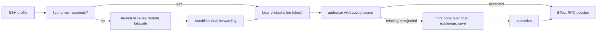

# Remote architecture

A BiBCode server represents one execution environment: the machine, filesystem,
credentials, provider processes, terminals, repositories, and durable server
state reached through that server. Clients may reach the same environment by a
direct endpoint, BiBCode Connect, or desktop-managed SSH without changing the
environment identity.

## Design rules

- One server process represents one environment.
- Access and launch are separate decisions. An endpoint says how to connect;
  SSH may additionally launch or discover a server before creating forwarding.
- `environmentId` is the stable logical routing identity. URLs, tunnel
  hostnames, SSH ports, and labels may change without creating a new logical
  environment, but this ID alone does not identify its persistent store.
- A server's _declared_ environment id is not unique across hosts: every server
  declares `"local"` unless configured otherwise. A client therefore keys a
  saved remote by that host's `storageInstanceId` — `remote:<uuid>` — so a
  paired server can never collide with the client's own local environment or
  with another saved remote. `BearerConnectionTarget.serverEnvironmentId`
  keeps the host's declared id beside it, and the resolver checks the endpoint
  still reports that value on every connect. Entries saved before the two were
  separated carry the declared id in `environmentId` and read `null` here, so
  the fallback resolves them unchanged. SSH and desktop-local targets keep
  taking their ids from the desktop bridge. See
  `docs/plans/remote-servers/2026-09-04-paired-remote-environment-identity.md`.
- A server's declared label is only the default name for a saved entry. A
  headless web-mode server (`bibcode serve`, including one the desktop launches
  over SSH) declares its machine's trimmed hostname, making it recognizable on
  other devices. If the host reports no usable hostname, it falls back to
  "Local". Browser-launching `bibcode start` and bare `bibcode` keep "Local",
  including when `--no-browser` suppresses opening the browser.
  Desktop-mode servers (the desktop's in-process backend and WSL backends
  launched with a bootstrap envelope) keep declaring "Local", and embedders
  that build a `ServerConfig` directly keep its "Local" default. A client saves
  the name when it adds the server (alias, offer name, or descriptor label) and
  may rename that saved entry locally; the saved name never refreshes from, or
  changes, the server.
- Current servers expose the persistent store UUID as `storageInstanceId` on
  direct and BiBCode Connect descriptors. New clients decode an omitted field
  from an older or third-party server as `null`.
- Remote clients use the same HTTP and Effect RPC APIs as local clients.
- Credentials are exchanged for bounded sessions; raw bootstrap credentials do
  not remain in WebSocket URLs.
- The desktop bootstrap credential stands for the host's own WebView, which
  exchanges it on every load and after every backend restart, once for its
  bearer access token and once for its browser-session cookie. Each exchange
  supersedes (durably revokes, closing live connections) every earlier active
  session minted from the desktop bootstrap with the same session method on
  that data root, so the host holds exactly one bearer and one cookie session
  and the paired-client list shows one row per method for it. One-time pairing
  exchanges are never superseded. Two desktop-mode servers
  sharing one data root would therefore supersede each other; the Tauri host
  starts one desktop backend per root, and headless servers have no desktop
  bootstrap.

## Client targets

The connection runtime defines four target types in
[`connection/model.ts`](../../packages/client-runtime/src/connection/model.ts).

| Target                    | Use                                                                                                    |
| ------------------------- | ------------------------------------------------------------------------------------------------------ |
| `PrimaryConnectionTarget` | The server supplied by the current browser or desktop host.                                            |
| `BearerConnectionTarget`  | A manually saved HTTP/WSS endpoint plus a separately stored pairing credential.                        |
| `RelayConnectionTarget`   | An environment discovered through BiBCode Connect and authorized with Clerk plus DPoP.                 |
| `SshConnectionTarget`     | A desktop-managed SSH profile plus a saved standard-scope bearer, used through a desktop-owned tunnel. |

Only bearer, relay, and SSH targets are persisted as saved connection targets.
`EnvironmentRegistry` creates one scoped supervisor per catalog entry and keeps
domain state keyed by environment.

## Advertised endpoints

An `AdvertisedEndpoint` is a connection candidate, not an environment. Its
contract records:

- provider kind: core, private network, tunnel, or manual;
- HTTP and derived WebSocket base URLs;
- reachability: loopback, LAN, private network, or public;
- hosted-HTTPS and desktop compatibility;
- source and availability status.

Contracts live in
[`remoteAccess.ts`](../../packages/contracts/src/remoteAccess.ts), and URL
normalization lives in
[`advertisedEndpoint.ts`](../../packages/shared/src/advertisedEndpoint.ts).
Desktop discovery can add host capabilities such as Tailscale endpoints. One
native address classifier owns usable-unicast admission, advertised reachability,
safe labeling, and default eligibility. Interface enumeration and default-route
ranking both call that classifier, so unspecified, loopback, multicast, and
link-local addresses fail closed. Until the desktop listener is dual-stack,
discovery emits IPv4 candidates only. It normalizes IPv4-mapped IPv6,
deduplicates by address, and ranks a usable private default-route address before
CGNAT/Tailscale and other private addresses. The native bridge publishes usable
interface observations even while its listener is loopback-only; those
off-host observations report `status: unavailable` until the native listener is
wide. This lets the renderer distinguish a private default route from a
public-only or non-default topology before it requests privileged mutation.
Native-managed automatic sharing accepts only a private or CGNAT default-route
observation. Public interface observations are never actionable in a
native-managed topology, including after an unrelated transition has made the
listener wide. A public-only host must use a custom address backed by an
externally managed `bibcode serve` listener or reverse proxy rather than asking
the native exposure command to infer public-listener authority. Public
endpoints in an externally managed topology are never preselected and require
an explicit public-address and firewall warning. Tailscale CLI discovery checks
the packaged Windows, macOS, and Linux install paths before `PATH` and emits only
usable private IPv4 candidates. Stable endpoint IDs include the address and
port, and the user's default is persisted by stable ID rather than array
position.

## Access methods

### Direct bearer access

Legacy manual pairing produces a one-time bootstrap credential and advertised
endpoint. A profile without a pinned host key saves the endpoint separately
from the credential, exchanges the bootstrap at `/oauth/token`, verifies the
returned environment identity, and obtains a WebSocket ticket from
`/api/auth/websocket-ticket`. This legacy route remains available for existing
profiles, but its connection presentation is `unencrypted` with guidance to
pair again.

Pairing links may carry a bootstrap in the URL fragment. Fragments are not sent
to the hosting web server. Compatibility parsing accepts older query-form links,
but newly generated links use the fragment form.

### A page a server served, or a remote client

The web app runs either as the UI a BiBCode server serves for itself
(`bibcode serve --mode web`), which pairs with its own origin through the
browser-session cookie, or as a remote client (the hosted static app) that has
no backend of its own and reaches saved servers with bearer credentials. The
server marks the entry document it serves with
`<meta name="bibcode-served-host" content="<host>">`, where `<host>` is the
request's `Host` authority. It writes the marker only when that authority is
plain (name, IPv4 or bracketed IPv6 characters and a port), and the response
carries `Vary: Host` so no cache serves one host's marker to another. The app
pairs with its own origin only when the marker names the host it runs on,
compared as the browser normalizes it (a forwarded `host:443` matches `host`
over HTTPS).
Without a matching marker it keeps the remote-client behaviour, as before.

- Only the served document can carry the marker; nothing read from the URL or
  storage can supply it. A copy of the document deployed on another origin
  names the wrong host and stays a remote client, so the marker cannot turn a
  remote client's page into one that pairs with its own origin.
- A reverse proxy that rewrites `Host` (and is not a loopback peer whose
  `X-Forwarded-Host` the server applies) gets a non-matching marker. Its page
  falls back to the remote-client behaviour.
- A host-based pairing link (`/pair?host=<other server>#token=…`) keeps the
  remote-client confirmation surface on a served page too, including after the
  token is removed from the URL.
- A served page whose own server is not paired, but that saved other
  environments (for example through such a link), opens as their remote client
  instead of redirecting to `/pair`. So does one whose saved environments did
  not load within ten seconds, since they may hold a server just paired, and so
  does one whose own server cannot be reached or does not answer its session
  check within ten seconds (later navigations then keep that mode until the
  page reloads or visits `/pair`). Until its server is paired, it
  does not add that server to its environments rather than offer one that
  cannot connect. It never removes one already added, since removal discards
  that environment's local data, unsent drafts included. Its own `/pair` route
  keeps the browser-session check.
- The marker selects a mode; it is not authenticated provenance. It does not
  compare the scheme, so the same host over HTTP and HTTPS reads the same
  marker. Choosing the server-session mode grants nothing by itself: the
  browser session still requires that server's own pairing.

### Desktop webview connect policy

The desktop webview's Content Security Policy keeps `default-src` and
`script-src` at `'self'`, but `connect-src` deliberately admits `http:` and
`ws:` in addition to loopback, `https:`, and `wss:`. Remote servers are
user-chosen plain-HTTP endpoints on a LAN or tailnet, and the client reaches
them from the webview with `fetch` for the descriptor and a `ws://` socket for
the encrypted channel; a policy limited to loopback and TLS makes every
Add Server attempt fail as "Server unreachable" before any packet leaves the
machine. `scripts/tauri-hardening.test.ts` pins both halves of that policy.

On macOS a second gate applies: App Transport Security refuses plain-HTTP
loads from web content unless the bundle declares an exception, and it does so
before any packet leaves the machine. `apps/desktop/src-tauri/Info.plist`,
merged into the bundle by Tauri, sets `NSAllowsArbitraryLoadsInWebContent` and
`NSAllowsLocalNetworking` for the webview only (native code keeps the default
policy) and carries the `NSLocalNetworkUsageDescription` shown by the macOS
Local Network prompt. The hardening test pins those keys and rejects the
broader `NSAllowsArbitraryLoads`.

### Served web UI script policy

`bibcode serve` sends `script-src 'self'`, so the served page runs only
same-origin scripts. The static `/theme-bootstrap.js` runs before first paint.
Only content-hashed build assets under `/assets/` are immutable. Other non-HTML
static files, such as `/theme-bootstrap.js` and the icons, use `no-cache` with an
ETag so browsers revalidate them and receive 304 when unchanged. The build still
versions the bootstrap URL with a content hash and rejects inline scripts in
the built `index.html`. The desktop webview has the same `script-src 'self'`
policy, and Tauri ignores the query string when resolving the static asset.

### Direct-connection E2EE

New direct pairings pin a server identity and carry RPC over an encrypted
WebSocket. The server generates one static X25519 responder key on first use and
stores the 64-byte private-then-public record as the secret
`host-identity-x25519` (`host-identity-x25519.bin` in the filesystem-backed
store). Public-key encoding is unpadded base64url of the raw 32 bytes. The public
key is distributed only in pairing codes; the unauthenticated descriptor never
publishes it.

The encrypted route is `/ws-e2ee` and uses
`Noise_NK_25519_ChaChaPoly_SHA256`. The client initiator pins the responder
static key from the pairing code. Both handshake messages require empty
payloads. After the handshake, every binary WebSocket message is one Noise
transport ciphertext containing one record:

- byte `0x00` marks the final chunk and byte `0x01` marks a continuation;
- a chunk is at most 65,518 bytes, keeping ciphertext within Noise's 65,535-byte
  message limit; and
- reassembled logical messages are capped at 64 MiB and at 2,048 records, and
  are exactly the bytes consumed by the unchanged RPC protocol. Empty
  continuations are invalid, so record-object overhead is bounded independently
  of byte count.

Browser clients set the E2EE socket's `binaryType` to `arraybuffer` before the
RPC socket adapter attaches. Ciphertext records therefore enter the Noise
decryptor in WebSocket delivery order without asynchronous `Blob` conversion.

Ordered terminal input uses the same typed RPC inside this channel. Its lease
is scoped to the physical connection lifetime, not the persisted bearer
session, so reconnecting cannot reuse or replay uncertain input. The same
ownership and admission rules apply to plain WebSocket, E2EE, relay, and SSH
connections; see [Ordered terminal input](./rpc-and-orchestration.md#ordered-terminal-input).

The first logical message authenticates inside the encrypted channel. A new
device sends `{"type":"e2ee_auth","pairing":"<one-time token>"}` with no
confirmation field: the **server** decides delivery from the grant it
consumes, so a client cannot opt out of the durable-delivery guard through the
wire message. Only a successful exchange consumes that token; a wrong host or
failed handshake does not reach the exchange. An off-host grant creates a
`pending-pairing` session and consumes the token before the encrypted
credential reply is delivered; an on-host or legacy grant is delivered
immediately as `active`. Pending-session compensation is armed before the
SQLite issuance job is queued, because a queued database call can outlive
cancellation of its awaiting future. A delivery guard then owns that session
until in-channel confirmation. Capacity binding, encoding, encryption, or
socket-write failures schedule
best-effort revocation of the undelivered session. An age-gated sweep — at
startup and every minute — durably
revokes pending sessions older than the two-minute confirmation grace, so a
crash-orphaned unconfirmed credential cannot hold the host's desired exposure
wide until the next restart while a live confirmation is never raced. After
delivery, verification or client-persistence failure closes the channel and
the same guard revokes the delivered-but-unconfirmed session without replacing
the original error. Confirmation owns its database activation through
cached-state publication and delivery-latch publication even if cancellation
drops the RPC handler future. The delivery guard therefore cannot observe an
active database row whose in-memory state and latch still appear pending.
The one-time token remains consumed, so the user generates a new offer, but the
pending credential cannot reconnect as steady-state authority. The server
returns `e2ee_authenticated` with the minted string credential,
`environmentId`, optional `storageInstanceId`, the credential's `scopes` (from
#202; older servers omit them, and a client whose schema predates the field
drops it, since `Schema.Struct` decoding ignores excess keys, which
`remotePairing.test.ts` pins), and
`pairingConfirmationRequired: true` exactly when the grant was off-host. The
reply flag is the client's only confirmation signal: when it is present the
client must call `auth.confirmPairing` on the same channel before the
credential authenticates anywhere; when it is absent the credential is already
active — which is also how a new client interoperates with servers that
predate the confirmation flow. A returning device sends
`{"type":"e2ee_auth","bearer":"<stored credential>"}` and receives an
`e2ee_authenticated` acknowledgement. Either form may carry
`"features":["interleave-v1"]`; the server then confirms the same list in
`e2ee_authenticated` and may send stand-alone `0x02` control records between
the records of a large message. Without the confirmation, control messages
overtake queued data only between whole messages. A client that can decompress
raw deflate (`DecompressionStream("deflate-raw")`) also lists `deflate-v1`; when
the server confirms it, a server message of at least 16 KiB leaves compressed
whenever that makes it smaller: a 4-byte big-endian uncompressed length, then
raw deflate data (level 3, compressed on a blocking thread), split into records
that all carry `0x10` with the final or continuation value. The 64 MiB limit
applies to the uncompressed message on both sides; the client refuses a
declared length above it and output that differs from it, and delivers messages
in arrival order while one inflates. Client messages and control records are
never compressed. Compression before encryption lets message lengths depend on
content, so only large server messages are compressed, each on its own;
`BIBCODE_REMOTE_COMPRESSION=0` in the server environment stops the server from
confirming `deflate-v1`
([design](../superpowers/specs/2026-10-13-e2ee-message-compression-design.md)).
SSH environments and plain remote servers get the same compression on plain
`/ws` through the `bibcode.rpc.chunked-deflate.v1` subprotocol, which the same
switch stops the server from selecting
([RPC and orchestration](./rpc-and-orchestration.md#wire-protocol)).
Invalid credentials receive
`e2ee_error/unauthorized`; malformed protocol receives `e2ee_error/protocol`;
both paths close the socket.

Sessions minted by this route have the signed token claim `transport: "e2ee"`.
Plain WebSocket and authenticated plain-HTTP surfaces reject that credential;
tokens without a transport claim decode as `plain` for compatibility. Client
preparation also sets `httpAuthorization` to `null` for a pinned profile, so an
E2EE-only credential is not exposed as a usable HTTP authorization capability.
File transfers use token-in-path URLs for the same reason asset previews do,
so they work on every profile. On a pinned (E2EE) profile whose endpoint is
plain `http://`, Files panel downloads and uploads (`/api/transfers/<token>`)
and asset previews (`/api/assets/<capability>/<path>`: chat images, project
icons, and HTML or PDF files opened in the integrated browser) travel outside
the Noise channel, and only the RPC that issues their URLs is encrypted, so
anyone on the network path can read and alter their contents, read the
workspace paths encoded in those URLs, and reuse a captured URL until it
expires (five minutes for transfers, one hour for previews).

Pre-auth work is bounded independently of normal RPC traffic. The complete
upgrade, handshake, and authentication sequence has one 10-second deadline;
the WebSocket upgrade caps both frames and reassembled WebSocket messages at
65,535 bytes before application buffering; the authentication logical message
is capped at 64 KiB; at most 32 unauthenticated E2EE connections may be in
flight. A non-loopback socket peer may hold at most four leases, consumes a
token bucket with burst eight and one-attempt-per-second refill, and shares a
network bucket with its IPv4 `/24` or IPv6 `/64`; one network may consume at
most 16 of the global leases. Buckets that already hold a connection may only
grow while global usage stays at or below the 24-lease soft cap; the eight
slots above it are reserved for a bucket's first connection, so a fresh
legitimate device still finds room while a small number of hostile networks
saturate their own buckets (a wide-prefix holder taking the reserve with many
distinct first-connections remains bounded only by the hard global cap — the
documented residual). Loopback sockets are the local trust boundary: when one
carries `X-Forwarded-For`, the last entry — the hop appended by that
implicitly trusted local reverse proxy — keys per-peer and per-network
admission as if the client had connected directly, an unparseable value falls
into the strict unspecified bucket, and remote sockets never have forwarding
headers honored. Loopback peers without the header form the
trusted-local-forwarder class, exempt from the public exact-peer and subnet
caps but still subject to the global limit and to a fleet-sized token bucket
(burst 32, refill 8 per second). Missing peer information uses one strict
unspecified bucket. Peer and network entries expire and remain hard-capped;
for every non-loopback socket the kernel peer address is authoritative. Non-empty handshake
payloads fail the protocol. Failure to decrypt the first handshake message
closes with code 4403, which a pinned initiator classifies as a host-identity
mismatch. Encrypted writers iterate one plaintext record at a time, encrypt it,
release the channel lock, and await its bounded write before producing the next
record. The receiver reuses one bounded decrypt scratch buffer. Transport cipher
nonces are monotonically increasing 64-bit counters. V1 does not rekey:
exhaustion or any AEAD/protocol error fails closed and requires a new connection.

Authenticated receivers additionally share a process-wide 128 MiB plaintext
budget. Each authenticated session ID has a 64 MiB aggregate budget across all
of its sockets, and each connection retains its separate 64 MiB offender limit.
The process and principal tiers use cancellable fit-first byte admission:
capacity pressure waits until capacity, cancellation, or session shutdown and
is not itself a protocol violation. Every non-empty decrypted chunk holds its
permits through assembly, decoding, authorization, and dispatch. The permits
are released before a spawned request handler completes, so a long-running RPC
does not retain reassembly capacity. Zero-byte chunks retain no permit. Every
logical inbound message additionally carries one absolute, size-derived
assembly deadline established at its first record — the base five-second
timeout plus one second per 64 KiB received, mirroring the outbound writer's
floor — and byte admission for every record, including the first, is bounded
by it. A compliant sender at or above the floor rate is never cut off, while
neither a dribbling sender nor pool pressure from other principals can park a
pump or the global pool indefinitely: capacity waits fail at the message's own
deadline instead of inheriting whatever sliver remains of a progress window.
Once a continuation starts an incomplete logical message, the next record must
also be received, decrypted, validated, and charged within the resetting
10-second progress deadline, which continues to cut idle senders early. An
idle authenticated connection between messages has no assembly deadline.
Session teardown joins in-flight request handlers under a bounded deadline and
aborts stragglers, so a handler that ignores cancellation cannot pin the
session or the budget permits riding on it. No channel mutex or second
ciphertext-frame read is held while capacity waits.

Established-socket admission is likewise partitioned. At most 64 E2EE sockets
are established process-wide, and one authenticated session ID may own at most
32 of them; unsafe no-auth development sockets remain subject to the global cap.
The global reservation is taken before credential exchange, then bound to the
authenticated session ID (the persisted session, not the human subject). The
resulting lease owns both permits until the
session ends, so handshake/authentication rejection, timeout, socket error,
session cancellation, revocation, nonce or AEAD failure, shutdown, and ordinary
close all return capacity through the same drop path. The principal budget map
holds only weak entries and prunes inactive identities while admitting a later
connection.

Established E2EE RPC output has a process-wide 128 MiB plaintext budget and a
64 MiB per-connection budget. The generic session encodes each response
exactly once, drops the JSON value tree, then admits the exact encoded length
through one process-wide combined fit-first queue, reserving both byte permits
in one critical section — the memory resident during the admission wait is
precisely the bytes that will be charged. It never sleeps while retaining only
one tier. (Guarded activity responses still reserve an upper bound covering
their possible fallback substitution and shrink after preparing.) The queued
frame owns those permits
through Noise record encryption and every successful or failed WebSocket
write;
generic queue capacity therefore cannot hide additional plaintext. Unary
results, stream chunks, handler-error terminals, and defects use the same
admission path. RPC `Pong`, interrupt exits, `RpcOutboundAdmissionError`
terminals, and client protocol errors bypass byte admission through the
connection writer's bounded control lane, which holds one small control message
per in-flight request plus room for Pongs; a full lane drops a `Pong` instead
of ending the read loop. When a budgeted terminal or unary response loses its
admission deadline, the session delivers that explicit `RpcOutboundAdmissionError`
terminal instead of ending the request silently. A control message larger than
one record keeps ordinary byte admission on the data queue and still never
counts as write progress. WebSocket-level ping/pong frames are
transport control and carry no RPC plaintext. A response larger than the
64 MiB connection cap fails only its own request with a typed
`RpcResponseTooLargeError { method, bytes, limitBytes }`, and the session stays
open; otherwise both
connection and process byte admission plus the bounded 64-entry response queue
share one absolute five-second admission deadline. Granting is push-based:
waiters sleep on their own grant channel and every release runs one fit-first
pass, so admission work per release is one queue scan rather than one scan per
waiter. Fit-first grants every queued request that fits in arrival order, and
once the front waiter has waited one second, released process capacity
accumulates in a reservation for it until it is granted — sustained small
traffic therefore cannot starve a large response, and the resulting pause for
younger waiters is bounded by the front waiter's own size rather than being an
open-ended blockade. Cancellation removes the waiter and refunds both a
concurrently granted reservation and any accumulated aged-head reservation
exactly once. The connection's one writer task encrypts and writes one record
at a time: each Noise record must be accepted by the socket within 20 seconds,
and the whole logical message within 30 seconds plus its size at 16 KiB/s. When
either deadline passes, the writer ends the session at once.
Dropping a queued, cancelled, rejected, serialization-failed, encryption-failed,
or write-failed frame releases its single permit set without double accounting.

An E2EE socket follows the shared heartbeat rule in
[RPC and orchestration](./rpc-and-orchestration.md#wire-protocol) once
`e2ee_authenticated` is sent (pre-auth keeps its 10-second deadline): a
WebSocket Ping every 15 seconds between records, and reaping after 45 seconds
without an inbound frame or a data write that waited on the peer, checked every 5 seconds. Reaping
an E2EE session frees its permits, live-connection row, and subscriptions.

Together, these limits preserve the 65,535-byte ciphertext record ceiling,
65,518-byte plaintext chunk size, and 64 MiB logical-message contract.
Established and inbound admission are principal-partitioned so one session
cannot consume all of either resource. Outbound admission instead bounds
aggregate retained plaintext; it is intentionally process/per-connection rather
than principal-partitioned. Fit-first admission prevents large queued
reservations from blocking smaller messages that can make progress, while the
aged-head reservation guarantees the reverse: a large response eventually wins
even under sustained small traffic. A large reservation that never fits fails
at the shared admission deadline with an explicit terminal.

The pairing payload is base64url-unpadded JSON in
`bibcode://pair?code=<payload>` with version, endpoint, display name, one-time
token, host public key, reach intent, and persistent storage identity. An
authenticated caller with `access:write` mints it through
`POST /api/auth/pairing-offer`. `Idempotency-Key` makes identical retries return
the original offer and rejects reuse with different input. Entries are scoped
to the authenticated principal and persisted in
`auth_pairing_offer_idempotency`. The pairing grant and a pending principal/key
reservation commit in one SQLite transaction; the encoded result completes that
reservation before the HTTP response is sent. A young pending reservation is
never treated as abandoned: another live server returns a retry failure while
the owning request is still encoding, then replays the recorded winner after it
commits. After the two-minute crash-recovery grace, a matching retry atomically
revokes the incomplete grant, removes the stale reservation, and returns the key
to fresh issuance. A fingerprint mismatch still fails and a cancellation
tombstone still blocks issuance.
Active results, pending reservations, and tombstones hydrate before capacity
checks and remain under bounded, expiring caps: 128 live entries per principal
and 4,096 globally. Expired rows are pruned at startup and inside every
reservation or cancellation transaction. For a persisted server, one immediate
SQLite transaction is the authority for a principal/key lookup, an existing or
pending result, admission under both caps, and the new pairing-plus-reservation
write. Simultaneously live services therefore return the persisted winner (or a
bounded retry failure while that winner is pending) rather than treating a
process-local cache miss, a young peer-owned reservation, or stale capacity
count as authority.
Pairing, pairing-offer, and session capacity constants live together in
`apps/server/src/auth/limits.rs`; persistence and the in-memory authority consume
that policy rather than mirroring numeric limits.
An authenticated `POST /api/auth/pairing-offer/cancel` names the same key. It
atomically revokes the mapped pairing grant and stores an expiring tombstone,
so cancellation remains safe after a lost response, across a process restart,
and before a delayed create reaches the issuance lock. A cancelled key cannot
mint or replay an offer. New tombstones obey the same durable per-principal and
global caps; replacing an existing keyed row does not consume another slot.
The server validates that `this-computer` uses loopback, `another-device` does
not use loopback, and that no offered endpoint is wildcard or port zero. Reach
is embedded in the code and persisted with the grant as described below.

The add flow parses and classifies the endpoint, fetches the public descriptor,
performs the pinned handshake and in-channel pairing, and calls authenticated
`server.getConfig` before saving anything. When the server requires pairing
confirmation, the new session is persisted as `pending-pairing`: the bootstrap
channel may verify RPC identity, but the delivered bearer cannot establish a
steady-state reconnect yet. The client
compares the in-channel environment and storage identities with both the pairing
payload and descriptor, registers the verified profile and credential, accepts
the storage identity, then calls the empty `auth.confirmPairing` RPC on that same
channel. The pending session confirms its own delivery through the session
capability gate; any other caller needs `access:write`. Confirmation derives
the session ID from the authenticated context and idempotently commits only
that session to `active`; the server owns the durable commit through in-memory
publication and delivery-latch publication even if the RPC future is
cancelled. Only the persistence writes and the confirm RPC itself run
uninterruptibly; everything after them is cancellable, and pairing opens no
additional verification socket: the registered environment supervisor connects
with the saved credential, and its state is the bearer proof. A successful
confirmation is conclusive by itself and wakes the supervisor without waiting.
After an ambiguous confirmation (transport loss, interruption, or an
unexpected response — dispatch may have committed), the client watches the
supervisor's state for a bounded window: a connected supervisor proves the
commit; a supervisor blocked on authentication, host identity, or a changed
storage identity conclusively refutes the credential, and the client rolls
back the saved entry and reports the pairing rejected instead of saving a
permanently dead entry; anything else keeps the durable local authority and
leaves recovery to the supervisor, which exposes any blocked or reconnecting
state. Typed confirmation rejections and the exact unknown-method response
from a server that required confirmation are definitively inactive and roll
back immediately. Compatibility is additive: a server that never requires
confirmation delivers an active credential, and the client's confirm call is
idempotent there; the exact unknown-method defect from a truly older server is
treated as that legacy delivery.

Registration, identity persistence, or definitive pre-activation confirmation
failure rolls back local writes best-effort before the bootstrap scope closes.
Registration removal is conditional on the exact registration still owning the
environment, and identity rollback restores or removes the prior value only if
this attempt's value is still current. Concurrent replacements therefore win
intact. Closing before confirmation revokes the pending server session; the
age-gated startup and periodic sweeps revoke crash-orphaned pending sessions
only after the two-minute grace. A confirmed session survives reconnect and
restart. Failures are classified as `unreachable`,
`host-identity-mismatch`, `pairing-rejected`, `incompatible`, or
`duplicate-storage-identity`, and cleanup copy reports any local compensation
failure. The client does not claim transparent retry with the same one-time
code.

### Command-line diagnostics pairing

`bibcode diagnostics pair` and `bibcode diagnostics download --remote` (#202)
are the one production Rust client of `/ws-e2ee`
(`apps/server/src/rpc/e2ee_client.rs`; design in
`docs/superpowers/specs/2026-10-27-cli-pairing-design.md`). The command pairs as
its own device and holds no connection between runs.

- **Credential.** The remote mints the offer with `bibcode pairing offer
  --access diagnostics` (or the pairing-offer route with
  `scopes: ["diagnostics:read"]`); its grant holds only `diagnostics:read`,
  which allows no method other than `server.downloadDiagnosticLogs` (plus
  `auth.confirmPairing` for its own pending pairing), and is
  labelled `<name> (diagnostics)`. `pair` keeps the credential only when the
  pairing reply's `scopes` are exactly `["diagnostics:read"]`; a wider grant,
  or a server that sends no `scopes`, is refused before anything is written,
  and closing the unconfirmed channel revokes the pending session as for any
  client.
- **Client.** It opens `ws(s)://<offer endpoint>/ws-e2ee` (the path replaced,
  as the web client does; no proxy, no redirect), runs Noise NK pinned to the
  offer's host key with empty payloads, and treats close code 4403 as a host
  identity mismatch. It offers no channel features, so only `0x00` and `0x01`
  records are valid; it refuses empty continuations, more than 2,048 records,
  and logical messages over 1 MiB (the pre-auth reply over 64 KiB). Requests
  use the same `ClientMessage`/`ServerMessage` types as the server, and each
  stream chunk is acknowledged only after its items were accepted. An `https`
  endpoint uses rustls with the operating system's verifier (as `reqwest`
  does).
- **Pairing order.** Pinned handshake, `e2ee_auth{pairing}`, the scope check,
  the in-channel `storageInstanceId` against the offer's, then the record is
  written (create, never replace), then `auth.confirmPairing` on the same
  channel when the reply asks for it. A typed refusal deletes the record. A
  lost answer is settled by one bearer reconnect: authenticated keeps the
  record, `unauthorized` deletes it, anything else keeps it and says so. The
  whole attempt, from the name check through any rollback, holds an advisory OS
  lock on `<name>.lock` in the store directory (`flock` on Unix, `LockFileEx`
  on Windows), as does `forget`; the system releases it when the holder exits,
  crashed or not, so a dead holder never blocks the name. A `forget` and
  re-pair of the same name therefore waits for a pairing in progress. Under
  the lock, a rollback reads the record and deletes it only if it holds this
  attempt's random pairing id; nothing is ever moved aside, so a crash leaves
  the record readable under its name. A rollback that cannot delete the record
  exits 1 with `rollback-failed` and names `bibcode diagnostics forget <name>`.
  A record whose
  write succeeded but left a temporary link behind counts as stored and is
  confirmed; the leftover file is reported.
- **Storage.** One record per remote in
  `<state dir>/diagnostics-remotes/<name>.bin` through `auth::SecretStore`
  (directory 0700, files 0600 on Unix, owner-only ACLs on Windows): endpoint,
  host key, environment and store ids, the remote's name, pairing time, the
  pairing id, and the credential, which is never printed. `forget` deletes the
  record only.
- **Download.** Bearer `e2ee_auth`, then `server.downloadDiagnosticLogs` with
  an empty `frontendLog`. `Started` must name the stored `storageInstanceId`
  and `environmentId` before any byte is kept, then the archive checks shared
  with the relay path (`diagnostics/archive.rs`) apply: 20 MiB, each item's
  encoded length against the 64 KiB item bound and the bytes still expected
  before it is decoded, the exact total, the inner `manifest.json`, and a
  publish that never replaces a file. Redaction, the size limit and the
  crash-dump scope check are the remote's own, unchanged.

### Remote Servers settings and pairing entry points

Settings exposes remote connectivity at `/settings/remote-servers` as **Remote
Servers**. `/settings/connections` redirects there. On Windows desktop, WSL
backend controls remain in **Local environment** at
`/settings/local-environment`.

The **Connect to a host** tab lists saved servers with connection status,
version, compatibility, and transport security. **Add Server** accepts a
pairing code first, keeps manual endpoint-and-token entry under **Advanced**,
and presents SSH as a first-class desktop option. BiBCode Connect relay rows
remain part of the same tab. The **Share this host** tab owns exposure and
pairing-code generation for the primary environment.

Settings pages read and write the primary server's settings. Each remote server
keeps its own persisted settings, and nothing in Settings edits those copies.
**Default Agent** is therefore a primary-server setting for projects on every
server. Create Worktree and Add Project read it through `usePrimaryDefaultAgent`
and apply it to the project's own server. That server's provider list and
provider settings decide which agents can start there.

Create Worktree:

- **Fallback:** when the default agent is unavailable on that server, the
  dialog falls back to the first ready chat and says why.
- **Waiting:** the dialog waits, and says why, until all of these hold. Waiting
  avoids creating a thread whose provider runtime would reject the first launch.
  - The server's connection phase is `connected`. A server whose session
    dropped keeps its last config snapshot, so the phase is checked first.
  - The server's config has arrived.
  - At least one agent is ready on that server.

Add Project never waits for an agent, because there is no picker to explain the
wait and first-time users add a project before they sign in:

- It still needs the server's config to read host information.
- It opens Main on the default agent when it is ready on the server, and
  otherwise on the first ready chat.
- With no ready agent, it records the default agent's provider instance as the
  project's model selection instead of a built-in Codex fallback.

Hosted `/pair` parses and normalizes its destination once before rendering or
network access. URLs with a non-empty username or password are rejected; the
confirmation displays the normalized `URL.host`, including punycode and an
explicit port, and submission uses the same normalized base URL. Both `/pair`
and the Remote Servers settings route remove a legacy query-string `code`
immediately after retaining it for the current add attempt. Saved profiles
normalize a missing, empty, or whitespace-only `hostKey` to `null` at the
catalog boundary, so only a non-empty key selects E2EE.

Connection persistence is monitored before the connection runtime starts. An
IndexedDB `VersionError` exposes an explicit destructive reset dialog that lists
the saved profiles, credentials, host identities, and cached connection state
that will be deleted. Reset requires a separate acknowledgement, so the second
click of a double-click cannot confirm destruction, and **Reload** remains a
safe alternative. IndexedDB reports blocked deletion as queued rather than
cancelled: the dialog stays pending, asks the user to close other BiBCode tabs or
windows, and observes the original request until it succeeds or errors. Generic
unavailability remains non-destructive. The app reloads automatically only
after deletion actually succeeds.

### Remote server updates

The typed update surface consists of `updater.activeWork`, `updater.status`,
`updater.check`, and `updater.install`. `updater.activeWork` returns
`{runningTurns, liveTerminals, queuedMessages}` counted across all clients through
its own read method so the one-second status poll never waits on the store; a
failed count answers the typed `RemoteUpdateActiveWorkError`.
Successful status, check, and install calls return a snapshot containing
`serverVersion`, nullable `latestVersion`, lifecycle `state`, nullable `error`,
and `support` (`installMode`, `reason`, and `installKind`: `archive`,
`system-package`, or `unknown`). The additive snapshot fields `downloadPercent`,
`targetVersion`, and `installStage` decode-default to `null`, and
`support.installKind` decode-defaults to `unknown`. Stages and kinds decode as
plain strings; unknown stages get a generic label. No new `state` literal was
added because an older client's literal decode would reject it. A server that
cannot install on behalf of the caller rejects `updater.install` with
`RemoteUpdateInstallError` code `remote_update_manual_required`. The TypeScript
wire contract is `packages/contracts/src/remoteUpdate.ts`; its Rust mirror and
state owner are in `apps/server/src/remote_update.rs`.

The well-known descriptor, `server.getConfig`, and the Connect/relay descriptor
all embed `remoteUpdateSupport`. Clients render update controls only when the
additive, default-false `remoteUpdateControl` capability is true. All three
descriptor producers also publish `bootId` and the default-false
`remoteUpdateProgress` capability, which advertises the snapshot's progress
fields, `bootId`, and `updater.activeWork`. The Remote
Servers settings page checks all capable saved environments through
`packages/client-runtime/src/state/remoteUpdates.ts`, with at most two requests
in flight. Each environment check has one 30-second Effect deadline around the
whole lazy operation, including supervisor acquisition, readiness, and RPC
execution. Timeout interrupts that work and releases its fan-out worker.
Disconnecting a registered but cold environment is a no-op and never creates a
supervisor merely to disconnect it. One failed or offline environment never
cancels or blocks the rest of the batch. A last-known `update-available`
snapshot also turns that environment's rail dot amber.

Each environment's update badge
(`apps/web/src/components/settings/ServerUpdateBadge.tsx`) combines the
`updater.status` query with the environment's shared check state, and keeps
apart the states that used to share one label:

- **Checking…** while a check runs (started from any view), while the first read
  is in flight, or while the host is checking its feed.
- **Not checked yet** for an `interactive` or `supervised` host still at `idle`.
  A desktop host starts every launch at `idle` and runs its own first check about
  15 seconds later. The card's **Check for updates** and the settings row's
  **Check** remain the explicit next step.
- **Can't reach updater** when a status read failed over a live connection, with
  the error as a tooltip and a **Retry** that re-runs the read.
- **Check failed** when the latest check failed over the current connection,
  with the reason as a tooltip. The card offers **Check again** beside the badge;
  a settings row relabels its own **Check** button **Check again**. The host's own
  activity (checking, downloading, installing) shows instead while it lasts.
- **Update status error** for an error the host's updater recorded, with the
  host's message as a tooltip and the same **Check again**.
- **Manual updates** for a `manual` host, and **Up to date**, **Update to v…**,
  or **Updating…** (downloading or installing) for the rest.

The `run` family in `createRemoteUpdateEnvironmentAtoms` retains one single-flight
update run per environment, owned by the Atom runtime, so closing a view does not
cancel it. At most two runs execute at once; a third shows **Queued**. The `update`
command drives `packages/client-runtime/src/state/remoteUpdateCoordinator.ts`
through a scoped follower that tracks both supervisor identity and connection
generation through a restart, with no RPC spanning it. Identity comes from the
current connection's initial config. The coordinator caps reads at 10 seconds,
the install request at 30 seconds, download at 10 minutes, installation at
2 minutes, and restart at 3 minutes. It asks the supervisor to retry only in
backoff, at most every 5 seconds; a blocked connection ends the run with its
failure message. It never reconnects an environment the user disconnected:
an unreachable host ends as "hasn't come back". `dismiss` clears a terminal run
and leaves an active run alone.

`createRemoteUpdateEnvironmentAtoms` in
`packages/client-runtime/src/state/remoteUpdates.ts` owns the check state: the
`check` command records its own progress and, stamped with the connection
generation it started on, a failure that arrived over a live connection. The
next successful check clears it, and a failure is shown only while that
connection generation is still the live one, so it disappears while the
environment is offline and after a reconnect. A read or check that only lost
its connection (`RpcClientError`, `EnvironmentRpcUnavailableError`, or an
interruption; see `isRemoteUpdateConnectionFailure`) brings no news: the badge
keeps its last snapshot instead of flashing a failure during a host restart,
when the session is cleared before the connection phase changes. While an
environment is not connected the badge likewise keeps its last snapshot, or
shows nothing, because the connection status already says why nothing can run.

The query atom re-reads itself while any view observes it, with one timer per
environment (`remoteUpdateStatusRefreshIntervalMs`): every 2.5 seconds while
the host is `checking`, `downloading`, or `installing`, and every 30 seconds
while an automatic host is `idle`. Terminal states, manual hosts, and failed
reads are never polled; a reconnect re-reads at once through the connection
generation. The environment rail observes the status of every update-capable
remote for its amber dot, so those hosts are polled while the sidebar is open
even when no badge is visible; that is bounded, because a desktop host leaves
`idle` about 15 seconds after it launches.

The update feed URL is baked into the desktop release configuration only
(`apps/desktop/src-tauri/tauri.release.conf.json`); the server binary has no
feed access. A `manual`-mode server therefore never reports a `latestVersion`:
the snapshot is honest about what the server can know, and manual-mode UI copy
instructs the operator instead of guessing. Teaching servers a feed URL is a
possible future extension, deliberately out of scope for v1.

On a desktop-integrated server, every call to the hosting updater delegate is
bounded to 30 seconds. A delegate that does not answer produces a successful
typed snapshot with `state: "error"` and the updater-timeout message, including
for an install request; it cannot pin an environment's single-flight update
operation indefinitely. An install request starts the host's check, download,
and install flow in the background and answers with the host updater's current
state, never a predicted `installing`. If the feed has nothing newer the host
records `up-to-date`, and a failed download records `error` with the updater's
message; clients see both through `updater.status`
(`apps/desktop/src-tauri/src/remote_update_delegate.rs`). The desktop keeps the
requester as `requestedBy` on its update state while the flow runs, clears it
when the flow ends, and joins a second remote request to the running flow.
The delegate fills `downloadPercent`, `targetVersion`, and `installStage`; a remote
install stopped by a secondary environment's protection says "Finish the update
on the host." A client following a run keeps polling `updater.status` through
`update-available` until the flow settles.
Plain authenticated WebSockets enter the live-client
registry only after the HTTP upgrade completes, and unregister from the same
upgrade-owned lifecycle.

Settings rows and the sidebar card start updates through the web runtime's one
confirmation-request Atom. `AppRoot` hosts `UpdateServerDialog`; counts are read
only while it is open and `remoteUpdateProgress` is advertised. Counts are
advice, so a failed or pending read never prevents confirmation. **Retry** from
a row, card, or outcome toast asks again with fresh counts. The shared run
survives closing either view. Rows and cards stop observing their status query
while a run is active; the rail's existing status observation remains bounded.
Progress replaces the action, a failed row offers **Retry** and **Dismiss**, and
a failed card retains **Retry** beside its explained badge.

**Settings → Providers → Update all…** is a third starter. Its one confirmation
lists, beside each environment's provider updates, the server install of every
connected remote environment whose snapshot reports `update-available` from an
automatic installer, with `remoteUpdateConfirmation` lines and the same
`updater.activeWork` counts; a `manual` host there is named as skipped with the
manual copy. The primary and desktop-local environments never get a server
install from it, so it never restarts this app. After confirmation it runs the
same `update` command for an environment only once that environment's
`server.updateProvider` calls have settled as updated, and never after a failed,
unchanged, or unconfirmed one, so it cannot restart a host under its own
provider install. The install joins the environment's shared `run`, so its
Remote Servers row shows the same progress
([providers](providers.md) describes the provider half).

Manual hosts expose **Show update steps**, using install kind, host OS and
architecture, and SSH launch state. Windows archive checks use PowerShell;
SSH steps require verifying the current server before stopping it. There is no
invented latest version for a manual host.

The host renderer announces `requestedBy` once per install with **Manage
devices**, which opens **Share this host**. Missing device addresses are omitted
from user copy. Browser mode records its primary server's first boot and offers
**Reload** after a changed boot/version; it never reloads automatically, so
unsent input stays intact until the user chooses.

### Share ceremony and exposure

The Share tab mints the complete pairing payload on the server through
`POST /api/auth/pairing-offer`. Each minted grant records its `reach` intent and
a mint-time `off_host` classification. The classification comes from the
validated offered endpoint, so a loopback custom address used through an SSH
tunnel remains loopback while a custom LAN or public address is off-host for
trust and audit presentation. A session created by consuming the grant inherits
both fields. Reach also owns exposure authority: `another-device` is the only
intent allowed to request native listener widening. Every `custom` address is
externally managed, so its ceremony and later access revisions never invoke the
native exposure bridge.

The server is the source of truth for desired exposure.
`GET /api/auth/share-state` derives `wide` only while at least one unrevoked
pairing link or client session has both `reach = another-device` and
`off_host = true`; it otherwise derives `loopback`. `offHostGrantCount` still
counts every active off-host grant, including externally managed custom grants,
so trust and audit presentation does not erase their reachability. Every native
exposure reason counts regardless of access method, including
`browser-session-cookie`, `bearer-access-token`, and `dpop-access-token`; an
unrevoked `pending-pairing` session also retains the reason during client
verification and persistence. Consuming an **Another device** browser pairing
link therefore replaces the one-time-link reason with the browser-session reason
instead of narrowing and disconnecting the newly paired browser. Unknown or
legacy null reach metadata never grants native widening authority.

Every fresh desktop process starts the actual primary backend local-only under
the native `ServerExposureCoordinator`, regardless of a previously persisted
wide setting. Once authenticated, the renderer compares authoritative share
state with actual runtime topology and requests a widen only when a live native
exposure reason exists. One coordinator serializes exposure applies and every
other settings mutation that can restart the native or WSL topology. Those
non-exposure mutations preserve the actual runtime exposure across their
restart instead of reapplying a stale durable mode. Widening uses an
ephemeral launch override, verifies a network-accessible advertised endpoint,
opens the program-scoped `BiBCode Remote Access` Windows Firewall rule, and
persists network-accessible only after those native side effects succeed. Any
failure attempts every local safeguard even if an earlier recovery step fails:
persist local-only, restart with a local-only override, close the firewall, and
stop an unverified backend. Narrowing persists local-only first, restarts and
verifies local topology, then closes the firewall; it never restores durable
wide state as compensation. On Windows, closing reads the persistent
firewall store, removes only the named BiBCode rule, and reads it again to verify
absence. A named `netsh` query that fails without returning that rule is absence
in every display language only after `netsh advfirewall show allprofiles state`
succeeds; a failed policy read stays incomplete cleanup. Firewall commands run
through the shared supervised process runner with a 15-second process timeout, a
64 KiB truncated-output bound, and kill/reap ownership for the process tree. A serialized firewall worker additionally gives
each caller a five-second deadline that includes spawn. Its bounded desired-state
coalescer retains at most one in-flight job and the latest pending state; a newer
pending request releases the superseded caller with an explicit saturation
error. The worker retains a late job after its caller returns; a late successful
enable is followed by a verified delete, and the latest pending firewall state
waits behind that cleanup so a timed-out add cannot become the final state. A missing rule is successful
only after its absence is verified; process, policy, and verification failures
propagate to the coordinator and are reported as incomplete cleanup. The
persisted desktop setting records the last completed transition but is neither
proof of actual topology nor permission to start wide.
Creating a **This computer only** grant or any **Custom address** grant never
widens a later launch, and there is no independent manual exposure toggle.

A fresh start with only legacy null-reach grants remains local-only. If the last
completed native configuration was network-accessible, the Share tab shows an
explicit **Resume legacy remote access** action; it never silently widens.

This coordinator governs only a native primary. When Windows desktop is in
WSL-only mode, the Share tab chooses an available WSL-owned advertised endpoint
and neither the offer ceremony nor the reconciler calls the native exposure
bridge. The reported exposure management mode is `external`: WSL/Hyper-V routing
and firewall policy remain an operator responsibility rather than an implied
desktop guarantee. Entering WSL-only first converges native exposure to
persisted and verified local-only state and closes the Windows firewall rule,
then switches topology under the same coordinator. Leaving WSL-only starts the
native topology explicitly local-only and lets authoritative share-state
reconciliation decide whether a later widen is justified. The privileged
exposure operation rereads authoritative desktop settings inside the coordinator
and rejects native transitions while WSL-only is active.

Compatibility grants whose persisted reach and off-host fields are `NULL`
never cause an automatic widen. While any unrevoked legacy one-time-token grant
remains, they do block automatic reversion from an already-wide bind. The Share
tab identifies that condition and tells the user to revoke or re-pair those
clients. Otherwise, the renderer checks share state at startup and after every
auth-access revision. It widens a local-only runtime only when the server
currently reports a live native exposure reason, and switches a wide runtime
back to loopback when the last reason is revoked. After narrowing it reads share
state once more. If a concurrent new native exposure grant appeared during that
operation, it performs one compensating widen; later revisions schedule a fresh
reconciliation rather than creating an internal loop.

Revoking a client invalidates its credential and actively cancels every live
plain or E2EE WebSocket registered to that session. Revoking all other clients
does the same for each affected session. Exposure changes still use a backend
restart: live local connections and running turns drop, while committed SQLite
state and other durable server state survive. After bounded mint attempts fail,
the share ceremony makes up to three bounded cancellation attempts with the
same principal-scoped idempotency key. This revokes a grant whose successful
response was lost, or tombstones the key ahead of a delayed create. Whether
cancellation succeeds or fails, an attempt that widened native exposure runs
cleanup against authoritative share state. A possibly live offer or another
native-managed reason keeps the host wide; authoritative absence narrows it,
so a failed cancellation alone cannot strand an otherwise reasonless wildcard
bind. Cleanup reports exactly one of four outcomes: local-only was confirmed,
another live reason correctly kept the host wide, cancellation and cleanup
were both unconfirmed, or cleanup failed and topology could not be verified.
No copy promises narrowing without the local-only confirmation. The direct
path does not depend on an auth revision event that may never arrive. The UI
distinguishes a successful cleanup with local-only confirmation from the other
outcomes, while the startup/revision reconciler remains a backstop. A failed
reconciliation pass retries up to three passes at five-second intervals; the
terminal failure surfaces a warning toast. Mount and topology generation state
gate work only before the first privileged apply. Once a local-only apply
commits, its authoritative share-state refetch and, when needed, one
compensating widen use the captured bridge and must finish even if the
initiating view unmounts. Every successful apply must return the requested
actual mode; later revisions schedule fresh reconciliation.

Every auth-authority mutation increments the singleton
`auth_authority_state.revision` in the same SQLite transaction. Each live
`AuthService` owns at most one convergence watcher while it has a cached active
grant or session, a registered live connection, or a `subscribeAuthAccess`
receiver. The watcher checks only that scalar every 250 ms when authority is
unchanged; it reads and decodes one coherent, read-only pairing/offer/session
snapshot only after the revision changes or the snapshot's nearest active
expiry is reached. It stops after the final authority consumer disappears and
uses a release-and-recheck handoff so a concurrent subscriber or grant cannot
lose watcher ownership. Thus a committed change on another live service is
eligible for reconciliation on the next 250 ms check (plus the bounded SQLite
queue/read), without a poller per socket or repeated full-table scans on idle
ticks. Reconciliation cancels removed sessions' local connection tokens while
holding the service state lock and before publishing access changes, so an
already-ACKed stream closes before later authority events are admitted. Local
revocation still cancels immediately without waiting for the watcher.
Live-connection registration arms its RAII guard immediately after the
in-memory count and cancellation token are published, before awaiting SQLite
connected-state persistence. Cancellation or persistence failure therefore
removes the token and count even when the database job remains queued.

Each pairing-offer create attempt and cancellation has a five-second deadline
at both the primary HTTP Effect and ceremony boundary. The HTTP deadline
interrupts the underlying request; the outer deadline also bounds injected or
test transports that never settle. Five create attempts remain separated by
the existing two-second backoff. A blackholed response therefore reaches the
explicit cancellation/cleanup result instead of leaving the renderer waiting
indefinitely after a native widen.

Privileged native exposure mutations are not raced against those renderer HTTP
deadlines. The renderer awaits the serialized native coordinator to completion,
whose restart, process, firewall, and cleanup operations own their own bounded
deadlines. This prevents the UI from reporting a failed transition while an
uncancelable desktop command later commits a wide topology.

The HTTP maintenance API stays hidden on a wide-bound native primary. The
desktop protects its in-process primary directly, so update protection works
the same while sharing.

Pairing links converge on that Add Server flow. Web clients accept
`/pair?code=...`; desktop bundles register `bibcode://pair?code=...` with the
Tauri deep-link plugin and use the single-instance plugin to route links to the
running application. Both entry points open Remote Servers with the code
prefilled. macOS scheme registration happens when the application bundle is
created, so custom-scheme links cannot be validated against an unbundled dev
process.

A saved direct bearer profile with a non-null `hostKey` always selects
`/ws-e2ee`; no `/oauth/token` or `/api/auth/websocket-ticket` request is made.
A profile whose additively decoded `hostKey` is null, empty, or whitespace is a
legacy `/ws` profile.
Relay and SSH selection is unchanged. `connectionTransportSecurity` is the
single presentation policy for `e2ee`, `unencrypted`, `channel-secured`, and
`local` badges.

Plain `/ws` explicitly caps a WebSocket frame at 16 MiB and a reassembled
WebSocket message at 64 MiB. Its authenticated session enters connected
bookkeeping only inside the successful upgrade-owned task; a failed upgrade
cannot leak a live connection count or revocation token.

Chat attachment staging (`uploads.begin`, `uploads.append`, `uploads.get`, and
`uploads.cancel`) uses the authenticated RPC channel. On host-key pairings its
metadata, chunks, digests, acknowledgements, and staged turn admission stay
inside Noise. Session ownership survives reconnect with the same credential;
a different session cannot read, append, or bind another session's stage.
Staging introduces no HTTP route or exception to this audit.

#### Host-key HTTP audit

Pinned profiles allow one pre-auth HTTP request: the unauthenticated
`/.well-known/bibcode/environment` descriptor, which is only a routing hint and
is re-verified over RPC. The production call-site audit is:

| Call site or surface                                                                                                                      | Host-key verdict                                                                                                                                                                                                                                                                                                                                                                                                                                                                                  |
| ----------------------------------------------------------------------------------------------------------------------------------------- | ------------------------------------------------------------------------------------------------------------------------------------------------------------------------------------------------------------------------------------------------------------------------------------------------------------------------------------------------------------------------------------------------------------------------------------------------------------------------------------------------- |
| `environment/descriptor.ts`, `authorization/service.ts`, and `connection/pairingAdd.ts` descriptor fetches                                | Allowed unauthenticated descriptor request. Pairing and reconnect both re-verify identity inside E2EE.                                                                                                                                                                                                                                                                                                                                                                                            |
| `/oauth/token`, `/api/auth/session`, and `/api/auth/websocket-ticket` helpers in `authorization/remote.ts` and `authorization/service.ts` | Not reachable for a profile with `hostKey`; those helpers serve legacy bearer, primary, relay, and SSH flows.                                                                                                                                                                                                                                                                                                                                                                                     |
| `PreparedConnection.httpAuthorization`                                                                                                    | Explicitly `null` whenever `PreparedConnection.e2ee` is non-null. Pinned bearer credentials exist only in the E2EE auth form.                                                                                                                                                                                                                                                                                                                                                                     |
| `assets.createUrl` and `apps/web/src/assets/assetUrls.ts`                                                                                 | URL issuance is authenticated RPC over E2EE. The resulting `/api/assets/<signed capability>/<path>` GET is a documented exception: it carries a bounded, expiring, resource-scoped HMAC capability and no bearer authorization.                                                                                                                                                                                                                                                                   |
| `projects.createDownloadUrl`, `projects.createUploadUrl`, and `apps/web/src/components/files/fileTransfers.ts`                            | Same documented exception as `assets.createUrl`. URL issuance is authenticated RPC over E2EE; the resulting `GET`/`POST /api/transfers/<token>` carries a bounded, five-minute, resource-scoped HMAC capability and no bearer authorization. A download token names one entry and an upload token one file name in one directory, so a leaked URL reaches nothing else. The browser upload sends `credentials: "omit"`; desktop mode reaches the route from the Rust host instead of the WebView. |
| `device.createMediaTicket` and `packages/client-runtime/src/device/mediaSocket.ts`                                                        | Ticket issuance is authenticated RPC over E2EE, and the ticket is redeemable only on the E2EE route. `GET /api/device-media-e2ee` carries no credential in the URL: it runs Noise_NK with the pinned key under the prologue `bibcode-device-media/1`, then reads the single-use ticket inside the encrypted records. See [Device media sockets](#device-media-sockets).                                                                                                                           |
| `apps/web/src/diagnostics/downloadDiagnosticLogs.ts`                                                                                      | Its direct authenticated HTTP request (`POST /api/diagnostics/logs.zip`) is primary-environment-only and never targets a saved bearer profile; an E2EE bearer must not be added to it. Another environment's bundle is environment-scoped RPC: `server.downloadDiagnosticLogs` over that environment's own connection, so on a pinned profile the archive stays inside Noise. It is sent only to a server advertising `capabilities.diagnosticLogs`.                                              |
| `rpc/http.ts` HTTP API client and primary/cloud-link callers                                                                              | The module is a transport constructor, not an independent request. Its host-key callers are limited to the descriptor row above; primary and Connect control-plane calls are not saved host-key targets.                                                                                                                                                                                                                                                                                          |

### BiBCode Connect

The signed-in client discovers linked environments from the relay. To connect,
it exchanges a Clerk token and client DPoP proof for a relay DPoP token, asks
the relay for environment status or a connection bootstrap, then exchanges that
bootstrap with the environment for a DPoP-bound access token. HTTP requests use
that token and fresh DPoP proofs; the WebSocket URL contains only a short-lived
`wsTicket`.

The relay is a control plane. It verifies user and DPoP authorization, stores
environment links, provisions the managed endpoint, and brokers signed health
and mint requests. It does not become the owner of environment sessions or
provider state. See [BiBCode Connect auth flow](../cloud/bibcode-connect-auth-flow.md).

The server starts the managed tunnel when a link applies its runtime config,
and again at startup from the stored link, so a restarted server comes back
online without a new link. The link records the local port the tunnel's
ingress was provisioned for; when the server listens on another port at
startup (the desktop picks a free port), it skips the restore and
`connect.linkState` reports `managedEndpointStale`. The running connector is
checked every 5 s; if it exits without being asked to, its preview hostnames
are withdrawn, the exit is logged, and with the Profiler on it is a
`subprocess.crash` finding labelled by the connector's executable. The tunnel's runtime config also names the
environment's preview hostnames (see [Preview gateway](#preview-gateway)). A
primary client whose server's stored link has a managed tunnel that needs
provisioning again (no preview hostnames, or `managedEndpointStale`) re-links
once per app session in the background, without the relay-client install
prompt. It does so only for the signed-in account the link belongs to, on the
same serialized scheduler as manual link and unlink, re-reading the link state
there. Its `connect.relayConfig` names the link it refreshes
(`requireLinkGeneration`, the `linkGeneration` that `connect.linkState`
reports: a digest of the environment credential, which every link rotates),
and the server refuses it with a conflict when the stored link changed
meanwhile (another client unlinked or linked again, even to the same account). The relay-side
link the refused attempt made stays: removing it could delete a newer link
another client made since, and the relay has no conditional unlink. On the server,
link, unlink, and the startup restore hold one lock, so a restore never
reapplies a config a newer change replaced.

### Desktop-managed SSH

The Tauri host owns SSH, not the server or React app. It validates the SSH
profile, probes or launches `bibcode` remotely, establishes local forwarding,
and returns a local HTTP/WSS bootstrap to the connection runtime. The bootstrap
carries a one-time pairing credential only when the caller asks for one
(`issuePairingToken: true`); the renderer exchanges it at `/oauth/token` for a
bearer. The resulting `SshConnectionTarget` enters the same authorization and
RPC pipeline as other targets.

Every remote step is a script written to the stdin of `ssh … sh -s --`, so the
remote login shell parses only `sh -s --` (OpenSSH joins the remote argv with
spaces and hands it to that shell, whatever it is). The launch script starts
`serve` as `nohup "$RUNNER_FILE" serve …` with no environment assignments;
`serve` already implies no browser. Each script has a deadline — pairing 30 s,
launch 60 s, stop 30 s — after which the desktop terminates and reaps the SSH
child and fails with a `[ssh_timeout:<operation>]` error the renderer treats as
transient: the supervisor keeps retrying, so its message ends "Check the
connection; BiBCode keeps trying." and asks the user for nothing. Remote API refusals reach the renderer as `[ssh_http:<status>]`:
401 blocks with `authentication`, 403 with `permission`, 400 with
`configuration`; network failures and 5xx stay transient.

**Remote bounds.** A deadline ends only the local `ssh`: `sshd` does not signal
a command without a PTY when the client goes away. The pairing script bounds
`bibcode pairing issue` itself. The desktop runs it as `sh -s -- <bound>`, the
pairing deadline plus 5 s (35 s by default), and at the bound the script sends
TERM, then KILL 2 s later. A host-side pairing command therefore ends within
about 37 s even with no client left, and the user still sees only
`[ssh_timeout:pairing]`. The launch script bounds its own waits on the host's
clock: a recorded server gets 10 s to answer and a new one 15 s. Curl probes
have a 1 s timeout; wget's own 1 s timeout runs under a 2 s watchdog (TERM after
1–2 s, then KILL 2 s later), bounding a stuck wget to about 4 s. It thus
ends well inside its 60 s deadline. Before it trusts, reuses, or stops a
recorded pid, it checks that the pid still runs this state's
`bibcode serve --port <port>` (`/proc/<pid>/cmdline`, or
`ps -p <pid> -o command=` on macOS), and it leaves any other process alone. A
live but silent recorded server is stopped (TERM, then KILL after 2 s) before
exactly one replacement starts, so two managed servers never share a data root;
if it survives KILL, the launch fails rather than start a second server beside
it. A server the script started and gave up on is stopped the same way before any
error is reported; SIGPIPE is ignored and every report may fail, so a closed
channel cannot leave that server running. The launch records the port before
the server starts, and the server records its own pid before it becomes
`bibcode serve`, so a launch cut short never leaves a running server
unrecorded or recorded with another port. The pid and port files are removed
only while they still name that pid.

The stop script sends TERM only, to a verified pid, then waits up to 10 s for
the server to exit and clears its state files only once it has. A launch that
follows at once therefore never starts a second server beside one still
shutting down. The stop never forces a server that outlives the wait: it
reports `{"stopped":false}` and keeps the record, and the desktop logs a warning.
The next launch finds that server and stops it (TERM, then KILL) before it starts
exactly one replacement.

**Credentials.** Add runs launch, tunnel, and the pairing script
`REMOTE_PAIRING_SCRIPT` (`bibcode pairing issue --base-dir "$HOME/.bibcode"
--json`, the data root the launched `serve` uses), fetches the descriptor, and
only then exchanges the credential, requesting `AuthStandardClientScopes`. The
command writes a one-time pairing link into that root's auth store; the server
consumes pairing links from the database and shares the store runtime lock, so
it works beside the running remote server without a restart. The resulting
bearer is saved in the connection catalog beside the SSH profile, in the same
update, and removed with the entry.

A reconnect calls `ensureTunnel` (no token) and authorizes with the saved
bearer, like a bearer target; no SSH command runs while the tunnel lives.
When the credential is missing, or the host rejects it (authentication), the
runtime mints once: pairing script, exchange, save, retry. A refreshed
credential is written only while the entry still exists. A rejection of the
freshly minted bearer blocks with `authentication` ("<host> rejected a new
pairing credential. Connect again; …") instead of looping.

The desktop never caches a pairing token: a live tunnel's bootstrap has none,
and `issuePairingToken: true` on a live tunnel always mints a fresh one. On a
cache hit it probes `/.well-known/bibcode/environment` through the tunnel
(2 s); if that fails it drops the tunnel and takes the full launch-or-reuse
path, which relaunches a managed server that stopped under a live SSH session.

Preparation is serialised per target. The desktop holds one async lock per
target connection key for the whole probe, launch-or-reuse, tunnel, and publish
sequence, and disconnect takes the same lock, so two preparations never launch
twice or overwrite each other's remote pid and port files, and a stop never
interleaves with a preparation. A second caller waits and then takes the
cache-hit path (probe, reuse, and a fresh mint if it asked for a token). The
wait is bounded by the holder's own limits: the 2 s probe; each script's
deadline, which also covers draining its output; 30 s of tunnel readiness
polling (each request at most 2 s); 1.5 s per terminate-and-reap before the
retained reaper takes over; and the 3-minute password prompt, at most twice
per step. After `ssh` exits, its output is read until end of file or until
the pipes have been idle for 2 s (a remote script's deadline bounds that
drain; an exited tunnel's stderr gets at most 10 s), and only the last 64 KiB
is kept, because a descendant that inherited the pipes (a ProxyCommand helper,
a ControlPersist master on older OpenSSH, a backgrounded process) can keep
them open indefinitely. Errors built from such output end with
`[output cut off]`.

**Preview port forwards.** `DesktopBridge.sshForward(target, remotePort, preferredLocalPort?)`
(`desktop_bridge_ssh_forward`) forwards a port on the SSH host's loopback,
such as the preview gateway's, to a local port and returns it. A preferred
local port of 1024 or more that is free on `127.0.0.1` and, when this computer
has IPv6 loopback, on `[::1]` is bound on both
(`-L [::1]:<port>:127.0.0.1:<remote> -L 127.0.0.1:<port>:127.0.0.1:<remote>`),
so `localhost` cannot reach another local server on the other family.
Otherwise, or when `ssh` then reports the bind lost to another process
(`Address already in use`, `Could not request local forwarding`; an
authentication failure is never retried this way), the forward binds one
free `127.0.0.1` port. It needs
the target's live tunnel ("SSH connection is not active." otherwise) and holds
the same per-target lock. Each forward is a dedicated
`ssh -o ControlPath=none … -o ExitOnForwardFailure=yes -n -N -L 127.0.0.1:<local>:127.0.0.1:<remote>`
child, admitted and reaped like every other SSH child and authenticated
through the same cached password and prompt path. The explicit loopback bind
overrides an inherited `GatewayPorts yes`, and `ControlPath=none` stops an
inherited multiplexing setup from moving the forward into a master the child
does not own. It is ready once its local port accepts a TCP connection while
the child still runs, polled every 50 ms for at most 30 s (the tunnel's
readiness allowance, which forwards behind a `ProxyCommand` or bastion need
too); after that its
stderr is drained so refused-channel messages never fill the pipe and block
`ssh`. Requests are idempotent per remote port:
a live forward is reused whatever its local port (so an open preview never
switches origin) and a dead one replaced. A tunnel keeps at most 8
forwards and all tunnels together at most 12, which keeps tunnels, forwards,
and the replacements being started well under the 32-child reaper capacity
so reconnect, stop, and pairing still find room. A forward beyond either
limit evicts the least recently used one (by creation or latest request) of
that tunnel or of any tunnel, only once the new forward is ready: a forward
that fails to start evicts nothing.
Forwards are reaped with their tunnel (drop, disconnect, shutdown, or a dead
tunnel found on the next request), and `releaseSshForward`
(`desktop_bridge_release_ssh_forward`) reaps one.

SSH children run on a private Tokio runtime owned by `SshEnvironmentManager`:
one worker thread and at most 128 blocking threads. It starts on first use and
stops in the background at the end of `shutdown()`, after every SSH child is
reaped. Script children are spawned, fed, drained, waited on, and reaped
there, and tunnels are spawned there and their stderr read there. A published
tunnel is terminated and reaped from the caller's runtime, which needs no
blocking-pool thread: on Windows a child wait is a registered wait, and
elsewhere it runs on the I/O runtime's driver. Password prompts and events stay
on Tauri's runtime. On Windows, Tokio
runs child pipe I/O on a blocking pool, so this keeps SSH output from queueing
behind the in-process server's blocking work. When a drain gives up (idle
pipes, the deadline, or shutdown), each pipe read still in flight is cancelled
with `CancelIoEx`. The cancel repeats while the read is polled, for up to 1 s,
so no pool thread stays parked on a pipe that a descendant holds open.

**Revocation.** SSH access is the authority for a desktop-managed environment.
A bearer revoked on the host's Share tab is replaced on the next connection by
a new mint over SSH; to cut a desktop off, remove its SSH access or remove the
environment on that desktop. The bearer has standard scopes only, so a leaked
saved credential cannot create pairing links or offers, manage access, or
install relay clients; an SSH connection therefore cannot use those host
features either.

`bibcode pairing offer` uses the same database-as-authority pattern for
encrypted offers: it writes a share-shaped grant (`one-time-token` subject,
standard scopes, reach and off-host recorded) into `auth_pairing_links`, reads
the persisted host identity key without generating one, reads the storage
identity marker, and encodes the same `RemotePairingCodePayload` the Share tab
mints. Endpoint and reach rules are shared with `POST /api/auth/pairing-offer`
through `auth::pairing_offer::validate_pairing_offer_input`. The command fails
closed when the data store or host key does not exist yet.

An authenticated web-mode `bibcode serve` bound to a concrete, non-loopback
address also mints one share-shaped offer through the live auth service. The
single startup JSON object includes its full `bibcode://pair?code=…` link as
`pairingCode`; this is separate from the administrative startup credential in
`pairingUrl`. Loopback and unspecified binds omit `pairingCode`, and operators
can disable startup minting with `--no-startup-pairing-offer` when stdout is
retained by a service manager or another log owner.

`bibcode service install` writes a per-user service definition (systemd user
unit, LaunchAgent, or logon scheduled task) that runs the absolute current
executable with `serve` and the captured `PATH`, and drives the platform's
user-level service manager. It never installs a system service or ships in the
Linux packages, because provider CLIs resolve from the process `PATH` and read
credentials from the user's home. The rendering and command sequence are
covered by unit tests through an injected command runner.

SSH is a desktop capability. Browser clients cannot assume a local SSH binary,
process supervision, or access to the user's SSH configuration.

The desktop host creates an unpredictable private askpass directory only while
an SSH command or live forwarding tunnel owns it. Passwords are passed only in
the child environment and are never written into the static helper scripts.
Each child reserves bounded cleanup ownership before spawn; cancellation moves
the child and helper lease together into the manager's retained reaper. Desktop
shutdown closes new SSH child admission, terminates live tunnels, and awaits all
retained reaps before releasing the exact helper files. Cleanup never recursively
removes an unexpected foreign entry from an askpass directory.

## Access versus launch

Direct and relay targets expect a server to be reachable through an existing
endpoint. SSH can prepare both the server and the transport, but those remain
separate steps internally:



Keeping launch separate prevents connection code from assuming that every
endpoint can install software, start a process, or use SSH.

## Preview gateway

A client that is not on the server's host cannot load a dev server that listens
on the server's loopback. `preview.gatewayOpen({ threadId, url })`, which needs
`orchestration:operate`, opens a reverse-proxy listener for it. The code lives
in `apps/server/src/preview/gateway/`.

- **Admission.** The URL must be plain `http` on `localhost`, `127.0.0.0/8`, or
  `::1`. `https` fails with `PreviewGatewayError` reason `https-unsupported`,
  and any other host or scheme fails with `not-admitted`. Every call is an
  explicit user or agent action by an operate caller, so there is no per-port
  allowlist. A literal address is probed only at that address, so
  `127.0.0.2` is never served by `127.0.0.1`. `localhost` is probed at
  `127.0.0.1:<port>`, then `[::1]:<port>`. Each probe waits 500 ms. The first
  address that accepts wins; if none does, the call fails with `no-upstream`.
  When a `localhost` upstream later refuses a connection, the gateway tries the
  other loopback family once, so a dev server that restarted on IPv6 stays
  reachable. A server without authentication returns `unavailable`, because a
  capability binds a session.
- **Bind and reachability.** The listener binds the local address the caller's
  RPC connection was accepted on, not the configured bind host. On a `0.0.0.0`
  bind, a LAN client gets a listener on the LAN address and an SSH tunnel gets
  one on loopback. The call fails with reason `not-reachable` in two cases:
  - The caller reached the server on a public address: "Previews aren't
    available on a public address." Private reach is loopback, RFC 1918,
    CGNAT `100.64.0.0/10` (tailnets), link-local, and IPv6 ULA `fc00::/7`.
  - The caller reached a loopback socket under a `Host` that is not a loopback
    name or address, which is a reverse proxy or Tailscale Serve: "Previews
    aren't available through a proxied address." Their listeners would be
    unreachable. SSH tunnels and WSL arrive with a loopback `Host` and are
    allowed. Loopback names are `localhost`, `*.localhost`, and loopback or
    unspecified IP literals; names are never resolved, so a machine name that
    resolves to loopback (`127.0.1.1` on Debian) is refused the same way.

  When the connection's local address is unknown, the listener binds the
  configured host only if it is `localhost` or a private address; otherwise
  the call returns `unavailable`.

- **Per-target listeners.** Each `(thread, upstream address and port, bound
  address)` gets its own listener on an ephemeral port, so two clients that
  reached the server on different addresses each get a listener they can
  reach. The separate port gives each target its own origin. Ports stay unique
  across addresses, because capabilities and gateway sessions name a listener
  by its port. Opening is idempotent under one lock: a second call reuses the
  listener and mints a fresh capability. At most 64 targets run at once;
  another open returns `unavailable`. The result is
  `{ gatewayPort, capability, expiresAtMs }`.
- **Auth bootstrap.** The capability is a `signed_token` with purpose
  `preview-gateway`. It is bound to the gateway port, upstream port, thread,
  and caller's session, lasts 60 s, and works once. The client navigates to
  `/__bibcode/bootstrap?cap=<token>&to=<path>`, where `to` is a path with no
  scheme or host. The gateway sets
  `bibcode-gw-<gatewayPort>=<id>; HttpOnly; SameSite=Lax; Path=/` and
  returns a `200` page that calls `location.replace(to)`. The follow-up
  navigation then comes from the gateway's own site, so the browser sends the
  cookie even when the BiBCode UI is on another site. `Lax` (not `Strict`)
  lets a top-level `GET` navigation from another site, such as an OAuth
  provider redirecting back to `http://localhost:<port>/callback`, carry the
  cookie; cross-site subrequests do not, and the Origin rule below refuses
  cross-site writes and WebSocket upgrades. Every later
  request needs that cookie; without it the gateway returns `401` with "This
  preview link expired. Go back to BiBCode and open it again."
- **Principal binding.** A gateway session lives no longer than its BiBCode
  session. The gateway rechecks the session through the auth service at least
  every 30 s. Revocation or expiry ends the gateway session and closes its live
  connections within that window.
- **Origin rule.** Cookies ignore ports, so another previewed app on the same
  host also carries the gateway cookie. Before any rewrite, a WebSocket upgrade
  or a request other than `GET`, `HEAD`, or `OPTIONS` must carry an `Origin`
  equal to the gateway's client-facing origin (`http://` plus the request
  `Host`). A missing or different `Origin` returns `403` before the request
  reaches the upstream. Only after that exact match does the gateway rewrite
  `Origin` to `http://localhost:<port>` on these requests, so upstreams that
  compare `Origin` with `Host` accept them.
- **Framing (browser mode).** The bootstrap accepts `ui=<origin>` and keeps it
  only when it is a bare `http`/`https` origin on the gateway's own host,
  canonicalized; the gateway session remembers it and the bootstrap page stores
  it in the frame's `sessionStorage`. Every response for such a session (and its
  bootstrap) carries `Content-Security-Policy: frame-ancestors 'self' <that origin>`
  (`'self'` for frames nested in the preview),
  and the upstream's `X-Frame-Options` and `frame-ancestors` directives are
  dropped from each of its policies (its other directives stay, byte for byte),
  so only that BiBCode UI can frame the preview. Browsers don't parse IPv6 host
  sources, and an IPv6 UI frames no preview, so a session with an IPv6 UI
  origin fails closed like one without a UI origin. Sessions without a UI
  origin (desktop views, system-browser tabs) keep the upstream's framing rules
  and add `frame-ancestors 'self'`, so a same-site sibling cannot frame them
  with the gateway cookie. A bootstrap without `ui` keeps the UI origin of the
  browser's current session for that target, so opening a framed preview in a
  tab does not break the frame. The gateway's own pages (expired link, nothing
  listening) carry no upstream content, so without a session origin they get no
  framing restriction and still explain themselves inside a frame. Every
  response varies by `Cookie`. Only
  pages on the server's host may frame a preview, and a frame from another site
  never carries the `Lax` gateway cookie. The UI's own policy, in turn, adds
  `frame-src 'self' http://<request host>:*` (the `Host` it was loaded from,
  letters, digits, dots, and hyphens only; no host source for IPv6), so the page
  may frame its host's gateways on their per-target ports. `GET /__bibcode/frame.js` (no session needed) is a
  navigation reporter: inside a frame with a stored UI origin it posts
  `{ type: "bibcode-preview-frame", url, title, canGoBack, canGoForward }` to
  that origin on load, `popstate`, `hashchange`, history changes, and title
  changes, and obeys `bibcode-preview-command` back/forward/reload messages from
  it only. Back and Forward use the Navigation API, which traverses only the
  frame's own history; without it they are reported unavailable (the joint
  `history` would move BiBCode's own tab). The gateway inserts the reporter right after the first `<head>` tag
  of uncompressed `200` `text/html` responses found in the first 64 KiB
  (outside comments, quoted attribute values, and script or style contents;
  never in downloads or `Cache-Control: no-transform` responses, and a page
  whose body starts before any `<head>`, or whose pre-head script uses HTML's
  escaped script state, streams untouched)
  (dropping `content-length`), and asks the upstream for `accept-encoding:
  identity` on page loads (document or iframe Fetch Metadata, or, on plain-HTTP
  origins that send none, an `Accept` naming `text/html`).
- **Forwarding.** `Host` becomes `localhost:<port>`. The gateway strips
  BiBCode's session cookie, every `bibcode-gw-*` cookie, `authorization`,
  `dpop`, and hop-by-hop headers, including `proxy-connection`. In responses
  it drops `Domain=` from `Set-Cookie` and drops cookies with reserved names.
  Cookie headers are filtered as bytes, so a non-ASCII cookie passes through
  unchanged and never costs a request its gateway cookie. It also rewrites a
  `Location` that points at `localhost`, `127.0.0.1`, or `[::1]` on the
  upstream port to the client-facing origin.
- **Limits.** Each target allows 64 concurrent upstream connections, and all
  targets share one limit of 256. Bodies stream through 64 KiB buffers and are
  never buffered whole. Over the limit, the gateway returns `503` with
  `retry-after: 1`. When nothing listens, it returns `502` with "Nothing is
  listening on port <port> on <environment>."
- **Teardown.** A target closes in four cases:
  - Every preview tab of its thread that has shown its port has closed. A
    tab that navigated away keeps it, so Back to its gateway origin still
    loads. The gateway follows `PreviewManager` events; after
    missed events it re-checks every thread that has a target.
  - It has had no connections for 10 minutes. The sweep runs every 60 s, and
    minting a capability counts as activity.
  - Its thread is deleted, which also closes the thread's preview tabs.
  - The server shuts down. Shutdown stops accepting, closes idle connections
    and WebSocket tunnels at once, and lets in-flight requests finish for up to
    2 s before cutting what is left. The server has no shutdown deadline of its
    own, and the desktop gives the whole backend 5 s to stop.

  The first case applies only once a tab of the thread has pointed at the
  target's port. A target no tab ever pointed at, such as one opened for a
  browser-mode tab, closes only in the other three cases.

- **E2EE caveat.** Gateway traffic is plain HTTP, outside Noise, like
  `/api/assets`. A client whose environment address is a public IP literal
  shows the `public-host` notice instead of calling the gateway, and the server
  refuses any caller that reached it on a public address with `not-reachable`.
- **Gateway over BiBCode Connect.** Each relay environment has 4 preview
  hostnames, `<environment label>-p1` … `-p4` in the tunnel zone, provisioned
  with the environment (proxied CNAMEs to its tunnel, ingress rules to the
  server's loopback origin before the catch-all) and returned in the tunnel's
  runtime config as `hostname` and `previewHostnames`. The server publishes
  them while the tunnel runs (`preview/gateway/relay.rs`). A `gatewayOpen`
  caller on a loopback socket whose `Host` is the environment's own hostname is
  a relay caller. Its target takes a slot: the one it holds, or one whose target
  has closed. A live target never loses its slot, because a page left open on a
  preview hostname also carries a newer target's cookie and would reach the
  wrong app; with every slot's target alive the call fails `relay-busy`; without published preview hostnames it
  fails `relay-not-provisioned`. Only a bootstrap or a request carrying one of
  its gateway sessions counts as a target's activity: anyone can request a
  public hostname, and requests without a session must not keep a target, or
  its slot, from closing after 10 idle minutes. The result carries
  `origin: https://<preview hostname>`, which the client bootstraps on,
  including a browser that opened BiBCode at the managed endpoint itself. On the
  main port, an outermost layer hands every request on a loopback socket whose
  `Host` is a published preview hostname to that slot's target, ahead of
  BiBCode's routes, CORS, and admission gate; an empty slot answers the
  expired-link page. These requests are HTTPS-facing (TLS ends at Cloudflare):
  the Origin rule compares against `https://<Host>`, the bootstrap cookie adds
  `Secure`, and `Location` is rewritten to the https origin. Every response on a
  preview hostname carries `Cloudflare-CDN-Cache-Control: no-store`: Cloudflare
  caches a proxied hostname's static assets by URL, ignoring the gateway cookie,
  so a cached response would reach unauthenticated requests and outlive a slot's
  reassignment; the browser's own cache is unaffected. Taking over a slot never
  carries a session across targets, because gateway cookies are named per
  gateway port; browser storage on that hostname is shared with whatever used
  the slot before, and a page still open on a reassigned hostname reaches the
  new target (reload it). No service worker script loads on a preview hostname
  (a request with `Service-Worker` gets `403`): a worker registered by one
  target would outlive it and intercept the next one's bootstrap. For the same
  reason every response is sent `Cache-Control: no-store`: a cached asset, even
  revalidated, could come back as another target's content (an older file's
  `If-Modified-Since` answered `304`), so relay previews skip the browser
  cache. A request that reached Cloudflare over plain
  HTTP for the environment's hostname or a preview hostname is redirected
  (`308`) to HTTPS. A refused open (`relay-busy`) removes the target it
  created. The server starts the gateway's drain as soon as shutdown is
  signaled, because the main port's graceful shutdown waits for preview
  exchanges that only the drain ends.
  On the client, each preview tab keeps the canonical origin it loaded on a
  preview hostname, so a later open that reuses the hostname for another port
  never changes what an open tab reports. Relay connections carry no E2EE, so preview traffic is
  visible to Cloudflare like all relay traffic. A previewed page's script can
  set cookies for the whole tunnel zone (the gateway drops `Domain=` only from
  upstream `Set-Cookie`); adding the zone to the Public Suffix List is a
  follow-up. Browser mode never frames these previews, because a BiBCode page on
  another site does not get the `Lax` gateway cookie inside a frame: links open
  in a new tab, and a navigation inside the panel explains why.
- **Client side** (`apps/web/src/browser/previewGateway.ts`). Shared preview
  state keeps the canonical `http://localhost:<port>` URL; each client resolves
  it for its own webview. A client maps every gateway origin a tab has used
  back to the canonical origin until that tab is released, so history Back to
  a replaced SSH forward still reports a canonical URL. Over SSH it leases
  forwards: a tab holds its forward until the tab closes, or 60 s after its
  view unmounts unless it mounts again; a system-browser open holds one for
  5 minutes. It calls `releaseSshForward` only when no lease remains, and when
  the server replaces a target's listener. Every open asks for the canonical
  port as the forward's local port, since later opens reuse that forward, but
  only a preview tab loads on the canonical origin, because its profile is the
  environment's own. A system-browser open always loads on
  `http://127.0.0.1:<local port>`, so it never shares a `localhost` origin's
  storage with other local apps. Only a typed gateway refusal that
  holds for every client (`https-unsupported`, `not-admitted`, `no-upstream`)
  becomes the shared tab's `LoadFailed`. A failure of the client's own reach
  (SSH forward, missing bridge or profile, transport, `unavailable`,
  `not-reachable` for the address it connected through, or any other failure
  resolving or forwarding the address) stays a client-local failed state that
  the tab and automation `status` report. On such a failure, Reload resolves
  the tab's URL again whatever its target kind. The desktop reports no native
  load failures today, so after a page has loaded, a dropped forward shows the
  webview's own error page instead of that state; Reload recovers.

### Preview tunnels

On the Linux desktop, a remote environment's previews load at their real
origin (`http://localhost:5173`, HTTPS included) instead of a gateway address
([design](../superpowers/specs/2026-10-11-preview-socks-profiles-design.md),
#69). The environment's preview profile routes through a SOCKS5 server on
`127.0.0.1`, one per environment, that the desktop starts with the
environment's first preview host:

```text
preview webview -> SOCKS (desktop, 127.0.0.1) -> DesktopBridge -> web client
  -> preview.tunnel* RPC on the environment's connection -> server -> 127.0.0.1:<port>
```

- **Routing.** A `CONNECT` to `localhost`, `*.localhost`, `127.0.0.0/8`,
  `::1` or a wildcard address (`0.0.0.0`, `::`) becomes a tunnel; any other
  destination is connected from this
  computer, as an unproxied browser would. Only `CONNECT` with no
  authentication is served, at most 64 page connections per environment.
  Every account on the computer reaches `127.0.0.1`, so the server first
  checks the kernel's socket table (`/proc/net/tcp`, `/proc/net/tcp6`) and
  drops a connection whose socket another user owns; otherwise another account
  could reach the environment's loopback through this user's connection.
  Tauri passes the proxy as host and port only, which rules out SOCKS
  username and password authentication.
- **Same access as the gateway.** A tunnel reaches any loopback port on the
  server except the two listed below, as the preview gateway's targets do, under the
  same `orchestration:operate` scope, which can already run agent commands
  there.
- **Desktop to renderer.** The SOCKS server emits `preview://tunnel-request`
  with a connection id and the destination host and port; the renderer answers it
  (`desktop_preview_tunnel_answer`, which writes the SOCKS reply), then pulls
  what the page sent (`desktop_preview_tunnel_read`) and writes what the
  environment sent (`desktop_preview_tunnel_write`), base64, one chunk at a
  time. A request with no answer in 20 s is refused. The renderer may also
  answer `direct` for the environment's own endpoint on this computer, matched
  by exact host and port (an SSH environment's local forward
  `127.0.0.1:<forward port>`, which serves its signed file links; the same port
  as `localhost:<port>` is a dev server on the environment): the desktop then
  connects it locally. A write either side cannot complete in 60 s closes the
  tunnel, so a stuck upstream cannot hide a page that went away. A page closing its side, or a reload of
  the main renderer, closes its connections on the desktop too. The web client
  carries at most 16 tunnels per environment at once and queues up to 64 more:
  each tunnel holds one of the connection's 64 RPC request slots for its
  lifetime, and one more while it writes. A request still queued after 15 s
  is dropped, since the desktop has refused it by then.
- **One decision per environment.** The desktop decides each environment's
  mode once, at the first `desktop_preview_tunnel_mode` or preview host,
  whichever comes first, and returns it from both for the app's lifetime. The
  URL a preview tab loads and the environment's preview host therefore always
  agree, also after the renderer reloads or the connection changes between
  the two.
- **Server.** `preview.tunnelOpen({ port })`, which needs
  `orchestration:operate`, connects to `127.0.0.1:<port>`, then `[::1]:<port>`,
  and streams `Opened { tunnelId }` followed by `Data { data }` (base64, up to
  64 KiB each). The transport sends the next chunk only after the client
  acknowledged the last, and the web client acknowledges only after the
  desktop wrote it, so a slow page cannot pile data up anywhere.
  `preview.tunnelWrite({ tunnelId, data })` returns once its chunk is written;
  `preview.tunnelClose` closes. Port 0 and the server's own port are refused
  (`not-admitted`): a loopback peer earns forwarded-header and pre-auth trust
  the gateway does not refuse either. Limits are 64 tunnels per session and
  256 per server (`busy`). A tunnel is written to and closed only by the
  session that opened it, and ends when that session's principal is revoked
  (checked every 30 s, `revoked`), when the stream is cancelled, or at
  shutdown. The methods are reads for update maintenance, like
  `previewAutomation.connect`: a tunnel lives as long as its page.
- **Choosing.** The desktop advertises `previewTunnels` in its bridge
  metadata on Linux, and a server advertises the `previewTunnels` capability
  in its environment descriptor (`/.well-known/bibcode/environment`, which a
  remote connection reads, and the server config).
  A remote environment (LAN, SSH, or relay) whose server has it gets a
  tunneled preview host; its first preview host decides for the app's
  lifetime, so a host created without a tunnel keeps using the gateway.
  Same-host environments, browser mode, Windows and macOS keep the gateway.
  Tunneled hosts have DNS prefetching off.

### Open requests and automation hosts

A command in an agent or terminal session asks a client to open a URL through
`$BROWSER` or `$BRAINSTORM_OPEN_CMD`; the shim and its environment are in
[Provider architecture](providers.md). The server never opens a browser
itself. It announces the request, and exactly one client claims it.

- **Route.** `POST /api/preview/open-url` with body `{ "url": … }` accepts only
  a thread-scoped open-url bearer token. It never accepts a session cookie, and
  that token authenticates no other route, `/mcp` included. A missing or
  unknown token gets `401` `invalid_open_url_credential`. An invalid or
  non-`http(s)` URL, or one longer than 2048 characters, gets `400`. A thread with 64
  unclaimed requests gets `429` `too_many_open_requests`. Otherwise the route
  answers `202 { requestId, delivered }`. `delivered` is false when no client
  was subscribed to preview events; the gateway's own tab follower does not
  count. The CLI then prints the URL itself.
- **Event and claim.** The request is broadcast as
  `openRequested { threadId, requestId, url, createdAt }` on
  `subscribePreviewEvents`. A client claims it with
  `preview.claimOpenRequest({ requestId })`, which needs
  `orchestration:operate` and returns `{ claimed }`. Only the first claim of a
  live request returns `true`; every other client does nothing. A request no
  client claims within 60 s expires.
- **Who claims** (`apps/web/src/components/preview/OpenRequestRouter.tsx`). A
  client _shows_ a thread when the thread is its routed thread or an active
  chat panel in its center layout.
  - A visible client that shows the thread claims at once.
  - Every other client waits 2 s and checks again. A hidden client then
    claims only a thread it shows, since nobody would see its prompt. A
    visible client claims anyway. If it doesn't show the thread, it shows a
    prompt naming the thread ("A command in “<thread title>” wants to open
    …"). **Show thread and open** routes to that thread and then opens the
    URL. Whether the client shows the thread is checked again when the claim
    returns, so a user who left or reached the thread meanwhile gets the
    prompt or the direct open accordingly.
  - On desktop, a claim for a thread on screen opens like a clicked link: in
    the BiBCode browser for the routed thread, or in the system browser when
    the thread is only a panel and links open in the BiBCode browser. In
    browser mode every claim becomes a prompt, because a new tab needs a user
    click.
- **Subscriptions.** Every client mounts one preview-events subscription per
  registered environment, whatever thread is on screen. The subscription
  runtime keeps it across reconnects. `delivered` therefore means some client
  of that environment is connected, not that one shows the thread.
- **Automation hosts.** Every client except a desktop without preview support
  also registers a preview automation host per environment and advertises the
  operations it supports. A desktop host
  advertises the full set or `status`, `open`, and `navigate`. A browser-mode
  host (no `window.desktopBridge`) advertises only `status` and `open`. It has
  no tab to drive, so its `status` reports an unavailable preview. Its `open`
  of a URL queues the "Agent wants to open" prompt and returns
  `{ status: "pending-user" }` at once. An `open` without a URL returns the
  unavailable status.
- **Host selection** (`apps/server/src/mcp/preview_automation.rs`). For each
  call the broker considers the hosts of that environment that support the
  operation. It picks the one with the most supported operations, then the
  most recent focus. Focus order advances when a host connects and when its
  window gains focus. A desktop therefore keeps automation even after the user
  last touched a browser tab, and the browser-mode host serves only when no
  desktop host is connected.

## Device media sockets

[Device previews](./overview.md#device-previews) send H.264 video outside the
RPC session, on two WebSocket routes of the main listener, so whatever reaches
`/ws` or `/ws-e2ee` (a LAN address, an SSH `-L` forward, the relay hostname)
reaches them too. The client derives the media URL from the connection's socket
URL by replacing its path (`deviceMediaTarget`).

- **Admission.** A media socket authenticates only with a ticket from
  `device.createMediaTicket` (read scope), sent as its first message. The routes
  read no cookie, bearer, or URL credential. Before the upgrade, both routes
  draw on one pre-auth admission pool of their own, with the same global,
  per-peer, and per-network limits as `/ws-e2ee`, so media sockets cannot
  starve RPC handshakes. An over-limit connection gets HTTP `503` and is never
  upgraded. While device previews are off, both routes answer `503` before
  admission and hold no slot. A socket leaves the pool once its ticket is
  redeemed, or once it is refused and before its close handshake, so a refused
  client that never answers the close holds no slot while the server waits.
- **Plain route.** `GET /api/device-media` waits 5 s for the ticket as a text
  message, then sends frames as binary messages.
- **E2EE route.** `GET /api/device-media-e2ee` serves profiles that pin the
  host key. It runs Noise_NK with that key, as `/ws-e2ee` does, but under the
  prologue `bibcode-device-media/1`, so a media handshake cannot be replayed
  into `/ws-e2ee` or the reverse. The handshake and the ticket share one 10 s
  deadline. After the handshake every message, the ticket included, is a
  logical message in `/ws-e2ee` records. A client that pinned another key or
  used another prologue is closed with 4403 `host-identity`.
- **Liveness.** Once its ticket is redeemed, a socket follows the shared
  heartbeat rule in
  [RPC and orchestration](./rpc-and-orchestration.md#wire-protocol): a
  WebSocket Ping every 15 seconds, which on the E2EE route travels outside the
  records, as on `/ws-e2ee`, and a close as `slow` after 45 seconds without an
  inbound frame (the browser's automatic Pong included) or a frame write that
  waited on the client. A socket that accepts no frame or Ping for 10 seconds
  closes as `slow` too.
- **Channel binding.** A ticket is bound to the session, the device, and the
  channel it was minted on: a ticket minted over E2EE is redeemable only on
  the E2EE route and a plain one only on the plain route (`wrongChannel`). A
  session revoked before its expiry closes its sockets with `unauthorized`, and
  a ticket whose session has already ended is refused the same way. A socket
  whose session ends once its expiry has passed closes with `expired`, which
  the client retries with a ticket from its renewed session. The reason comes
  from the session's expiry, not from which part of the server noticed the
  end first: the socket's own expiry timer, the authority watcher, or a
  request's session refresh.

## Profiler data

Each environment has its own [Profiler](./overview.md#profiler): its toggle is
that server's `enableProfiler` setting, and its data stays in that server's data
root. WSL, SSH, and remote environments run their own `bibcode` process, so each
has its own crash monitor and follows its own setting. The Diagnostics Profiler
section switches between connected environments; **Open folder** works only for
the desktop's primary environment. **Export bundle** and **Download logs** cover
the selected environment: another environment's server builds and redacts its
own bundle and sends it with `server.downloadDiagnosticLogs` over that
environment's RPC connection (see
[Observability](../operations/observability.md#diagnostic-bundle)). A server
without `capabilities.diagnosticLogs` gets no such request; the page says it
must be updated. To query a remote profiler directly, run `bibcode profiler` on
its host, for example over SSH, or `ssh <host> bibcode profiler mcp` for an AI
harness.

Without SSH, `bibcode diagnostics download` on the desktop's machine fetches a
connected environment's bundle through the desktop app, after one approval
there (#201). This adds no connection between servers: the local server only
hands the request to the desktop app's own session, and the app downloads with
its own credential, scopes and identity checks, exactly as **Download logs**
does. The local server never learns a remote credential, and no other paired
device can be asked to pull logs onto this host. Any program running as the
user can ask, so the prompt says the request comes from a program on this
computer, not BiBCode, and shows the code that program printed, the
environment as typed, and the directory it saves in. With the app closed,
`bibcode diagnostics download --remote` uses a diagnostics-only credential of
its own instead (#202; see
[Command-line diagnostics pairing](#command-line-diagnostics-pairing)). See
[Observability](../operations/observability.md#from-the-command-line).

A server older than the profiler does not advertise `capabilities.profiler`. The
client then sends it no profiler RPC, ignores the `enableProfiler: true` it may
echo back, and shows the switch disabled with "This server's BiBCode version has
no profiler. Update the server to record." Such a server answers an unknown
method by failing every request on the connection, so this gate keeps a newer
client usable against it.

A client connected to several environments measures its requests and its own
responsiveness, and reports them only to environments whose profiler is on:

- request records and per-method histograms go to the environment that served
  the request, which joins them to its own timing by correlation ID;
- client-wide metrics (main-thread stalls, slow interactions, and the
  JavaScript heap) go to every connected environment whose profiler is on; and
- the correlation header is sent only to environments whose profiler is on.

The batch RPC needs `orchestration:operate`, so a read-only credential's batch is
refused, and the client stops reporting to that environment for the session. In
Remote Server mode, the joined record's slow part (`server`, `network`, or
`render`) tells which side made the client wait. See
[Profiler timing and client reports](./rpc-and-orchestration.md#profiler-timing-and-client-reports).

## Security boundaries

- Pairing credentials and access tokens are secrets; connection catalog labels
  and endpoint metadata are not authorization.
- Bearer or DPoP authentication is performed over HTTP before a WebSocket is
  opened. Only a single-purpose, short-lived `wsTicket` appears in the socket
  URL; each ticket is redeemable exactly once, only by the plain `/ws` route,
  and only for a plain-transport session (the client mints a fresh ticket per
  connection attempt). A process restart forgets redemptions for at most one
  five-minute ticket window.
- When the browser-session cookie is the credential, any method other than
  `GET`, `HEAD`, or `OPTIONS`, and any WebSocket upgrade, must carry an `Origin`
  equal to the request's own `http(s)://<Host>` origin or the `--dev-url`
  origin. A missing or different `Origin` returns `403`
  `EnvironmentOperationForbiddenError` with reason `origin_not_allowed`.
  Bearer, DPoP, and `wsTicket` authentication do not check `Origin`. The
  desktop app's `bibcode://app` origin gets no exception: it sends a bearer
  token with `credentials: "omit"` and never uses the cookie.
- `X-Forwarded-Host` and `X-Forwarded-Proto` are honored only from a loopback
  socket peer, the same trust as `X-Forwarded-For`. From such a peer the first
  `X-Forwarded-Host` entry replaces `Host` before any handler runs, so the
  Origin rule, DPoP request URLs, and the preview gateway see the address the
  browser used. Every other peer has both headers removed. A reverse proxy
  must therefore run on the server's host and send `X-Forwarded-Host`. With
  nginx's default `proxy_set_header Host $proxy_host`, a proxy that omits it
  gets `403` on every cookie mutation and WebSocket.
- DPoP binds Connect-issued relay and environment tokens to the client's proof
  key and the target HTTP request.
- Relay request proofs and environment health/mint responses are independently
  signed and scoped to their nonce and operation.
- A tunnel changes reachability, not the environment's authorization rules.
- The in-process runtime owns its managed tunnel as an exact per-runtime helper
  root with a dedicated Unix process group or Windows Job. Shutdown closes
  tunnel admission, drains that owner, and never signals a peer runtime's tunnel.
- Hosted HTTPS clients must not select plain-HTTP endpoints that browsers would
  block as mixed content.
- Remote descriptors expose storage identity but never requested/effective
  roots, alias diagnostics, or other server filesystem paths.
- Device video is the one application stream outside typed RPC. Its sockets
  are admitted only by a single-use, 60-second ticket bound to the minting
  session, device, and channel, and pinned profiles carry it only over
  Noise. A read-scope session can watch a device but cannot start, stop, or
  drive it: `device.open`, `device.close`, `device.input`, and `device.rotate`
  need `orchestration:operate`.
- `/mcp` serves two kinds of principal (#139). A **provider credential** is the
  random bearer the server issues when it launches a thread's provider; it holds
  `orchestration:read orchestration:operate` implicitly and reaches only the
  `preview_*` and `device_*` tools. An **outside agent** presents an `mcp-client`
  session (see [Environment authentication](../cloud/environment-auth.md#outside-agents-over-mcp))
  and reaches only the thread tools. Every other bearer gets 401. Each tool is
  registered in `mcp::control` with its principal kind and the required scope of
  the RPC method it maps to, and every call checks both before the handler runs;
  a call to the other kind's tool is a scope refusal.
- `/mcp` refuses a request whose `Origin` is not this server's own (403). A
  modern (2026-07-28) request must repeat its version, method and tool name in
  `MCP-Protocol-Version`, `Mcp-Method` and `Mcp-Name` (400, `-32020`, on a
  mismatch); an unknown modern method gets 404. Providers keep the legacy
  `initialize` and `Mcp-Session-Id`; outside agents get no HTTP session, so a
  restart or an off/on cycle loses nothing.
- Outside agents reach `/mcp` from the same host only: `bibcode mcp` relays stdio
  to loopback after proving the listener with `POST /mcp/endpoint-proof`, an
  unauthenticated, loopback-only route that signs a caller's nonce and the local
  address and port the connection reached with the per-boot key in the
  owner-only `server-runtime.json`. The relay dials exactly the record's
  `dialHost` and `port` (a `--url` must name that listener), so another
  listener on the same port of the other loopback family, or one that
  forwards to the real server, cannot pass the proof. A remote
  agent uses `ssh <host> bibcode mcp`. Remote Streamable HTTP for outside agents
  needs MCP OAuth and is not served.
- Emulator, adb, and scrcpy sockets listen on loopback only; BiBCode never
  passes `adb -a`.

Storage-identity mismatch protection applies equally to direct bearer,
BiBCode Connect, and desktop-managed SSH targets: a different non-null
`storageInstanceId` is blocked before synchronization. The desktop project-data
recovery screen is intentionally narrower. It can inspect or mutate only a
desktop-owned native or WSL launch plan whose root the Rust host can resolve.
It cannot open, restore, start empty, or export local-path diagnostics for a
bearer, relay, or SSH remote environment. Recovery of a remote store must be
performed on the machine that owns that server and filesystem.

## Current limitations

- OS-backed protection for the desktop connection catalog is implemented on
  Windows; other platforms currently use renderer storage fallback, which also
  holds saved SSH bearers.
- Desktop-managed SSH still runs its first preparation after a desktop restart
  (launch and tunnel, possibly a password prompt) inside the supervisor's
  attempt window, and the bridge command cannot be cancelled. Preparation is
  serialised per target, but two windows that both see a rejected bearer still
  each ask for a token, so each mints once on the live tunnel (one extra host
  session). Sessions
  minted for SSH expire after 30 days; a standard-scope bearer cannot revoke
  them.
- `bibcode diagnostics download --remote` reaches only direct endpoints. An
  environment reached only through desktop-managed SSH or only through
  BiBCode Connect has no endpoint for it (the tunnel is the app's; Connect
  needs a Clerk sign-in); use `--environment` through the app instead. Its
  credential expires 30 days after pairing and is not renewed, and `forget`
  deletes it locally only: the remote lists the client until it is revoked on
  its Share tab or expires. A remote whose address changes needs a new pairing.
- The remote bounds cannot end a process stuck in uninterruptible I/O. A
  recorded server stuck that way blocks new launches of its environment until
  it exits.
- The stop script never forces a managed server that ignores TERM, because
  killing it could orphan its provider children. Such a server keeps running,
  still recorded, until the next launch of its environment stops it; if the
  environment is never launched again, it runs until the host ends it.
- Desktop SSH and some advertised endpoint providers are host capabilities and
  are unavailable in an ordinary browser.
- Endpoint availability is advisory. The connection supervisor still verifies
  identity, authentication, and initial RPC synchronization on every attempt.
- Device previews run only Android emulators (no physical devices), one
  running device per environment. Two clients watching one device both drive
  it, and their input interleaves.
- Emulators are stopped on close, on the setting turning off, and on server
  shutdown. A server that crashes or is killed (`SIGKILL`) leaves its running
  emulator behind, and the next server neither sees nor stops it; it keeps
  its RAM and console port until it is stopped by hand
  (`adb -s <serial> emu kill`), and a new launch takes the next free port.
- The emulator's console, adb, and gRPC ports are probed free and released
  before the emulator binds them, so two servers on one host, or another
  emulator started at the same moment, can pick the same port. The emulator
  then fails to start and the device shows **Failed:** with the reason;
  starting it again picks fresh ports.
- A provider's MCP `tools/list` reflects the device-preview setting when the
  provider asks for it; a provider that cached its list keeps showing the
  `device_*` tools after the setting turns off, and their calls then fail
  with `DevicePreviewsDisabledError`.
- The media URL replaces the whole socket path, so a server behind a reverse
  proxy that mounts it under a path prefix serves RPC but not device video;
  the client then falls back to still images. Device video over the BiBCode
  Connect relay has not been validated natively.
- Browsers expose WebCodecs only in a secure context, so a browser on
  `http://<lan-ip>` shows still images. WebKitGTK builds without
  `VideoDecoder` fall back the same way.
- Media tickets are bound to a signed-in session, so a server started with
  `--unsafe-no-auth` refuses `device.createMediaTicket` with
  `DeviceMediaUnavailableError` and its clients show still images at once.
