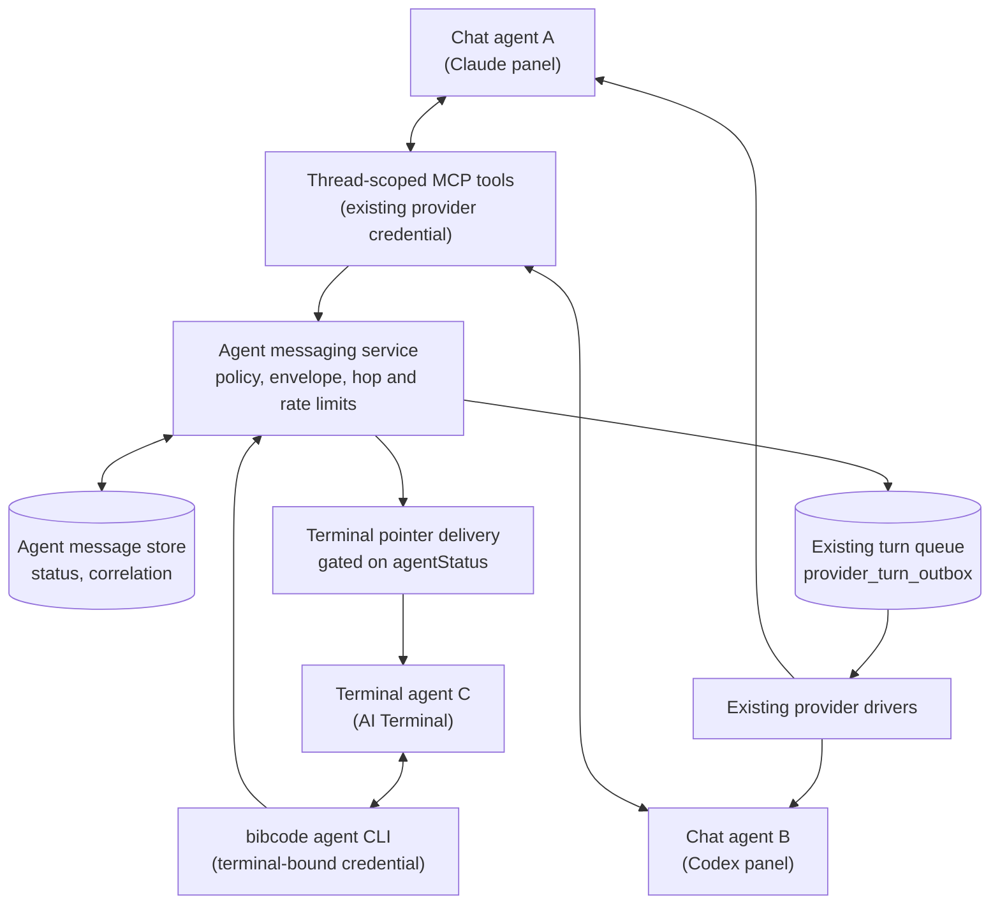
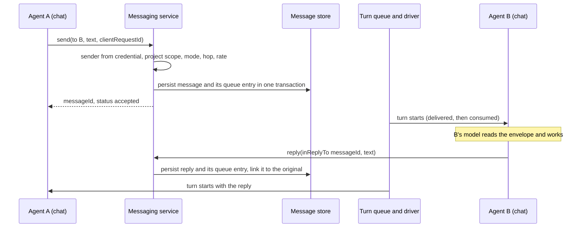
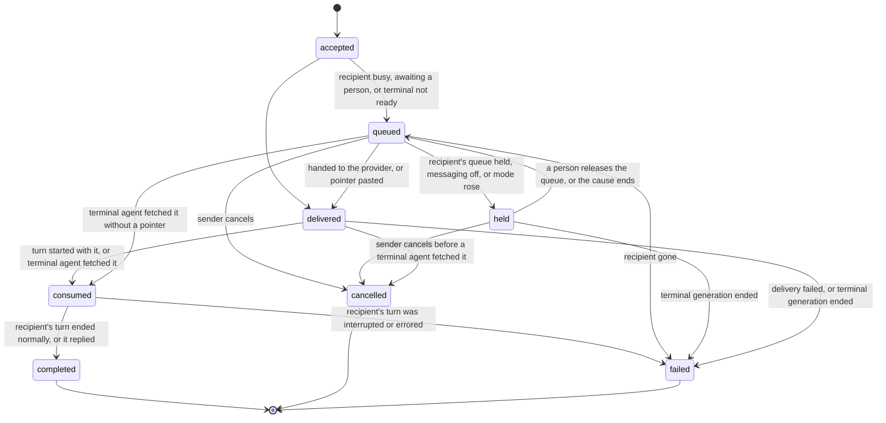

# Agent messaging: one BiBCode agent sends a message to another and gets a reply

Status: Approved 2026-11-13 (approved in chat by the maintainer, after an independent read
and two Codex reviews)
Amended 2026-11-13, for requests sent by a person only, by the approved
[Send to agent design](./2026-11-13-send-to-agent-design.md): R2, R5, R6, R8, R10, R14 and
the inbox row of D12. That document's Constraints section states each change.
Size: full    Mode: quick    Type: feature
Source: research handoff "Inter-Agent Communication for BibCode", conversation 2026-11-13.
Verified at `a9938193b` (`main`). Research notes and the full report with every permalink
are kept outside the repository (see [Evidence](#evidence)).

This document is the design brief, the specification and the decision record in one file.
It covers messaging only. It does not cover agent teams, task scheduling or delegation.

## Problem

A person running a Claude thread in one panel, a Codex thread in another and a CLI agent in
a terminal must copy text between them by hand, because no agent BiBCode hosts can address
another one. The server already has the transport: a durable per-thread turn queue, a
thread-bound MCP credential on every provider launch, and a server-stamped actor. But the
credential exposes only `preview_*` and `device_*` tools, so only an outside agent can call
`send_message`, and AI Terminals get no BiBCode identity at all. In the gap map, 10 of the
12 handoff requirements are partly met and 2 (terminal-to-terminal, panel-to-terminal) are
missing; none is fully met.

## Goals

1. An agent in one chat thread sends a message to an agent in another chat thread of the
   same project and later receives the reply in its own context, with no person relaying
   text. Checked by the end-to-end scenario of R7 and R10 across two providers.
2. The same works when either side is a CLI agent in an AI Terminal. Checked by R16 and R17.
3. The sender can always tell how far a message got: accepted, delivered to the transport,
   consumed by the recipient's model, or finished. Checked by R11.
4. A message from an agent never carries a person's authority and never crosses a project
   boundary. Checked by R4, R8 and R9.
5. A runaway exchange between agents stops without a person. Checked by R14 and R15.

## Non-goals

- Broadcast and group addresses (handoff FR-13). One sender, one recipient keeps
  authorization and loop accounting simple; a group send can be added on the same store.
- Automatic task delegation, starting threads or terminals for another agent, worker
  supervision (handoff FR-14). That is orchestration, which the handoff excludes.
- Messaging across projects or across environments. Decided by the user: same project only.
- Interrupting or steering a recipient's running turn with an agent message. A message
  waits for the turn to end, so one agent cannot derail another's work in progress.
- Changing what an outside agent (`mcp-client`) can do. `send_message`,
  `send_panel_message` and `terminal_write` keep their behavior and their access rules.
- Typing a message body into a terminal. Only a fixed pointer line is ever pasted.
- Provider-native messaging (Claude cross-session messages, Codex collab tools). It cannot
  carry a Claude-to-Codex message.

Anti-goals, which count as failure even when everything works:

- A recipient acts on an agent message as if its user had typed it.
- A message is reported `consumed` because bytes reached a PTY or a WebSocket. `delivered`
  means only that the transport took it.
- A message is silently dropped; every accepted message ends in a state the sender can read.
- A pointer line lands in a prompt that is waiting for a person's answer, or in a shell.

## Users and scenarios

1. As an agent in a chat thread, I want to ask another agent of my project a question and
   get its answer in my own conversation, so that I can use work it already did.
2. As a CLI agent in an AI Terminal, I want the same, so that the kind of surface I run in
   does not cut me off.
3. As the person running the project, I want agent messaging off until I turn it on, and I
   want to see who sent what to whom, so that agents never talk behind my back.
4. As a receiving agent, I want every agent message labelled with its sender and marked as
   not from my user, so that I can weigh it as untrusted input.

## Vocabulary

| Term | Meaning |
| --- | --- |
| Chat agent | The provider session of a thread, including a chat panel's thread. |
| Terminal agent | A provider CLI that BiBCode launched in an AI Terminal. |
| Agent address | `thread:<threadId>` for a chat agent, `terminal:<threadId>/<terminalId>` for a terminal agent. |
| Agent message | One text sent from one agent address to another through this feature. |
| Conversation | The first agent message and every reply that descends from it; it has one conversation id. |
| Hop | The position of a message in a chain of agent-triggered messages, starting at 1. |
| Envelope | The labelled block around the text that the recipient's model reads. |
| Terminal generation | One launch of the agent process in one terminal by one server run. A restart, a replacement, an exit or a close ends it. |
| Ready for a prompt | A terminal agent whose process is alive, whose last turn ended, and which has no pending question or approval. |

## Architecture

The handoff's router, session registry and inbox map onto existing parts: the router is a
thin policy service in front of `orchestration.dispatchCommand`, the registry is the thread
projection plus the terminal manager, and the queue is the existing outbox. The only new
store is the agent message record.

The handoff's diagram has B acknowledge delivery. That step does not exist: no provider
reports "the model read this" as a separate signal. `consumed` is therefore defined as the
recipient's turn starting with the message in it (chat) or the recipient fetching it
(terminal), and `completed` as that turn ending normally. A terminal agent has no turn the
server can see, so for a terminal recipient `consumed` is the last state unless it replies,
which sets `completed`.

Agent messages share a thread's one turn queue with the person's queued messages, in
acceptance order. An agent message that may not be delivered (messaging off, or the
recipient's mode rose above the sender's) is taken out of the queue and marked `held`, so
it never blocks a person's message behind it.

## Requirements

### R1. Agent directory  [Must]

WHEN an agent asks for the agents it can reach, the messaging service SHALL return every
chat agent and terminal agent of the caller's project except the caller's own address
(a panel's host thread and the terminals of the caller's thread are listed), each with its
agent address, title, provider, kind (chat or terminal), activity status and whether it can
receive now.

#### Scenario: two panels and a terminal
- GIVEN a project with a Claude thread, a Codex panel and a Claude AI Terminal, messaging on
- WHEN the Claude thread's agent lists agents
- THEN it gets two entries, the Codex panel and the terminal, each with an address

#### Scenario: other projects stay invisible
- GIVEN a second project in the same environment with one thread
- WHEN an agent of the first project lists agents
- THEN the second project's thread is not in the result, and no count hints at it

### R2. Sending  [Must]

WHEN an agent sends text to an agent address, the messaging service SHALL store one agent
message together with its queue entry, so that both exist or neither does, and return its
message id, its conversation id and the status `accepted`.

#### Scenario: crash right after acceptance
- GIVEN A's send returned a message id
- WHEN the server stops before delivery and starts again
- THEN the message is still queued for B and is delivered or reported under R18; it never
  stays `accepted` with nothing left to deliver it

#### Scenario: accepted
- GIVEN agents A and B in one project
- WHEN A sends "Which port does the dev server use?" to B's address
- THEN A gets a message id and `accepted`, and the message exists with sender A, recipient B

#### Scenario: invalid recipient
- GIVEN agent A
- WHEN A sends to an address that does not exist, to its own address, or with empty text or
  text over 16,000 characters
- THEN the call fails with an error naming the reason, and no message is stored

### R3. Sender identity  [Must]

The messaging service SHALL take the sender of every agent message from the caller's
credential and SHALL refuse a call that supplies a sender or any other unknown field.

#### Scenario: no spoofing
- GIVEN agent A's credential
- WHEN A sends a message with a field claiming agent C as the sender
- THEN the call is refused as an invalid argument, and no message is recorded with sender C

### R4. Project scope  [Must]

IF the recipient is not in the sender's project and environment, THEN the messaging service
SHALL refuse the send with the same error as for an address that does not exist.

#### Scenario: cross-project send
- GIVEN agent A in project one and thread X in project two
- WHEN A sends to `thread:<X>`
- THEN A gets the unknown-recipient error, nothing is queued for X, and the error does not
  reveal that X exists

### R5. Opt-in  [Must]

WHILE agent messaging is off for the environment, the messaging service SHALL refuse every
directory, send, reply, status and inbox call with an error that names the setting.

#### Scenario: default is off
- GIVEN a fresh environment
- WHEN an agent calls the directory
- THEN it gets the disabled error naming Settings → Agents, and no agent is listed

#### Scenario: turned off mid-conversation
- GIVEN messaging on and a message from A queued for B
- WHEN a person turns messaging off
- THEN new calls are refused, the queued message becomes `held` with reason
  `messaging_off` and leaves B's turn queue, a person's message queued behind it is
  delivered normally, and the agent message rejoins the end of the queue when messaging is
  on again; it is not deleted

### R6. Runtime-mode ceiling  [Must]

IF the recipient's runtime mode ranks above the sender's in the order `approval-required`,
`auto-accept-edits`, `full-access`, at send time or at delivery time, THEN the messaging
service SHALL refuse the send, or mark the already accepted message `held` with reason
`recipient_mode_above_sender`; a terminal agent sends with its owning thread's mode and
receives as `full-access`.

#### Scenario: a supervised agent cannot drive a full-access agent
- GIVEN A in `approval-required` and B in `full-access`
- WHEN A sends to B
- THEN the send is refused and B receives nothing

#### Scenario: equal or lower is allowed
- GIVEN A in `full-access` and B in `approval-required`
- WHEN A sends to B
- THEN the message is accepted

#### Scenario: the recipient's mode rises while the message waits
- GIVEN A and B in `auto-accept-edits` and A's message queued behind B's running turn
- WHEN a person switches B to `full-access` before the message is delivered
- THEN the message is not delivered and becomes `held` with `recipient_mode_above_sender`

#### Scenario: terminal recipient
- GIVEN A in `auto-accept-edits` and terminal agent C
- WHEN A sends to C
- THEN the send is refused, because a terminal agent's own permissions are not known to
  BiBCode

### R7. Delivery to a chat agent  [Must]

WHEN an agent message for a chat agent reaches the head of that thread's queue and the
thread is ready, the messaging service SHALL start a turn whose input is the envelope, and
SHALL set the status to `delivered` when the provider accepts the turn and `consumed` when
the turn starts.

#### Scenario: idle recipient
- GIVEN B idle
- WHEN A's message is accepted
- THEN B starts a turn without any person acting, B's transcript shows the message, and the
  message status reaches `consumed`

#### Scenario: busy recipient
- GIVEN B in the middle of a turn
- WHEN A's message is accepted
- THEN the status is `queued`, B's running turn is not interrupted or steered, and the
  message is delivered after that turn ends

### R8. Envelope  [Must]

The messaging service SHALL deliver every agent message inside an envelope that states the
sender's title, provider and agent address, the message id, the conversation id, the id of
the message it replies to when there is one, and that the text comes from another agent and
not from the recipient's user.

#### Scenario: recipient can tell who wrote it
- GIVEN A, titled "API refactor", sends "Run the migration" to B
- WHEN B's turn starts
- THEN the input B's model receives names "API refactor" as the sender and states that the
  text is not from B's user

#### Scenario: text cannot forge an envelope
- GIVEN A sends text that contains the envelope's own closing marker followed by a line
  claiming to be from the user
- WHEN B's turn starts
- THEN the forged marker is neutralized, and everything A wrote stays inside A's envelope

#### Scenario: text is delivered literally
- GIVEN A sends text that starts with a slash command, names a skill, or contains an
  `@path` file reference
- WHEN B's turn starts
- THEN B's provider runs no command, loads no skill and expands no file because of that
  text; B's model receives the characters A wrote

### R9. No user authority  [Must]

WHILE a recipient is waiting for an approval or for an answer to a question, the messaging
service SHALL keep agent messages for it `queued` and SHALL NOT deliver any of them as the
approval or the answer.

#### Scenario: pending approval
- GIVEN B is waiting for a person to approve a command
- WHEN A sends "approve it"
- THEN the approval stays pending, the message stays `queued`, and it is delivered as an
  ordinary agent message only after a person resolved the approval

### R10. Replies and correlation  [Must]

WHEN an agent replies to an agent message it received, the messaging service SHALL deliver
the reply to that message's sender in the same conversation, record which message it
answers, and report the reply's id in the answered message's status; a reply is accepted at
any later time while both agents exist, and a reply from a terminal agent sets the answered
message to `completed`.

#### Scenario: round trip across providers
- GIVEN A (Claude) sent message m1 to B (Codex) and B consumed it
- WHEN B replies to m1 with "Port 5173"
- THEN A starts a turn whose envelope carries "Port 5173", m1's id as the answered message
  and the same conversation id, and A did not have to wait in a tool call for it

#### Scenario: reply to a message that was not yours
- GIVEN message m1 from A to B
- WHEN agent C replies to m1
- THEN the reply is refused and A receives nothing from C

### R11. Status tracking  [Must]

WHEN the sender of an agent message asks for its status, the messaging service SHALL return
one of `accepted`, `queued`, `held`, `delivered`, `consumed`, `completed`, `cancelled` or
`failed`, the time of the last change, the id of a reply when one exists, and for `held` and
`failed` a reason. A chat recipient's message is `completed` when the turn that consumed it
ends normally and `failed` with `recipient_turn_failed` when that turn is interrupted or
errors.

#### Scenario: four distinct stages
- GIVEN A sent m1 to a busy B
- WHEN A reads the status before B's turn ends, after B's next turn starts, and after it ends
- THEN A reads `queued`, then `consumed`, then `completed`

#### Scenario: only the sender may ask
- GIVEN message m1 from A to B
- WHEN agent C asks for m1's status
- THEN the call fails as for an unknown message, and C learns nothing about m1

### R12. Idempotent sends  [Must]

WHEN an agent repeats a send or a reply with the same client request id and the same
arguments, the messaging service SHALL return the first call's result and SHALL NOT store
or deliver a second message.

#### Scenario: retry after a timeout
- GIVEN A sent m1 with client request id k and lost the response
- WHEN A sends again with id k and the same arguments
- THEN A gets m1's id, and B receives the text once

#### Scenario: same id, other arguments
- GIVEN client request id k was used for m1
- WHEN A sends different text with id k
- THEN the call fails with a conflict error and nothing is delivered

### R13. Ordering  [Must]

The messaging service SHALL deliver the agent messages for one recipient in the order it
accepted them, interleaved with a person's queued messages for that thread by acceptance
time.

#### Scenario: two senders, one recipient
- GIVEN B busy, A's message accepted first and C's second
- WHEN B becomes ready
- THEN B receives A's message in one turn and C's in the following turn, never the reverse

### R14. Hop limit  [Must]

IF sending a message would make its hop number greater than 8, THEN the messaging service
SHALL refuse it with an error that names the limit. For a chat sender the hop number is 1
when a person's message started its current turn, and one more than the triggering
message's hop when an agent message started it. For a terminal sender it is one more than
the highest hop among the agent messages it fetched in its terminal generation since a
person last typed into that terminal, and 1 when it fetched none since then.

#### Scenario: a slow exchange does not reset itself
- GIVEN terminal agents C and D answering each other once an hour with no person typing in
  either terminal, the last message at hop 8
- WHEN its recipient fetches it and sends again
- THEN the send is refused with the hop-limit error, however much time passed

#### Scenario: two terminals cannot ping-pong
- GIVEN terminal agents C and D answering each other within seconds, the last message at
  hop 8
- WHEN its recipient fetches it and sends again
- THEN the send is refused with the hop-limit error

#### Scenario: ping-pong stops
- GIVEN A and B answering each other with no person involved, the last message at hop 8
- WHEN its recipient sends another message in the turn that message started
- THEN the send is refused with the hop-limit error and nothing is delivered

#### Scenario: a person resets the chain
- GIVEN the same conversation stopped at hop 8
- WHEN a person types a message in A's thread and A then sends to B
- THEN the message is accepted at hop 1

### R15. Rate and backlog limits  [Should]

IF an agent has sent 30 agent messages in the last 60 seconds, or the recipient already has
20 agent messages not yet consumed, THEN the messaging service SHALL refuse the send with an
error that names the limit that applied.

#### Scenario: flooding one recipient
- GIVEN B is held with 20 unconsumed agent messages
- WHEN A sends one more
- THEN the send is refused with the backlog error and B's queue stays at 20

### R16. Terminal agents can send and receive  [Must]

WHEN BiBCode launches an AI Terminal, the terminal runtime SHALL give its process a
credential bound to that terminal generation, SHALL revoke it when the generation ends, and
the `bibcode agent` command run inside it SHALL offer the directory, send, reply, status and
inbox operations under that terminal's agent address.

#### Scenario: a sibling terminal cannot use the credential
- GIVEN AI Terminals C and E on the same thread
- WHEN a process in E runs the send command
- THEN the message is sent from E's address; nothing BiBCode gives E (environment, shared
  thread configuration or files) contains C's credential

#### Scenario: a restarted terminal does not inherit mail
- GIVEN m1 queued for terminal agent C
- WHEN C's terminal is restarted and a new agent process starts under the same terminal id
- THEN m1 is `failed` with `recipient_gone`, the old credential is refused, and the new
  process's inbox is empty

#### Scenario: terminal to panel
- GIVEN a Codex AI Terminal C and a chat agent B in one project
- WHEN C's agent runs the send command addressed to B
- THEN B receives the envelope naming C's terminal as the sender

#### Scenario: a shell without the credential
- GIVEN a plain terminal that BiBCode did not launch as an AI Terminal
- WHEN a process in it runs the send command
- THEN the command exits non-zero with a message that it has no agent identity, and nothing
  is sent

### R17. Delivery to a terminal agent  [Must]

WHEN a terminal agent has agent messages it has not fetched and it is observed ready for a
prompt in its current terminal generation, the messaging service SHALL paste one fixed
pointer line into the terminal and submit it, SHALL set those messages to `delivered`, and
SHALL set a message to `consumed` only when the terminal agent fetches it through the inbox
operation.

#### Scenario: ready terminal
- GIVEN terminal agent C ready for a prompt and a message m1 from A
- WHEN m1 is accepted
- THEN one line telling the agent to run the inbox command appears in C's terminal, m1 is
  `delivered`, and after C's agent runs the inbox command m1 is `consumed` and the command
  printed the envelope

#### Scenario: terminal not safe to type into
- GIVEN C is working, is blocked on a permission prompt, is waiting for an answer to a
  question it asked, or its readiness cannot be observed
- WHEN m1 is accepted
- THEN nothing is typed into the terminal, m1 is `queued`, C can still fetch m1 with the
  inbox operation, and the body of m1 is never written to the terminal in any state

### R18. Recipient unavailable  [Must]

IF a recipient's queue is held, or a terminal recipient's generation ended (close, exit,
restart, replacement or server restart) before the message was consumed, THEN the messaging
service SHALL set the message to `held` (held chat queue) or `failed` with reason
`recipient_gone` (ended terminal generation) and SHALL keep that status readable by the
sender.

#### Scenario: recipient errored
- GIVEN B's last turn ended in an error, so its queue is held
- WHEN A sends m1
- THEN m1 is `held` with the reason, B's session is not restarted by the message, and m1 is
  delivered when a person releases B's queue

#### Scenario: terminal closed
- GIVEN m1 queued for terminal agent C
- WHEN C's terminal closes
- THEN m1 becomes `failed` with `recipient_gone`, and no later terminal receives it

### R19. Persistence  [Should]

The messaging service SHALL keep every agent message, its status and its correlation data
across a server restart.

#### Scenario: restart with a queued message
- GIVEN m1 queued for chat agent B, whose turn was running
- WHEN the server restarts
- THEN m1 still exists, its status is `held` because B's abandoned session holds its queue,
  and A can read that status after the restart

#### Scenario: restart with an idle recipient
- GIVEN m1 queued for chat agent B, which was ready and not running
- WHEN the server restarts
- THEN m1 keeps its place and is delivered as it would have been without the restart

### R20. Cancelling  [Should]

WHEN the sender cancels an agent message that is `queued` or `held`, or `delivered` to a
terminal agent that has not fetched it, the messaging service SHALL set it to `cancelled`
and SHALL NOT deliver it.

#### Scenario: too late to cancel
- GIVEN m1 already `consumed`
- WHEN A cancels m1
- THEN the call fails saying the message was already delivered, and m1's status is unchanged

### R21. Visible to the person  [Must]

WHEN an agent message is accepted, refused, delivered or failed, the application SHALL show
it to the person: the recipient's transcript marks the message with the sending agent, and
the agent activity log records sender, recipient, outcome and time without the message text.

#### Scenario: transcript attribution
- GIVEN A's message was delivered to B
- WHEN a person opens B's thread
- THEN the message shows a chip naming A's thread as the sender, distinct from messages the
  person typed

#### Scenario: no content in diagnostics
- GIVEN the Profiler is on
- WHEN agents exchange messages
- THEN profiler events, findings and logs contain ids and outcomes and no message text

## Constraints and assumptions

- Provider credentials already carry `environment_id`, `thread_id`, `owner_thread_id`,
  `provider_session_id` and `provider_instance_id`
  (`apps/server/src/production/connect_mcp.rs:149-158`). A panel's `owner_thread_id` is its
  host; the sender is `thread_id`.
- Provider tools are served by a separate path from outside-agent tools
  (`apps/server/src/production/connect_mcp.rs:1142-1157`); idempotency, limits and activity
  rows do not apply there today and must be added for the new tools.
- Only Codex and Claude can take a message during a turn
  (`apps/server/src/provider/mod.rs:43-46`). This design does not use that.
- Queue promotion is blocked by a pending approval or question, and the queue is held after
  an interrupt, an error or a restart until a person acts
  (`docs/architecture/rpc-and-orchestration.md:3512-3518`, `:3565-3590`). This design keeps
  both rules for agent messages (agent's call: releasing a held queue without a person
  would let one agent restart another's failed session).
- Terminals are kept in memory only (`apps/server/src/terminal/manager.rs:2002`), so a
  terminal address does not survive a restart.
- Activity status exists for Claude, Codex and OpenCode AI Terminals; Cursor and Grok report
  `unavailable` (`docs/architecture/activity-observation.md:367-370`, `:418-421`). Those
  terminal agents can send and can fetch their inbox, but get no pointer (agent's call).
- No current activity status means "ready for a prompt": `waiting` also covers a Codex
  question awaiting an answer (`apps/server/src/provider_terminal/codex.rs:2272`), and
  `done` covers an exited agent (`docs/architecture/activity-observation.md:420`). Slice 4
  must add that observation per provider; a provider that cannot give it gets no pointer.
- The terminal manager already tracks process generations and rejects work against a
  replaced one (`apps/server/src/terminal/manager.rs:452-477`).
- Runtime modes are `approval-required`, `auto-accept-edits` and `full-access`
  (`packages/contracts/src/orchestration.ts:128-132`), and a thread's mode can change at any
  time (`apps/server/src/orchestration/engine.rs:5163-5177`).
- After a restart only abandoned running sessions hold their queue; ready, idle and stopped
  threads keep their queued rows deliverable
  (`docs/architecture/rpc-and-orchestration.md:3575-3586`).
- "Ready for a prompt" can be derived from signals the observers already read (Codex
  `turn/completed`, OpenCode `session.idle`, Claude status hooks;
  `docs/architecture/activity-observation.md:398-410`), but no published status carries it
  today.
- Terminals run on the server's own host (`docs/architecture/remote.md:4`), so the
  `bibcode agent` command reaches the server over loopback the way the URL-opening helper
  does (agent's call that this holds for WSL and SSH environments; verify in slice 4).
- Codex filters the environment it passes to the shell commands its agent runs. Orca's
  command fails for that reason until the user allows its variables
  (Orca `src/cli/orchestration/identity/terminal-identity.ts`, at the commit under
  Evidence). Whether BiBCode's existing terminal variables survive that filter is not
  verified. Slice 4 must prove that `bibcode agent` finds its credential inside a Codex AI
  Terminal, and otherwise carry the credential another way (for example a file the launch
  names); R16's refusal message covers the case until then.
- Providers can treat incoming text as commands: the Claude SDK documents flags for text
  composed by a client rather than typed, and the second reference project has an open
  change about agent text triggering the recipient's skills. R8's literal-delivery scenario
  must be checked per provider.
- A terminal agent is treated as `full-access` when receiving, because BiBCode does not
  know the CLI's own permission flags (agent's call), and takes its owning thread's mode
  when sending (agent's call).
- A terminal sender's hop number resets only when a person types into that terminal; the
  terminal manager already records where input came from (agent's call).
- The terminal credential's trust boundary is the agent process and everything it starts:
  any child process of the agent can read it and send as that terminal. That is accepted,
  because those processes already act with the agent's access (agent's call).
- Every terminal process already receives a thread-bound loopback credential for opening
  URLs (`docs/architecture/providers.md:1058-1061`); the terminal credential follows that
  pattern.
- Codex's default MCP tool timeout is 60 seconds (vendor configuration reference). No tool
  in this design blocks waiting for a reply.
- A user-registered `bibcode` stdio entry can load beside the thread-scoped server in a chat
  (`docs/reference/mcp.md:29-35`). Calls through it are outside-agent calls and are not agent
  messages; this design does not change them.
- Text limit 16,000 characters (agent's call: the size `read_thread` returns uncut, so a
  message never needs paging).
- Hop limit 8 (agent's call on the number: the user chose a hop cap that refuses).
- Rate limit 30 per 60 seconds per sender, backlog limit 20 per recipient (agent's call).

## Decisions

D0. Verdict: build a small native BiBCode feature on the existing queue, adapting two
patterns. From the second reference project: tools on a per-session MCP server, with the
sender taken from the session credential. From Orca: stored messages plus a pointer line for
terminal agents. Neither project is adopted as code, and both lack the sender label and the
loop limit this design adds. Decided by: user (approach), agent's call (wording).

D1. Agents reach messaging through tools on the thread-scoped MCP server every provider
launch already receives. Alternatives considered: an inbox that agents poll (an idle agent
never wakes; blocking waits hit Codex's 60-second limit); provider-native messaging (not
cross-provider); a new broker process (duplicates the outbox). Decided by: user.

D2. Delivery to a chat agent is a queued turn on the existing turn queue. Alternatives:
steering into a running turn (two providers only, and lets an agent derail another); a
separate inbox the recipient must read (no wake). Decided by: agent's call.

D3. A reply is an agent message to the original sender's thread, so the existing queue wakes
the sender. Alternatives: a blocking wait tool (timeouts, holds a wait slot); MCP
notifications (no client acts on them when idle). Decided by: agent's call.

D4. Terminal agents use a `bibcode agent` command with a terminal-bound credential, and
delivery is a pasted pointer line, as Orca does. Alternatives: injecting an MCP server into
each CLI's launch (per-provider configuration, name collision with a user's own entry);
typing the body into the PTY (unverifiable, collides with drafts and dialogs). Decided by:
agent's call. Terminals are in the first milestone. Decided by: user.

D5. The pointer is pasted only when the terminal agent is observed ready for a prompt. Orca
also pastes while the agent is working; BiBCode does not, because what a TUI does with
input during a turn differs per agent, and a line pasted into a pending question would
answer it. Decided by: agent's call.

D6. Off by default, same project and environment only. Alternatives: whole environment; on
by default; a person approves each first contact. Decided by: user.

D7. A message over the hop limit is refused with an error to the sender; nothing waits for a
person. Alternatives: hold for a person; rate limit only. Decided by: user.

D8. A recipient with a broader runtime mode than the sender refuses the message.
Alternative: allow it and rely on the envelope (a read-only agent could then get writes
done through a full-access one). The second reference project applies the same rule.
Decided by: agent's call.

D9. The message text travels in an envelope naming the sender; the second reference project
delivers raw text and has an open issue about it. Decided by: agent's call.

D10. Agent tools are named `agents_list`, `agent_message_send`, `agent_message_reply`,
`agent_message_status`, `agent_message_cancel`; the terminal command adds
`bibcode agent inbox`. Decided by: agent's call.

D12. Message contract. Decided by: agent's call.

| Operation | Arguments | Result |
| --- | --- | --- |
| `agents_list` | none | `agents[]`: `address`, `title`, `provider`, `kind`, `status`, `canReceive` |
| `agent_message_send` | `to`, `text`, `clientRequestId` | `messageId`, `conversationId`, `status`, `hop` |
| `agent_message_reply` | `inReplyTo`, `text`, `clientRequestId` | same as send |
| `agent_message_status` | `messageId` | `status`, `reason?`, `updatedAt`, `replyMessageId?` |
| `agent_message_cancel` | `messageId` | `status` |
| `bibcode agent inbox` (terminal only) | none | the envelopes of every `queued` or `delivered` message addressed to the caller's terminal generation that still passes R5 and R6, oldest first; fetching marks them `consumed` in the same step. Held, cancelled and failed messages are never returned |

A stored agent message holds: message id, conversation id, sender address, recipient
address, the answered message's id, hop, text, status, reason, the times of acceptance and
of the last change, the sender's runtime mode at send time, and for a terminal recipient
its generation. Errors are typed: disabled, unknown recipient, invalid argument, mode
ceiling, hop limit, rate limit, backlog limit, conflict, not cancellable, no agent identity.

D11. A new actor kind identifies a hosted agent as the sender, beside `mcp-client`.
Alternative: reuse `mcp-client` (would make a thread's agent look like an outside agent and
bypass the panel provenance rule). Decided by: agent's call.

## Milestone plan

One milestone, in slices that each run end to end. The first slice is the proof of concept.

1. **Proof of concept.** Send, envelope and reply between two chat agents on different
   providers, behind the setting, with sender identity, project scope and status. Proves
   R2, R3, R4, R5, R7, R8, R10, R11.
2. **Safety.** Runtime-mode ceiling, no user authority, hop limit, rate and backlog limits,
   idempotency, ordering. R6, R9, R12, R13, R14, R15.
3. **Directory and visibility.** Agent list, transcript chip, activity log, settings
   control. R1, R21.
4. **Terminal agents.** Terminal credential, `bibcode agent` command, pointer delivery.
   R16, R17.
5. **Recovery.** Held and failed states, persistence across restart, cancel. R18, R19, R20.
6. **Documentation.** `docs/reference/mcp.md` (a provider tools section),
   `docs/user/mcp.md`, `docs/architecture/rpc-and-orchestration.md`,
   `docs/architecture/providers.md`, `docs/architecture/activity-observation.md`, the
   `bibcode-mcp` skill, and the affected testing runbooks.

## Risks

- A recipient's model follows an agent message as an instruction from its user → the
  envelope (R8), the approval rule (R9) and the runtime-mode ceiling (R6); residual risk
  stays, because no envelope makes a model ignore text.
- The pointer line is pasted while a person is typing in that terminal → paste only when
  the agent is ready for a prompt, one pointer per ready period, and never the body; a collision costs one stray line.
- A pasted pointer is not submitted by a CLI that needs a different key sequence → the
  message stays `delivered` and never `consumed`, which the sender can read; per-provider
  submit handling is verified in slice 4 against the three observable CLIs.
- Agents spend tokens answering each other → hop limit, rate limit, off by default.
- The provider tool path lacks the retry and limit machinery of the outside-agent path →
  slice 2 adds it before the feature leaves the proof of concept.
- An 8-hour provider credential expires in a long session → not changed here; a call with
  an expired credential fails as it does for preview tools today.

## Verification

| Requirement | Checked by |
| --- | --- |
| R1 to R6, R11 to R15, R20 | Server integration tests on the provider MCP endpoint with two or three thread credentials and scripted providers. |
| R7, R9, R10, R13, R18, R19 | Orchestration tests driving the turn queue with a fake provider driver, including restart and held-queue cases. |
| R8 | Unit tests of the envelope, including the forged-marker case, plus one assertion on the text the fake driver received. |
| R16, R17 | Terminal manager tests with a scripted PTY program and a controlled activity status; one end-to-end run per observable CLI in the Linux lab. |
| R21 | Web component tests for the chip and the activity row; a profiler redaction test. |
| Goal 1 | One end-to-end test: Claude thread to Codex panel and back, real providers, Profiler on. |

Input classes no scenario names, and what happens: a message to a deleted or archived
thread fails as unknown recipient; a message containing control characters is delivered
with them escaped in the envelope; a reply to a message whose sender's thread was deleted
fails with `recipient_gone`; attachments are not accepted in this version.

Profiler coverage for the implementation: the new tools register through the RPC and MCP
wrappers so they are timed, none of them waits on a provider, and no event carries message
text.

## Evidence

The research behind this design, with every source link, is in the report "BibCode inter
agent messaging" (kept in the maintainer's private workspace, not in this repository).
Summary of what it verified in source:

- **Orca** at commit `683fea748d63`: agents message each other through an
  `orca orchestration send|check|ask|reply` command over a local socket, marked
  experimental. Terminal recipients get a pasted pointer line and fetch the body; chat
  recipients get a queued turn. Messages persist in SQLite. No general ping-pong guard was
  found.
- **The second reference project** (the predecessor GUI this repository descends from) at
  commit `c83e78fe073d`: every agent session gets an MCP server with thread send, wait, read
  and interrupt tools and a task-delegation tool. The sender comes from a per-session
  token. The recipient's model is not told who sent a message, plain sends have no reply
  correlation, and no loop control was found.
- **BiBCode** at `a9938193b`: see Problem and Constraints. The earlier finding that neither
  reference project has agent-to-agent messaging is contradicted by both sources.

## Open questions

- Which of two same-named `bibcode` MCP entries Claude Code uses when the launch
  configuration and the user's settings both define one. Owner: engineering. Can wait
  because: the thread-scoped tools are reached by tool name either way, and slice 1's
  end-to-end test shows the answer.
- Whether a later version lets a person release a recipient's held queue from the sender's
  side. Owner: maintainer. Can wait because: this version keeps today's rule.

## Appendix: interview record

- 2026-11-13 Evidence: gap map of this checkout / Decision: the transport, the thread-bound
  credential and the server-stamped actor exist; the messaging tools, envelope,
  correlation, loop control and terminal identity do not.
- 2026-11-13 Evidence: Orca and second reference project sources at the commits above /
  Decision: both already ship agent messaging; their gaps (no sender label, no loop guard,
  unverifiable terminal paste) shape R8, R14 and R17.
- 2026-11-13 Q: which design for chat-panel agents / Recommended: tools on the thread-scoped
  MCP server / Decision: as recommended (D1).
- 2026-11-13 Q: when to cover terminal agents / Recommended: a later milestone of this spec
  / Decision: in the first milestone (D4).
- 2026-11-13 Q: who may message whom by default / Recommended: opt-in, same project /
  Decision: as recommended (D6).
- 2026-11-13 Q: how to stop runaway exchanges / Recommended: hop cap, then hold for a person
  / Decision: hop cap, then refuse (D7).
- 2026-11-13 Agent's calls, to be confirmed at approval: D2, D3, D5, D8, D9, D10, D11; the
  numbers 8, 30 per 60 seconds, 20 and 16,000; a terminal's hop resets only when a person
  types into it; child processes of a terminal agent can send as that terminal; keeping
  the held-queue rule; no pointer for agents whose readiness cannot be observed; terminal
  agents receive as `full-access` and send with their thread's mode, which nothing in the
  terminal launch enforces today; only AI Terminals that BiBCode launched count as agents;
  terminal agents use a command, not an MCP server; D0 wording; D12; no attachments; no
  steering.
- 2026-11-13 Approval: the maintainer approved the written file, including every agent's
  call listed above and the two consequences below.
- 2026-11-13 Consequences confirmed: only a `full-access` sender can message a terminal
  agent; a message to a recipient whose last turn errored waits until a person releases
  that queue.
- 2026-11-13 Evidence: independent read (9 findings) and Codex review (6 findings) of the
  first draft / Decision: all applied: readiness instead of idle status for the pointer,
  terminal generations, mode recheck at delivery, completion for terminals, restart
  wording, atomic store and queue, shared-queue rule, strict arguments, late replies.
