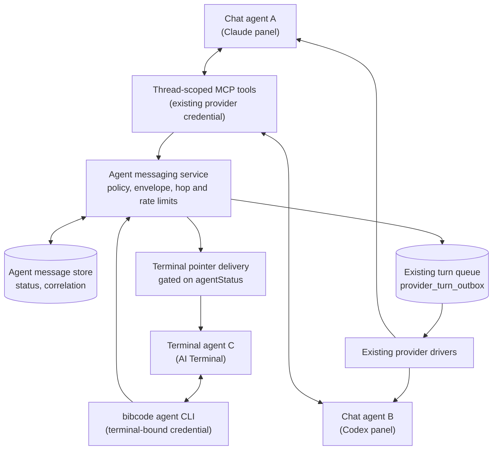
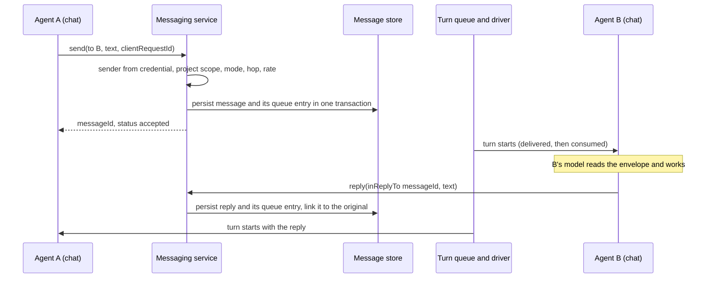
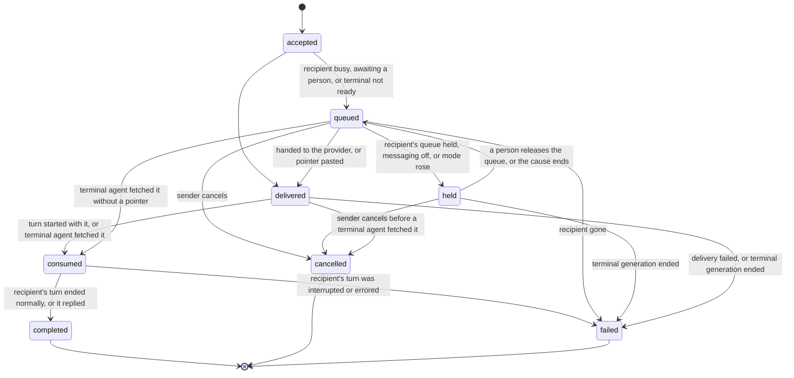

# Combined spec: agent messaging and Send to agent

This file joins two approved specifications so that one plan can cite unique requirement numbers.
Part A is `../2026-11-13-agent-messaging-design.md` unchanged (R1 to R21, D0 to D12).
Part B is `../2026-11-13-send-to-agent-design.md` with its requirements R1 to R19 renumbered to R101 to R119 and its decisions D1 to D17 to D101 to D117. In Part B, "messaging R<n>" names a requirement of Part A.
The two source files are the binding text; on any difference they win.

---

<!-- Part A -->

# Part A: Agent messaging: one BiBCode agent sends a message to another and gets a reply

Status: Approved 2026-11-13 (approved in chat by the maintainer, after an independent read
and two Codex reviews)
Amended 2026-11-13, for requests sent by a person only, by the approved
[Send to agent design](./2026-11-13-send-to-agent-design.md): R2, R5, R6, R8, R10, R14 and
the inbox row of D12. That document's Constraints section states each change.
Size: full    Mode: quick    Type: feature
Source: research handoff "Inter-Agent Communication for BibCode", conversation 2026-11-13.
Verified at `a9938193b` (`main`). Research notes and the full report with every permalink
are kept outside the repository (see [Evidence](#evidence)).

This document is the design brief, the specification and the decision record in one file.
It covers messaging only. It does not cover agent teams, task scheduling or delegation.

## Problem

A person running a Claude thread in one panel, a Codex thread in another and a CLI agent in
a terminal must copy text between them by hand, because no agent BiBCode hosts can address
another one. The server already has the transport: a durable per-thread turn queue, a
thread-bound MCP credential on every provider launch, and a server-stamped actor. But the
credential exposes only `preview_*` and `device_*` tools, so only an outside agent can call
`send_message`, and AI Terminals get no BiBCode identity at all. In the gap map, 10 of the
12 handoff requirements are partly met and 2 (terminal-to-terminal, panel-to-terminal) are
missing; none is fully met.

## Goals

1. An agent in one chat thread sends a message to an agent in another chat thread of the
   same project and later receives the reply in its own context, with no person relaying
   text. Checked by the end-to-end scenario of R7 and R10 across two providers.
2. The same works when either side is a CLI agent in an AI Terminal. Checked by R16 and R17.
3. The sender can always tell how far a message got: accepted, delivered to the transport,
   consumed by the recipient's model, or finished. Checked by R11.
4. A message from an agent never carries a person's authority and never crosses a project
   boundary. Checked by R4, R8 and R9.
5. A runaway exchange between agents stops without a person. Checked by R14 and R15.

## Non-goals

- Broadcast and group addresses (handoff FR-13). One sender, one recipient keeps
  authorization and loop accounting simple; a group send can be added on the same store.
- Automatic task delegation, starting threads or terminals for another agent, worker
  supervision (handoff FR-14). That is orchestration, which the handoff excludes.
- Messaging across projects or across environments. Decided by the user: same project only.
- Interrupting or steering a recipient's running turn with an agent message. A message
  waits for the turn to end, so one agent cannot derail another's work in progress.
- Changing what an outside agent (`mcp-client`) can do. `send_message`,
  `send_panel_message` and `terminal_write` keep their behavior and their access rules.
- Typing a message body into a terminal. Only a fixed pointer line is ever pasted.
- Provider-native messaging (Claude cross-session messages, Codex collab tools). It cannot
  carry a Claude-to-Codex message.

Anti-goals, which count as failure even when everything works:

- A recipient acts on an agent message as if its user had typed it.
- A message is reported `consumed` because bytes reached a PTY or a WebSocket. `delivered`
  means only that the transport took it.
- A message is silently dropped; every accepted message ends in a state the sender can read.
- A pointer line lands in a prompt that is waiting for a person's answer, or in a shell.

## Users and scenarios

1. As an agent in a chat thread, I want to ask another agent of my project a question and
   get its answer in my own conversation, so that I can use work it already did.
2. As a CLI agent in an AI Terminal, I want the same, so that the kind of surface I run in
   does not cut me off.
3. As the person running the project, I want agent messaging off until I turn it on, and I
   want to see who sent what to whom, so that agents never talk behind my back.
4. As a receiving agent, I want every agent message labelled with its sender and marked as
   not from my user, so that I can weigh it as untrusted input.

## Vocabulary

| Term | Meaning |
| --- | --- |
| Chat agent | The provider session of a thread, including a chat panel's thread. |
| Terminal agent | A provider CLI that BiBCode launched in an AI Terminal. |
| Agent address | `thread:<threadId>` for a chat agent, `terminal:<threadId>/<terminalId>` for a terminal agent. |
| Agent message | One text sent from one agent address to another through this feature. |
| Conversation | The first agent message and every reply that descends from it; it has one conversation id. |
| Hop | The position of a message in a chain of agent-triggered messages, starting at 1. |
| Envelope | The labelled block around the text that the recipient's model reads. |
| Terminal generation | One launch of the agent process in one terminal by one server run. A restart, a replacement, an exit or a close ends it. |
| Ready for a prompt | A terminal agent whose process is alive, whose last turn ended, and which has no pending question or approval. |

## Architecture

The handoff's router, session registry and inbox map onto existing parts: the router is a
thin policy service in front of `orchestration.dispatchCommand`, the registry is the thread
projection plus the terminal manager, and the queue is the existing outbox. The only new
store is the agent message record.

The handoff's diagram has B acknowledge delivery. That step does not exist: no provider
reports "the model read this" as a separate signal. `consumed` is therefore defined as the
recipient's turn starting with the message in it (chat) or the recipient fetching it
(terminal), and `completed` as that turn ending normally. A terminal agent has no turn the
server can see, so for a terminal recipient `consumed` is the last state unless it replies,
which sets `completed`.

Agent messages share a thread's one turn queue with the person's queued messages, in
acceptance order. An agent message that may not be delivered (messaging off, or the
recipient's mode rose above the sender's) is taken out of the queue and marked `held`, so
it never blocks a person's message behind it.

## Requirements

### R1. Agent directory  [Must]

WHEN an agent asks for the agents it can reach, the messaging service SHALL return every
chat agent and terminal agent of the caller's project except the caller's own address
(a panel's host thread and the terminals of the caller's thread are listed), each with its
agent address, title, provider, kind (chat or terminal), activity status and whether it can
receive now.

#### Scenario: two panels and a terminal
- GIVEN a project with a Claude thread, a Codex panel and a Claude AI Terminal, messaging on
- WHEN the Claude thread's agent lists agents
- THEN it gets two entries, the Codex panel and the terminal, each with an address

#### Scenario: other projects stay invisible
- GIVEN a second project in the same environment with one thread
- WHEN an agent of the first project lists agents
- THEN the second project's thread is not in the result, and no count hints at it

### R2. Sending  [Must]

WHEN an agent sends text to an agent address, the messaging service SHALL store one agent
message together with its queue entry, so that both exist or neither does, and return its
message id, its conversation id and the status `accepted`.

#### Scenario: crash right after acceptance
- GIVEN A's send returned a message id
- WHEN the server stops before delivery and starts again
- THEN the message is still queued for B and is delivered or reported under R18; it never
  stays `accepted` with nothing left to deliver it

#### Scenario: accepted
- GIVEN agents A and B in one project
- WHEN A sends "Which port does the dev server use?" to B's address
- THEN A gets a message id and `accepted`, and the message exists with sender A, recipient B

#### Scenario: invalid recipient
- GIVEN agent A
- WHEN A sends to an address that does not exist, to its own address, or with empty text or
  text over 16,000 characters
- THEN the call fails with an error naming the reason, and no message is stored

### R3. Sender identity  [Must]

The messaging service SHALL take the sender of every agent message from the caller's
credential and SHALL refuse a call that supplies a sender or any other unknown field.

#### Scenario: no spoofing
- GIVEN agent A's credential
- WHEN A sends a message with a field claiming agent C as the sender
- THEN the call is refused as an invalid argument, and no message is recorded with sender C

### R4. Project scope  [Must]

IF the recipient is not in the sender's project and environment, THEN the messaging service
SHALL refuse the send with the same error as for an address that does not exist.

#### Scenario: cross-project send
- GIVEN agent A in project one and thread X in project two
- WHEN A sends to `thread:<X>`
- THEN A gets the unknown-recipient error, nothing is queued for X, and the error does not
  reveal that X exists

### R5. Opt-in  [Must]

WHILE agent messaging is off for the environment, the messaging service SHALL refuse every
directory, send, reply, status and inbox call with an error that names the setting.

#### Scenario: default is off
- GIVEN a fresh environment
- WHEN an agent calls the directory
- THEN it gets the disabled error naming Settings → Agents, and no agent is listed

#### Scenario: turned off mid-conversation
- GIVEN messaging on and a message from A queued for B
- WHEN a person turns messaging off
- THEN new calls are refused, the queued message becomes `held` with reason
  `messaging_off` and leaves B's turn queue, a person's message queued behind it is
  delivered normally, and the agent message rejoins the end of the queue when messaging is
  on again; it is not deleted

### R6. Runtime-mode ceiling  [Must]

IF the recipient's runtime mode ranks above the sender's in the order `approval-required`,
`auto-accept-edits`, `full-access`, at send time or at delivery time, THEN the messaging
service SHALL refuse the send, or mark the already accepted message `held` with reason
`recipient_mode_above_sender`; a terminal agent sends with its owning thread's mode and
receives as `full-access`.

#### Scenario: a supervised agent cannot drive a full-access agent
- GIVEN A in `approval-required` and B in `full-access`
- WHEN A sends to B
- THEN the send is refused and B receives nothing

#### Scenario: equal or lower is allowed
- GIVEN A in `full-access` and B in `approval-required`
- WHEN A sends to B
- THEN the message is accepted

#### Scenario: the recipient's mode rises while the message waits
- GIVEN A and B in `auto-accept-edits` and A's message queued behind B's running turn
- WHEN a person switches B to `full-access` before the message is delivered
- THEN the message is not delivered and becomes `held` with `recipient_mode_above_sender`

#### Scenario: terminal recipient
- GIVEN A in `auto-accept-edits` and terminal agent C
- WHEN A sends to C
- THEN the send is refused, because a terminal agent's own permissions are not known to
  BiBCode

### R7. Delivery to a chat agent  [Must]

WHEN an agent message for a chat agent reaches the head of that thread's queue and the
thread is ready, the messaging service SHALL start a turn whose input is the envelope, and
SHALL set the status to `delivered` when the provider accepts the turn and `consumed` when
the turn starts.

#### Scenario: idle recipient
- GIVEN B idle
- WHEN A's message is accepted
- THEN B starts a turn without any person acting, B's transcript shows the message, and the
  message status reaches `consumed`

#### Scenario: busy recipient
- GIVEN B in the middle of a turn
- WHEN A's message is accepted
- THEN the status is `queued`, B's running turn is not interrupted or steered, and the
  message is delivered after that turn ends

### R8. Envelope  [Must]

The messaging service SHALL deliver every agent message inside an envelope that states the
sender's title, provider and agent address, the message id, the conversation id, the id of
the message it replies to when there is one, and that the text comes from another agent and
not from the recipient's user.

#### Scenario: recipient can tell who wrote it
- GIVEN A, titled "API refactor", sends "Run the migration" to B
- WHEN B's turn starts
- THEN the input B's model receives names "API refactor" as the sender and states that the
  text is not from B's user

#### Scenario: text cannot forge an envelope
- GIVEN A sends text that contains the envelope's own closing marker followed by a line
  claiming to be from the user
- WHEN B's turn starts
- THEN the forged marker is neutralized, and everything A wrote stays inside A's envelope

#### Scenario: text is delivered literally
- GIVEN A sends text that starts with a slash command, names a skill, or contains an
  `@path` file reference
- WHEN B's turn starts
- THEN B's provider runs no command, loads no skill and expands no file because of that
  text; B's model receives the characters A wrote

### R9. No user authority  [Must]

WHILE a recipient is waiting for an approval or for an answer to a question, the messaging
service SHALL keep agent messages for it `queued` and SHALL NOT deliver any of them as the
approval or the answer.

#### Scenario: pending approval
- GIVEN B is waiting for a person to approve a command
- WHEN A sends "approve it"
- THEN the approval stays pending, the message stays `queued`, and it is delivered as an
  ordinary agent message only after a person resolved the approval

### R10. Replies and correlation  [Must]

WHEN an agent replies to an agent message it received, the messaging service SHALL deliver
the reply to that message's sender in the same conversation, record which message it
answers, and report the reply's id in the answered message's status; a reply is accepted at
any later time while both agents exist, and a reply from a terminal agent sets the answered
message to `completed`.

#### Scenario: round trip across providers
- GIVEN A (Claude) sent message m1 to B (Codex) and B consumed it
- WHEN B replies to m1 with "Port 5173"
- THEN A starts a turn whose envelope carries "Port 5173", m1's id as the answered message
  and the same conversation id, and A did not have to wait in a tool call for it

#### Scenario: reply to a message that was not yours
- GIVEN message m1 from A to B
- WHEN agent C replies to m1
- THEN the reply is refused and A receives nothing from C

### R11. Status tracking  [Must]

WHEN the sender of an agent message asks for its status, the messaging service SHALL return
one of `accepted`, `queued`, `held`, `delivered`, `consumed`, `completed`, `cancelled` or
`failed`, the time of the last change, the id of a reply when one exists, and for `held` and
`failed` a reason. A chat recipient's message is `completed` when the turn that consumed it
ends normally and `failed` with `recipient_turn_failed` when that turn is interrupted or
errors.

#### Scenario: four distinct stages
- GIVEN A sent m1 to a busy B
- WHEN A reads the status before B's turn ends, after B's next turn starts, and after it ends
- THEN A reads `queued`, then `consumed`, then `completed`

#### Scenario: only the sender may ask
- GIVEN message m1 from A to B
- WHEN agent C asks for m1's status
- THEN the call fails as for an unknown message, and C learns nothing about m1

### R12. Idempotent sends  [Must]

WHEN an agent repeats a send or a reply with the same client request id and the same
arguments, the messaging service SHALL return the first call's result and SHALL NOT store
or deliver a second message.

#### Scenario: retry after a timeout
- GIVEN A sent m1 with client request id k and lost the response
- WHEN A sends again with id k and the same arguments
- THEN A gets m1's id, and B receives the text once

#### Scenario: same id, other arguments
- GIVEN client request id k was used for m1
- WHEN A sends different text with id k
- THEN the call fails with a conflict error and nothing is delivered

### R13. Ordering  [Must]

The messaging service SHALL deliver the agent messages for one recipient in the order it
accepted them, interleaved with a person's queued messages for that thread by acceptance
time.

#### Scenario: two senders, one recipient
- GIVEN B busy, A's message accepted first and C's second
- WHEN B becomes ready
- THEN B receives A's message in one turn and C's in the following turn, never the reverse

### R14. Hop limit  [Must]

IF sending a message would make its hop number greater than 8, THEN the messaging service
SHALL refuse it with an error that names the limit. For a chat sender the hop number is 1
when a person's message started its current turn, and one more than the triggering
message's hop when an agent message started it. For a terminal sender it is one more than
the highest hop among the agent messages it fetched in its terminal generation since a
person last typed into that terminal, and 1 when it fetched none since then.

#### Scenario: a slow exchange does not reset itself
- GIVEN terminal agents C and D answering each other once an hour with no person typing in
  either terminal, the last message at hop 8
- WHEN its recipient fetches it and sends again
- THEN the send is refused with the hop-limit error, however much time passed

#### Scenario: two terminals cannot ping-pong
- GIVEN terminal agents C and D answering each other within seconds, the last message at
  hop 8
- WHEN its recipient fetches it and sends again
- THEN the send is refused with the hop-limit error

#### Scenario: ping-pong stops
- GIVEN A and B answering each other with no person involved, the last message at hop 8
- WHEN its recipient sends another message in the turn that message started
- THEN the send is refused with the hop-limit error and nothing is delivered

#### Scenario: a person resets the chain
- GIVEN the same conversation stopped at hop 8
- WHEN a person types a message in A's thread and A then sends to B
- THEN the message is accepted at hop 1

### R15. Rate and backlog limits  [Should]

IF an agent has sent 30 agent messages in the last 60 seconds, or the recipient already has
20 agent messages not yet consumed, THEN the messaging service SHALL refuse the send with an
error that names the limit that applied.

#### Scenario: flooding one recipient
- GIVEN B is held with 20 unconsumed agent messages
- WHEN A sends one more
- THEN the send is refused with the backlog error and B's queue stays at 20

### R16. Terminal agents can send and receive  [Must]

WHEN BiBCode launches an AI Terminal, the terminal runtime SHALL give its process a
credential bound to that terminal generation, SHALL revoke it when the generation ends, and
the `bibcode agent` command run inside it SHALL offer the directory, send, reply, status and
inbox operations under that terminal's agent address.

#### Scenario: a sibling terminal cannot use the credential
- GIVEN AI Terminals C and E on the same thread
- WHEN a process in E runs the send command
- THEN the message is sent from E's address; nothing BiBCode gives E (environment, shared
  thread configuration or files) contains C's credential

#### Scenario: a restarted terminal does not inherit mail
- GIVEN m1 queued for terminal agent C
- WHEN C's terminal is restarted and a new agent process starts under the same terminal id
- THEN m1 is `failed` with `recipient_gone`, the old credential is refused, and the new
  process's inbox is empty

#### Scenario: terminal to panel
- GIVEN a Codex AI Terminal C and a chat agent B in one project
- WHEN C's agent runs the send command addressed to B
- THEN B receives the envelope naming C's terminal as the sender

#### Scenario: a shell without the credential
- GIVEN a plain terminal that BiBCode did not launch as an AI Terminal
- WHEN a process in it runs the send command
- THEN the command exits non-zero with a message that it has no agent identity, and nothing
  is sent

### R17. Delivery to a terminal agent  [Must]

WHEN a terminal agent has agent messages it has not fetched and it is observed ready for a
prompt in its current terminal generation, the messaging service SHALL paste one fixed
pointer line into the terminal and submit it, SHALL set those messages to `delivered`, and
SHALL set a message to `consumed` only when the terminal agent fetches it through the inbox
operation.

#### Scenario: ready terminal
- GIVEN terminal agent C ready for a prompt and a message m1 from A
- WHEN m1 is accepted
- THEN one line telling the agent to run the inbox command appears in C's terminal, m1 is
  `delivered`, and after C's agent runs the inbox command m1 is `consumed` and the command
  printed the envelope

#### Scenario: terminal not safe to type into
- GIVEN C is working, is blocked on a permission prompt, is waiting for an answer to a
  question it asked, or its readiness cannot be observed
- WHEN m1 is accepted
- THEN nothing is typed into the terminal, m1 is `queued`, C can still fetch m1 with the
  inbox operation, and the body of m1 is never written to the terminal in any state

### R18. Recipient unavailable  [Must]

IF a recipient's queue is held, or a terminal recipient's generation ended (close, exit,
restart, replacement or server restart) before the message was consumed, THEN the messaging
service SHALL set the message to `held` (held chat queue) or `failed` with reason
`recipient_gone` (ended terminal generation) and SHALL keep that status readable by the
sender.

#### Scenario: recipient errored
- GIVEN B's last turn ended in an error, so its queue is held
- WHEN A sends m1
- THEN m1 is `held` with the reason, B's session is not restarted by the message, and m1 is
  delivered when a person releases B's queue

#### Scenario: terminal closed
- GIVEN m1 queued for terminal agent C
- WHEN C's terminal closes
- THEN m1 becomes `failed` with `recipient_gone`, and no later terminal receives it

### R19. Persistence  [Should]

The messaging service SHALL keep every agent message, its status and its correlation data
across a server restart.

#### Scenario: restart with a queued message
- GIVEN m1 queued for chat agent B, whose turn was running
- WHEN the server restarts
- THEN m1 still exists, its status is `held` because B's abandoned session holds its queue,
  and A can read that status after the restart

#### Scenario: restart with an idle recipient
- GIVEN m1 queued for chat agent B, which was ready and not running
- WHEN the server restarts
- THEN m1 keeps its place and is delivered as it would have been without the restart

### R20. Cancelling  [Should]

WHEN the sender cancels an agent message that is `queued` or `held`, or `delivered` to a
terminal agent that has not fetched it, the messaging service SHALL set it to `cancelled`
and SHALL NOT deliver it.

#### Scenario: too late to cancel
- GIVEN m1 already `consumed`
- WHEN A cancels m1
- THEN the call fails saying the message was already delivered, and m1's status is unchanged

### R21. Visible to the person  [Must]

WHEN an agent message is accepted, refused, delivered or failed, the application SHALL show
it to the person: the recipient's transcript marks the message with the sending agent, and
the agent activity log records sender, recipient, outcome and time without the message text.

#### Scenario: transcript attribution
- GIVEN A's message was delivered to B
- WHEN a person opens B's thread
- THEN the message shows a chip naming A's thread as the sender, distinct from messages the
  person typed

#### Scenario: no content in diagnostics
- GIVEN the Profiler is on
- WHEN agents exchange messages
- THEN profiler events, findings and logs contain ids and outcomes and no message text

## Constraints and assumptions

- Provider credentials already carry `environment_id`, `thread_id`, `owner_thread_id`,
  `provider_session_id` and `provider_instance_id`
  (`apps/server/src/production/connect_mcp.rs:149-158`). A panel's `owner_thread_id` is its
  host; the sender is `thread_id`.
- Provider tools are served by a separate path from outside-agent tools
  (`apps/server/src/production/connect_mcp.rs:1142-1157`); idempotency, limits and activity
  rows do not apply there today and must be added for the new tools.
- Only Codex and Claude can take a message during a turn
  (`apps/server/src/provider/mod.rs:43-46`). This design does not use that.
- Queue promotion is blocked by a pending approval or question, and the queue is held after
  an interrupt, an error or a restart until a person acts
  (`docs/architecture/rpc-and-orchestration.md:3512-3518`, `:3565-3590`). This design keeps
  both rules for agent messages (agent's call: releasing a held queue without a person
  would let one agent restart another's failed session).
- Terminals are kept in memory only (`apps/server/src/terminal/manager.rs:2002`), so a
  terminal address does not survive a restart.
- Activity status exists for Claude, Codex and OpenCode AI Terminals; Cursor and Grok report
  `unavailable` (`docs/architecture/activity-observation.md:367-370`, `:418-421`). Those
  terminal agents can send and can fetch their inbox, but get no pointer (agent's call).
- No current activity status means "ready for a prompt": `waiting` also covers a Codex
  question awaiting an answer (`apps/server/src/provider_terminal/codex.rs:2272`), and
  `done` covers an exited agent (`docs/architecture/activity-observation.md:420`). Slice 4
  must add that observation per provider; a provider that cannot give it gets no pointer.
- The terminal manager already tracks process generations and rejects work against a
  replaced one (`apps/server/src/terminal/manager.rs:452-477`).
- Runtime modes are `approval-required`, `auto-accept-edits` and `full-access`
  (`packages/contracts/src/orchestration.ts:128-132`), and a thread's mode can change at any
  time (`apps/server/src/orchestration/engine.rs:5163-5177`).
- After a restart only abandoned running sessions hold their queue; ready, idle and stopped
  threads keep their queued rows deliverable
  (`docs/architecture/rpc-and-orchestration.md:3575-3586`).
- "Ready for a prompt" can be derived from signals the observers already read (Codex
  `turn/completed`, OpenCode `session.idle`, Claude status hooks;
  `docs/architecture/activity-observation.md:398-410`), but no published status carries it
  today.
- Terminals run on the server's own host (`docs/architecture/remote.md:4`), so the
  `bibcode agent` command reaches the server over loopback the way the URL-opening helper
  does (agent's call that this holds for WSL and SSH environments; verify in slice 4).
- Codex filters the environment it passes to the shell commands its agent runs. Orca's
  command fails for that reason until the user allows its variables
  (Orca `src/cli/orchestration/identity/terminal-identity.ts`, at the commit under
  Evidence). Whether BiBCode's existing terminal variables survive that filter is not
  verified. Slice 4 must prove that `bibcode agent` finds its credential inside a Codex AI
  Terminal, and otherwise carry the credential another way (for example a file the launch
  names); R16's refusal message covers the case until then.
- Providers can treat incoming text as commands: the Claude SDK documents flags for text
  composed by a client rather than typed, and the second reference project has an open
  change about agent text triggering the recipient's skills. R8's literal-delivery scenario
  must be checked per provider.
- A terminal agent is treated as `full-access` when receiving, because BiBCode does not
  know the CLI's own permission flags (agent's call), and takes its owning thread's mode
  when sending (agent's call).
- A terminal sender's hop number resets only when a person types into that terminal; the
  terminal manager already records where input came from (agent's call).
- The terminal credential's trust boundary is the agent process and everything it starts:
  any child process of the agent can read it and send as that terminal. That is accepted,
  because those processes already act with the agent's access (agent's call).
- Every terminal process already receives a thread-bound loopback credential for opening
  URLs (`docs/architecture/providers.md:1058-1061`); the terminal credential follows that
  pattern.
- Codex's default MCP tool timeout is 60 seconds (vendor configuration reference). No tool
  in this design blocks waiting for a reply.
- A user-registered `bibcode` stdio entry can load beside the thread-scoped server in a chat
  (`docs/reference/mcp.md:29-35`). Calls through it are outside-agent calls and are not agent
  messages; this design does not change them.
- Text limit 16,000 characters (agent's call: the size `read_thread` returns uncut, so a
  message never needs paging).
- Hop limit 8 (agent's call on the number: the user chose a hop cap that refuses).
- Rate limit 30 per 60 seconds per sender, backlog limit 20 per recipient (agent's call).

## Decisions

D0. Verdict: build a small native BiBCode feature on the existing queue, adapting two
patterns. From the second reference project: tools on a per-session MCP server, with the
sender taken from the session credential. From Orca: stored messages plus a pointer line for
terminal agents. Neither project is adopted as code, and both lack the sender label and the
loop limit this design adds. Decided by: user (approach), agent's call (wording).

D1. Agents reach messaging through tools on the thread-scoped MCP server every provider
launch already receives. Alternatives considered: an inbox that agents poll (an idle agent
never wakes; blocking waits hit Codex's 60-second limit); provider-native messaging (not
cross-provider); a new broker process (duplicates the outbox). Decided by: user.

D2. Delivery to a chat agent is a queued turn on the existing turn queue. Alternatives:
steering into a running turn (two providers only, and lets an agent derail another); a
separate inbox the recipient must read (no wake). Decided by: agent's call.

D3. A reply is an agent message to the original sender's thread, so the existing queue wakes
the sender. Alternatives: a blocking wait tool (timeouts, holds a wait slot); MCP
notifications (no client acts on them when idle). Decided by: agent's call.

D4. Terminal agents use a `bibcode agent` command with a terminal-bound credential, and
delivery is a pasted pointer line, as Orca does. Alternatives: injecting an MCP server into
each CLI's launch (per-provider configuration, name collision with a user's own entry);
typing the body into the PTY (unverifiable, collides with drafts and dialogs). Decided by:
agent's call. Terminals are in the first milestone. Decided by: user.

D5. The pointer is pasted only when the terminal agent is observed ready for a prompt. Orca
also pastes while the agent is working; BiBCode does not, because what a TUI does with
input during a turn differs per agent, and a line pasted into a pending question would
answer it. Decided by: agent's call.

D6. Off by default, same project and environment only. Alternatives: whole environment; on
by default; a person approves each first contact. Decided by: user.

D7. A message over the hop limit is refused with an error to the sender; nothing waits for a
person. Alternatives: hold for a person; rate limit only. Decided by: user.

D8. A recipient with a broader runtime mode than the sender refuses the message.
Alternative: allow it and rely on the envelope (a read-only agent could then get writes
done through a full-access one). The second reference project applies the same rule.
Decided by: agent's call.

D9. The message text travels in an envelope naming the sender; the second reference project
delivers raw text and has an open issue about it. Decided by: agent's call.

D10. Agent tools are named `agents_list`, `agent_message_send`, `agent_message_reply`,
`agent_message_status`, `agent_message_cancel`; the terminal command adds
`bibcode agent inbox`. Decided by: agent's call.

D12. Message contract. Decided by: agent's call.

| Operation | Arguments | Result |
| --- | --- | --- |
| `agents_list` | none | `agents[]`: `address`, `title`, `provider`, `kind`, `status`, `canReceive` |
| `agent_message_send` | `to`, `text`, `clientRequestId` | `messageId`, `conversationId`, `status`, `hop` |
| `agent_message_reply` | `inReplyTo`, `text`, `clientRequestId` | same as send |
| `agent_message_status` | `messageId` | `status`, `reason?`, `updatedAt`, `replyMessageId?` |
| `agent_message_cancel` | `messageId` | `status` |
| `bibcode agent inbox` (terminal only) | none | the envelopes of every `queued` or `delivered` message addressed to the caller's terminal generation that still passes R5 and R6, oldest first; fetching marks them `consumed` in the same step. Held, cancelled and failed messages are never returned |

A stored agent message holds: message id, conversation id, sender address, recipient
address, the answered message's id, hop, text, status, reason, the times of acceptance and
of the last change, the sender's runtime mode at send time, and for a terminal recipient
its generation. Errors are typed: disabled, unknown recipient, invalid argument, mode
ceiling, hop limit, rate limit, backlog limit, conflict, not cancellable, no agent identity.

D11. A new actor kind identifies a hosted agent as the sender, beside `mcp-client`.
Alternative: reuse `mcp-client` (would make a thread's agent look like an outside agent and
bypass the panel provenance rule). Decided by: agent's call.

## Milestone plan

One milestone, in slices that each run end to end. The first slice is the proof of concept.

1. **Proof of concept.** Send, envelope and reply between two chat agents on different
   providers, behind the setting, with sender identity, project scope and status. Proves
   R2, R3, R4, R5, R7, R8, R10, R11.
2. **Safety.** Runtime-mode ceiling, no user authority, hop limit, rate and backlog limits,
   idempotency, ordering. R6, R9, R12, R13, R14, R15.
3. **Directory and visibility.** Agent list, transcript chip, activity log, settings
   control. R1, R21.
4. **Terminal agents.** Terminal credential, `bibcode agent` command, pointer delivery.
   R16, R17.
5. **Recovery.** Held and failed states, persistence across restart, cancel. R18, R19, R20.
6. **Documentation.** `docs/reference/mcp.md` (a provider tools section),
   `docs/user/mcp.md`, `docs/architecture/rpc-and-orchestration.md`,
   `docs/architecture/providers.md`, `docs/architecture/activity-observation.md`, the
   `bibcode-mcp` skill, and the affected testing runbooks.

## Risks

- A recipient's model follows an agent message as an instruction from its user → the
  envelope (R8), the approval rule (R9) and the runtime-mode ceiling (R6); residual risk
  stays, because no envelope makes a model ignore text.
- The pointer line is pasted while a person is typing in that terminal → paste only when
  the agent is ready for a prompt, one pointer per ready period, and never the body; a collision costs one stray line.
- A pasted pointer is not submitted by a CLI that needs a different key sequence → the
  message stays `delivered` and never `consumed`, which the sender can read; per-provider
  submit handling is verified in slice 4 against the three observable CLIs.
- Agents spend tokens answering each other → hop limit, rate limit, off by default.
- The provider tool path lacks the retry and limit machinery of the outside-agent path →
  slice 2 adds it before the feature leaves the proof of concept.
- An 8-hour provider credential expires in a long session → not changed here; a call with
  an expired credential fails as it does for preview tools today.

## Verification

| Requirement | Checked by |
| --- | --- |
| R1 to R6, R11 to R15, R20 | Server integration tests on the provider MCP endpoint with two or three thread credentials and scripted providers. |
| R7, R9, R10, R13, R18, R19 | Orchestration tests driving the turn queue with a fake provider driver, including restart and held-queue cases. |
| R8 | Unit tests of the envelope, including the forged-marker case, plus one assertion on the text the fake driver received. |
| R16, R17 | Terminal manager tests with a scripted PTY program and a controlled activity status; one end-to-end run per observable CLI in the Linux lab. |
| R21 | Web component tests for the chip and the activity row; a profiler redaction test. |
| Goal 1 | One end-to-end test: Claude thread to Codex panel and back, real providers, Profiler on. |

Input classes no scenario names, and what happens: a message to a deleted or archived
thread fails as unknown recipient; a message containing control characters is delivered
with them escaped in the envelope; a reply to a message whose sender's thread was deleted
fails with `recipient_gone`; attachments are not accepted in this version.

Profiler coverage for the implementation: the new tools register through the RPC and MCP
wrappers so they are timed, none of them waits on a provider, and no event carries message
text.

## Evidence

The research behind this design, with every source link, is in the report "BibCode inter
agent messaging" (kept in the maintainer's private workspace, not in this repository).
Summary of what it verified in source:

- **Orca** at commit `683fea748d63`: agents message each other through an
  `orca orchestration send|check|ask|reply` command over a local socket, marked
  experimental. Terminal recipients get a pasted pointer line and fetch the body; chat
  recipients get a queued turn. Messages persist in SQLite. No general ping-pong guard was
  found.
- **The second reference project** (the predecessor GUI this repository descends from) at
  commit `c83e78fe073d`: every agent session gets an MCP server with thread send, wait, read
  and interrupt tools and a task-delegation tool. The sender comes from a per-session
  token. The recipient's model is not told who sent a message, plain sends have no reply
  correlation, and no loop control was found.
- **BiBCode** at `a9938193b`: see Problem and Constraints. The earlier finding that neither
  reference project has agent-to-agent messaging is contradicted by both sources.

## Open questions

- Which of two same-named `bibcode` MCP entries Claude Code uses when the launch
  configuration and the user's settings both define one. Owner: engineering. Can wait
  because: the thread-scoped tools are reached by tool name either way, and slice 1's
  end-to-end test shows the answer.
- Whether a later version lets a person release a recipient's held queue from the sender's
  side. Owner: maintainer. Can wait because: this version keeps today's rule.

## Appendix: interview record

- 2026-11-13 Evidence: gap map of this checkout / Decision: the transport, the thread-bound
  credential and the server-stamped actor exist; the messaging tools, envelope,
  correlation, loop control and terminal identity do not.
- 2026-11-13 Evidence: Orca and second reference project sources at the commits above /
  Decision: both already ship agent messaging; their gaps (no sender label, no loop guard,
  unverifiable terminal paste) shape R8, R14 and R17.
- 2026-11-13 Q: which design for chat-panel agents / Recommended: tools on the thread-scoped
  MCP server / Decision: as recommended (D1).
- 2026-11-13 Q: when to cover terminal agents / Recommended: a later milestone of this spec
  / Decision: in the first milestone (D4).
- 2026-11-13 Q: who may message whom by default / Recommended: opt-in, same project /
  Decision: as recommended (D6).
- 2026-11-13 Q: how to stop runaway exchanges / Recommended: hop cap, then hold for a person
  / Decision: hop cap, then refuse (D7).
- 2026-11-13 Agent's calls, to be confirmed at approval: D2, D3, D5, D8, D9, D10, D11; the
  numbers 8, 30 per 60 seconds, 20 and 16,000; a terminal's hop resets only when a person
  types into it; child processes of a terminal agent can send as that terminal; keeping
  the held-queue rule; no pointer for agents whose readiness cannot be observed; terminal
  agents receive as `full-access` and send with their thread's mode, which nothing in the
  terminal launch enforces today; only AI Terminals that BiBCode launched count as agents;
  terminal agents use a command, not an MCP server; D0 wording; D12; no attachments; no
  steering.
- 2026-11-13 Approval: the maintainer approved the written file, including every agent's
  call listed above and the two consequences below.
- 2026-11-13 Consequences confirmed: only a `full-access` sender can message a terminal
  agent; a message to a recipient whose last turn errored waits until a person releases
  that queue.
- 2026-11-13 Evidence: independent read (9 findings) and Codex review (6 findings) of the
  first draft / Decision: all applied: readiness instead of idle status for the pointer,
  terminal generations, mode recheck at delivery, completion for terminals, restart
  wording, atomic store and queue, shared-queue rule, strict arguments, late replies.

---

<!-- Part B -->

# Part B: Send to agent: a person sends a review request, a second opinion, a handoff or a message to a chosen agent

Status: Approved 2026-11-13 (approved in chat by the maintainer, including the amendments to
the messaging design listed under Constraints; after an independent read and three Codex
passes)
Size: full    Mode: quick    Type: feature
Source: [design brief](./2026-11-13-send-to-agent-brief.md), approved 2026-11-13. Builds on the
approved [agent messaging design](./2026-11-13-agent-messaging-design.md) ("the messaging
design"). Verified at `a9938193b` (`main`).

## Problem

A person running several agents in one project cannot act on another agent from the panel
or terminal they are in. Asking a running agent for a review, getting a second opinion,
handing work over, or continuing here after an agent ran out of tokens all mean opening the
other thread and copying text by hand. The only one-click path today is the Source Control
panel's Code review button, which always starts a new reviewer. The messaging design lets
agents message each other, but there the person can only ask their own agent to do it, and
that agent picks the recipient and rewrites the words.

## Goals

1. From a chat panel or an AI Terminal, the person sends one of five actions to an agent
   they pick, in one flow, without pasting context. Checked by R101 to R110.
2. The person sees what is attached and can cut it before sending. Checked by R105.
3. A review or a second opinion returns to where it was asked, and reaches the person's
   current agent only if they send it. Checked by R116.
4. Continuing here works when the other agent cannot answer at all. Checked by R110.
5. Every entry that cannot be used says why. Checked by R103.

## Non-goals

- Changing how agents message each other. The messaging design stands as approved.
- Typing a request or its context into a terminal's input. Terminals receive through the
  messaging design's inbox and pointer line.
- Sending across projects or environments. Decided in the brief.
- Replacing the Source Control panel's Code review button. Both stay.
- An `@agent` shortcut typed in the composer. It can be added later on the same menu.
- A summary of a thread written by a model. Handoffs are built from stored text.
- Stopping, archiving or changing the mode of any agent as a side effect of a send.

Anti-goals:

- Context from a thread other than the one the person clicked in is sent.
- A request to a terminal agent is shown as read when it was only pasted.
- An answer is delivered into the person's current agent without the person sending it.
- The person's note is lost because a send failed.

## Users and scenarios

1. As the person running a project, I want to ask an agent that already knows the code for
   a review of the work in this panel, so that I do not start a reviewer from zero.
2. As that person, I want a second opinion on my agent's last answer from another agent, so
   that I can compare before I act on it.
3. As that person, I want to hand this panel's work to another agent, so that it carries on
   there with what was done and what is left.
4. As that person, I want to continue here after another agent ran out of tokens, so that
   the work does not stop with it.
5. As that person, I want the same control in an AI Terminal, so that the kind of surface
   does not change what I can do.

## Vocabulary

| Term | Meaning |
| --- | --- |
| Source | The chat panel or AI Terminal whose Send to agent control was used. |
| Target | The agent picked in the menu, or the new panel it creates. |
| Action | Review, Second opinion, Hand off, Take over from, or Message. |
| Note | What the person typed for this send. |
| Attachment | The context an action adds below the note. |
| Handoff text | A thread's first message from the person, then its most recent messages. |
| Answer notice | The marker in the source that a review or second opinion was answered. |
| Chat agent, terminal agent, ready for a prompt | As in the messaging design. |

## Requirements

### R101. The control  [Must]

The application SHALL show a Send to agent control in every chat panel's composer footer
and in every AI Terminal's toolbar, with the same five actions in both.

#### Scenario: chat panel
- GIVEN a project with two chat panels
- WHEN the person looks at either composer
- THEN a Send to agent control is beside the other composer actions and opens with the
  keyboard as well as the pointer

#### Scenario: plain terminal
- GIVEN a terminal that is not an AI Terminal
- WHEN the person looks at its toolbar
- THEN there is no Send to agent control

### R102. Picking the action and the target  [Must]

WHEN the person opens the control, the application SHALL offer the five actions and, for
the chosen action, every chat agent of the project that has a provider session and is
neither archived nor deleted, every live AI Terminal of the project, and, for every action
except Take over from, a new panel with a provider the person picks; the source itself is
not listed.

#### Scenario: agents and a new panel
- GIVEN a project with a Claude panel, a Codex panel and a Codex AI Terminal
- WHEN the person opens the control in the Claude panel and chooses Second opinion
- THEN the list shows the Codex panel, the Codex terminal and the new-panel entry, each
  agent with its title, provider and whether it is busy

#### Scenario: another project
- GIVEN a second project in the same environment
- WHEN the person opens the control
- THEN no agent of the second project is listed

### R103. Entries that cannot be used say why  [Must]

IF an action or a target cannot be used, THEN the application SHALL show it disabled with
the reason in words next to it and in its accessible name.

#### Scenario: the listed reasons
- GIVEN the control is open
- WHEN the person reaches an entry in one of these states
- THEN it is disabled and reads: Second opinion with no finished answer in the source
  ("No answer to review yet"); Review for a target in another worktree ("This agent works
  in another checkout and cannot see these changes"); a terminal agent that cannot be told
  it has mail ("This terminal cannot be notified of new requests"); Take over from a thread
  with no messages ("Nothing to take over yet")

#### Scenario: taking over from a terminal that cannot be notified
- GIVEN a Cursor AI Terminal, which cannot be told it has mail
- WHEN the person chooses Take over from in another panel
- THEN that terminal can be picked, because taking over sends it nothing; it is disabled
  only as a target of the other four actions

#### Scenario: an agent that is out of usage
- GIVEN an agent carrying the hint of R117
- WHEN the person picks it for Review, Second opinion, Hand off or Message
- THEN it can be picked, and the preview says it may not answer until the time shown

#### Scenario: nothing is hidden
- GIVEN an agent that cannot be a target for the chosen action
- WHEN the list is shown
- THEN the agent is still in the list, disabled, and not removed from it

### R104. The source is where the person clicked  [Must]

The application SHALL take every attachment from the source and SHALL name the source in
the preview before anything is sent.

#### Scenario: two panels open side by side
- GIVEN panels A and B are both visible and B has keyboard focus
- WHEN the person uses the control in A's composer
- THEN the preview names A as the source and the attachment comes from A's thread

### R105. Preview and trimming  [Must]

WHEN an action and a target are chosen, the application SHALL show the note field, the
target, the source, each attachment with its size, and what was left out, and SHALL let the
person remove or shorten an attachment before sending.

#### Scenario: trimming
- GIVEN a Hand off preview with handoff text of 18,000 characters
- WHEN the person removes the oldest part and sends
- THEN the target receives the shortened text and the note

#### Scenario: backing out
- GIVEN a preview is open and the composer held a draft before
- WHEN the person closes the preview without sending
- THEN nothing is sent, the composer's draft is unchanged, and the note typed in the
  preview is still there when the preview is opened again in that panel

### R106. Message  [Must]

WHEN the person sends a Message, the application SHALL deliver the note to the target with
no attachment.

#### Scenario: empty note
- GIVEN a Message preview with an empty note
- WHEN the person looks at the send button
- THEN it is disabled with "Write a message first", and nothing can be sent

### R107. Review  [Must]

WHEN the person sends a Review, the application SHALL deliver the same review request the
Code review button builds for the source's checkout and the scope picked in the preview
(uncommitted changes, or the branch against its base, with the button's default
preselected), with the note as extra instructions, and SHALL attach no diff text.

#### Scenario: new panel
- GIVEN the person picks a new panel with Codex as the target
- WHEN the review is sent
- THEN a review panel opens through the Code review button's launcher with Codex as the
  reviewer whatever the Code review agent in Settings is, with the guard that launcher
  applies for that provider, and the preview named that guard or said that this provider
  cannot be kept from editing

#### Scenario: running agent that can edit
- GIVEN the target is a running chat agent in `auto-accept-edits` or `full-access`, or any
  running terminal agent
- WHEN the preview opens
- THEN it states that this agent can change files and that the request asks it not to, and
  the person can still send

#### Scenario: same checkout
- GIVEN a source thread and a target thread whose working folders are the same path
- WHEN the person chooses Review
- THEN the target can be picked; a terminal as source or target counts with the checkout
  of the thread it belongs to

#### Scenario: other checkout
- GIVEN the target works in a different worktree
- WHEN the person chooses Review
- THEN that target is disabled with the reason of R103, and no review is sent to it

### R108. Second opinion  [Must]

WHEN the person sends a Second opinion, the application SHALL attach the source's last
message from the person and the last finished answer, each cut at 16,000 characters, under
a fixed lead-in that asks for an assessment without changing files.

#### Scenario: long answer
- GIVEN the source's last finished answer is 40,000 characters
- WHEN the preview opens
- THEN it shows the answer cut to 16,000 characters and says how much was left out

#### Scenario: answer still streaming
- GIVEN the source's agent is still writing its answer
- WHEN the person chooses Second opinion
- THEN the attachment is the last finished answer, and the action is disabled with the
  reason of R103 when there is none

#### Scenario: terminal source with nothing to attach
- GIVEN an AI Terminal with no selection and no output yet
- WHEN the person opens the control there
- THEN Second opinion and Hand off are disabled with "Nothing to attach yet"

### R109. Hand off  [Must]

WHEN the person sends a Hand off, the application SHALL attach the source's handoff text,
which is the person's first message cut at 4,000 characters followed by the most recent 40
messages within 24,000 characters, and SHALL leave the source's agent as it was.

#### Scenario: the task survives a long thread
- GIVEN a source thread of 300 messages
- WHEN the preview opens
- THEN the handoff text starts with the person's first message, marks the gap, and ends
  with the most recent messages

#### Scenario: the source keeps running
- GIVEN the source's agent is in the middle of a turn
- WHEN the hand off is sent
- THEN that turn is not interrupted and the source thread is neither stopped nor archived

### R110. Take over from  [Must]

WHEN the person sends Take over from with another agent picked, the application SHALL build
that agent's handoff text from what BiBCode has stored, without sending anything to that
agent, and SHALL deliver it with the note to the source's own agent.

#### Scenario: the other agent cannot answer
- GIVEN agent A's thread stopped with a full context window and cannot take another turn
- WHEN the person, in panel B, takes over from A
- THEN B's agent starts a turn with A's handoff text and the note, and A's thread received
  no message and started no turn

#### Scenario: taking over into a terminal
- GIVEN the source is an AI Terminal
- WHEN the person takes over from another agent there
- THEN the handoff reaches the terminal's agent as a request under R115, never typed into
  the terminal; and Take over from is disabled there with the reason of R103 when that
  terminal cannot be notified

#### Scenario: taking over from a terminal agent
- GIVEN the picked agent is a terminal agent whose conversation BiBCode cannot read
- WHEN the preview opens
- THEN the attachment is that terminal's recent output of at most 16,000 characters, and
  the preview says it is terminal text

### R111. An AI Terminal as the source  [Must]

WHEN the source is an AI Terminal, the application SHALL open the preview as its own
composer over the terminal, SHALL type nothing into the terminal, and SHALL build Second
opinion and Hand off attachments from the person's current selection in that terminal, or
from its most recent 16,000 characters of output when nothing is selected.

#### Scenario: selection wins
- GIVEN the person selected 30 lines in the terminal
- WHEN they choose Second opinion
- THEN the attachment is those 30 lines, labelled as a selection from that terminal

#### Scenario: the CLI sees nothing
- GIVEN the terminal's CLI is waiting at its prompt
- WHEN the person writes a note in the preview and sends
- THEN no character of the note or the attachment was written to that terminal

### R112. Reading a CLI's own conversation  [Should]

WHERE BiBCode can read the conversation of an AI Terminal's CLI, the application SHALL
build that terminal's handoff text and last answer from the conversation instead of from
terminal output, and SHALL say in the preview which one was used; a conversation file is
read only when it belongs to the session BiBCode observed for that terminal and lies
inside that provider's own conversation folder.

#### Scenario: a path that points elsewhere
- GIVEN the CLI reported a conversation file that is a link to, or lies in, another folder,
  or that belongs to another session
- WHEN the person chooses Hand off there
- THEN the file is not read, the attachment falls back as in R111, and the preview says so

#### Scenario: fallback
- GIVEN a Claude AI Terminal whose conversation cannot be read at this moment
- WHEN the person chooses Hand off there
- THEN the attachment falls back to selection or recent output as in R111, and the preview
  says so

### R113. Delivery to a chat agent  [Must]

WHEN a send targets a chat agent, the server SHALL add it to that thread's turn queue as a
new queued message from the person, so that it starts a turn when the agent is idle and
waits behind a running turn, a pending approval or a pending question; it is never taken as
the answer to a pending approval or question.

#### Scenario: idle target
- GIVEN the target is idle
- WHEN the person sends
- THEN the target starts a turn with the note and the attachment, and the source shows the
  request as read

#### Scenario: no agent rules applied
- GIVEN agent messaging is off, the target is in `full-access` and the source thread is in
  `approval-required`
- WHEN the person sends
- THEN the send is accepted: the messaging design's opt-in, runtime-mode ceiling, hop limit
  and agent envelope do not apply to a person's send

#### Scenario: another project is refused by the server
- GIVEN a request whose source, target, new panel or taken-over thread is in another
  project or environment than the rest
- WHEN it reaches the server
- THEN it is refused, nothing is queued and no context is returned, whatever the client
  showed

#### Scenario: only a signed-in person can use this path
- GIVEN a hosted agent's credential, a terminal credential, or an outside agent's MCP
  session
- WHEN it calls the person-send operation, or asks for another thread's handoff text or a
  terminal's output through it
- THEN the call is refused; agents keep only the paths and rules of the messaging design
  and of the existing outside-agent tools

### R114. Where a request came from  [Must]

The application SHALL mark every message that arrived through Send to agent, in the
target's transcript, as sent by the person from the named source, with the action, and
SHALL NOT mark it as sent by an agent.

#### Scenario: attribution
- GIVEN the person sent a Review from panel "API refactor" to the Codex panel
- WHEN anyone opens the Codex panel's transcript
- THEN the message reads as the person's, with "Review, sent from API refactor", and
  carries no agent chip

#### Scenario: different worktrees, same project
- GIVEN source and target are threads of one project in different worktrees
- WHEN the person sends a Message
- THEN it is delivered and attributed the same way

### R115. Delivery to a terminal agent  [Must]

WHEN a send targets a terminal agent, the server SHALL store it as a request from the
person in the messaging design's store, announce it by that design's pointer line when the
agent is ready for a prompt, and let the agent fetch it and reply to it whether or not
agent messaging is on; the application SHALL show its state to the person as queued,
delivered or read, where read is that design's `consumed`. The inbox prints a person's
request marked as from the user of this project, with the action and the source, and not
with the envelope line that says a message is not from the user.

#### Scenario: agent messaging is off
- GIVEN agent messaging is off and the person sent a Review to a terminal agent
- WHEN that agent runs its inbox command and then its reply command for that request
- THEN it receives the request and its reply is stored as the request's answer; its inbox
  returns no agent messages and it still cannot send to other agents

#### Scenario: a reply starts no turn
- GIVEN a terminal agent replies to a person's request
- WHEN the reply is stored
- THEN no message is queued for any agent and no turn starts; the reply appears only as the
  answer notice of R116

#### Scenario: not ready
- GIVEN the target terminal agent is in the middle of a turn
- WHEN the person sends
- THEN the request shows as queued, nothing is typed into that terminal, and it becomes
  delivered when the pointer line is pasted

#### Scenario: pasted is not read
- GIVEN the pointer line was pasted and the agent has not fetched its inbox
- WHEN the person looks at the request
- THEN it shows delivered and not read

### R116. Answer notice and Bring back  [Must]

WHEN the turn that a Review or a Second opinion started in a chat target ends, or a
terminal target replies to it through its command, the application SHALL show an answer
notice in the source that names the target and offers Bring back, SHALL keep it until the
person brings it back or dismisses it, and SHALL mark the source's thread unread while it
waits; Bring back drafts that request's own answer, quoted, into the source's composer and
sends nothing. For a terminal source the notice belongs to the thread that owns the
terminal.

#### Scenario: the right answer
- GIVEN the target answered the request and then answered two later messages
- WHEN the person uses Bring back on the request's notice
- THEN the draft quotes the final answer of the turn the request started, not the target's
  latest answer

#### Scenario: the person decides
- GIVEN a second opinion was answered
- WHEN the notice appears in the source
- THEN the source's agent has received nothing; after Bring back the quoted answer is in
  the composer as a draft, and it is sent only when the person sends it

#### Scenario: answered while away
- GIVEN the person closed the source panel and reloaded the application before the answer
- WHEN they open the source thread again
- THEN the notice is there and the thread was marked unread in the sidebar

#### Scenario: terminal source
- GIVEN the request was sent from an AI Terminal
- WHEN the answer arrives
- THEN the notice is on that terminal's Send to agent control and opens its composer with
  the quoted answer, to copy or to send on; nothing is typed into the terminal

#### Scenario: a turn that failed
- GIVEN the target's turn ended in an error or was interrupted
- WHEN the source is shown
- THEN the notice says the request was not answered and offers to open the target; it
  offers no Bring back

### R119. Every request has a visible state  [Must]

The application SHALL keep, for every send, one request that links the source, the action,
the target, the delivered message and its answer, and SHALL show its state in a row above
the source's composer (for a terminal source, on its Send to agent control) as one of
queued, waiting, delivered, read, answered, not answered or cancelled, with a way to open
the target and, while it is queued or waiting, to cancel it. For a chat target, read means
its turn started, and delivered is not shown. A Message, Hand off or Take over row
disappears once its turn started or it was read; a Review or Second opinion row stays until
its answer notice is brought back or dismissed.

#### Scenario: the target's queue is paused
- GIVEN the target's last turn errored, so its queue is held
- WHEN the person sends a Second opinion to it
- THEN the request shows "Waiting: this agent's queue is paused" with Open and Cancel, and
  it does not stay silently queued

#### Scenario: the target is deleted
- GIVEN a request for a target that has no stored answer yet, whether queued, delivered or
  read
- WHEN the target thread is deleted, or the terminal agent it was sent to closes, exits,
  restarts or is replaced
- THEN the request shows not answered with the reason, and offers no Bring back; an answer
  stored before that moment is kept

#### Scenario: cancel
- GIVEN a queued request
- WHEN the person cancels it in the source
- THEN the target never receives it and the request shows cancelled

### R117. Out-of-tokens hint  [Should]

WHILE a chat agent's last turn failed because its context window was full, or its
provider's account usage is at its limit, the application SHALL show that state beside the
agent in the control's list and put Take over from first for it.

#### Scenario: usage limit
- GIVEN the Claude account's usage is at its limit with a reset time
- WHEN the person opens the control in a Codex panel
- THEN the Claude agents read "Out of usage until <time>" and Take over from is still
  available for every other agent as well

#### Scenario: no signal
- GIVEN a Cursor agent, for which neither signal exists
- WHEN the list is shown
- THEN it carries no hint and can still be taken over from

### R118. Failed sends keep the person's work  [Must]

IF a send fails or its outcome is unknown, THEN the application SHALL keep the preview with
the note and the attachments, say what failed and what to do next, and SHALL NOT deliver
the request twice when the person sends again; every send carries one request id that the
server uses to recognize a repeat.

#### Scenario: connection lost while sending
- GIVEN the connection drops after the person pressed send
- WHEN it returns and the person presses send again
- THEN the target receives the request once

#### Scenario: target gone
- GIVEN the target thread was deleted while the preview was open
- WHEN the person sends
- THEN the preview stays with its note, says the agent no longer exists, and offers to
  pick another target

## Constraints and assumptions

- The composer footer renders its actions in `ComposerFooterPrimaryActions`
  (`apps/web/src/components/chat/ChatComposer.tsx`) and already takes a menu as a slot; the
  menu, popover and permission-button components it uses carry disabled reasons in the
  label and tooltip (`apps/web/src/components/chat/ComposerPrimaryActions.tsx:56`).
- An AI Terminal has no header of its own. Its controls are three buttons in the terminal
  toolbar (`apps/web/src/components/ThreadTerminalPanel.tsx:3339-3395`), and an AI Terminal
  is one whose launch command carries activity data (`:2937`).
- A terminal selection can already be sent to the chat composer with "Add to chat"
  (`apps/web/src/components/ThreadTerminalPanel.tsx:2075-2089`, type in
  `apps/web/src/lib/terminalContext.ts`).
- The server keeps a terminal's last 5,000 lines within 1 MiB
  (`apps/server/src/terminal/manager.rs:215`, `apps/server/src/terminal/history.rs:9`). No
  RPC for a person returns a bounded tail of it; attach returns the whole history.
- A person's `thread.turn.start` may not name a source thread today: the engine accepts one
  only from an outside agent and only within one worktree
  (`apps/server/src/orchestration/engine.rs:5310-5341`). R114 needs both rules widened for a
  person's send within one project.
- The attribution chip always reads as an agent
  (`apps/web/src/components/chat/AgentActorChip.tsx`); a person's send needs its own form.
- Bring back takes the last finished answer, quotes it and appends it to the host
  composer's draft without sending (`apps/web/src/sideChatBringBack.ts`). It applies no
  size cut.
- The review launcher already takes a one-off reviewer and builds the prompt from scope
  and instructions. Its guards differ per provider: chat reviewers open in
  `approval-required`, Claude also in plan mode, and some providers cannot be kept from
  editing (`apps/web/src/codeReview.ts:49-59`, `handleStartCodeReview` in
  `apps/web/src/components/ChatView.tsx`). Terminal reviewers exist for Claude and Codex
  only.
- Outside agents reach the same command dispatcher a person's client does
  (`apps/server/src/mcp/control.rs:1387`), and the actor stamp identifies a caller without
  refusing it (`apps/server/src/production/orchestration_rpc.rs:165`). The person-send
  operation therefore has to refuse agent principals itself (R113).
- A held queue can keep a request from ever starting
  (`apps/server/src/production/turn_delivery_queue_tests.rs:319`), which is why R119 shows it.
- Claude hook validation checks only that a conversation path is absolute and ends in
  `.jsonl` (`apps/server/src/provider_terminal/claude.rs:2107`); R112 adds the ownership and
  location checks.
- A message queued for a thread waits behind a pending approval or question and is not its
  answer; answering is a separate command
  (`docs/architecture/rpc-and-orchestration.md:3512-3518`, `:4093`).
- The review launcher already has the per-provider guard wording
  (`codeReviewGuardLine`, `apps/web/src/codeReview.ts`).
- This design amends the messaging design for requests from a person only (see D115):
  - messaging R2: the 16,000-character limit does not apply to a person's request, whose note
    and attachments together are limited to 48,000 characters (agent's call: room for the
    largest attachment set of this design, a 4,000-character first message and a
    24,000-character tail, or two 16,000-character texts, plus the note);
  - messaging R5: inbox and reply work for a person's request while agent messaging is off;
  - messaging R6: a person's request reaches a terminal agent whatever any thread's mode is;
  - messaging R8: a person's request is printed as from the user, not in the agent envelope;
  - messaging R10: a reply to a person's request is stored as an answer and queued for nobody;
  - messaging R14: fetching a person's request sets that terminal's hop number back to 1, as a
    person typing into it does;
  - messaging D12 inbox row: the inbox also returns a person's requests, which skip messaging R5 and messaging R6.
- The existing context handoff takes the last 40 messages within 24,000 characters and is
  reachable only from the resume path
  (`apps/server/src/production/provider_runtime.rs:8112-8240`). Side-chat seeding reuses the
  same lines. R109 and R110 need it on demand for any thread of the project, with the first
  message added.
- A full context window is classified for Claude and Codex chat threads
  (`apps/server/src/provider/claude/failure.rs:111-200`,
  `apps/server/src/provider/codex/runtime.rs:3946`). Usage and rate limits are not a
  distinct failure class; account usage with a reset time exists for Claude and Codex only
  (`packages/contracts/src/providerUsage.ts`). AI Terminals report only that the agent
  stopped with a failure.
- Claude hooks give the path of the CLI's transcript, and the Codex observer already calls
  the methods that list a thread's turns (`apps/server/src/provider_terminal/claude.rs:2104-2160`,
  `apps/server/src/provider_terminal/codex.rs:2440-2470`). Whether Codex returns message
  text there is not verified. `docs/architecture/activity-observation.md:544` bars
  transcript reads as correlation input; R112 is a different use and that document must say
  so.
- The numbers 16,000 and 4,000 characters (agent's call: 16,000 is what `read_thread`
  returns uncut and one `terminal_read` page; 4,000 keeps a long first message from taking
  the handoff). 40 messages and 24,000 characters are copied from the existing handoff.
- Interface copy follows `UI.md`: verb labels, reasons on disabled entries, no confirmation
  for a harmless send, no em dashes.

## Decisions

D101. One Send to agent control in the chat composer footer and the AI Terminal toolbar.
Alternatives: a typed slash command (no terminal equivalent, hard to discover); actions on
sidebar agent rows (the source becomes implicit). Decided by: user (brief).

D102. A send to a chat agent is the person's own message on the existing turn queue, with a
recorded source and action. Alternative: the messaging design's agent message with a
person flag (would drag the envelope, hop and mode rules along and then switch them off).
Decided by: agent's call (brief).

D103. A send to a terminal agent uses the messaging design's store, inbox and pointer line
with the person as sender. Alternative: typing into the terminal (unverifiable, and a long
attachment cannot be pasted safely). Decided by: agent's call (brief).

D104. The preview is the only step between choosing and sending; there is no confirmation
dialog. Reason: `UI.md` reserves confirmation for destructive or expensive actions.
Decided by: agent's call.

D105. Review reuses the Code review button's prompt and launcher and attaches no diff; the
reviewer reads the checkout. Alternative: attach the diff (up to about 4 MB, and a target in
another checkout still could not open the files). Decided by: user (other checkout
refused), agent's call (no diff).

D106. A running agent that can edit may be asked for a review, with a warning in the preview.
Alternative: offer Review only to new panels and supervised agents. Decided by: user.

D107. Handoff text is the first message plus the tail, built by one server-side builder that
the resume path, side-chat seeding, Hand off and Take over all use. Alternative: the tail
alone (loses the task on long threads); a model-written summary (impossible for an agent
that ran out). Decided by: user (first message, built by BiBCode), agent's call (one
builder).

D108. Hand off and Take over move context only; no agent is stopped or archived. Decided by:
agent's call (brief).

D109. Take over from is offered for any agent; the out-of-tokens state is a hint taken from a
full context window on that thread or the provider's account usage. Alternative: offer it
only for detected agents (no signal exists for most providers and terminals). Decided by:
user.

D110. The answer notice is stored with the source thread, survives reload and a closed
panel, and marks the thread unread. Alternative: a notice that lives only while the panel
is open. Decided by: user.

D111. An answer reaches the source's agent only through Bring back. Alternative: deliver it
as an agent message that starts a turn. Decided by: user (brief).

D112. From a terminal, attachments come from the selection or the recent output first, and
from the CLI's own conversation where it can be read. Decided by: user.

D113. A terminal agent that cannot be notified is listed, disabled as a target, and usable
as a source. Decided by: agent's call (brief).

D114. The new-panel target is not offered for Take over from, because the handoff goes to
the source's own agent. Decided by: agent's call.

D115. A person's send is its own server operation, open only to a signed-in person, which
checks project and environment for every thread and terminal it touches. The existing rule
for a source named by an agent is not widened. A person's request to a terminal agent can
be fetched and answered while agent messaging is off, and its reply is stored as an answer
and queued for nobody; this amends the messaging R5 and messaging R10 for person requests
only. Alternative: widen the engine's source rule for everyone (would let agents onto a
path that skips the messaging safeguards). Decided by: agent's call.

D116. One request record per send carries the correlation and the state the person sees.
A chat target's answer is the final answer of the turn the request's message started, or,
when that turn ended with a proposed plan instead of an assistant message (a Claude reviewer
in plan mode), the text of that plan (amended 2026-11-13, decided by the user); a terminal
target's answer is its reply to that request. This replaces the brief's call that
a send to a chat agent needs no store of its own: the message still travels on the turn
queue, but the request record is new stored state. Decided by: agent's call.

D117. In the menu the action is picked first, then the agent, and the answer notice is a bar
above the composer. Decided by: agent's call (shown to the user as mock-ups).

## Milestone plan

Slices, each working end to end. Slices 1 to 4 need nothing from the messaging design.

1. **Chat to chat, Message.** The control, the menu, the preview, the person-send
   operation, delivery, attribution, request state, failed sends. R101 to R106, R113, R114, R118,
   R119.
2. **Review and Second opinion, with the answer notice for chat targets.** R107, R108, R116.
3. **Hand off and Take over from between chat agents, with the hint.** R109, R110, R117.
4. **An AI Terminal as the source**, to chat targets. R111 and the terminal-source notice of
   R116.
5. **A terminal agent as the target**, including taking over into a terminal and a
   terminal's reply as the answer. R115 and the terminal halves of R110 and R116. Needs the
   messaging design's terminal identity, inbox and pointer delivery (its slice 4).
6. **Reading a CLI's conversation**, Claude first, then Codex. R112.
7. **Documentation.** `docs/user/workspace-ui.md`, `docs/architecture/rpc-and-orchestration.md`,
   `docs/architecture/providers.md`, `docs/architecture/activity-observation.md`, and the
   testing runbooks for the packaged flows.

## Risks

- A target agent treats a review request as permission to edit → the request says not to,
  new panels are read-only, and the preview warns for agents that can edit (R107). The risk
  stays for running agents; the person chose it (D106).
- Terminal output attached as context contains secrets shown on screen → the preview shows
  the exact text and lets the person cut it (R105); nothing is attached without the preview.
- The first message is not the task (the thread drifted) → the preview shows the handoff
  text, and the person can cut it and write the task in the note.
- Notices pile up for requests nobody reads → one notice per request, each dismissable,
  and a failed request says so instead of waiting forever (R116).
- Two ways to start a review confuse → the new-panel review opens exactly what the button
  opens; the button stays the one-click path for the default reviewer.

## Verification

| Requirement | Checked by |
| --- | --- |
| R101 to R106 | Web component tests of the control, the list, disabled reasons, focus and keyboard path, preview and draft keeping. |
| R107, R108 | Web logic tests of the request text; one test that a new-panel review calls the review launcher with the picked provider. |
| R109, R110 | Server tests of the handoff builder: first message plus tail, limits, gap marker, and that the picked thread gets no command. |
| R111, R112 | Terminal panel tests for selection and recent output; server tests for the bounded output read; per-CLI tests with recorded, anonymized session data. |
| R119 | Server tests of the request record through queued, waiting, read, answered, not answered and cancelled; web tests of the state row and Cancel. |
| R113, R114, R118 | Refusal tests for a hosted agent's credential, a terminal credential and an MCP session on the person-send operation. Orchestration tests: person send with source and action, same project across worktrees accepted, other project refused, idempotent retry. |
| R115 | The messaging design's terminal tests, with a person as sender. |
| R116, R117 | Web tests of the notice across reload; server test that the notice is stored with the thread; hint tests with a context-limit failure and a usage snapshot. |
| Goal 1 | One WebDriver end-to-end run: second opinion from a Claude panel to a Codex panel and Bring back, Profiler on. |

Input classes no scenario names, and what happens: a note with only whitespace counts as
empty; a target that becomes busy between preview and send is queued as in R113; an
attachment the person cut to nothing is sent as the note alone; a source thread deleted
while a notice waits drops the notice with it.

Reviews owed by the implementation: `UI.md` and `vercel-react-best-practices` for every
changed component. Profiler coverage: the new RPC methods register through the session
wrappers, none waits on a provider, and no event carries note or attachment text.

## Open questions

- Whether the Codex observer's turn listing returns message text. Owner: engineering. Can
  wait because R112 is a Should with a specified fallback.
- Whether the Code review button later becomes an entry of this menu. Owner: maintainer.
  Can wait because both work side by side.

## Appendix: interview record

- 2026-11-13 Source: approved brief / Decision: its user decisions are settled (D101, D105
  other checkout, D107 built by BiBCode, D111, D112, list of running agents and new panel) and
  its agent's calls are carried as D102, D103, D108, D113 and R106, R114, R116 terminal notice.
- 2026-11-13 Evidence: lookup of composer, terminal toolbar, review launcher, handoff
  builder, Bring back, engine source rule, failure classes and terminal observers /
  Decision: resolved without asking: no diff is attached to a review; the terminal control
  goes in the toolbar; a person's source needs an engine change; one handoff builder.
- 2026-11-13 Q: may a running agent that can edit be asked for a review / Recommended: yes,
  with a warning / Decision: as recommended (D106).
- 2026-11-13 Q: does the takeover handoff always include the first message / Recommended:
  yes / Decision: as recommended (D107).
- 2026-11-13 Q: does the out-of-tokens hint use both a full context window and account
  usage / Recommended: yes / Decision: as recommended (D109).
- 2026-11-13 Q: does the answer notice persist with the thread and mark it unread /
  Recommended: yes / Decision: as recommended (D110).
- 2026-11-13 Agent's calls, to be confirmed at approval: D102, D103, D104, D108, D113 to D117; no
  diff in a review; one handoff builder; the numbers 16,000 and 4,000; the disabled-entry
  wording of R103; a failed turn's notice offers no Bring back; a review can be asked of a
  running terminal agent with the same warning; slice order.
- 2026-11-13 Evidence: independent read (9 findings) and Codex review (5 findings) of the
  first draft / Decision: all applied: person-only operation, request record and states,
  answer bound to its request, terminal replies stored as answers, conversation-file
  checks, accurate review guards, review scope, takeover into a terminal, slice 5 scope.
- 2026-11-13 Evidence: mock-ups of the five surfaces shown to the user / Decision: recorded
  as D117, open to change at approval.
- 2026-11-13 Approval: the maintainer approved the written file, with every agent's call
  above and the amendments to the messaging design.
- 2026-11-13 Q (from the plan review): what counts as the answer when a Claude reviewer in
  plan mode ends its turn with a plan card / Recommended: the plan's text counts / Decision:
  as recommended; D116 amended, approved in chat by the maintainer.
